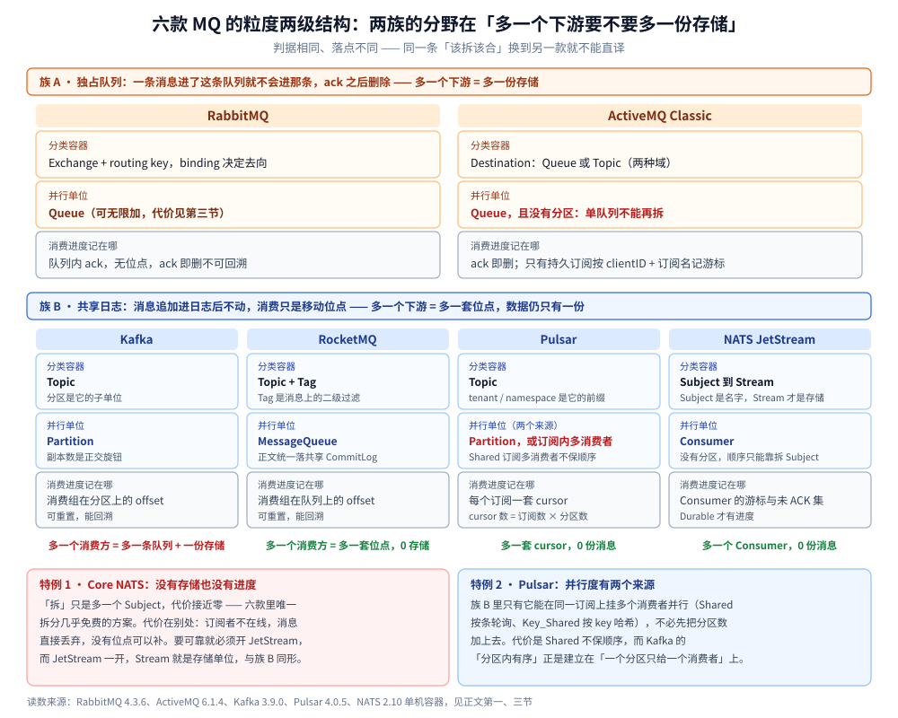
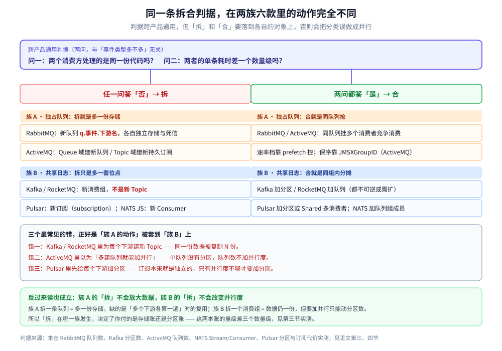
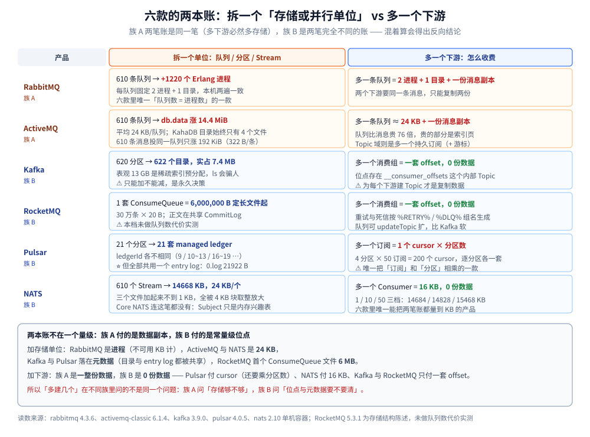

# 消息模型与存储代价

> 覆盖 ⭐ **消息模型（一条消息该进哪个容器、谁来并行、进度记在哪）以及它切开的物理代价，在六款 MQ 里分成两族**：**独占队列族**（RabbitMQ / ActiveMQ，多一个下游 = 多一份存储）与**共享日志族**（Kafka / RocketMQ / Pulsar / NATS JetStream，多一个下游 = 多一套位点），外加两个破坏通例的特例（Core NATS 无存储、Pulsar 并行不必绑分区）。内容是一套跨产品通用的拆合判据、六款「拆开」的代价各自落在哪（Erlang 进程 / KahaDB 索引页 / 分区目录 / ConsumeQueue 文件 / managed ledger 与 cursor / JetStream 目录块），以及能对齐各套体系的命名规则。
>
> 不覆盖：业务层该按什么维度切 Topic（按操作 / 按服务 / 按聚合根）、动作怎么用 `event_type` 区分、七个事件驱动反模式见 [Topic切分与事件设计.md](Topic切分与事件设计.md)；各产品的机制细节见 [README.md](RabbitMQ/README.md) / [README.md](ActiveMQ/README.md) / [README.md](Kafka/README.md) / [README.md](RocketMQ/README.md) / [README.md](Pulsar/README.md) / [README.md](NATS/README.md)；RabbitMQ 侧的绑定与命名落地见 [队列与绑定设计.md](RabbitMQ/队列与绑定设计.md)；Kafka 侧见 [Topic与分区设计.md](Kafka/Topic与分区设计.md)；RocketMQ 侧见 [Topic与队列设计.md](RocketMQ/Topic与队列设计.md)；Pulsar 侧的订阅类型见 [订阅与消费语义.md](Pulsar/订阅与消费语义.md)；NATS 侧的队列组见 [订阅与消费语义.md](NATS/订阅与消费语义.md)；多产品选型见 [消息队列选型对比.md](消息队列选型对比.md)。
>
> 内容整理自个人学习笔记，素材见 [素材清单.md](../../../素材清单.md)。**实测口径**：RabbitMQ 队列数代价来自 `rabbitmq:4-management`（**4.3.6**）单机容器 `amqp-lab`，两遍进程数 / 目录数完全一致；Kafka 分区数代价来自 `apache/kafka:3.9.0` 单节点容器 `kafka-gran-lab`；**ActiveMQ**（`apache/activemq-classic:6.1.4`，`amq-gran-lab`）、**NATS**（`nats:2.10-alpine`，`nats-gran-lab`）、**Pulsar**（`apachepulsar/pulsar:4.0.5` standalone，`pulsar-gran-lab`）三组为本轮新增实测，KahaDB 与 JetStream 的读数两遍逐行一致；**RocketMQ 侧未做队列数代价实测**，第三节按存储结构陈述并标出。

---

## 一、为什么「粒度」在六款 MQ 里是不同的问题？

**本节要点**：六款产品都要解决「**分类**」和「**并行**」两件事，但落点分成两族。**族 A（RabbitMQ / ActiveMQ）** 把并行放在队列上，队列独占消息，所以多一个下游就多一份存储；**族 B（Kafka / RocketMQ / Pulsar / NATS JetStream）** 把消息追加进共享日志，消费只移动位点，所以多一个下游只是多一套位点。判据相同、落点不同——「一个事件一个 topic」这句话换到 RabbitMQ 就不能直译。



这张图按族分了两块：上面一族两列、下面一族四列，同一个业务事件在两族里会被拆成几个对象、哪些产品会复制数据，从每一列底部的红绿结论行就能直接读出来。

| 产品 | 族 | 分类容器 | 并行单位 | 消费进度记在哪 | 多一个下游要付什么 |
| --- | --- | --- | --- | --- | --- |
| **RabbitMQ** | A 独占 | Exchange + routing key | **Queue** | 队列内 ack（无位点） | ⚠️ 一条队列 + 一份存储 |
| **ActiveMQ** | A 独占 | Destination（Queue / Topic 两域） | **Queue**（⚠️ 无分区） | ack 即删；持久订阅记游标 | ⚠️ 一条队列 / 一个持久订阅 |
| **Kafka** | B 共享 | Topic | **Partition** | 消费组在分区上的 offset | 一套 offset，0 份数据 |
| **RocketMQ** | B 共享 | Topic + Tag | **MessageQueue** | 消费组在队列上的 offset | 一套 offset，0 份数据 |
| **Pulsar** | B 共享 | Topic（tenant / ns 前缀） | **Partition 或订阅内多消费者** | 每个订阅一套 cursor | 一套 cursor，0 份数据 |
| **NATS JetStream** | B 共享 | Subject → Stream | **Consumer** | Consumer 游标 + 未 ACK 集 | 一个 Consumer，0 份数据 |
| **NATS Core** | 特例 | Subject | Queue Group | ⚠️ **无进度** | 零（本来就不存） |

> ⭐ **第一个分水岭：只有族 A 的「多一个消费方」会改变存储布局**。族 A 的消息进了这条队列就不会进那条、ack 之后删除，「两个下游都要这条消息」只能复制成两份；族 B 的消息追加在日志里不动，两个下游各自移动位点即可。**这决定了两族记的根本不是同一本账**：族 A 记的是数据副本，族 B 记的是位点与元数据——第三节的实测里，族 A 多一条队列就是多一份消息存储，族 B 多一个下游是 0 份数据。

> ⭐ **第二个分水岭：族 B 里有两款破了「并行 = 分区」这条通例**。**Pulsar** 用 Shared / Key_Shared 订阅能在**同一个订阅上挂多个消费者并行**，不必先把分区数加上去；**NATS** 干脆没有分区这个对象，顺序只能靠把 key 编进 Subject 再拆订阅。反过来 **ActiveMQ 是族 A 里的反例**：Queue 没有分区，单队列不可水平拆分，加队列也不加并行度。**不写这三条，「加并行 = 加队列」就会被当成通例。**

**这个差异从哪里来？** 从「消息被消费后去哪」来：

- 族 A 的队列是**独占的**：ack 之后消息删除，队列是订阅本身。所以「两个下游都要这条消息」只能复制成两条队列。
- 族 B 的日志是**共享的**：消息追加在分区 / CommitLog / managed ledger / Stream 里不动，消费只是移动位点。所以「两个下游都要」各自移动位点即可。

> ⚠️ **ActiveMQ 的 Topic 域容易看错**：Topic 是广播，但「离线期间的消息」只对**持久订阅**保留，且保留的是该订阅的游标，不是整条 Topic 的日志——所以 Topic 不能被当成 Kafka 用。四个产品的完整分发规则见 [消息类型与消费语义.md](ActiveMQ/消息类型与消费语义.md) 第一节。

## 二、拆还是合，用什么判据？

**本节要点**：判据只有一条——**同一份代码、同一个速率档 → 合；不同代码或不同速率档 → 拆**，与「事件类型多不多」无关。但同一条判据在两族里的**动作**不一样：族 A 拆的是**队列**（ActiveMQ 的 Topic 域则是**持久订阅**），族 B 拆的是**消费组 / 订阅 / Consumer**（在 Kafka 里为每个下游建 Topic 是常见错误）。

### 2.1 六种动机，两族落点

| 动机 | 该拆吗 | 族 A 落点（RabbitMQ / ActiveMQ） | 族 B 落点（Kafka / RocketMQ / Pulsar / NATS） |
| --- | --- | --- | --- |
| **消费逻辑不同**（不同下游） | ✅ 拆 | 每个下游一条队列；ActiveMQ 的 Topic 域建持久订阅 | 新消费组（Kafka / RocketMQ）/ 新订阅（Pulsar）/ 新 Consumer（NATS），**都不是新 Topic** |
| **速率档差一个数量级** | ✅ 拆 | 新队列 + 各自 `prefetch`（ActiveMQ 默认 1000） | 各自调 `max.poll.records` / 消费线程数 / `MaxAckPending` |
| **需要独立的死信 / 重试** | ✅ 拆 | 队列级 `x-dead-letter-exchange`；ActiveMQ 按队列或按 DLQ 策略 | 消费组级：RocketMQ `%RETRY%`、NATS 手工建 DLQ Subject |
| **需要独立的优先级** | ✅ 拆 | `x-max-priority`（quorum 不支持）；ActiveMQ 用 selector 模拟 | ❌ 四款都没有原生优先级 |
| **只是事件类型不同，处理一样** | ❌ 不拆 | 用 **routing key** 区分；ActiveMQ 用 selector 或消息属性 | 同一 Topic 的不同 key / Tag / Subject 后缀 |
| **只是同类任务要并行** | ❌ 不拆 | 同队列挂多个消费者（竞争消费） | Kafka 加分区、RocketMQ 加队列、Pulsar 加分区或 Shared 多消费者、NATS 队列组 |

### 2.2 判据为什么要这么定

**「同一份代码、同一个速率档 → 合」的背后是配额与队头阻塞**。族 A 的配额是**队列级**的，一条慢消息占住配额，快消息排在后面等。RabbitMQ 侧实测过（见 [消费者与投递语义.md](RabbitMQ/消费者与投递语义.md) 第二节）：不设 `prefetch` 时慢消费者独吞 20 条、快消费者 0 条、耗时 3.0s；设 1 后变成 3/17、0.5s。ActiveMQ 的 `queuePrefetch` 默认 **1000**（本机 6.1.4 读到的 `ActiveMQPrefetchPolicy`：`queue=1000 topic=32767 queueBrowser=500 durableTopic=100`），默认值比 RabbitMQ 激进得多，所以「两个实例负载严重不均」在 ActiveMQ 上第一个要改的就是它。

**族 B 里这条判据要翻译一次**：Kafka 的 `max.poll.records` 是**消费者的**配额，不是分区的配额，所以慢速下游不会拖住快速下游——它们在**不同的消费组**里各记位点。Pulsar 与 NATS 同理：订阅 / Consumer 各自持有游标，一个慢订阅只让自己的 backlog 涨。

> ⚠️ **族 B 最常见的粒度错误**：为每个下游建一个 Topic（Pulsar 则是建新 Topic 而非新订阅）。这会让同一份数据被复制 N 份，而正确做法是**一个 Topic + N 个消费组 / 订阅 / Consumer**。这与族 A 恰好相反：RabbitMQ 里「为每个下游建一条队列」是**正确**的，因为队列之间本来就不共享。

> ⚠️ **Pulsar 的订阅有一种反向陷阱**：`Exclusive` 订阅只允许一个消费者，想加并行**必须换订阅类型**（Shared / Key_Shared）或加分区；而 Shared 会把同一个 key 的消息轮询给不同消费者——本机 40 条 4 个 key 的实测里两个消费者拿到 20/20，但**每个 key 都被拆到了两边**。这是从 Kafka 迁过来最容易踩的认知差，详见 [订阅与消费语义.md](Pulsar/订阅与消费语义.md) 第二、三节。

### 2.3 一条判据 + 两族落点，怎么记



这张图把判据的两个问句放在顶部，左右两栏分别是「拆」和「合」时两族各自的动作，底部三行红色是三条错法——它们共同点都是把族 A 的动作套到了族 B 上。

```text
问一：两个消费方处理的是同一份代码吗？问二：两者的单条耗时差一个数量级吗？
├─ 任一为「否」→ 拆
│    RabbitMQ  ：新队列
│    ActiveMQ  ：新队列（Queue 域）/ 新持久订阅（Topic 域）
│    Kafka     ：新消费组（同一个 Topic）
│    RocketMQ  ：新消费组（同一个 Topic）
│    Pulsar    ：新订阅（subscription）
│    NATS      ：新 Consumer（同一个 Stream）
└─ 都为「是」→ 合
     RabbitMQ  ：同队列多消费者竞争消费
     ActiveMQ  ：同队列多消费者，prefetch 调小
     Kafka     ：同消费组，靠分区数分摊
     RocketMQ  ：同消费组，靠队列数分摊
     Pulsar    ：同订阅多消费者（Shared / Key_Shared），或靠分区数
     NATS      ：同队列组，靠成员数分摊
```

## 三、拆开的代价，两族六款分别落在哪？

**本节要点**：族 A 的代价在**队列对象**上——RabbitMQ 每队列 2 个 Erlang 进程，ActiveMQ 每队列约 **24 KB** 的 KahaDB 索引页；族 B 的代价在**位点与元数据**上——Kafka 每分区 1 个目录（表观 10 MB 的稀疏索引、实占近 0，且不可缩减），RocketMQ 每队列一套 ConsumeQueue（20 B/条），Pulsar 每分区一套 managed ledger 但共享一个 entry log，NATS 每 Stream 约 **24 KB** 目录块、每 Consumer 约 **16 KB**。**同一句「多拆一点」，六款撞墙时的症状完全不同。**

### 3.1 RabbitMQ：每队列 2 个 Erlang 进程

本机实测（`rabbitmq:4-management` 4.3.6，声明 N 个 durable 队列、每个投 1 条 7 字节消息，`sleep 2` 后取读数）：

| 本轮新增 | 累计队列数 | Erlang 进程增量 | 总内存增量 | 队列存储目录增量 |
| --- | --- | --- | --- | --- |
| 10 | 10 | **+20** | +207312 B | +10 |
| 100 | 110 | **+220** | +3385504 B | +110 |
| 500 | 610 | **+1220** | +23828992 B | +610 |

进程增量 `20 / 220 / 1220` 与目录增量 `10 / 110 / 610` **两遍完全一致**，比值严格 2.0；内存增量第二遍是 `903768 / 7952120 / 24385768` B，波动 2%~4 倍（基线 GC 状态不同），**只能取量级**。结论：**每队列固定 2 个 Erlang 进程、1 个存储目录、几十 KB 内存底噪**，600 条队列就是 1220 个进程。

**这是六款里唯一「队列数直接变成进程数」的一款**。撞墙的症状是调度开销变大、管理 UI 卡、`consumer_timeout` 误杀——不是磁盘满。

### 3.2 ActiveMQ：每队列约 24 KB，全部落在全局 db.data 里

本机实测（`apache/activemq-classic:6.1.4`，STOMP 1.2 手写帧，声明 N 条队列各投 1 条 7 字节持久消息，等一个 KahaDB checkpoint 周期再读）：

| 累计队列 | db.data | db.redo | KahaDB 实占（du） |
| --- | --- | --- | --- |
| 0（基线） | 12288 | 12304 | 44 KB |
| 10 | 258048 | 258544 | 528 KB |
| 110 | 2727936 | 2487016 | 5156 KB |
| 610 | **15077376** | 3287296 | 18188 KB |

⭐ **关键对照**：实验最后一档建了 611 条队列、共 1220 条消息；再往其中一条队列追加 610 条消息后，`db.data` 只从 `15077376` 涨到 `15273984`——**增量 196608 B，平均 322 B/条消息**。而 610 条队列各 1 条消息贡献的是 `15077376 - 12288 = 15065088 B`，**平均 24697 B/条队列**。

**队列比消息贵约 76 倍**。这解释了为什么 ActiveMQ 敢说「单机挂万级队列」：它**没有 per-queue 文件、也没有 per-queue 进程**（`ls` KahaDB 目录永远只有 `db-*.log` + `db.data` + `db.redo` + `lock` 四个文件，队列多到 611 条还是这四个），代价全压在**一个全局 BTree 里**，表现为 `db.data` 按页增长。

> ⚠️ **读 KahaDB 别被 `ls` 骗**：`db-1.log` 恒为 `33554432` B（32 MiB 预分配），基线时 `du` 只有 44 KB。**表观大小和实际占用差三个数量级**，这与 Kafka 稀疏索引是同一类陷阱。
>
> ⚠️ **本组未取 RSS**：Java 进程 RSS 两遍分别读到 278 MB 与 421 MB（同一档位差 40%），未触发 GC，不能作定量依据。**内存只写量级：600 条队列后 broker 常驻在 200~400 MB 区间。**

### 3.3 Kafka：每分区 1 个目录 × 副本数，且不可缩减

本机实测（`apache/kafka:3.9.0` 单节点 KRaft，`replication-factor=1`，数据目录 `/tmp/kafka-logs`）：

| 阶段 | Topic 分区总数 | 分区目录 | `.log` | `.index` | `.timeindex` | broker fd | 实际占盘 |
| --- | --- | --- | --- | --- | --- | --- | --- |
| 基线 | 2（系统 Topic） | 2 | 1 | 1 | 1 | 174 | — |
| 建 `gran-100` 后 2s | 102 | **86** | 86 | 86 | 87 | 263 | — |
| 建 `gran-500` 后取总量 | 620 | **622** | 621 | 621 | 621 | 796 | **7.4 MB** |

三个读数值得单独说：

- ⚠️ **`--create` 返回成功时，分区目录还没建完**。102 个分区只数到 86 个目录、620 个分区最后是 622 个目录（620 + 2 个系统分区）。所以「建完立刻数目录」会少算 15% 左右，**要么等，要么用 `--describe` 数 `Partition:` 行**。
- ⭐ **索引是稀疏预分配，`ls` 会骗人**。单个分区目录里 `.index` 显示 **10485760 B**、`.timeindex` 显示 **10485756 B**，但 620 个分区合计**表观 13 GB、实际只占 7.4 MB**（`du --apparent-size` 与 `du` 的差）。所以「500 分区要吃 10 GB 索引」是错的——真正的代价不在磁盘。
- **fd 不是线性的**：621 个数据文件只对应 796 个 fd（基线 174），说明索引文件是**按需打开**的，不能拿「分区数 × 3」估句柄。

单个分区目录的实际内容（`gran-100-0`）：

| 文件 | 大小 | 作用 |
| --- | --- | --- |
| `00000000000000000000.log` | 0（无消息） | 消息段，按 `segment.bytes` 滚动 |
| `00000000000000000000.index` | 10485760（10 MiB 稀疏） | 稀疏索引，实测每 4096 B 一条（见 [核心概念与架构.md](Kafka/核心概念与架构.md)） |
| `00000000000000000000.timeindex` | 10485756 | 按时间戳检索的索引 |
| `leader-epoch-checkpoint` | 8 | Leader 纪元，用于副本截断判断 |
| `partition.metadata` | 43 | 分区的 Topic ID 与版本 |

**真正的代价是不可逆性**。实测分区缩减请求被直接拒绝：

```text
Error while executing topic command : The topic gran-100 currently has 100 partition(s);
20 would not be an increase.
```

扩容则成功（`gran-100` 从 100 扩到 120，`--describe` 数到 120 个 `Partition:`）。**「只能加不能减」意味着分区数是个一次性决策**——估多了的代价是永久的重平衡成本与元数据负担，而不是磁盘。这一点在 [Topic与分区设计.md](Kafka/Topic与分区设计.md) 第二节展开。

### 3.4 RocketMQ：每队列一套 ConsumeQueue，CommitLog 共享

⚠️ **本节未做队列数代价实测**，按存储结构陈述，依据 [核心概念与架构.md](RocketMQ/核心概念与架构.md) 第四节的实测文件尺寸：

| 对象 | 与队列数的关系 | 实测依据 |
| --- | --- | --- |
| **CommitLog** | ⚠️ **与队列数无关**——所有 Topic 的所有队列混写进同一个 CommitLog | 单文件 1,073,741,824 B（1 GiB）滚动 |
| **ConsumeQueue** | ✅ **每队列一套**，目录 `consumequeue/<topic>/<queueId>/` | 单文件 6,000,000 B（30 万条 × 20 B） |
| **IndexFile** | ⚠️ 按 **Topic** 计（非按队列），每 Topic 一组 | 单文件 420,000,040 B（`40 + 500 万 × 4 + 2000 万 × 20`） |

所以 RocketMQ 的队列数代价比 RabbitMQ 轻、比 Kafka 重：**多一个队列 = 多一套 ConsumeQueue 定长文件**（20 B/条索引），但没有多一份消息正文（正文在共享 CommitLog 里）。这也解释了 RocketMQ 官方「单机可挂万级队列」的口径——代价落在索引，不在消息体，也不在进程。

### 3.5 Pulsar：每分区一套 managed ledger，但所有分区共用一个 entry log

本机实测（`apachepulsar/pulsar:4.0.5` standalone，建三种分区数的 topic 各投 10 条，读 `topics stats-internal` 与 BookKeeper 落盘）：

| topic | 分区数 | 每分区的 `ledgers` 数 | 各分区的 `lastConfirmedEntry` | BookKeeper `current/0.log` |
| --- | --- | --- | --- | --- |
| `gran-p1` | 1（非分区） | 1 | `9:9` | 0 B（写入前） |
| `gran-p4` | 4 | 各 1 | `10:2` / `11:1` / `13:2` / `12:1` | **21922 B** |
| `gran-p16` | 16 | 各 1 | `16:0` / `17:0` / `18:0` / `19:0` … | **21922 B**（未再增长） |

三个读数：

- ⭐ **每个分区一个独立的 managed ledger**：21 个分区的 `lastConfirmedEntry` 落在 21 个不同的 ledgerId 上（9、10、11、12、13、16~19……），说明分区不是「一个 ledger 里的区间」，而是**各自向 BookKeeper 申请**。
- ⭐ **所有分区共用一个 entry log**：`current/` 目录下 `0.log` 始终只有**一个**文件（21922 B），16 个分区、160 条消息之后都没再涨——与 Kafka「每分区一个目录、目录里三个文件」是完全相反的形态。**Pulsar 的分区数到底贵在哪，不在 entry log，在元数据与 ledger 分配。**
- ⚠️ **`metadata` 目录没变**（76216 KB 前后一致）：cursor 与 ledger 元数据走在 RocksDB + 异步 flush 上，**拿不到「每分区多少字节」这种读数**。这一档只能给结构证据，不给定量。

**订阅的放大在 cursor 上，而且是乘法**。同一台机器上往 `gran-p4`（4 分区）叠订阅：

| 订阅数 | `gran-p4-partition-0` 的 cursor 数 | 推算全 topic 的 cursor 总数 |
| --- | --- | --- |
| 1 | 1 | 4 |
| 10 | 10 | 40 |
| 50 | **50** | **200** |

⭐ **cursor 数 = 订阅数 × 分区数**。这是族 B 里唯一把「订阅」和「分区」相乘的一款：Kafka 的消费组位点也是「组 × 分区」，但位点存在 `__consumer_offsets` 这个内部 Topic 里、由 Kafka 自己压缩；Pulsar 的每个 cursor 是**订阅维度上的一等对象**，还要向 BookKeeper 维护自己的 ack 状态。所以 Pulsar 上「加一个下游」的真实代价要按 `分区数` 乘一下，48 分区的 topic 加 10 个订阅就是 480 个 cursor。

### 3.6 NATS：每 Stream 约 24 KB 目录块，每 Consumer 约 16 KB

本机实测（`nats:2.10-alpine`，`-js -sd /data`，每个 Stream 绑一个 Subject、file storage、Replicas 1，各投 1 条 7 字节消息）：

| 累计 Stream | `streams` 目录数 | `.blk` 块数 | JetStream 实占（du） |
| --- | --- | --- | --- |
| 0 | 0 | 0 | 4 KB |
| 10 | 10 | 10 | 252 KB |
| 110 | 110 | 110 | 2652 KB |
| 610 | **610** | **610** | **14668 KB** |

单个 Stream 的目录内容（`gran_s_0`）：`meta.inf` 458 B + `meta.sum` 16 B + `msgs/1.blk` 45 B + 一个空的 `obs/` 目录。三个文件加起来不到 1 KB，但 `du` 统计每个 Stream 约 **24 KB**——**全部是 4 KB 目录块与文件块的取整放大**，610 个 Stream 里真实数据只有几百 KB。

往同一个 Stream 上叠 durable Consumer：

| Consumer 数 | `obs` 目录数 | JetStream 实占 | 增量 |
| --- | --- | --- | --- |
| 1 | 1 | 14684 KB | — |
| 10 | 10 | 14828 KB | +144 KB（9 个，**16 KB/个**） |
| 50 | 50 | 15468 KB | +640 KB（40 个，**16 KB/个**） |

每个 Consumer 是 `obs/<name>/` 下一个目录 + `meta.inf` 252~255 B + `meta.sum` 16 B + `o.dat` 8 B，`du` 算 **16 KB/个**。⭐ **这是「多一个下游 0 份数据」在文件系统上的具体价格：16 KB**——只有 Stream 的三分之二，且与消息体积无关。

> ⭐ **NATS 的对照价值在这里**：它是六款里唯一能同时观察到「拆存储单位（Stream，24 KB）」与「加下游（Consumer，16 KB）」两笔账的产品，而且两笔都是**块取整主导**。Core NATS 连这两笔都没有——`SUB` 只是内存里的兴趣表，多一个 Subject 一分钱不花。

### 3.7 六款对照：撞墙时的症状不一样



这张图把两笔账分开摆：左边是「拆一个存储或并行单位」的代价、右边是「多一个下游」的代价，族 A 两列都在右侧付出存储，族 B 只有 Pulsar 与 NATS 付出常量级的位点开销。

| 产品 | 拆一个单位的物理代价 | 实测读数 | 可逆性 | 撞墙时的第一个症状 |
| --- | --- | --- | --- | --- |
| **RabbitMQ** | 2 个 Erlang 进程 + 1 个目录 + 几十 KB 内存 | 610 队列 → **+1220 进程** | 可逆（删队列，**未消费的消息随之丢失**） | 调度开销变大、管理 UI 卡、`consumer_timeout` 误杀 |
| **ActiveMQ** | KahaDB 全局 `db.data` 里的索引页 | 610 队列 → **+14.4 MiB**（**24 KB/队列**）；610 条消息只 +192 KiB（**322 B/条**） | 可逆（删队列） | `db.data` / `db.redo` 增长、checkpoint 变慢、磁盘 IO 抖动 |
| **Kafka** | 1 个目录 × 副本数 + 元数据项（磁盘近 0） | 620 分区 → 622 目录，实占 **7.4 MB**、fd 796 | ⚠️ **不可逆**（只能加） | 重平衡变慢、Controller 元数据膨胀、`fd` 打满 |
| **RocketMQ** | 1 套 ConsumeQueue 定长文件（20 B/条） | 单文件 **6,000,000 B**（未实测队列数代价） | 可扩（`updateTopic` 加队列） | 索引文件增长、磁盘 IO 抖动 |
| **Pulsar** | 每分区一套 managed ledger；每订阅每分区一个 cursor | 21 分区 → **21 个不同 ledgerId**，entry log 仍 1 个（21922 B）；4 分区 × 50 订阅 = **200 cursor** | 分区不可缩；订阅可删 | backlog 涨、cursor 刷盘变慢、bookie 磁盘 IO |
| **NATS JS** | Stream 一套目录块；Consumer 一套 `obs` 目录 | 610 Stream → **14668 KB**（**24 KB/个**）；50 Consumer → **16 KB/个** | 可删（Stream 删了数据丢） | `max_file_store` 打满、`nats stream report` 里 Stream 数过多难查 |

> ⭐ **一句话选型指引**：如果业务天然需要「每个下游一份独立数据」（审计、风控各存一份），族 A 的队列模型反而直接；如果只是「每个下游各算一遍」，族 B 的消费组 / 订阅 / Consumer 模型省掉 N 份存储。**判断依据是「数据要不要各存一份」，不是「MQ 快不快」。**
>
> ⚠️ **两本账要分开记**：上表左半列是「加存储单位」的代价（族 A 的队列、族 B 的分区 / Stream），右半列是「加下游」的代价。族 A 两笔账是同一笔（多下游必然多存储），族 B 则是两笔完全不同的账——Pulsar 加下游付 cursor、加分区付 ledger，NATS 加下游付 16 KB、加 Stream 付 24 KB。**混在一起算，就会得出「Kafka 分区贵、所以下游也别加」这种错误结论。**

## 四、命名怎么在各套体系里对齐？

**本节要点**：六套体系的命名对象数量不同（RabbitMQ 有 exchange / queue / routing key 三类，ActiveMQ 有 Queue 与 Topic 两个域 + 订阅名，Kafka 只有 topic / group，RocketMQ 有 topic / tag / group，Pulsar 多一层 tenant / namespace，NATS 是 subject 层级 + Stream + Consumer），但**四条硬规则通用**：不用保留前缀、不用中文与空格、不带环境前缀（用命名空间隔离）、名字里不写版本号。

### 4.1 同一业务的两族写法

假设业务是「订单创建事件」，有两个下游（通知、审计）。族 A 的写法（**消费方写在队列名或订阅名里**）：

| 对象 | RabbitMQ | ActiveMQ |
| --- | --- | --- |
| 分类 | exchange `order.topic.exchange` + routing key `order.order.created` | Topic `ORDER.EVENT` + 消息属性 `type=CREATED` |
| 并行单位 | 队列 `q.order.created.notify` / `q.order.created.audit` | Queue `ORDER.CREATED.NOTIFY` / `ORDER.CREATED.AUDIT` |
| 消费方标识 | 队列名自带（`notify` / `audit`） | Queue 域写在队列名；Topic 域写 `clientID.subscriptionName` |
| 重试 / 死信 | `q.order.created.notify.dlq` | `ActiveMQ.DLQ`（默认全局）或按队列的 DLQ 策略 |

族 B 的写法（**消费方写在组名 / 订阅名 / Consumer 名里，类名不写下游**）：

| 对象 | Kafka | RocketMQ | Pulsar | NATS |
| --- | --- | --- | --- | --- |
| 分类 | topic `order.events` | topic `ORDER_EVENT` + tag `CREATED` | `persistent://shop/default/order-events` | subject `order.event.created` |
| 并行单位 | 分区数（如 6） | 队列数（如 4） | 分区数，或订阅内多消费者 | Consumer 数 / 队列组成员 |
| 消费方标识 | 组 `cg-order-notify` | 组 `cg-order-notify` | 订阅 `sub-order-notify` | 队列组 `q-notify` + durable 名 |
| 重试 / 死信 | 无内建（自己建 topic） | `%RETRY%cg-order-notify` | 无内建（重投 + DLQ topic） | 无内建（自己建 DLQ Subject） |

**注意「消费方」写在哪一行**：族 A 写成**队列名或订阅名**（因为队列/订阅就是消费单位），族 B 写成**消费组 / 订阅名 / Consumer 名**（因为存储单位是共享的）。**名字里体现「谁在消费」的位置不同，这是两族命名最大的差异。**

⭐ **NATS 是唯一「命名即粒度」的一款**：Subject 的层级（`order.event.created`）本身就是分类，`>` 与 `*` 只在**订阅侧**生效（发布时写 `order.>` 不会广播，它就是一个含 `>` 字符的字面 Subject）。所以 NATS 拆分类**不产生任何对象**，代价是「顺序只能靠拆 Subject 换来」——把 key 编进 Subject（`order.123.created`）是它替代分区 key 的唯一手段。

### 4.2 四条硬规则

- ⚠️ **不用保留前缀**：RabbitMQ 的 `amq.`（声明报 `ACCESS_REFUSED`）、Kafka 的 `__`（`__consumer_offsets` 等内部 Topic）、RocketMQ 的 `%RETRY%` / `%DLQ%`（系统生成）、Pulsar 的 `__change_events` 等系统 Topic、NATS 的 `$JS.API.>` / `$SYS.>` 系统 Subject。
- ⚠️ **不用中文与空格**：名字会进 HTTP API 的 URL、监控指标标签、日志。非 ASCII 会变成转义串，检索时对不上。
- ⚠️ **不带环境前缀就别带**：`prod_order_q` 在「一个环境一个实例 / 一个 vhost」的部署下是冗余的。多环境共用一个集群时应该用 **vhost（RabbitMQ）/ 前缀 + ACL（Kafka）/ 命名空间（RocketMQ）/ tenant + namespace（Pulsar，它同时是配额与权限单位）/ account（NATS）** 隔离，而不是靠名字前缀——权限也是按这些维度给的。
- ⚠️ **名字里不写版本号**：`order.events.v2` 会在灰度期变成两套同时消费，切换时还得双写。换实现应该换**消费组 / 订阅名**，不是换 Topic 名（族 B 尤其如此，因为数据不用搬）。

> ⭐ **命名与粒度是同一件事的两面**：RabbitMQ 里叫 `q.order.created.notify`（一事件一队列）还是 `q.order.notify`（一业务一队列），直接暴露了你选的是哪种粒度；Kafka 里 Topic 叫 `order.events` 还是 `order.created.events`，直接暴露了你有没有把「分类」误做成「并行」；NATS 里 Subject 写成 `order.created` 还是 `order.123.created`，直接暴露了你有没有把「分片」误做成「分类」。

## 五、应用场景

| 场景 | 粒度选型 | 落在哪一款上更自然 |
| --- | --- | --- |
| **订单 / 支付等业务事件**，多个下游各算一遍 | 一个 Topic + N 个消费组 / 订阅 / Consumer（**不复制数据**） | Kafka / RocketMQ / Pulsar / NATS JS |
| **每个下游要独立死信与重试策略**，且消息可丢可重放 | 每个下游一条队列（**各自存储**） | RabbitMQ / ActiveMQ |
| **任务分发**（同一批任务被一组 worker 抢） | 一个队列 + 多消费者竞争，**不按任务类型拆** | RabbitMQ（work queue）/ ActiveMQ |
| **IoT 设备上报**，按设备或租户分区 | 分区键取 deviceId，**不按设备建队列** | Kafka / Pulsar |
| **设备状态这种「丢了就丢」的轻量上报** | 一个 Subject + 队列组，**不进 Stream** | NATS Core（代价接近零，也别指望补数据） |
| **审计 / 风控需要原始流量副本**，与业务消费解耦 | 两个消费组各自消费，或独立 Topic（**明确接受两份存储**） | 族 B 全部 |
| **一条消息要按类型分给不同系统处理**（JMS 生态） | Queue + selector，或两域切换 | ActiveMQ（selector 是 broker 侧过滤） |
| **延迟 / 定时任务** | 按**延迟档位**建队列，**绝不按订单建** | RabbitMQ（TTL+DLX 或延迟插件）/ RocketMQ 延迟等级 / Pulsar `deliverAt` |
| **同一订单严格串行** | 同 key 同分区 / 同组 | Kafka key / RocketMQ 顺序消息 / Pulsar Key_Shared / ActiveMQ `JMSXGroupID` |

本仓对应落地：[队列与绑定设计.md](RabbitMQ/队列与绑定设计.md)（RabbitMQ 侧的队列数与绑定）、[Topic与分区设计.md](Kafka/Topic与分区设计.md)（Kafka 侧的分区数决策）、[Topic与队列设计.md](RocketMQ/Topic与队列设计.md)（RocketMQ 侧的 Topic/Queue/Tag 三级）、[订阅与消费语义.md](Pulsar/订阅与消费语义.md)（四种订阅类型怎么选）、[订阅与消费语义.md](NATS/订阅与消费语义.md)（Stream 与 Consumer 的组合）。

## 六、具体使用

### 6.1 数清「粒度有没有失控」的六条命令

```bash
# RabbitMQ：按业务域聚合队列数，一眼看出哪个域在膨胀
rabbitmqctl list_queues name | awk -F. '/^q\./ {print $2}' | sort | uniq -c | sort -rn

# ActiveMQ：队列总数与总消息数（Jolokia；本机 6.1.4 没有 TotalQueueCount 属性，要数 Queues 数组）
curl -s -u admin:admin 'http://localhost:8161/api/jolokia/read/org.apache.activemq:type=Broker,brokerName=localhost' \
  | jq '{queues: (.value.Queues | length), messages: .value.TotalMessageCount}'

# Kafka：每个 Topic 的分区数与副本数（分区数超 50 且消费组只有 1 个，通常是估多了）
kafka-topics.sh --bootstrap-server localhost:9092 --describe | \
  awk '/Partition:/ {c[$2]++} END {for (t in c) print c[t], t}' | sort -rn

# RocketMQ：队列数与 Topic 的对应（读写队列数不一致说明有历史扩容）
mqadmin topicList -n localhost:9876
mqadmin topicRoute -t ORDER_EVENT -n localhost:9876 | grep -E "queueNums|readQueueNums|writeQueueNums"

# Pulsar：每个订阅一套 cursor，数量超预期说明「一订阅一下游」没做到
pulsar-admin topics stats-internal persistent://shop/default/order-events \
  | jq '{entries: .numberOfEntries, ledgers: (.ledgers | length), cursors: (.cursors | length)}'

# NATS：Stream 数与各自的 Consumer 数（Stream 数多而每个 Consumer 只有 1 个，通常是按下游拆了 Stream）
nats stream list -n
nats consumer list ORDER_EVENTS -n
```

### 6.2 判断「该拆还没拆」的三条信号

```text
信号一：某个消费组的 LAG 一直涨，而同 Topic 下另一个消费组正常
      → 两个下游混在一个消费组 / 订阅里（族 B），或混在一个队列里（族 A）
信号二：prefetch / max.poll.records / MaxAckPending 调大调小都难受
      → 队列里混了两个速率档，任何单一配额都是折中
信号三：一个下游改重试策略，另一个下游的重复率跟着涨
      → 死信 / 重试没有独立，必须拆
```

### 6.3 三处「先别拆」的提醒

- **别为「监控能分开看」拆**：监控的分组维度应该是 routing key / consumer group / tag / subscription / Subject，不是队列或 Topic。
- **别为「削峰」拆**：削峰的容量来自消费端并发与配额，拆队列只是把同样的消费能力切几份，总吞吐不变。
- **别为「多租户」拆**：租户数不封顶，队列数会跟着不封顶。按**业务域**分，租户 ID 放在消息头或分区键里；Pulsar 用 namespace、NATS 用 account 做隔离，都不需要建队列。

## 延伸追问

- **Kafka 里「一个事件一个 Topic」为什么是错的，而 RabbitMQ 里「一个事件一条队列」是对的？** 因为 Kafka 的 Topic 是**存储容器**（一个 Topic 的数据存一份），拆 Topic 就是拆存储；RabbitMQ 的队列是**订阅**，本来就要为每个订阅方各建一条。前者的分类应该用 key 或消费组，后者的分类本来就落在队列上。
- **ActiveMQ 的队列才 24 KB 一条，为什么不能拿「多建队列」当分区用？** 因为它没有分区这个概念：队列之间**没有共同顺序**，也没有「同 key 恒定落同一队列」的静态绑定。`JMSXGroupID` 是 broker 侧**动态**记录「组 → 消费者」的绑定，消费者掉线会重新分配，且热点组会串行。队列便宜不等于并行度免费——**单队列的消费并行上限就是消费者的 prefetch 之和，加队列不改变任何一条队列的内部并行度**。
- **Pulsar 已经有 Shared 订阅了，为什么还要分区？** 两者解决的不是一件事：分区决定**顺序**与**单 topic 的吞吐上限**（一个非分区 topic 只属于一个 bundle、由一个 Broker 持有），Shared 决定**同一订阅内的并行**。要「同 key 有序 + 并行」得用 Key_Shared，而 Key_Shared 的 key 分配是按哈希区间切的，key 少时会倾斜——本机 4 个 key 的分组实测是 1 : 3。
- **NATS「拆 Subject 免费」的代价藏在哪？** 三处：① Core NATS 没有存储，订阅者不在线就丢，没有位点可以补；② 通配符订阅是**订阅侧扇出**，一个 `order.>` 订阅者会收全部子 Subject，拆得越细、扇出越大；③ 进 JetStream 后 Subject 不再是免费的——Stream 按 Subject 集合划存储，**两个 Stream 不允许订阅重叠的 Subject**，所以「拆」必须在建 Stream 时就确定好。
- **RocketMQ 的 Tag 能替代 Topic 吗？** 不能完全替代。Tag 是**消息属性上的二级过滤**，过滤在 Broker 侧做但索引粒度粗；Topic 决定存储与队列分布。经验判据：**需要独立的队列数 / 独立的保留策略 → Topic；只是同一类消息的不同子类型 → Tag**。
- **六款里哪一款的粒度决策最不该拍脑袋？** Kafka 的分区数。RabbitMQ 加错了删掉重来（丢消息但是能重建），ActiveMQ 删队列即可，RocketMQ 能扩队列，Pulsar 能加订阅和分区（分区不可缩），**Kafka 只能加不能减**，估多了永久背着。
- **为什么两本账要分开记？** 族 A 的「加队列」同时是「加存储单位」和「加下游」，一笔账两用；族 B 的「加分区」是加存储单位、「加消费组」是加下游，两笔完全不同的账。RocketMQ 用共享 CommitLog 把前者摊薄了，Pulsar 用共享 entry log 把前者摊得更薄，但后者（cursor）反而被分区数放大了——**所以同一句「多拆一点」，在六款里指向的账单根本不是同一张**。

## 关联

- **上游/总纲**：[Topic切分与事件设计.md](Topic切分与事件设计.md) — 业务层按什么维度切（按操作 / 按服务 / 按聚合根）、动作怎么用 `event_type` 区分；本篇接住切完之后的物理代价
- **上游/总纲**：[消息队列选型对比.md](消息队列选型对比.md) — 六款 MQ 的十二维度对比，本篇的「消息模型与代价」是其中「消费模型」一维的下钻
- **下游机制**：[队列与绑定设计.md](RabbitMQ/队列与绑定设计.md) — RabbitMQ 侧的队列数实测、绑定写法与命名落地
- **下游机制**：[Topic与分区设计.md](Kafka/Topic与分区设计.md) — Kafka 侧的分区数决策与不可逆性
- **下游机制**：[Topic与队列设计.md](RocketMQ/Topic与队列设计.md) — RocketMQ 侧的 Topic / Queue / Tag 三级
- **下游机制**：[订阅与消费语义.md](Pulsar/订阅与消费语义.md) — 四种订阅类型，Shared 与 Key_Shared 是「并行不必绑分区」的来源
- **下游机制**：[订阅与消费语义.md](NATS/订阅与消费语义.md) — 队列组与 JetStream Consumer，NATS 的两套粒度模型
- **对照/互补**：[消息类型与消费语义.md](ActiveMQ/消息类型与消费语义.md) — 两个域的差异，以及 `JMSXGroupID` 这个唯一的保序手段
- **对照/互补**：[核心概念与架构.md](RabbitMQ/核心概念与架构.md) — 第三节的路由规则：routing key 与 binding 才是 RabbitMQ 的「分类」落点
- **对照/互补**：[核心概念与架构.md](Kafka/核心概念与架构.md) — 分区副本分布与「多分区、多副本这两个正交旋钮」
- **对照/互补**：[消费者组与重平衡.md](Kafka/消费者组与重平衡.md) — 分区数与消费者数的关系，是「合」这一侧的上限来源
