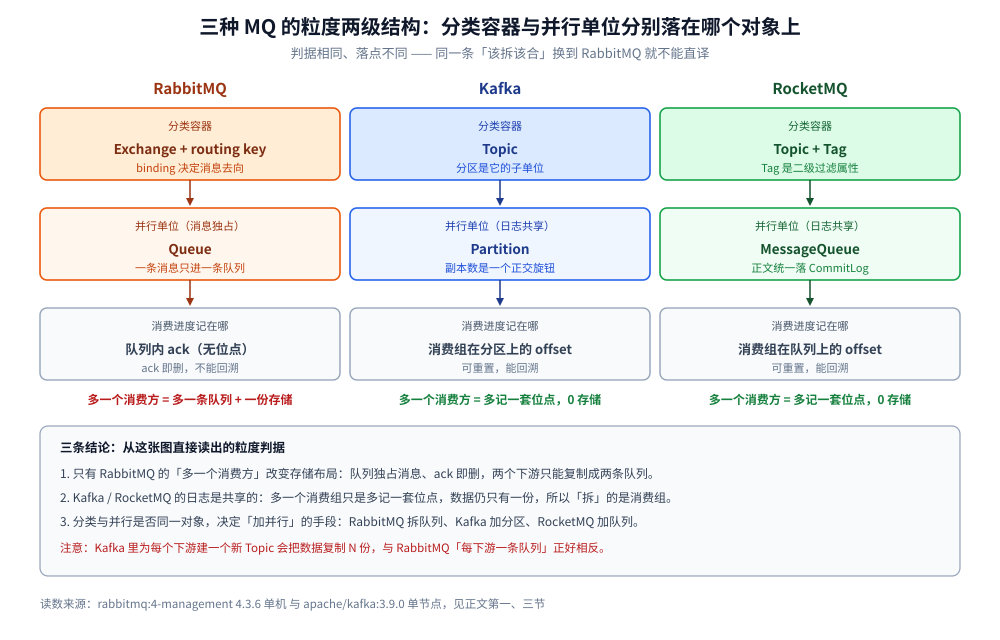
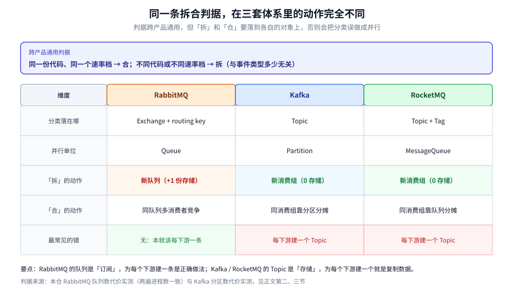

# 队列粒度设计

> 覆盖 ⭐ **「一条消息该进哪个容器」这件事，在 RabbitMQ / Kafka / RocketMQ 里是三个不同的问题**：三者的「分类容器」与「并行单位」分别落在哪个对象上、一套跨产品通用的拆合判据、三种产品「拆开」的代价分别落在哪（Erlang 进程 / 分区目录 / ConsumeQueue 文件），以及能对齐三套体系的命名规则。
>
> 不覆盖：各产品的机制细节见 [README.md](RabbitMQ/README.md) / [README.md](Kafka/README.md) / [README.md](RocketMQ/README.md)；RabbitMQ 侧的绑定与命名落地见 [队列与绑定设计.md](RabbitMQ/队列与绑定设计.md)；Kafka 侧见 [Topic与分区设计.md](Kafka/Topic与分区设计.md)；RocketMQ 侧见 [Topic与队列设计.md](RocketMQ/Topic与队列设计.md)；多产品选型见 [消息队列选型对比.md](消息队列选型对比.md)。
>
> 内容整理自个人学习笔记，素材见 [素材清单.md](../../../素材清单.md)。**实测口径**：RabbitMQ 队列数代价来自 `rabbitmq:4-management`（**4.3.6**）单机容器 `amqp-lab`，两遍进程数 / 目录数完全一致；Kafka 分区数代价来自 `apache/kafka:3.9.0` 单节点容器 `kafka-gran-lab`（`partition.metadata` / `.index` 尺寸为实测）；**RocketMQ 侧未做队列数代价实测**，第三节按存储结构陈述并标出。

---

## 一、为什么「粒度」在三种 MQ 里是三个不同的问题？

**本节要点**：三种产品都要解决「**分类**」和「**并行**」两件事，但它们把这两件事放在了不同的对象上。RabbitMQ 的分类在 **routing key / binding**、并行在 **Queue**；Kafka 的分类在 **Topic**、并行在 **Partition**；RocketMQ 的分类在 **Topic + Tag**、并行在 **MessageQueue**。判据相同，落点不同——所以「一个事件一个 topic」这句话换到 RabbitMQ 就不能直译。



这张图把三套体系的「分类」与「并行」两层并排放在一起，同一个业务事件在三种产品里会被拆成几个对象，从三列的框数就能直接读出来。

| 维度 | RabbitMQ | Kafka | RocketMQ |
| --- | --- | --- | --- |
| **分类容器** | Exchange + routing key（binding 决定去向） | **Topic** | **Topic** + Tag（Tag 是二级过滤） |
| **并行单位** | **Queue** | **Partition** | **MessageQueue** |
| 分类与并行是否同一对象 | ❌ 两个对象 | ✅ 同一对象（Topic 下的 Partition） | ✅ 同一对象（Topic 下的队列） |
| 消费进度记账单位 | **队列内 ack**（无位点） | 消费组在**分区**上的 offset | 消费组在**队列**上的 offset |
| **多一个消费方要付什么** | ⚠️ **多一条队列 + 一份存储** | 零（新消费组，共享同一份日志） | 零（新消费组，共享同一份 CommitLog） |
| 「加并行」的手段 | 拆队列 / 加消费者 | 加分区（**不可逆**） | 加队列（可扩） |

> ⭐ **第一个分水岭**：**只有 RabbitMQ 的「多一个消费方」会改变存储布局**。Kafka / RocketMQ 里多一个消费组只是多记一套位点，数据仍然只有一份。这直接决定了后面三节的代价结构完全不同。

**这个差异从哪里来？** 从「消息被消费后去哪」来：

- RabbitMQ 的队列是**独占的**：一条消息进了队列 A 就不会进队列 B，ack 之后消息删除。所以「两个下游都要这条消息」只能复制成两条队列。
- Kafka / RocketMQ 的日志是**共享的**：消息追加在分区 / CommitLog 里不动，消费只是移动位点。所以「两个下游都要」各自移动位点即可，不需要复制。

## 二、拆还是合，用什么判据？

**本节要点**：判据只有一条——**同一份代码、同一个速率档 → 合；不同代码或不同速率档 → 拆**，与「事件类型多不多」无关。但同一条判据在三个产品里的**动作**不一样：RabbitMQ 拆的是**队列**，Kafka / RocketMQ 拆的是**消费组**（在 Kafka 里为每个下游建 Topic 是常见错误）。

### 2.1 六种动机，三处落点

| 动机 | 该拆吗 | RabbitMQ 落点 | Kafka 落点 | RocketMQ 落点 |
| --- | --- | --- | --- | --- |
| **消费逻辑不同**（不同下游） | ✅ 拆 | 每个下游一条队列 | ⚠️ **新消费组**，不是新 Topic | ⚠️ **新消费组**，不是新 Topic |
| **速率档差一个数量级** | ✅ 拆 | 新队列 + 各自 `prefetch` | 新消费组 + 各自的 `max.poll.records` | 新消费组 + 各自的消费线程数 |
| **需要独立的死信 / 重试** | ✅ 拆 | 队列级 `x-dead-letter-exchange` | 消费组级（无队列级 DLX） | 消费组级 `%RETRY%` / `%DLQ%` |
| **需要独立的优先级** | ✅ 拆 | `x-max-priority`（队列级，quorum 不支持） | ❌ 无原生优先级 | ❌ 无原生优先级 |
| **只是事件类型不同，处理一样** | ❌ 不拆 | 用 **routing key** 区分 | 同一个 Topic 的不同 key | 用 **Tag** 区分 |
| **只是同类任务要并行** | ❌ 不拆 | 同队列挂多个消费者（竞争消费） | 加分区（同组内分摊） | 同队列挂多个消费者 |

### 2.2 判据为什么要这么定

**「同一份代码、同一个速率档 → 合」的背后是配额与队头阻塞**：RabbitMQ 的 `prefetch` 是**队列级**配额，一条慢消息占住配额，快消息排在后面等。实测过（见 [消费者与投递语义.md](RabbitMQ/消费者与投递语义.md) 第二节）：不设 `prefetch` 时慢消费者独吞 20 条、快消费者 0 条、耗时 3.0s；设 1 后变成 3/17、0.5s。**只要两类消息的耗时差一个数量级，合在一个队列里就必然互相拖。**

**Kafka 里这条判据要翻译一次**：Kafka 的 `max.poll.records` 是**消费者的**配额，不是分区的配额，所以慢速下游不会拖住快速下游——它们在**不同的消费组**里各记位点。因此 Kafka 的「拆」几乎总是「新消费组」，把「速率档不同」翻译成「建两个消费组，一个调小 `max.poll.records`」。

> ⚠️ **Kafka 里最常见的粒度错误**：为每个下游建一个 Topic。这会让同一份数据被复制 N 份（N 个 Topic 各自存一遍），而正确做法是**一个 Topic + N 个消费组**。这与 RabbitMQ 恰好相反：RabbitMQ 里「为每个下游建一条队列」是**正确**的，因为队列之间本来就不共享。

### 2.3 一条判据 + 三处落点，怎么记



这张矩阵把「维度 × 产品」摆在一起，右侧两列的「拆」全是新消费组、左侧一列全是新队列，最后一行的红色格是三个产品里唯一会踩的坑。

```text
问：两个消费方处理的是同一份代码吗？
├─ 否 → 拆
│        RabbitMQ ：新队列
│        Kafka    ：新消费组（同一个 Topic）
│        RocketMQ ：新消费组（同一个 Topic）
└─ 是 → 问：两者的单条耗时差一个数量级吗？
         ├─ 是 → 拆（同上，但只拆出「慢」的那一个）
         └─ 否 → 合
                  RabbitMQ ：同队列多消费者竞争消费
                  Kafka    ：同消费组，靠分区数分摊
                  RocketMQ ：同消费组，靠队列数分摊
```

## 三、拆开的代价，三种产品分别落在哪？

**本节要点**：RabbitMQ 的代价是**进程数**（每队列固定 2 个 Erlang 进程，实测），Kafka 的代价是**文件与元数据**（每分区 1 个目录 × 副本数，且分区数**不可缩减**），RocketMQ 的代价是**索引文件**（每队列一套 ConsumeQueue，但共享 CommitLog）。三者撞墙时的症状完全不同。

### 3.1 RabbitMQ：每队列 2 个 Erlang 进程

本机实测（`rabbitmq:4-management` 4.3.6，声明 N 个 durable 队列、每个投 1 条 7 字节消息，`sleep 2` 后取读数）：

| 本轮新增 | 累计队列数 | Erlang 进程增量 | 总内存增量 | 队列存储目录增量 |
| --- | --- | --- | --- | --- |
| 10 | 10 | **+20** | +207312 B | +10 |
| 100 | 110 | **+220** | +3385504 B | +110 |
| 500 | 610 | **+1220** | +23828992 B | +610 |

进程增量 `20 / 220 / 1220` 与目录增量 `10 / 110 / 610` **两遍完全一致**，比值严格 2.0；内存增量第二遍是 `903768 / 7952120 / 24385768` B，波动 2%~4 倍（基线 GC 状态不同），**只能取量级**。结论：**每队列固定 2 个 Erlang 进程、1 个存储目录、几十 KB 内存底噪**，600 条队列就是 1220 个进程。

### 3.2 Kafka：每分区 1 个目录 × 副本数，且不可缩减

本机实测（`apache/kafka:3.9.0` 单节点 KRaft，`replication-factor=1`，数据目录 `/tmp/kafka-logs`）：

| 阶段 | Topic 分区总数 | 分区目录 | `.log` | `.index` | `.timeindex` | broker fd | 实际占盘 |
| --- | --- | --- | --- | --- | --- | --- | --- |
| 基线 | 2（系统 Topic） | 2 | 1 | 1 | 1 | 174 | — |
| 建 `gran-100` 后 2s | 102 | **86** | 86 | 86 | 87 | 263 | — |
| 建 `gran-500` 后取总量 | 620 | **622** | 621 | 621 | 621 | 796 | **7.4 MB** |

三个读数值得单独说：

- ⚠️ **`--create` 返回成功时，分区目录还没建完**。102 个分区只数到 86 个目录、620 个分区最后是 622 个目录（620 + 2 个系统分区）。所以「建完立刻数目录」会少算 15% 左右，**要么等，要么用 `--describe` 数 `Partition:` 行**。
- ⭐ **索引是稀疏预分配，`ls` 会骗人**。单个分区目录里 `.index` 显示 **10485760 B**、`.timeindex` 显示 **10485756 B**，但 620 个分区合计**表观 13 GB、实际只占 7.4 MB**（`du --apparent-size` 与 `du` 的差）。所以「500 分区要吃 10 GB 索引」是错的——真正的代价不在磁盘。
- **fd 不是线性的**：621 个数据文件只对应 796 个 fd（基线 174），说明索引文件是**按需打开**的，不能拿「分区数 × 3」估句柄。

单个分区目录的实际内容（`gran-100-0`）：

| 文件 | 大小 | 作用 |
| --- | --- | --- |
| `00000000000000000000.log` | 0（无消息） | 消息段，按 `segment.bytes` 滚动 |
| `00000000000000000000.index` | 10485760（10 MiB 稀疏） | 稀疏索引，实测每 4096 B 一条（见 [核心概念与架构.md](Kafka/核心概念与架构.md)） |
| `00000000000000000000.timeindex` | 10485756 | 按时间戳检索的索引 |
| `leader-epoch-checkpoint` | 8 | Leader 纪元，用于副本截断判断 |
| `partition.metadata` | 43 | 分区的 Topic ID 与版本 |

**真正的代价是不可逆性**。实测分区缩减请求被直接拒绝：

```text
Error while executing topic command : The topic gran-100 currently has 100 partition(s);
20 would not be an increase.
```

扩容则成功（`gran-100` 从 100 扩到 120，`--describe` 数到 120 个 `Partition:`）。**「只能加不能减」意味着分区数是个一次性决策**——估多了的代价是永久的重平衡成本与元数据负担，而不是磁盘。这一点在 [Topic与分区设计.md](Kafka/Topic与分区设计.md) 第二节展开。

### 3.3 RocketMQ：每队列一套 ConsumeQueue，CommitLog 共享

⚠️ **本节未做队列数代价实测**，按存储结构陈述，依据 [核心概念与架构.md](RocketMQ/核心概念与架构.md) 第四节的实测文件尺寸：

| 对象 | 与队列数的关系 | 实测依据 |
| --- | --- | --- |
| **CommitLog** | ⚠️ **与队列数无关**——所有 Topic 的所有队列混写进同一个 CommitLog | 单文件 1,073,741,824 B（1 GiB）滚动 |
| **ConsumeQueue** | ✅ **每队列一套**，目录 `consumequeue/<topic>/<queueId>/` | 单文件 6,000,000 B（30 万条 × 20 B） |
| **IndexFile** | ⚠️ 按 **Topic** 计（非按队列），每 Topic 一组 | 单文件 420,000,040 B（`40 + 500 万 × 4 + 2000 万 × 20`） |

所以 RocketMQ 的队列数代价比 RabbitMQ 轻、比 Kafka 重：**多一个队列 = 多一套 ConsumeQueue 定长文件**（20 B/条索引），但没有多一份消息正文（正文在共享 CommitLog 里）。这也解释了 RocketMQ 官方「单机可挂万级队列」的口径——代价落在索引，不在消息体，也不在进程。

### 3.4 三者对照：撞墙时的症状不一样

| 产品 | 拆一个单位的物理代价 | 可逆性 | 撞墙时的第一个症状 |
| --- | --- | --- | --- |
| **RabbitMQ** | 2 个 Erlang 进程 + 1 个目录 + 几十 KB 内存（实测） | 可逆（删队列，**未消费的消息随之丢失**） | 调度开销变大、管理 UI 卡、`consumer_timeout` 误杀 |
| **Kafka** | 1 个目录 × 副本数 + 元数据项（磁盘近 0） | ⚠️ **不可逆**（只能加） | 重平衡变慢、Controller 元数据膨胀、`fd` 打满 |
| **RocketMQ** | 1 套 ConsumeQueue 定长文件（约 6 MB/文件起） | 可扩（`updateTopic` 加队列） | 索引文件增长、磁盘 IO 抖动 |

> ⭐ **一句话选型指引**：如果业务天然需要「每个下游一份独立数据」（比如审计、风控各存一份），RabbitMQ 的队列模型反而直接；如果只是「每个下游各算一遍」，Kafka / RocketMQ 的消费组模型省掉 N 份存储。**判断依据是「数据要不要各存一份」，不是「MQ 快不快」。**

## 四、命名怎么在三套体系里对齐？

**本节要点**：三套体系的命名对象不同（RabbitMQ 有 exchange / queue / routing key 三类，Kafka 只有 topic / group，RocketMQ 有 topic / tag / group），但**四条硬规则通用**：不用保留前缀、不用中文与空格、不带环境前缀（用命名空间隔离）、名字里不写版本号。

### 4.1 同一业务的三套写法

假设业务是「订单创建事件」，有两个下游（通知、审计）：

| 对象 | RabbitMQ | Kafka | RocketMQ |
| --- | --- | --- | --- |
| 分类 | exchange `order.topic.exchange` + routing key `order.order.created` | topic `order.events` | topic `ORDER_EVENT` + tag `CREATED` |
| 并行单位 | 队列 `q.order.created.notify` / `q.order.created.audit` | 分区数（如 6） | 队列数（如 4） |
| 消费方 | 队列名自带（`notify` / `audit`） | 消费组 `cg-order-notify` / `cg-order-audit` | 消费组 `cg-order-notify` / `cg-order-audit` |
| 重试 / 死信 | `q.order.created.notify.dlq` | 无内建（自己建 topic） | `%RETRY%cg-order-notify` |

**注意第二行与第三行的关系**：RabbitMQ 里「消费方」写在**队列名**里（因为队列就是消费单位），Kafka / RocketMQ 里写在**消费组名**里（因为队列/分区是共享的）。**名字里体现「谁在消费」的位置不同，这是三套命名最大的差异。**

### 4.2 四条硬规则

- ⚠️ **不用保留前缀**：RabbitMQ 的 `amq.`（声明报 `ACCESS_REFUSED`）、Kafka 的 `__`（`__consumer_offsets` 等内部 Topic）、RocketMQ 的 `%RETRY%` / `%DLQ%`（系统生成）。
- ⚠️ **不用中文与空格**：名字会进 HTTP API 的 URL、监控指标标签、日志。非 ASCII 会变成转义串，检索时对不上。
- ⚠️ **不带环境前缀就别带**：`prod_order_q` 在「一个环境一个实例 / 一个 vhost」的部署下是冗余的。多环境共用一个集群时应该用 **vhost（RabbitMQ）/ 前缀 + ACL（Kafka）/ 命名空间（RocketMQ）** 隔离，而不是靠名字前缀——权限也是按这些维度给的。
- ⚠️ **名字里不写版本号**：`order.events.v2` 会在灰度期变成两套同时消费，切换时还得双写。换实现应该换**消费组**，不是换 Topic 名（Kafka / RocketMQ 侧尤其如此，因为数据不用搬）。

> ⭐ **命名与粒度是同一件事的两面**：RabbitMQ 里叫 `q.order.created.notify`（一事件一队列）还是 `q.order.notify`（一业务一队列），直接暴露了你选的是哪种粒度；Kafka 里 Topic 叫 `order.events` 还是 `order.created.events`，直接暴露了你有没有把「分类」误做成「并行」。

## 五、应用场景

| 场景 | 粒度选型 | 落在哪个产品上更自然 |
| --- | --- | --- |
| **订单 / 支付等业务事件**，多个下游各算一遍 | 一个 Topic + N 个消费组（**不复制数据**） | Kafka / RocketMQ |
| **每个下游要独立死信与重试策略**，且消息可丢可重放 | 每个下游一条队列（**各自存储**） | RabbitMQ |
| **任务分发**（同一批任务被一组 worker 抢） | 一个队列 + 多消费者竞争，**不按任务类型拆** | RabbitMQ（work queue） |
| **IoT 设备上报**，按设备或租户分区 | 分区键取 deviceId，**不按设备建队列** | Kafka |
| **审计 / 风控需要原始流量副本**，与业务消费解耦 | 两个消费组各自消费，或独立 Topic（**明确接受两份存储**） | Kafka / RocketMQ |
| **延迟 / 定时任务** | 按**延迟档位**建队列，**绝不按订单建** | RabbitMQ（TTL+DLX 或延迟插件） |

本仓对应落地：[队列与绑定设计.md](RabbitMQ/队列与绑定设计.md)（RabbitMQ 侧的队列数与绑定）、[Topic与分区设计.md](Kafka/Topic与分区设计.md)（Kafka 侧的分区数决策）、[Topic与队列设计.md](RocketMQ/Topic与队列设计.md)（RocketMQ 侧的 Topic/Queue/Tag 三级）。

## 六、具体使用

### 6.1 一条命令数清「粒度有没有失控」

```bash
# RabbitMQ：按业务域聚合队列数，一眼看出哪个域在膨胀
rabbitmqctl list_queues name | awk -F. '/^q\./ {print $2}' | sort | uniq -c | sort -rn

# Kafka：每个 Topic 的分区数与副本数（分区数超 50 且消费组只有 1 个，通常是估多了）
kafka-topics.sh --bootstrap-server localhost:9092 --describe | \
  awk '/Partition:/ {c[$2]++} END {for (t in c) print c[t], t}' | sort -rn

# RocketMQ：队列数与 Topic 的对应（读写队列数不一致说明有历史扩容）
mqadmin topicList -n localhost:9876
mqadmin topicRoute -t ORDER_EVENT -n localhost:9876 | grep -E "queueNums|readQueueNums|writeQueueNums"
```

### 6.2 判断「该拆还没拆」的三条信号

```text
信号一：某个消费组的 LAG 一直涨，而同 Topic 下另一个消费组正常
      → 两个下游混在一个消费组里（Kafka / RocketMQ），或混在一个队列里（RabbitMQ）
信号二：prefetch / max.poll.records 调大调小都难受
      → 队列里混了两个速率档，任何单一配额都是折中
信号三：一个下游改重试策略，另一个下游的重复率跟着涨
      → 死信 / 重试没有独立，必须拆
```

### 6.3 三处「先别拆」的提醒

- **别为「监控能分开看」拆**：监控的分组维度应该是 routing key / consumer group / tag，不是队列或 Topic。
- **别为「削峰」拆**：削峰的容量来自消费端并发与配额，拆队列只是把同样的消费能力切几份，总吞吐不变。
- **别为「多租户」拆**：租户数不封顶，队列数会跟着不封顶。按**业务域**分，租户 ID 放在消息头或分区键里。

## 延伸追问

- **Kafka 里「一个事件一个 Topic」为什么是错的，而 RabbitMQ 里「一个事件一条队列」是对的？** 因为 Kafka 的 Topic 是**存储容器**（一个 Topic 的数据存一份），拆 Topic 就是拆存储；RabbitMQ 的队列是**订阅**，本来就要为每个订阅方各建一条。前者的分类应该用 key 或消费组，后者的分类本来就落在队列上。
- **RocketMQ 的 Tag 能替代 Topic 吗？** 不能完全替代。Tag 是**消息属性上的二级过滤**，过滤在 Broker 侧做但索引粒度粗；Topic 决定存储与队列分布。经验判据：**需要独立的队列数 / 独立的保留策略 → Topic；只是同一类消息的不同子类型 → Tag**。
- **分区数与消费者数是什么关系？** 消费并行度的上限是**分区数**（同组内一个分区只能给一个消费者）。消费者数超过分区数就是浪费——多出来的消费者空转，还增加重平衡次数。这条在 [消费者组与重平衡.md](Kafka/消费者组与重平衡.md) 有展开。
- **RabbitMQ 如果一定要「多下游各存一份」怎么办？** 只能建多条队列（fanout / topic 绑定复制）。这时要评估存储放大：一条消息进 N 条队列就是 N 份，惰性队列下也在磁盘上 N 份。这正是 [消息队列选型对比.md](消息队列选型对比.md) 里「存储放大」这一维的来源。
- **三种产品的粒度决策，哪个最不该拍脑袋？** Kafka 的分区数。RabbitMQ 加错了删掉重来（丢消息但是能重建），RocketMQ 能扩队列，**Kafka 只能加不能减**，估多了永久背着。

## 关联

- **上游/总纲**：[消息队列选型对比.md](消息队列选型对比.md) — 五款 MQ 的十二维度对比，本篇的「粒度」是其中「消费模型」一维的下钻
- **下游机制**：[队列与绑定设计.md](RabbitMQ/队列与绑定设计.md) — RabbitMQ 侧的队列数实测、绑定写法与命名落地
- **下游机制**：[Topic与分区设计.md](Kafka/Topic与分区设计.md) — Kafka 侧的分区数决策与不可逆性
- **下游机制**：[Topic与队列设计.md](RocketMQ/Topic与队列设计.md) — RocketMQ 侧的 Topic / Queue / Tag 三级
- **对照/互补**：[核心概念与架构.md](RabbitMQ/核心概念与架构.md) — 第三节的路由规则：routing key 与 binding 才是 RabbitMQ 的「分类」落点
- **对照/互补**：[核心概念与架构.md](Kafka/核心概念与架构.md) — 分区副本分布与「多分区、多副本这两个正交旋钮」
