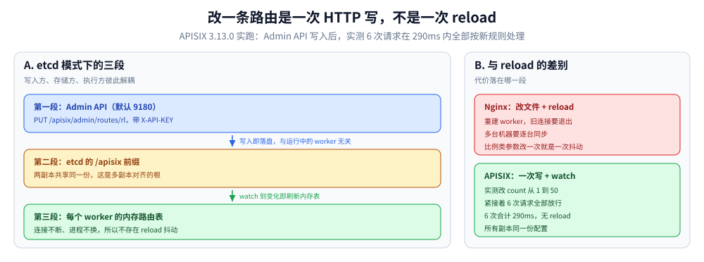
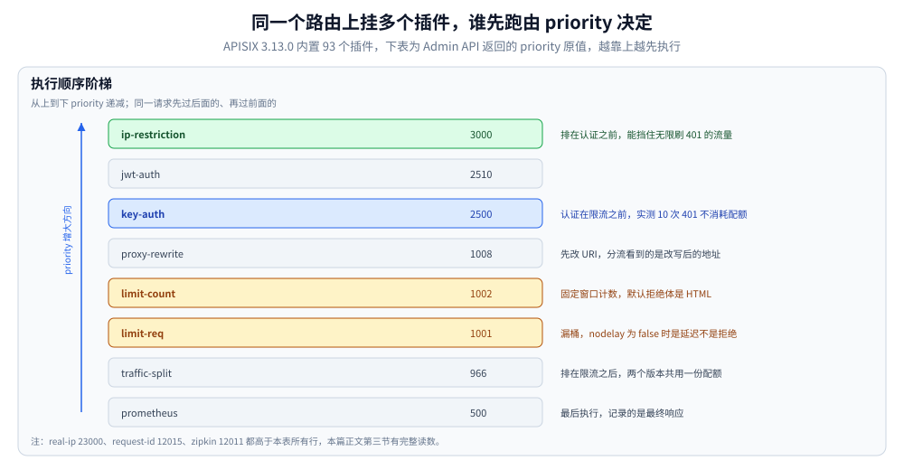
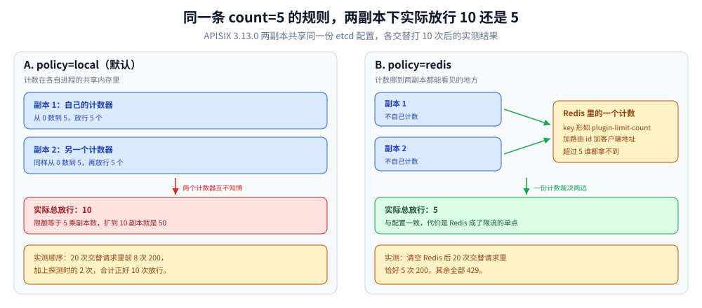

# APISIX

> 覆盖：APISIX 的定位与两种运行模式、**一条请求怎么被路由选中**、插件执行顺序（93 个内置插件的 priority 实测表）、限流两个插件的语义差别（漏桶 vs 固定窗口）、**多副本下计数边界**、认证与「认证先于限流」、灰度权重的真实精度、健康检查、热更新与排障。
>
> 不覆盖：该不该上网关、五层网关怎么选，见 [网关选型对比.md](网关选型对比.md)；`location` / `proxy_pass` / `rewrite` 的配置语义见 [Nginx配置语义.md](../../../02-计算机基础/网络/代理与网关/Nginx配置语义.md)；在 Nginx 里写 Lua 的阶段模型见 [OpenResty.md](OpenResty.md)；令牌桶与漏桶的数学推导见 [限流算法.md](../../../04-架构与系统/分布式/稳定性/限流算法.md)；多副本共享状态的取舍见 [多副本共享状态.md](../../../04-架构与系统/分布式/稳定性/多副本共享状态.md)。
>
> ⭐ 本篇读数为本机真跑：**APISIX 3.13.0 + etcd 3.5.21 + Redis 7**，Docker 内两副本 APISIX、两个真实上游、MySQL 不参与。所有状态码、响应体、响应头、耗时区间都是原始输出；**未实测的部分在第九节逐块标注**。
>
> 内容整理自个人学习笔记，素材见 [素材清单](../../../素材清单.md)。

---

## 一、定位：它把「改配置」变成了「改数据」

**本节要点**：Nginx 的路由写在 `nginx.conf` 里，改一条要 reload；APISIX 的路由写在 etcd 里，**改一条是一次 HTTP 请求**。这一个差别派生出后面所有行为——插件能热更新、副本能共享配置、灰度能按比例调。

### 1.1 两种运行模式

| 模式 | 配置存哪 | 改路由怎么生效 | 适用 |
|---|---|---|---|
| **etcd（默认）** | etcd 的 `/apisix` 前缀下 | Admin API 写入 → 各 worker watch 到即生效 | 多副本、要动态 |
| **standalone** | 本地 `apisix.yaml` | 改文件后依赖热加载周期 | 单机、边缘、配置由 CI 下发 |



这张图把「改一条路由」拆成写、存、执行三段。三者的解耦是后面所有能力的地基——第四节的多副本计数、第六节的按比例灰度，都依赖「配置只有一份、所有副本看到的一样」。

⚠️ standalone 模式不是「没有依赖」，而是「把 etcd 换成一个 YAML 文件」——**灰度比例这类要频繁改的参数在 standalone 下就退化成改文件**，失去了本篇第四节到第六节的大部分能力。

### 1.2 最小可跑起来的配置

镜像自带 `conf/config.yaml` 只有注释和一个 `deployment.role`，etcd 地址、admin key 都要自己补：

```yaml
apisix:
  node_listen: 9080
deployment:
  role: traditional
  role_traditional:
    config_provider: etcd
  admin:
    allow_admin:
      - 0.0.0.0/0
    admin_key:
      - name: admin
        key: ${ADMIN_KEY}
        role: admin
  etcd:
    host:
      - "http://apisix-etcd:2379"
    prefix: /apisix
    timeout: 30
```

⭐ **第一个坑就在这四行里**：不写 `allow_admin` 时，从容器外访问 Admin API 会收到 **403 的 HTML 页面**——

```text
<html><head><title>403 Forbidden</title></head>
<body><center><h1>403 Forbidden</h1></center><hr><center>openresty</center></body></html>
```

这不是 APISIX 的 JSON 错误体，而是 **OpenResty 层的拒绝**（默认只放行 `127.0.0.0/24`，而容器外的来源 IP 是 Docker 网桥地址）。判据：**APISIX 自己返回的错误一定是 `{"error_msg":...}` 或 `{"message":...}` 的 JSON，收到 HTML 就说明请求根本没进 APISIX 的逻辑层。**

### 1.3 与 OpenResty 的分界

| 判据 | OpenResty | APISIX |
|---|---|---|
| 会不会写 Lua | 必须会（六类能力都要手写） | 不用写，配插件 |
| 改一条路由的代价 | 改配置 + reload | 一次 Admin API 调用 |
| 多副本一致性 | 每台机器各自 reload | etcd 一份，各副本 watch |
| 能力上限 | 你的 Lua 写到哪算哪 | 93 个内置插件 + 自己写插件 |

> 一句话：**OpenResty 是「Nginx 的可编程版」，APISIX 是「Nginx 的配置数据库版」**。前者解决「配置表达不了」，后者解决「配置改得太慢、多副本对不齐」。

## 二、路由匹配：一条请求怎么被选中

**本节要点**：五条规则按顺序裁决——`priority` 最大者优先，同 `priority` 下**精确 URI 胜过前缀**，同为前缀则**更长的胜**，`vars` 只是「选中这条路由的附加条件」。

### 2.1 匹配顺序的实测

建两条路由（`priority` 都用默认 0）：

| 请求 | 已有路由 | 实际命中 | 结论 |
|---|---|---|---|
| `/api/user` | `/api/*` → up-a | up-a | 前缀能匹配 |
| `/api/user` | 再加 `/api/user` → up-b | **up-b** | 精确胜过前缀 |
| `/api/user/1` | 同上两条 | up-a | 精确只匹配完全相等 |
| `/api/user/1` | 再加 `/api/user/*` → up-b | **up-b** | 更长前缀胜出 |
| `/api/` | `/api/*` | up-a | `*` 可以匹配空 |

### 2.2 `vars` 不匹配 ≠ 拒绝

这是最容易被误解的一条。给 `/api/user` 加一条 `priority: 100`、`vars: [["http_x_channel", "==", "vip"]]` 的路由：

- 带 `X-Channel: vip` → 命中新路由（up-a）
- **不带** → 仍然 **200，走原来的 up-b**

也就是说 `vars` 是**筛选条件**，不满足时这条路由**根本不参与竞争**，请求会继续落到别的路由上。**它不是拦截器**——想拒绝请求要用 `ip-restriction` / `key-auth` 这类型插件。

### 2.3 三种「没匹配上」的形态

| 场景 | 状态码 | 响应体 | 归属 |
|---|---|---|---|
| 没有路由匹配 | 404 | `{"error_msg":"404 Route Not Found"}` | **APISIX** |
| Admin 查不存在的资源 | 404 | `{"message":"Key not found"}` | **APISIX Admin** |
| 上游自己返回 404 | 404 | 上游的页面 | **上游** |

⚠️ 三种都是 404，但**只有前两种的响应体是 APISIX 的格式**。排障时先看响应体：`{"error_msg":...}` 说明网关侧没匹配上，正文是 HTML 或业务格式说明请求已经到了后端。

## 三、插件：93 个内置插件，顺序由 priority 决定

**本节要点**：同一路由上挂多个插件时，**执行顺序不是配置顺序，也不是字母顺序，而是插件内置的 `priority` 从大到小**。这条决定了「认证能不能挡住限流」「改写后的 URI 会不会影响上游选择」。

### 3.1 priority 实测表

`GET /apisix/admin/plugins?all=true` 返回 **93 个内置插件**，下表是常用插件的 `priority`（降序）：

| priority | 插件 | 作用 |
|---|---|---|
| 23000 | `real-ip` | 用 `X-Forwarded-For` 还原客户端 IP |
| 12015 | `request-id` | 注入请求 ID |
| 12011 | `zipkin` | 链路追踪埋点 |
| 4000 | `cors` | 跨域头 |
| **3000** | `ip-restriction` | IP 黑白名单 |
| **2510** | `jwt-auth` | JWT 认证 |
| **2500** | `key-auth` | API Key 认证 |
| 2400 | `consumer-restriction` | 按 Consumer 限权 |
| 2002 | `forward-auth` | 外部鉴权服务 |
| 1010 | `proxy-mirror` | 流量镜像 |
| 1008 | `proxy-rewrite` | 改写 URI / Header |
| 1005 | `api-breaker` | 熔断 |
| 1003 | `limit-conn` | 并发数限制 |
| **1002** | `limit-count` | 固定窗口计数 |
| **1001** | `limit-req` | 漏桶限速 |
| 966 | `traffic-split` | 按权重分流 |
| 899 | `response-rewrite` | 改响应 |
| 500 | `prometheus` | 指标暴露 |



读这张图要看的是**相对位置**而不是绝对值：3000 与 2500 之间的落差让 IP 白名单挡在认证前面，1008 与 966 的先后让分流看到的是改写后的 URI。这些顺序不能通过路由配置调整，只能靠选插件绕开。

### 3.2 由这张表推出的四条结论

1. **`ip-restriction` 在认证之前** → IP 黑名单能挡住「无限刷 401」的请求；反之，只配 `key-auth` 时，未认证流量**不受任何限流保护**（见 5.3 实测）。
2. **`key-auth` / `jwt-auth` 在 `limit-count` 之前** → 认证失败不消耗配额。
3. **`proxy-rewrite`(1008) 在 `traffic-split`(966) 之前** → 分流看到的是**改写后**的 URI，这条对灰度很关键。
4. **`traffic-split` 在 `limit-*` 之后** → 限流在分流前执行，**两个版本共用一份配额**；想按版本分别限流，得把限流插件挂到各自的 `weighted_upstreams` 上。

## 四、限流：两个插件不是一回事

**本节要点**：`limit-req` 是**漏桶**，被限的请求默认不是被拒绝而是**被延迟**；`limit-count` 是**固定窗口计数**，超了直接拒。两者的响应头、拒绝形态、多副本行为**全不一样**。

### 4.1 `limit-req`：`nodelay=false` 时它在「拖慢」而不是「拒绝」

`rate=2, burst=3`，连续打 8 次：

| `nodelay` | 状态码序列 | 耗时（ms） |
|---|---|---|
| `true` | `200 200 200 200 503 503 503 503` | `10 11 56 56 8 9 12 10` |
| `false` | **`200` × 8**（全部通过） | `17 498 499 500 501 498 500 504` |

⭐ 两个读数各自是一个事故：

- `nodelay=true` 时放行 **1 + burst = 4** 个，第 5 个起直接 503——这是直觉里的「限流」。
- `nodelay=false`（默认）时**一个都不拒**，而是每个请求排队约 **500ms**（= 1/rate）。**如果客户端超时设成 1 秒、上游再慢一点，用户看到的是超时而不是 429/503**，监控上表现为「延迟升高、错误率来自超时」，根本看不出是限流造成的。

> 选型口径：要「快速失败」必须显式写 `"nodelay": true`；要「削峰填谷」才用 `false`，并且要保证客户端超时 > `burst / rate`。

### 4.2 `limit-count`：不配 `rejected_msg` 会返回 HTML

`count=5, time_window=60`，连续打 9 次：`200 200 200 200 200 429 429 429 429`。

拒绝时的三种形态（实测）：

| 插件 | 配 `rejected_msg` | `Content-Type` | 响应体 | 限流头 |
|---|---|---|---|---|
| `limit-req` | 是 | `text/plain` | `{"error_msg":"rate exceeded"}` | **无** |
| `limit-count` | **否** | `text/html` | OpenResty 的 `<h1>429 Too Many Requests</h1>` 页面 | `X-RateLimit-Limit/Remaining/Reset` |
| `limit-count` | 是 | `text/plain` | `{"error_msg":"quota exceeded"}` | 同上 |

两个坑：

1. **`limit-count` 的默认拒绝体是 HTML**。前端按 JSON 解析会直接抛异常，把「限流」显示成「服务异常」。
2. **`Content-Type` 是 `text/plain` 而响应体是 JSON**——按 `Content-Type` 分派的客户端（不少 HTTP 客户端库）会把它当纯文本。

### 4.3 多副本：`policy=local` 的限额是「× 副本数」

这是本篇最值得记住的一组读数。两个 APISIX 副本共享同一份 etcd 配置，路由上 `count=5`：

| 策略 | 两副本交替各打 10 次的结果 | 实际总放行 |
|---|---|---|
| `policy=local`（默认） | `200` × 8，其余 429 | **10**（5 × 2 副本） |
| `policy=redis` | `200` × 5，其余 429 | **5** |

⚠️ `local` 的计数在**各副本自己的共享内存**里，副本之间不通信。**扩容到 N 个副本，实际限额就是 N × count**。以为「配了 5 就是 5」而横向扩容，是限流形同虚设最常见的原因。



左右两边的配置完全相同，只有 `policy` 一个字段不同，放行数就差一倍。这也解释了「限流配了却不生效」最常见的情形：不是插件没跑，而是它跑得太宽。

⭐ 同一篇里的对照：Go 侧「集中计数 vs 令牌预领」的取舍见 [多副本共享状态.md](../../../04-架构与系统/分布式/稳定性/多副本共享状态.md) 第六节——APISIX 的 `policy=redis` 就是「集中计数」的一种实现。

### 4.4 `policy=redis` 的配置与 key 形态

```json
"limit-count": {
  "count": 5, "time_window": 60,
  "policy": "redis",
  "redis_host": "apisix-redis", "redis_port": 6379, "redis_database": 0,
  "redis_timeout": 1000,
  "key_type": "var", "key": "remote_addr",
  "rejected_code": 429, "rejected_msg": "quota exceeded"
}
```

实测 Redis 里的 key 长这样：

```text
plugin-limit-countroutemc:1887251771:172.20.0.1
```

即「插件名 + 路由 id + 限流 key」**直接拼接、没有分隔符**。可预测、可批量清（`KEYS plugin-limit-count*`），但**不可读**——排查「这个 key 是哪条路由的」时要把路由 id 对回去。

> ⚠️ Redis 成为限流的单点：它挂了，`limit-count` 的行为取决于版本容错策略，可能是「全部放行」。**限流依赖的存储必须有降级预案**，这一点与 `local` 策略的安全性正好相反。

## 五、认证：Consumer 承载身份

**本节要点**：APISIX 里「身份」是 Consumer 对象，认证插件挂在路由上开启校验、挂在 Consumer 上存凭据。**拒绝文案是排障的第一手线索**——同一个 401，六种文案对应六种原因。

### 5.1 `key-auth` 的两种拒绝

| 请求 | 状态码 | 响应体 |
|---|---|---|
| 不带头 | 401 | `{"message":"Missing API key in request"}` |
| key 错误 | 401 | `{"message":"Invalid API key in request"}` |
| 正确（`apikey` 头） | 200 | 转发到上游 |
| 正确（`?apikey=` 查询参数） | 200 | 转发到上游 |

⚠️ **查询参数也能传 key**（默认参数名 `apikey`），意味着 **API Key 会进 access log 和浏览器历史**。生产上要么关掉 `query`，要么用 `hide_credentials: true`。

### 5.2 `jwt-auth` 的四种拒绝

| 请求 | 状态码 | 响应体 |
|---|---|---|
| 无 `Authorization` | 401 | `{"message":"Missing JWT token in request"}` |
| 签名错误 | 401 | `{"message":"failed to verify jwt"}` |
| **已过期** | 401 | `{"message":"failed to verify jwt"}` |
| token 里的 key 不存在 | 401 | `{"message":"Invalid user key in JWT token"}` |

⭐ **过期和签名错误返回同一条文案**。排障时看到 `failed to verify jwt` 要先排除「时钟偏差」再怀疑密钥——两边机器时间差超过 `exp` 的容忍度，现象和密钥配错一模一样。

### 5.3 认证先于限流：401 不消耗配额

路由上同时挂 `key-auth` 和 `limit-count(count=3)`：

```text
先打 10 次无 key  → 401 401 401 401 401 401 401 401 401 401
再带 key 打 5 次  → 200 200 200 429 429
```

前 3 次带 key 的请求仍然 200，说明**401 一个配额都没花**（`key-auth` 2500 > `limit-count` 1002）。

⭐ 反过来的推论更要紧：**未认证流量完全不受限流保护**。攻击者不带 key 可以无限打，每次都会走一遍认证插件。要挡这类流量，得在认证**之前**挂 `ip-restriction`(3000) 或 `limit-req` 并用 IP 维度限流——否则「有认证」会给人一种「已经防住了」的错觉。

## 六、灰度：`traffic-split` 的权重行为

**本节要点**：`traffic-split` 按权重分流，**实测比例精确**；它会**覆盖路由自带的 `upstream`**；`weight=0` 表示**完全不选**，不是「按比例丢弃」。

### 6.1 权重比例的实测精度

两个真实上游，各打 1000 次：

| 配置权重 (a/b) | 实际 (a/b) | 偏差 |
|---|---|---|
| 50 / 50 | 500 / 500 | 0 |
| 30 / 70 | 300 / 700 | 0 |
| 1 / 99 | 10 / 990 | 0 |

⭐ 对照 nginx `split_clients` 的同场景实测（`30%` 配出 `28.9% / 71.1%`，见 [网关选型对比.md](网关选型对比.md) 3.4）：**Nginx 的按比例分流是基于变量哈希**，比例精度取决于 key 分布；**APISIX 的 `weighted_upstreams` 是每次请求独立取随机**，1000 次就能收敛到整数位。

这个差别对灰度的影响是：**用 Nginx 做 1% 灰度，小流量下实际比例会明显偏离**；用 APISIX 则稳定。

### 6.2 两个容易踩的语义

| 配置 | 实测结果 | 说明 |
|---|---|---|
| route 有 `upstream: up-a`，`traffic-split` 配 `up-b` 权重 100 | **200 次全走 up-b** | `traffic-split` **覆盖** route 的 upstream，不是叠加 |
| `weighted_upstreams` 里一个 `weight: 0`，另一个 100 | 200 次全走 100 那条 | `weight=0` = **永不选中**，不是「按 0% 概率丢弃」 |

> 用法：灰度期把老版本放 `route.upstream`、新版本写进 `traffic-split`，调权重只改一处；**回滚 = 把权重改成 0**，不需要动路由。

### 6.3 与 OpenResty / Nginx 方案的分界

| 方案 | 灰度判据 | 改比例的代价 |
|---|---|---|
| Nginx `split_clients` | 变量哈希 | 改配置 + reload（掉不断连但有一次抖动） |
| OpenResty + Redis | 自己写 Lua 读配置 | 无 reload，但要自己实现计数与降级 |
| APISIX `traffic-split` | 权重随机 | 一次 Admin API 调用，两副本同时生效 |

## 七、健康检查：默认没有，配了才秒级

**本节要点**：字段名是 **`checks`**（不是 `healthcheck`，写错直接 400）；**不配就没有主动探测**，上游挂掉后每个踩到它的请求都要自己付一次连接超时的代价。

### 7.1 字段名踩坑的原文

```text
400 {"error_msg":"invalid configuration: property \"upstream\" validation failed:
     additional properties forbidden, found healthcheck"}
```

⚠️ 这个报错**不会告诉你正确字段名**。APISIX 的 `upstream` 用的是 `checks`：

```json
"upstream": {
  "type": "roundrobin",
  "nodes": {"10.0.0.11:8080": 1, "10.0.0.12:8080": 1},
  "checks": {
    "active":  {"type": "http", "http_path": "/healthz", "timeout": 1,
                "healthy":   {"interval": 1, "successes": 1},
                "unhealthy": {"interval": 1, "http_failures": 2, "tcp_failures": 2, "timeouts": 2}},
    "passive": {"unhealthy": {"http_statuses": [500,502,503,504],
                              "http_failures": 3, "tcp_failures": 3, "timeouts": 3}}
  }
}
```

### 7.2 停掉一个上游：延迟分布差 60 倍

两个上游，停掉其中一个后各打 60 次：

| 配置 | 结果 | P50 | P95 | max |
|---|---|---|---|---|
| **不配 `checks`** | up-a 59 次 + 客户端超时 1 次 | **3072ms** | 3084ms | **20006ms** |
| 配 `checks`（active，1s 间隔） | up-a 60 次 | **48ms** | 3069ms | 3070ms |
| 只配 `passive` | up-a 40 次 | 47ms | 53ms | 53ms |

⭐ 读法：

- **不配 `checks`** 时，一半请求打到死节点 → 等 TCP 连接超时（约 3s）→ 再重试到活节点。**用户侧 P50 直接变成 3 秒**。
- 配了主动探测后，节点在 1~2 个探测周期内被摘除，**P50 回到 48ms**；P95 仍是 3069ms，那是摘除前的窗口里踩进去的少数请求。
- `max=20006ms` 是客户端自己的 20 秒超时——**说明有一部分请求在摘除前卡到了客户端放弃**。

### 7.3 恢复之后

实测恢复上游后 **2 秒、6 秒各打 40 次，仍然全部落到 up-a**——健康检查把节点**重新纳回**比摘除慢。本篇的观察窗口只到 6 秒，**更长时间后是否纳回没有验证**（见第九节）。

> 运维含义：摘除是「保护用户」，纳回是「恢复容量」。**扩容后新节点迟迟不吃流量**，先看健康检查的 `healthy.successes` 和 `interval`，而不是怀疑负载均衡。

## 八、热更新与可观测

### 8.1 配置热更新：没有 reload

改路由上 `limit-count` 的 `count` 从 1 改成 50，**改完立刻**打 6 次：

```text
初始 count=1     → 200 429 429 429
改为 count=50 后 → 200 200 200 200 200 200   （6 次合计 290ms，无 reload）
```

⭐ 这与 Nginx 的 reload 是两件事：Nginx reload 会重建 worker（长连接会断，见 [网关选型对比.md](网关选型对比.md) 第三节实测）；APISIX 改的是 worker 内存里的路由表，**连接不断、配置立即生效**。

### 8.2 三处该看的信号

| 位置 | 看什么 | 典型判据 |
|---|---|---|
| `access.log` | 状态码、`route_id`、`upstream_addr` | 502 集中在一个 upstream → 上游问题；404 全是 `{"error_msg":...}` → 路由没匹配 |
| Prometheus（`prometheus` 插件，priority 500） | `apisix_http_status{route=...}` | 按路由维度看错误率，比全局错误率有用得多 |
| Admin API `GET /routes` | 实际生效的配置 | 排查「改了没生效」——**etcd 里是什么，运行的就是什么** |

## 九、校验口径

**本节要点**：本篇所有数字均为本机真跑，逐块标注适用范围；**未实测的部分明确列出**，不要外推。

### ✅ 实测口径

| 项 | 环境与做法 |
|---|---|
| 版本 | APISIX **3.13.0**（`apache/apisix:3.13.0-debian`）、etcd **3.5.21**、Redis **7**、上游为 Python `http.server` 两副本 |
| 拓扑 | 两副本 APISIX 共享同一 etcd 前缀；上游用**固定 IP**（`172.20.0.11/12`），避免容器重启后地址漂移 |
| 路由匹配 | 五组场景逐个建路由后单次请求，读状态码与响应体里的上游标识 |
| 限流 | 单线程串行请求，读状态码序列与单次耗时；多副本实验用「两副本交替各打 10 次」 |
| 灰度 | 每个权重配置打 1000 次，统计落在两个上游的计数 |
| 健康检查 | 停/启上游容器后按时间点采样 40~60 次，统计 P50/P95/max |
| 未保留 | 原始日志在 `.workbuddy/tmp/apisix-lab/`（`exp1_route.py` ~ `exp7b_checks.py`），可重跑 |

### ⚠️ 未实测

| 项 | 边界 |
|---|---|
| **standalone 模式** | 只读了配置字段，**没有实际以 YAML 模式启动** |
| **健康检查的「纳回」时间** | 只观察到恢复后 6 秒仍不接流量，**更长时间未验证** |
| **`limit-req` 的排队上限** | 只测了 `burst=3`，请求排队超过 `burst` 后被拒的时刻没单独定位 |
| **`policy=redis` 的降级行为** | 没有停掉 Redis 观察 `limit-count` 的失败策略 |
| **`traffic-split` 的按 header / 按 Consumer 路由** | 只测了纯权重，`match` 条件分支未跑 |
| **长连接与 `keepalive` 参数** | 未调优，所有耗时含每次建连成本 |
| **与 MySQL / 业务后端的真实链路** | 上游是 echo 服务，不含业务处理时间 |

> 引用本篇数字时请带上版本号：**插件的 `priority`、默认拒绝体、schema 字段名都随版本变**，跨大版本升级前必须重新核对第三节那张表。

## 延伸追问

- **`limit-count` 的 `policy` 除了 `local` / `redis` 还有别的吗？** 还有 `redis-cluster`。三种的差别是「计数存在哪」：共享内存（快、各副本独立）、单 Redis（准、单点）、Redis 集群（准、要配 slot）。
- **插件顺序能不能改？** 单个插件在路由上挂载时不能改 `priority`，但 `_meta.priority` 允许覆盖（同一插件的多实例场景）。**能改不等于该改**——调顺序会连带改变认证与限流的先后关系。
- **`traffic-split` 和「按 header 灰度」怎么配？** 在 `rules` 里用 `match` 条件而不是纯 `weighted_upstreams`，本篇只实测了后者。
- **两副本的 etcd 挂了会怎样？** 已加载的路由继续工作（内存里有一份），但新配置无法下发。**这是 etcd 模式的下限**，监控必须覆盖 etcd。

## 关联

- **选型**：[网关选型对比.md](网关选型对比.md) — 五层网关的分工与四款 API 网关的横向对比
- **对照/互补**：[OpenResty.md](OpenResty.md) — 同一件事用 Lua 手写要多少钱
- **上游机制**：[限流算法.md](../../../04-架构与系统/分布式/稳定性/限流算法.md) — 令牌桶、漏桶、滑动窗口的数学
- **共享状态**：[多副本共享状态.md](../../../04-架构与系统/分布式/稳定性/多副本共享状态.md) — `policy=local` 与 `policy=redis` 的理论位置
- **配置语义**：[Nginx配置语义.md](../../../02-计算机基础/网络/代理与网关/Nginx配置语义.md) — 网关前面那层容易配错的四条
- **灰度流程**：[灰度发布与流量路由.md](../../../06-工程实践/部署/灰度发布与流量路由.md) — 权重之外的放量节奏、观察窗口与回滚判据
