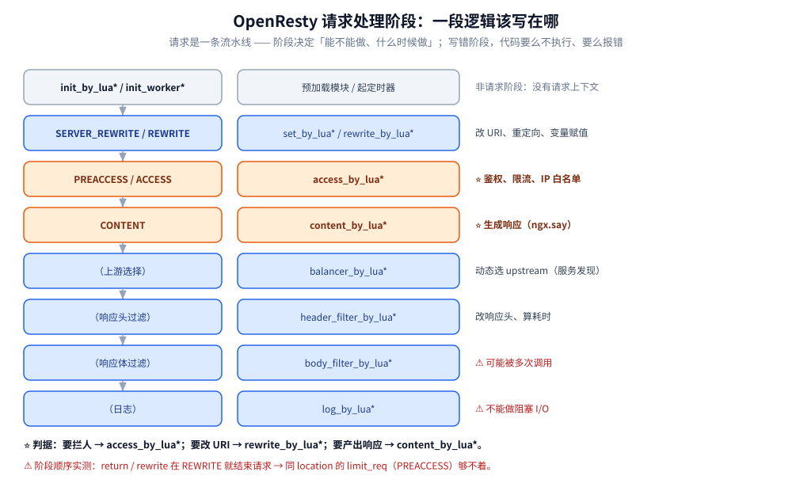
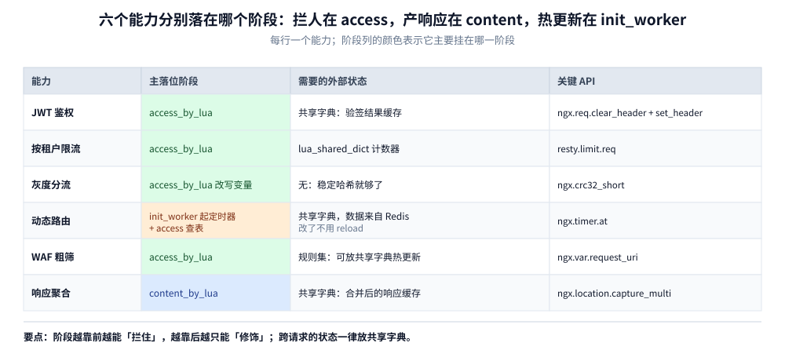
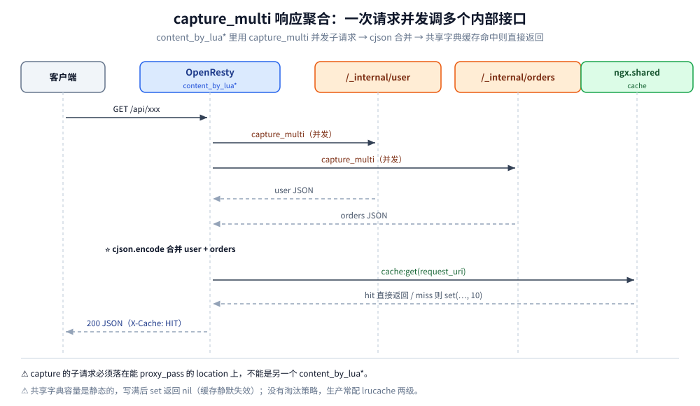

# OpenResty

> 覆盖：OpenResty 的定位与部署、**执行阶段与 Lua 入口的对应关系**、`ngx.*` API 速查（含 cosocket 三条硬限制）、六个典型能力（鉴权 / 限流 / 灰度 / 动态路由 / WAF / 聚合），以及把它接进一个真实 Go 后端时的配置与排障。
>
> 不覆盖：Lua 语法本身（`local`、真值、table、模块）见 [Lua语法够用版.md](../../../01-编程语言/lua/Lua语法够用版.md)；`location` / `proxy_pass` / `rewrite` / `limit_req` 的配置语义与四组本机实测见 [Nginx配置语义.md](../../../02-计算机基础/网络/代理与网关/Nginx配置语义.md)；11 个处理阶段的框架级原理见 [04-HTTP框架执行流程.md](../../../02-计算机基础/linux/深入理解Nginx/04-HTTP框架执行流程.md)；版本与 `lua-resty-*` 生态见 [14-OpenResty生态.md](../../../02-计算机基础/linux/深入理解Nginx/14-OpenResty生态.md)。
>
> ⭐ 本篇的**配置行为结论**来自本机 `nginx/1.15.11` 隔离实例的四组真跑读数（已移入 Nginx配置语义篇，本文只引用结论）；**Lua 代码未逐个跑通**——`openresty/openresty:1.31.1.1-alpine` 镜像在本机可用，但本轮没有为每个片段搭 location 回读响应。分块口径见第九节。
>
> 内容整理自个人学习笔记，素材见 [素材清单](../../../素材清单.md)。网关选型见 [网关选型对比.md](网关选型对比.md)，限流算法见 [限流算法.md](../../../04-架构与系统/分布式/稳定性/限流算法.md)。

---

## 一、一句话定位：OpenResty 与「只改配置的 Nginx」差在哪

**本节要点**：OpenResty **不是另一个服务器**，它就是 Nginx（配置 100% 兼容）**加上 LuaJIT 和一个脚本运行时**。判据只有一句：**只改配置的 Nginx，什么时候不够用？**

### 1.1 Nginx 的天花板在哪

Nginx 的配置是**声明式**的，规则在**启动 / reload 时**就定死了。这带来三个"配置改不动"的困境：

| 困境 | 例子 |
|---|---|
| **要按请求内容动态决策** | 按 JWT 里的 `company_id` 路由到不同 upstream；按 `User-Agent` 决定是否限流 |
| **决策前要访问外部资源** | 先查 Redis 才知道这个 token 有没有被吊销；先查配置中心才知道这条路由存不存在 |
| **改一条规则要 reload** | 动态路由、灰度比例调整、黑名单更新——reload 有代价，且频繁 reload 会掉连接 |

### 1.2 三条出路，OpenResty 是第三条

| 出路 | 代价 |
|---|---|
| **写 C 模块** | 开发慢、内存安全自担、每次升级 Nginx 都要重新编译 |
| **放到上游服务**（网关自己写一版） | 多一跳网络开销；占用应用运行时的资源；性能天花板低于 Nginx |
| ⭐ **OpenResty（在 Nginx 进程内跑 LuaJIT）** | 脚本在**同一个进程内**执行，性能接近 C；改脚本**不用重编也不重启** |

**OpenResty = Nginx + LuaJIT + 一组 `lua-resty-*` 库**（`lua-resty-core`、`lua-resty-redis`、`lua-resty-mysql`、`lua-resty-limit-traffic`、`lua-resty-string`、`lua-resty-upload` …）。

⭐ 所以它的定位一句话：**请求入口上的编程**——南北向 API 网关、WAF、动态路由、限流、响应聚合。

⚠️ 两个常见误解：

1. **"OpenResty 是 Nginx 的替代品"** —— 不是。它**就是** Nginx，`nginx.conf` 的语法、模块、指令全部照旧；Lua 只是多出来的一种"可编程能力"。
2. **"用了 Lua 就会变慢"** —— 关键看**写在哪**。LuaJIT 把热点代码编译成机器码，简单判断与字符串处理的性能接近 C；真正拖慢的是**用错阶段**（比如在 `log_by_lua` 里做阻塞 I/O）和**每次请求都重新 `require` 模块**。

## 二、核心概念：一个请求在 OpenResty 里要经过哪些阶段

**本节要点**：Nginx 处理一个请求是一条**流水线**，每个阶段只允许做特定的事。**「这段逻辑该写在哪个阶段」是 OpenResty 里最核心的判断题**——写错阶段，代码要么不执行、要么报错。

### 2.1 阶段与 Lua 入口的对照表

| Nginx 阶段 | OpenResty 指令 | 典型用途 | 该阶段**不能**做什么 |
|---|---|---|---|
| （配置加载，master 进程） | `init_by_lua*` | 预加载模块、初始化共享内存 | 不能用 `ngx.var` / `ngx.req` 等请求级 API |
| （worker 启动） | `init_worker_by_lua*` | 起定时器、预热连接池 | 没有请求上下文 |
| **SERVER_REWRITE / REWRITE** | `set_by_lua*` / `rewrite_by_lua*` | 改 URI、重定向、（轻量）变量赋值 | 不能产生响应体（`set_by_lua` 只能返回一个值） |
| **PREACCESS / ACCESS** | `access_by_lua*` | ⭐ **鉴权、限流、IP 白名单** | — |
| **CONTENT** | `content_by_lua*` | ⭐ 生成响应（`ngx.say`）、调子请求、调 Redis | 一个 location 只能有一个 content handler |
| （上游选择） | `balancer_by_lua*` | 动态选 upstream（服务发现） | 只能决定"发给谁" |
| （响应头过滤） | `header_filter_by_lua*` | 改响应头、算耗时 | 不能改响应体 |
| （响应体过滤） | `body_filter_by_lua*` | 改/替换响应体（可能被**多次**调用） | 不能假设一次拿到完整 body |
| （日志） | `log_by_lua*` | 打点、异步上报 | ⚠️ 不能做阻塞 I/O（会拖住连接） |
| （TLS 握手） | `ssl_certificate_by_lua*` | 按 SNI 动态选证书 | — |

### 2.2 该写哪个阶段的四条判据

- **要拦人**（鉴权、限流、黑名单）→ `access_by_lua*`
- **要改 URI**（重写、跳转）→ `rewrite_by_lua*`
- **要产出响应**（自己返回数据）→ `content_by_lua*`
- **要改别人的响应**（加头、改 body）→ `header_filter_by_lua*` / `body_filter_by_lua*`



这 10 个 Lua 入口对应 nginx 的 11 个原生阶段，逐阶段的 `rewrite_log` 验证与 `error_page` 旁证见 [04-HTTP框架执行流程.md](../../../02-计算机基础/linux/深入理解Nginx/04-HTTP框架执行流程.md) 第三节——**阶段本体不是 OpenResty 发明的，它只是往既有阶段上挂了 Lua 钩子**。

### 2.3 六个能力分别落在哪个阶段

**本节要点**：把第五～七节的六个能力先按阶段摆一遍——**同一个请求里，阶段越靠前越能"拦住"，越靠后越只能"修饰"**。



⭐ 这张矩阵最有用的一行是**动态路由**：它同时占两个阶段——`init_worker` 起定时器把路由表刷进共享字典，`access` 只负责查表。**把"拉数据"放进请求路径是常见错误**：每个请求都连一次 Redis，延迟和连接数都会失控。

### 2.4 写错阶段的真实代价

**本节要点**：阶段写错往往**不报错**，只是静默不生效——所以它比语法错误难查得多。

最典型的例子是 `limit_req` 与 `return` 同处一个 location：本机连发 6 个请求，带 `return 200` 的 location 全部返回 200（限流完全没执行），而参数完全相同、用静态文件做 content handler 的 location 从第 3 个起返回 503。根因是 `return` 在 REWRITE 阶段就把请求结束了，PREACCESS 阶段的 `limit_req` 根本没跑到。

⚠️ 同理，**鉴权必须写在 `access_by_lua*`** 而不是 `rewrite_by_lua*`：写在 rewrite 阶段虽然"能跑通"，但同 location 里排在后面的限流、其他 access 检查会与它错位。

完整的对照配置、实测输出与阶段顺序图见 [Nginx配置语义.md](../../../02-计算机基础/网络/代理与网关/Nginx配置语义.md) 第四节。

## 三、整体架构：`ngx.*` 与 cosocket 提供了什么

**本节要点**：OpenResty 给 Lua 注入了一个全局 `ngx` 表。**记住每一类 API 属于哪个阶段**，比记住函数名更重要；语法层面（`local`、table、模块）先看 [Lua语法够用版.md](../../../01-编程语言/lua/Lua语法够用版.md)。

### 3.1 输出与结束请求

| API | 说明 |
|---|---|
| `ngx.say(...)` | 输出并**追加换行**（多个参数依次输出） |
| `ngx.print(...)` | 输出**不追加换行** |
| `ngx.exit(status)` | ⭐ **结束整个请求**（≥200 时后续阶段不再执行）；`ngx.exit(0)` 表示"当前阶段到此为止，继续往下走" |
| `ngx.status = 404` | 只改状态码，**不结束请求** |
| `ngx.redirect(url, 302)` | 发 302/301 跳转并结束请求 |

⚠️ **`ngx.status` 与 `ngx.exit` 的区别**是新手最常混的：`ngx.status = 403` 之后如果继续 `ngx.say("x")`，客户端会收到 **403 + "x"**；而 `ngx.exit(403)` 会立刻终止。另外 `return` 只结束**当前 handler 函数**，后续阶段（如 `header_filter`）照常执行——**结束整个请求只能用 `ngx.exit`**。

### 3.2 读请求

| API | 说明 |
|---|---|
| `ngx.var.arg_name` | URL 查询参数（`?name=1`）；**永远是字符串或 nil** |
| `ngx.var.http_x_foo` | 请求头 `X-Foo`（**下划线转义**：header 里的 `-` 写成 `_`） |
| `ngx.var.remote_addr` / `uri` / `request_uri` / `host` / `scheme` | 常用内置变量 |
| `ngx.req.get_uri_args()` | 返回 table（同名参数会变成**数组**，这点很坑） |
| `ngx.req.get_headers()` | 返回请求头 table（同上，同名多值变数组） |
| `ngx.req.read_body()` + `ngx.req.get_body_data()` | 读请求体（⚠️ 大 body 会落盘，要配合 `client_body_buffer_size`） |
| `ngx.req.set_header(k, v)` / `ngx.req.clear_header(k)` | 改/删请求头（**转发给上游前改**） |
| `ngx.req.set_uri(uri, jump)` | 改 URI；`jump=true` 会**重新走 location 匹配**（相当于 `rewrite ... last`） |

### 3.3 写响应

| API | 说明 |
|---|---|
| `ngx.header["X-Foo"] = "bar"` | 设响应头；`ngx.header["X-Foo"] = nil` 删除 |
| `ngx.header.content_length = nil` | 改了 body 之后必须把 `Content-Length` 清掉，让 nginx 用 chunked |
| `ngx.arg[1]` / `ngx.arg[2]` | **`body_filter_by_lua*` 专用**：`arg[1]` 是本次数据块，`arg[2]` 表示是否最后一块 |

⚠️ `body_filter_by_lua*` 会被**多次调用**（每个响应数据块一次），不能假设一次拿到完整 body——要聚合必须自己用 `ngx.ctx` 攒。

### 3.4 子请求与两种上下文

| API | 说明 |
|---|---|
| `ngx.location.capture(uri, opts)` | 发起**内部子请求**（等价于 curl 自己），返回 `{status, header, body}`；⭐ **必须配 `proxy_pass` 到 `127.0.0.1` 的 location**，且**不能捕获 `content_by_lua*` 的 location**（会报错） |
| `ngx.location.capture_multi({...})` | **并发**发多个子请求（⭐ 这是 OpenResty 做"响应聚合"的核心） |
| `ngx.ctx` | **单请求生命周期**内的 table（贯穿所有阶段），用来在 `access` 阶段存数据给 `content` 用 |
| `ngx.shared.DICT` | **跨 worker 共享**的字典（`get/set/incr/ttl`），限流计数、配置热更新都靠它 |

⚠️ `ngx.ctx` 与 `ngx.shared.DICT` 的区别是高频考点：

| | `ngx.ctx` | `ngx.shared.DICT` |
|---|---|---|
| 作用范围 | **单个请求** | **整个 nginx（所有 worker）** |
| 生命周期 | 请求结束即销毁 | 常驻（可设 `expire`） |
| 能存什么 | 任意 Lua 值 | 只有**字符串 / 数字 / 布尔 / nil** |
| 典型用途 | 传参（鉴权结果 → content） | 限流计数、配置缓存、锁 |

### 3.5 时间、日志、定时器

| API | 说明 |
|---|---|
| `ngx.now()` / `ngx.time()` | 返回**缓存**的当前时间（`ngx.now` 有小数，**不自动刷新**，要先用 `ngx.update_time()`） |
| `ngx.log(ngx.ERR, ...)` | 写 error_log；级别：`ngx.STDERR/EMERG/ALERT/CRIT/ERR/WARN/NOTICE/INFO/DEBUG` |
| `ngx.timer.at(delay, fn)` | 延时执行（**异步、不阻塞请求**）；`ngx.timer.every` 是周期版 |
| `ngx.thread.spawn/wait` | 轻量线程（可在同一请求内并发多个 cosocket 操作） |

⚠️ `ngx.now()` **不刷新时间**是个经典坑：在一个长 handler 里连续调用会拿到同一个值（精度够用但"时间不动"）。要准就先 `ngx.update_time()`。

### 3.6 cosocket：为什么能连 Redis 却不阻塞

**cosocket（cosock）是 OpenResty 的核心发明**：它让 Lua 里写"看起来同步"的网络代码，实际由 nginx 事件循环驱动，**不阻塞 worker**。

```lua
local redis = require("resty.redis")
local red = redis:new()
red:set_timeouts(100, 100, 100)   -- connect/send/read 各 100ms
local ok, err = red:connect("127.0.0.1", 6379)
if not ok then
    ngx.log(ngx.ERR, "connect failed: ", err)
    return ngx.exit(500)
end
-- ⭐ 这一段"阻塞式"写法实际是非阻塞的：在等待网络时 worker 会去处理别的请求
local res, err = red:get("token:" .. token)
red:set_keepalive(60000, 100)     -- ⭐ 放回连接池（不写这句每次都要 TCP 握手）
```

⚠️ **cosocket 的三条硬限制**（写错就报 `API disabled in the context of ...`）：

1. **不能在 `init_by_lua*` / `init_worker_by_lua*` 的同步代码里用**（那时还没有请求上下文）——要连数据库只能放进 `ngx.timer.at(0, fn)`；
2. **不能在 `set_by_lua*` 里用**（该阶段要求纯计算、同步返回）；
3. **有连接池就要 `set_keepalive`**，否则每个请求都新建连接，性能直接塌掉。

### 3.7 读请求体与 JSON

```lua
-- 读请求体（⚠️ 默认已读进内存；大 body 用 ngx.req.socket 流式处理）
ngx.req.read_body()
local body = ngx.req.get_body_data()

-- 读 JSON 体（需要 lua-cjson，OpenResty 自带）
local cjson = require("cjson.safe")     -- ⭐ 用 safe 版：解析失败返回 nil+err 而不是抛异常
local obj, err = cjson.decode(body)
if not obj then
    return ngx.exit(400)
end

-- 输出 JSON
ngx.header["Content-Type"] = "application/json; charset=utf-8"
ngx.say(cjson.encode({ code = 0, data = obj }))
```

## 四、部署：最小可运行配置与启动检查

**本节要点**：OpenResty 的部署单位是**一个目录**：`conf/nginx.conf` + `lua/` + `logs/`。所有 Lua 模块路径都由 `lua_package_path` 决定，配错时表现为 `module 'xxx' not found`。

### 4.1 装什么、放哪里

| 方式 | 做法 | 适用 |
|---|---|---|
| 官方镜像 | `openresty/openresty:<nginx版本>.<补丁号>-alpine` | 容器化部署、本机实验 |
| 官方仓库包 | `apt install openresty` / `yum install openresty` | 虚拟机、物理机 |

⭐ OpenResty 的版本号是 `<nginx 版本>.<补丁号>`：`1.31.1.1` 读作「基于 nginx 1.31.1 的第 1 个补丁」；本仓对齐的版本与变更清单见 [14-OpenResty生态.md](../../../02-计算机基础/linux/深入理解Nginx/14-OpenResty生态.md)。

目录结构固定成这样，`nginx.conf` 里的相对路径才有意义：

```text
gateway/
├── conf/nginx.conf
├── lua/
│   ├── auth.lua          # JWT 校验 + 注入身份头
│   ├── limit.lua         # 按 company_id 限流
│   └── routes.lua        # 动态路由表热更新
└── logs/                 # error.log / access.log
```

### 4.2 最小 `nginx.conf`

```nginx
worker_processes auto;
error_log logs/error.log warn;

events { worker_connections 1024; }

http {
    lua_shared_dict limit_store 10m;      # 限流计数器（所有 worker 共享）
    lua_shared_dict routes      1m;       # 路由表
    lua_package_path "/usr/local/openresty/nginx/lua/?.lua;;";   # ⚠️ 末尾 ;; = 再带上默认搜索路径
    lua_code_cache on;                    # ⚠️ 生产必须 on

    server {
        listen 80;

        location /healthz {
            content_by_lua_block { ngx.say("ok") }
        }

        location /api/ {
            access_by_lua_file lua/auth.lua;
            proxy_pass http://127.0.0.1:8080/;   # 带斜杠：剥掉 /api 前缀
        }
    }
}
```

⚠️ 三个配置项直接决定能不能上线：`lua_package_path` 的 `;;` 不能漏（漏了会丢掉默认路径，连 `resty.redis` 都加载不到）；`lua_code_cache` 生产必须 `on`；`lua_shared_dict` 的容量是**静态的**，写满后 `set` 返回 `nil, "no memory"`。

### 4.3 启动与检查

```bash
# ① 语法检查（不影响运行中的进程）
nginx -t

# ② 热加载：新 worker 起来、老 worker 处理完存量连接再退出
nginx -s reload

# ③ 冒烟（容器映射到宿主的 18080 时用 18080）
curl -s http://127.0.0.1/healthz

# ④ 容器方式（本机镜像 tag 见 14-OpenResty生态篇）
MSYS_NO_PATHCONV=1 docker run -d --name or-gateway -p 18080:80 \
  -v D:/www/dev-notes/.verify-tmp/gateway/conf/nginx.conf:/usr/local/openresty/nginx/conf/nginx.conf:ro \
  -v D:/www/dev-notes/.verify-tmp/gateway/lua:/usr/local/openresty/nginx/lua:ro \
  openresty/openresty:1.31.1.1-alpine
```

⭐ 判断"到底是不是 OpenResty"只需一条：`openresty -V` 的输出里带 ngx_http_lua 模块；原生 nginx 配 `content_by_lua_block` 会直接报 `unknown directive`。

> ⚠️ 本节配置片段**本轮未实跑**（未起容器），只用 `nginx -t` 级别的语法口径编写；容器命令里的路径是本仓实验目录约定，换成你自己的目录即可。

## 五、使用一：鉴权与按租户限流

**本节要点**：这两件事是网关出现的第一理由，且都落在 `access_by_lua*`——**在请求被转发之前决定"放不放行"**。

### 5.1 鉴权网关：把 JWT 解析搬到入口

```lua
-- access_by_lua_file auth.lua
local cjson = require("cjson.safe")

local token = ngx.var.http_authorization
if not token or token == "" then
    ngx.header["Content-Type"] = "application/json"
    ngx.status = 401
    ngx.say(cjson.encode({ code = 401, msg = "missing token" }))
    return ngx.exit(401)
end

local claims, err = verify_jwt(token)        -- 校验签名与过期
if not claims then
    ngx.log(ngx.WARN, "invalid token: ", err)
    return ngx.exit(401)
end

-- ⭐ 安全必做：先剥离客户端伪造的同名头，再写自己算出来的（否则越权）
ngx.req.clear_header("X-Company-Id")
ngx.req.set_header("X-Company-Id", claims.company_id)
ngx.req.set_header("X-User-Id",    claims.user_id)
```

⚠️ **`clear` 与 `set` 的顺序就是重点**：一定要先 `clear`（清掉外部传进来的）再 `set`（写自己算出来的），否则客户端只要在请求头里塞一个 `X-Company-Id` 就能冒充别的租户——**多租户系统的头号越权漏洞**。

⭐ 另一个现实问题：JWT 校验要算 HMAC / RSA，纯 Lua 实现慢。常见做法是**第一次校验结果存 `ngx.shared.DICT`**（key 用 token 的 hash、TTL 设成 token 剩余有效期），后续请求只查内存。

### 5.2 限流：`resty.limit.req`（令牌桶 + 共享计数）

```nginx
http {
    lua_shared_dict limit_req_store 10m;    # ⭐ 所有 worker 共享的计数器
    server {
        location /api/ {
            access_by_lua_block {
                local limit_req = require("resty.limit.req")
                -- 按 company_id 限流：500 r/s，突发可到 600
                local lim, err = limit_req.new("limit_req_store", 500, 100)
                if not lim then
                    ngx.log(ngx.ERR, "limit init failed: ", err)
                    return ngx.exit(500)
                end
                local key = ngx.var.http_x_company_id or ngx.var.remote_addr
                local delay, err = lim:incoming(key, true)
                if not delay then
                    if err == "rejected" then
                        return ngx.exit(503)          -- 超出 burst
                    end
                    ngx.log(ngx.ERR, "limit failed: ", err)
                    return ngx.exit(500)
                end
                if delay > 0 then
                    ngx.sleep(delay)                  -- ⭐ 非阻塞延时（cosocket 驱动）
                end
            }
            proxy_pass http://backend/;
        }
    }
}
```

⭐ 与 nginx 原生 `limit_req` 的关键差异：

| | nginx `limit_req` | `resty.limit.req` |
|---|---|---|
| 限流维度 | 主要按 `$binary_remote_addr` 等**变量** | ⭐ **任意 key**（company_id、user_id、API path） |
| 突发 | 靠 `burst`（**排队或拒绝**） | `burst` 是**额外额度**，且可 `ngx.sleep(delay)` 平滑 |
| 拒绝方式 | 直接 503 | 可**自定义**（改状态码、返回 JSON、降级到缓存） |
| 精确性 | 漏桶式整形 | 令牌桶（允许突发） |

原生 `limit_req` 的参数含义、`return` 让限流失效的实测见 [Nginx配置语义.md](../../../02-计算机基础/网络/代理与网关/Nginx配置语义.md) 第四节；跨机共享配额的 Redis 方案见 [限流算法.md](../../../04-架构与系统/分布式/稳定性/限流算法.md) 第九节。

## 六、使用二：灰度与动态路由

**本节要点**：这两件都是"改一行配置就要 reload"的经典痛点；客户端口的做法是**把决策搬进 Lua，把决策依据搬进共享状态**。

### 6.1 灰度发布：按 company_id 分流

```lua
-- access_by_lua_block（放在 proxy_pass 之前）
local uid = ngx.var.http_x_company_id or ngx.var.remote_addr
local bucket = ngx.crc32_short(uid) % 100        -- 稳定哈希：同一租户永远进同一组
if bucket < 10 then
    ngx.var.backend = "http://127.0.0.1:8081"    -- 10% 走新版本
else
    ngx.var.backend = "http://127.0.0.1:8080"
end
```

```nginx
location /api/ {
    set $backend "http://127.0.0.1:8080";        # ⭐ 先在配置里声明变量
    access_by_lua_file gray.lua;                 # 由 Lua 改写 $backend
    proxy_pass $backend;                         # ⚠️ 用变量时 URI 不再自动替换
}
```

⚠️ 两个坑：① **必须先 `set $backend` 声明**，否则 Lua 里写 `ngx.var.backend` 会报 "variable not found"；② **`proxy_pass` 用变量时不自动替换 URI**（见 [Nginx配置语义.md](../../../02-计算机基础/网络/代理与网关/Nginx配置语义.md) 第二节），要自己拼：`proxy_pass $backend$request_uri;`。

⭐ 为什么用**稳定哈希**而不是随机：灰度要"同一个租户始终命中同一版本"，否则用户会看到版本来回跳。原生 nginx 的等价手段 `split_clients` 与它的实测见 [网关选型对比.md](网关选型对比.md) 第 3.4 节。

### 6.2 动态路由：从共享字典 / Redis 读配置

```lua
-- 配置热更新：定时器每 5 秒从 Redis 拉一次路由表
local routes = ngx.shared.routes

local function load_routes(premature)
    local red = require("resty.redis"):new()
    if not red:connect("127.0.0.1", 6379) then return end
    local data = red:get("gateway:routes")
    if data and data ~= ngx.null then
        routes:set("table", data)                 -- ⭐ 只存字符串，用 cjson 编解码
    end
    red:set_keepalive(60000, 100)
end

ngx.timer.at(0, load_routes)                      -- init_worker 里起定时器，之后周期刷新
```

```lua
-- access 阶段查表
local cjson = require("cjson.safe")
local raw = ngx.shared.routes:get("table")
local map = raw and cjson.decode(raw)
if map and map[ngx.var.uri] then
    ngx.var.backend = map[ngx.var.uri]
end
```

⭐ **这就是 OpenResty 相比原生 nginx 最大的价值**：路由表变了**不用 reload**（原生 nginx 改 upstream 必须 reload，会掉长连接）。APISIX / Kong 的核心机制就是这一套（它们把路由存在 etcd / PostgreSQL，再下发到共享字典）。

⚠️ 定时器第一次执行时 `load_routes` 的 `premature` 参数不用管（只在 worker 退出时才是 true）；但**拉取失败必须保留上一版路由表**——直接把字典清空会让全部请求瞬间 404。

## 七、使用三：WAF 粗筛与响应聚合

**本节要点**：这两个能力一个在入口"减噪"、一个在出口"合并"，共同点是**都不该承载业务判断**。

### 7.1 WAF：拦截明显的注入特征

```lua
local function has_dangerous(s)
    if not s then return false end
    -- ⚠️ 这里只做"粗筛"，真正生产要用成熟规则集（如 lua-resty-waf）
    return s:find("union%s+select", 1, true) ~= nil
        or s:find("<?php", 1, true) ~= nil
        or s:find("%.%.%/", 1, true) ~= nil        -- 路径穿越
        or s:find("<script", 1, true) ~= nil
end

local uri   = ngx.var.request_uri
local ua    = ngx.var.http_user_agent
if has_dangerous(uri) or has_dangerous(ua) then
    ngx.log(ngx.WARN, "blocked suspicious request: ", uri)
    return ngx.exit(403)
end
```

⚠️ 三条必须说清的边界：

1. **正则匹配请求体代价高**（要读 body、要跑正则）→ 通常只查 URI / UA / 少量参数，body 交给应用自己防（参数化查询才是根本）；
2. **WAF 是"降低噪声"，不是"安全边界"**——真正防注入靠**参数化 SQL**（见 [Web攻击与防御.md](../../../06-工程实践/安全/应用与数据安全/Web攻击与防御.md)）；
3. **规则要可热更新**，否则每次加规则都得 reload（同 6.2 的做法）。

### 7.2 响应聚合与缓存：`capture_multi` + 共享字典

```lua
-- content_by_lua_block：并发调用多个内部接口再合并
local res = { ngx.location.capture_multi({
    { "/_internal/user",   { method = ngx.HTTP_GET } },
    { "/_internal/orders", { method = ngx.HTTP_GET } },
}) }

local cjson = require("cjson.safe")
local body = cjson.encode({
    user   = cjson.decode(res[1].body),
    orders = cjson.decode(res[2].body),
})

-- ⭐ 进程内缓存（跨 worker 共享）
local cache = ngx.shared.cache
local key = ngx.var.request_uri
local hit = cache:get(key)
if hit then
    ngx.header["X-Cache"] = "HIT"
    return ngx.say(hit)
end
cache:set(key, body, 10)          -- 10 秒过期
ngx.say(body)
```

⚠️ 三个限制：① `capture` 的子请求**必须落在能 `proxy_pass` 的 location 上**，不能是另一个 `content_by_lua*`；② 共享字典的**容量是静态的**（`lua_shared_dict cache 10m`），写满后 `set` 会失败（**必须判返回值**，否则缓存静默失效）；③ 共享字典**没有淘汰策略**（LRU 之类要自己实现），生产更适合用 `lua-resty-lrucache`（worker 内 LRU）+ 共享字典两级。



这张图强调的是**两次并发的区别**：`capture_multi` 让两个子请求在同一个请求内并行（总耗时取决于最慢的那个），而共享字典的命中与否决定了这一次要不要真的发子请求——**缓存放在聚合之前**，才有意义。

## 八、验证与排查：接进 photography-server 与故障速查

**本节要点**：拿一个真实的 Go 后端走一遍——**哪些该放在网关、哪些绝不能放**，以及上线前后各查什么。

### 8.1 边界：哪些下沉到网关，哪些留在后端

[photography-server](https://github.com/Eleven-26/photography-server) 是 `Go + Gin + GORM` 的多租户服务（按 `company_id` 隔离数据），直接对外暴露。引入 OpenResty 做**南北向入口**后，能下沉这些事：

| 放在网关（`access_by_lua*`） | 留在后端 |
|---|---|
| JWT 验签 + 注入 `X-Company-Id` / `X-User-Id` | 业务鉴权（这个用户能不能看这个订单） |
| 按 `company_id` 限流 | 业务流程 |
| `/internal/`、`/metrics` 不对外 | 数据访问与事务 |
| 灰度（按 `company_id` 分流 v1/v2） | — |
| 访问日志 / 耗时埋点 | 业务日志 |

⚠️ **判据（与 [网关选型对比.md](网关选型对比.md) 的口径一致）**：网关只做**所有请求都需要的横切关注点**；**业务逻辑（订单校验、库存判断）绝不进网关**——否则网关会变成"最难发布、最不敢改"的组件。

### 8.2 完整配置

```nginx
http {
    lua_shared_dict limit_store 10m;
    lua_shared_dict routes      1m;
    lua_package_path "/path/to/gateway/lua/?.lua;;";   # ⚠️ 末尾的 ;; 表示"再带上默认搜索路径"

    server {
        listen 80;

        # 内部接口与指标不对外
        location ~ ^/(internal|metrics)/ {
            return 404;
        }

        location /api/ {
            # ① 身份
            access_by_lua_file /path/to/gateway/lua/auth.lua;
            # ② 限流
            access_by_lua_file /path/to/gateway/lua/limit.lua;

            # ⚠️ 安全兜底：无论 Lua 怎么写，先把外部传的租户头清掉
            proxy_set_header X-Company-Id "";
            proxy_set_header X-User-Id "";

            proxy_pass http://127.0.0.1:8080/;         # ⚠️ 带斜杠：剥掉 /api 前缀
            proxy_http_version 1.1;
            proxy_set_header Connection "";
        }
    }
}
```

⭐ 回到第二节的阶段口径：**`/metrics` 用 `return 404` 是安全的**（就是要它早早返回），但如果想把**限流**也加到这个 location 上，那个 `limit_req` / `access_by_lua*` **永远不会执行**——这正是 [Nginx配置语义.md](../../../02-计算机基础/网络/代理与网关/Nginx配置语义.md) 第四节实测出来的阶段顺序。

### 8.3 上线前必须确认的四件事

| 项 | 为什么 |
|---|---|
| `lua_code_cache on`（默认） | ⚠️ `off` 只用于**开发**：每个请求都重新编译 Lua，性能差一个数量级 |
| 每个 handler `require` 提到文件顶部 | 避免每次请求查 `package.loaded` |
| cosocket 用完 `set_keepalive` | 否则每次请求都重建 TCP 连接 |
| 共享字典 `set` 判返回值 | 容量写满后 `set` 返回 `nil, "no memory"`，**缓存会静默失效** |

### 8.4 故障速查

| 症状 | 先查什么 |
|---|---|
| 启动报 `unknown directive "content_by_lua_block"` | 装的是原生 nginx 还是 OpenResty？`openresty -V` 里要有 ngx_http_lua |
| 改了 Lua 文件不生效 | 生产是不是 `lua_code_cache off`？改完有没有 `nginx -s reload` |
| 报 `API disabled in the context of init_by_lua*` | cosocket 用在了没有请求上下文的阶段，挪进 `ngx.timer.at(0, fn)` |
| 报 `variable "backend" not found` | 配置里没有 `set $backend`，Lua 写 `ngx.var.backend` 之前必须先声明 |
| 报 `module 'xxx' not found` | `lua_package_path` 少了 `;;`，或模块没有放在声明的目录里 |
| 限流 / 鉴权配了却不生效 | 同 location 里是不是有 `return`？见 [Nginx配置语义.md](../../../02-计算机基础/网络/代理与网关/Nginx配置语义.md) 第四节 |
| 上游收到的路径不对 | `proxy_pass` 用了变量时不自动替换 URI；或末尾斜杠写错 |
| 缓存命中率突然归零 | 共享字典写满，`set` 静默失败 |
| Lua 报 `attempt to index a nil value` | `require` 的模块没有 `return`；或变量名拼错（Lua 的拼错不会报"未定义"，只会给 nil） |

| 排查项 | 命令 |
|---|---|
| 版本与编译模块 | `openresty -V` |
| 配置语法 | `nginx -t` |
| 生效的完整配置 | `nginx -T` |
| 响应头回读（看命中了哪个 location） | `curl -s -D - -o /dev/null <url>` |
| 错误日志尾部 | `tail -n 50 logs/error.log` |
| 容器日志 | `docker logs or-gateway` |

## 九、校验口径

> ✅ 本篇的校验方式与范围（本机 `nginx/1.15.11` 隔离实例；OpenResty 镜像 `1.31.1.1`）：

- **配置行为真跑**：`location` 匹配 5 例、`proxy_pass` 2 例、`rewrite` 3 例、`limit_req` 正反例四组读数，来自本机 nginx 隔离实例，已移入 [Nginx配置语义.md](../../../02-计算机基础/网络/代理与网关/Nginx配置语义.md)；本篇第 2.4、6.1、8.2 节只引用结论。
- **未逐个跑通**：第三、五、六、七、八节的 Lua 代码与配置片段。`openresty/openresty:1.31.1.1-alpine` 镜像在本机可用（版本与 `nginx -t` 读数见 [14-OpenResty生态.md](../../../02-计算机基础/linux/深入理解Nginx/14-OpenResty生态.md)），但本轮**没有**为每个片段搭 location 并回读响应。
- **未实测**：多机共享限流（需 Redis + 多实例）、TLS/SNI 动态证书（需证书链）、容器化部署命令（本轮未起容器）。
- **语义来源**：`lua-nginx-module` 与 `lua-resty-*` 官方文档、Lua 5.1 参考手册。

| 依赖 | 实际版本 |
|---|---|
| nginx（配置实测） | 1.15.11 |
| OpenResty（镜像可用的版本，本篇未跑代码） | 1.31.1.1 |
| Lua / LuaJIT | 未独立安装（语义以 5.1 文档为准） |

## 延伸追问

- **OpenResty 和 APISIX / Kong 是什么关系？** → 后两者**都基于 OpenResty**：APISIX / Kong 是"OpenResty 之上的网关产品"（把路由、插件、控制面做成产品），OpenResty 是"能写网关的运行时"。选型见 [网关选型对比.md](网关选型对比.md)。
- **为什么鉴权要写在 `access_by_lua*` 而不是 `rewrite_by_lua*`？** → 因为 rewrite 阶段**早于** `limit_req` 等 PREACCESS 阶段的指令；写在 rewrite 里虽然"能跑"，但一旦同 location 里还有限流、其他 access 检查，顺序就乱了。**规则：要拦人就用 access。**
- **`ngx.exit(403)` 和 `ngx.status = 403` 有什么区别？** → `ngx.exit` **结束整个请求**（后续阶段不执行）；`ngx.status` 只改状态码，代码继续跑，响应体还会输出。写错会导致"403 里带着正常响应体"。
- **cosocket 为什么不能在 `init_by_lua*` 里用？** → cosocket 依赖 nginx 的事件循环与请求上下文，配置加载阶段（master 进程、无请求）没有这些东西。要在启动时连 Redis，只能 `ngx.timer.at(0, fn)` 把任务推迟到事件循环里。
- **`lua_shared_dict` 写满了会怎样？** → `set` 返回 `nil, "no memory"`，**缓存/计数静默失效**（不报错、不影响请求）。所以要么判返回值 + 降级，要么定期 `flush_expired()`。
- **共享字典能不能替代 Redis？** → 只能替代**单机**场景。它不跨机器（每个 nginx 实例各有自己的），所以多实例限流仍要 Redis（见 [限流算法.md](../../../04-架构与系统/分布式/稳定性/限流算法.md)）；它的优势是**零网络开销**。
- **LuaJIT 到底有多快，什么时候会慢？** → 热点代码被 JIT 编译成机器码，字符串与算术接近 C；**慢的三种情况**：① 每次请求重新 `require` 或重建 table；② 用 `string.find` 跑复杂正则（用 `ngx.re` 走 PCRE 更快）；③ 写错阶段导致阻塞（如 `log_by_lua` 里做同步 I/O）。
- **能不能在 OpenResty 里直接连 MySQL？** → 能（`lua-resty-mysql`），但**不建议**：SQL 逻辑会散落到网关，且结果集在 Lua 里处理很笨。网关只连 **Redis / 配置中心**这类"决策用"的存储。
- **`ngx.location.capture` 和直接 `proxy_pass` 有什么区别？** → `capture` 是**内部子请求**（不出网卡、不发真实 HTTP），能在一个响应里聚合多个上游；`proxy_pass` 是直接把请求转给上游。前者用于聚合，后者用于转发。
- **和 Go 写的网关相比怎么选？** → 要**极致性能 + 复用现有 Nginx 运维体系** → OpenResty；要**强类型、复杂业务编排、团队是 Go 栈** → Go 网关（[Kratos框架.md](../../../01-编程语言/go/工程实践/框架/微服务/Kratos框架.md) 的网关层）。⚠️ 别在网关里写业务逻辑，这条与选哪种技术栈无关。
- **`proxy_pass` 带变量的那个坑有多坑？** → 很坑：写了变量就**不再自动替换 URI**（[Nginx配置语义.md](../../../02-计算机基础/网络/代理与网关/Nginx配置语义.md) 第二节实测），动态 upstream 场景必须自己写 `$backend$request_uri`，否则上游收到的路径是错的。而且这类错误**只在动态路径上出现**，平时测不出来。
- **写 Lua 时最容易犯的语法错是什么？** → 不是语法，是**语义**：忘了 `local`（跨请求污染）、把 `0` 或 `""` 当假、数组从 `arr[0]` 开始取值。三类坑与真值表见 [Lua语法够用版.md](../../../01-编程语言/lua/Lua语法够用版.md)。

## 关联

- **上游/总纲**：[网关选型对比.md](网关选型对比.md) — 本篇的上一层：四层横向对比（流量网关 / API 网关 / 微服务网关 / K8s 入口）、Nginx 能力边界的四组本机实测、跟服务网格的边界
- **上游/总纲**：[中间件选型.md](../中间件选型.md) — 上一层的**族与子类级**选型（要不要引网关子类）
- **配置语义**：[Nginx配置语义.md](../../../02-计算机基础/网络/代理与网关/Nginx配置语义.md) — `location` / `proxy_pass` / `rewrite` / `limit_req` 四组实测，本篇依赖它的结论
- **语言基础**：[Lua语法够用版.md](../../../01-编程语言/lua/Lua语法够用版.md) — 写本篇 Lua 代码之前该先过一遍的语法子集
- **生态与版本**：[14-OpenResty生态.md](../../../02-计算机基础/linux/深入理解Nginx/14-OpenResty生态.md) — `lua-resty-*` 三层地图、版本变更清单（本篇讲用法，那篇讲版本与生态）
- **阶段本体**：[04-HTTP框架执行流程.md](../../../02-计算机基础/linux/深入理解Nginx/04-HTTP框架执行流程.md) — 11 个处理阶段的框架级原理与逐阶段日志实测
- **算法原理**：[限流算法.md](../../../04-架构与系统/分布式/稳定性/限流算法.md) — 令牌桶 / 漏桶的原理，与 `limit_req`、`resty.limit.req` 的口径对照
- **安全**：[Web攻击与防御.md](../../../06-工程实践/安全/应用与数据安全/Web攻击与防御.md) — 7.1 的 WAF 只是"降噪"，真正的注入防御在参数化查询
- **TLS**：[HTTPS与TLS.md](../../../02-计算机基础/网络/应用层/HTTPS与TLS.md) — `ssl_certificate_by_lua*` 按 SNI 动态选证书的前置知识
- **部署**：[容器原理.md](../../../06-工程实践/部署/docker/容器原理.md) — Nginx / OpenResty 的官方镜像与容器化部署
- **对照/互补**：[Kratos框架.md](../../../01-编程语言/go/工程实践/框架/微服务/Kratos框架.md) — 网关与微服务框架的分工边界
- **控制面**：[服务发现.md](../../../04-架构与系统/分布式/服务治理/服务发现.md)、[负载均衡.md](../../../04-架构与系统/分布式/服务治理/负载均衡.md) — 动态 upstream 的控制面（`balancer_by_lua*` 的上一层）

> 反向引用（本篇被下列文档引到）：[从零实现网关.md](../../../01-编程语言/go/网络编程/从零实现网关.md)、[网关路由匹配.md](../../../01-编程语言/go/网络编程/网关路由匹配.md)、[01-编译安装与配置.md](../../../02-计算机基础/linux/深入理解Nginx/01-编译安装与配置.md)、[04-HTTP框架执行流程.md](../../../02-计算机基础/linux/深入理解Nginx/04-HTTP框架执行流程.md)、[06-HTTP模块开发入门.md](../../../02-计算机基础/linux/深入理解Nginx/06-HTTP模块开发入门.md)、[07-配置解析与请求上下文.md](../../../02-计算机基础/linux/深入理解Nginx/07-配置解析与请求上下文.md)、[08-upstream与子请求.md](../../../02-计算机基础/linux/深入理解Nginx/08-upstream与子请求.md)、[09-HTTP过滤模块.md](../../../02-计算机基础/linux/深入理解Nginx/09-HTTP过滤模块.md)、[10-HTTP变量机制.md](../../../02-计算机基础/linux/深入理解Nginx/10-HTTP变量机制.md)、[13-njs模块与动态脚本.md](../../../02-计算机基础/linux/深入理解Nginx/13-njs模块与动态脚本.md)、[15-Tengine生态.md](../../../02-计算机基础/linux/深入理解Nginx/15-Tengine生态.md)、[16-模块开发实战.md](../../../02-计算机基础/linux/深入理解Nginx/16-模块开发实战.md)
