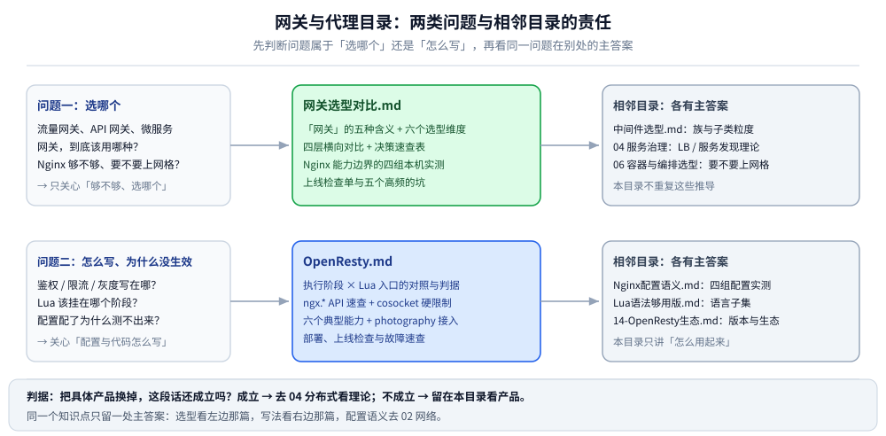

# 网关与代理

> 覆盖：入口层的三类问题——**选哪个**（流量网关 / API 网关 / 微服务网关 / K8s 入口 / 网格数据面）、**怎么写**（Nginx 原生配置、OpenResty 的 Lua 阶段）、**换成动态网关后行为怎么变**（APISIX 的路由匹配、插件顺序、限流与灰度）。本目录只放「产品怎么配、能力边界在哪、报错长什么样」。
>
> 不覆盖：负载均衡与服务发现的机制见 [04 服务治理](../../../04-架构与系统/分布式/服务治理/README.md)；中间件族的选型见 [中间件选型.md](../中间件选型.md)；`location` / `proxy_pass` / `rewrite` / `limit_req` 的配置语义见 [Nginx配置语义.md](../../../02-计算机基础/网络/代理与网关/Nginx配置语义.md)；Lua 语法见 [Lua语法够用版.md](../../../01-编程语言/lua/Lua语法够用版.md)；OpenResty 的版本与生态见 [14-OpenResty生态.md](../../../02-计算机基础/linux/深入理解Nginx/14-OpenResty生态.md)。
>
> 内容整理自个人学习笔记，素材见 [素材清单](../../../素材清单.md)。

---

## 一、这个目录回答哪两类问题？

**本节要点**：先分清「选哪个」和「怎么写」——它们的主答案在两篇不同的文件里，混着读会来回跳。

这张图只做一件事——把「问题类型 → 主答案文件」的对应关系固定下来；左右两列标出相邻目录，提醒你哪些推导不必在这里找。第三篇 [APISIX.md](APISIX.md) 是「问题二」在动态网关上的一种延伸：同样是配限流与灰度，只是配置从文件搬进了 etcd。

## 二、三篇正文怎么分工？

| 文件 | 回答什么 | 实测口径 |
|---|---|---|
| [网关选型对比.md](网关选型对比.md) | 「网关」的五种含义、六个选型维度、四层横向对比、Nginx 能力边界、L4 负载均衡器怎么选 | **四组本机实测**：reload 掉不掉长连接、不改配置换后端、`split_clients` 灰度、upstream 被动摘除 |
| [OpenResty.md](OpenResty.md) | 在 Nginx 里写 Lua：执行阶段与入口、`ngx.*` 速查、六个能力落在哪、部署与排障 | 配置行为引用 [Nginx配置语义.md](../../../02-计算机基础/网络/代理与网关/Nginx配置语义.md) 的四组读数；**Lua 代码未逐个跑通**（见该篇第九节） |
| [APISIX.md](APISIX.md) | etcd 动态网关：路由匹配五条规则、**插件 priority 与执行顺序**、限流两个插件的语义差别、多副本计数边界、认证、灰度权重、健康检查 | ✅ **APISIX 3.13.0 真跑**：两副本 + 两上游 + Redis，路由匹配、限流序列、401 文案、1000 次分流比例、停上游的延迟分布全部为原始读数 |

⚠️ 三篇的边界：**选型篇回答「能不能做、代价多大」，OpenResty 篇回答「用 Lua 怎么写」，APISIX 篇回答「换成动态网关后，规则与插件的实际行为是什么」**。同一个实测读数只在一处出现，另一处只写结论并给链接。

## 三、按问题走阅读顺序

| 你现在的状态 | 读哪几节 |
|---|---|
| 还没决定用不用网关 | [中间件选型.md](../中间件选型.md) → [网关选型对比.md](网关选型对比.md) 第一节（五种含义） |
| 决定了用 Nginx，想确认够不够 | [网关选型对比.md](网关选型对比.md) 第三节（四组能力实测）与第九节（决策速查表） |
| 要写鉴权 / 限流 / 灰度 / 聚合 | [OpenResty.md](OpenResty.md) 第二节（阶段）→ 第五～七节（六个能力） |
| 要换成动态网关（秒级改路由、插件化限流） | [APISIX.md](APISIX.md) 第一节（定位）→ 第二、三节（路由匹配与插件顺序）→ 第四节（多副本下的限流边界） |
| 配置写了却不生效 | [Nginx配置语义.md](../../../02-计算机基础/网络/代理与网关/Nginx配置语义.md) 第四节（阶段顺序） |
| 要做 L4 或混合分层 | [网关选型对比.md](网关选型对比.md) 第 3.7 节、第八节（一层还是两层） |

⭐ 阅读顺序的判据是**先定性再定量**：先确认「该由哪一层负责」（选型），再确认「这一层具体怎么配」（写法）——反过来做，往往会花大量时间调一个本不该放在网关的逻辑。

## 四、与相邻目录的边界

**本节要点**：按「**理论设计归 04、实际工具归 03**」切，本目录只保留换掉产品就作废的那部分。

| 目录 | 它回答的问题 | 主答案在哪 |
|---|---|---|
| [04 分布式 / 服务治理](../../../04-架构与系统/分布式/服务治理/README.md) | 负载均衡的分类轴与选择策略、服务发现、健康检查的判据 | 04 各零件篇（本目录只讲产品实现） |
| [02 网络 / 代理与网关](../../../02-计算机基础/网络/代理与网关/Nginx配置语义.md) | 反向代理原理、客户端真实 IP、`location` / `proxy_pass` 等配置语义 | `Nginx配置语义.md` 等篇 |
| [01 编程语言 / lua](../../../01-编程语言/lua/Lua语法够用版.md) | Lua 5.1 语言子集（`local`、table、模块、`pcall`） | `Lua语法够用版.md` |
| [06 部署 / 容器与编排选型](../../../06-工程实践/部署/容器与编排选型.md) | 要不要上服务网格、三个产品怎么选 | 该篇相关章节 |
| [02 linux / 深入理解Nginx](../../../02-计算机基础/linux/深入理解Nginx/README.md) | nginx 源码级机制、11 个处理阶段、模块开发 | 该系列 01～16 篇 |

> ⭐ 一条实操判据：在解释「**为什么这样设计**」时，多半该去 04；在解释「**怎么配**」「**报错原文是什么**」时，才是这里。

## 五、已知缺口

| 缺口 | 现状 |
|---|---|
| Kong / Higress 的产品实操 | 只在选型篇里作横向对比，没有单独篇目（APISIX 已有专篇） |
| K8s Ingress / Gateway API 的实操 | 选型篇第六节只到「怎么选」，没有配置示例 |
| L4 负载均衡的配置实操 | 选型篇 3.7 只讲转发模式与产品差异，理论在 04 |
| OpenResty 的 Lua 代码 | 未逐个跑通（镜像可用但未为每个片段搭 location 回读响应） |
| APISIX 的 standalone 模式与 Proxy 之外的形态 | 只跑过 etcd 模式（见 APISIX 篇第九节未实测表） |

## 关联

- **上游/总纲**：[中间件选型.md](../中间件选型.md) — 治理族里「网关」这一子类的定位与引入判据
- **选型**：[网关选型对比.md](网关选型对比.md) — 四层横向对比与 Nginx 能力边界四组实测
- **单技术**：[OpenResty.md](OpenResty.md) — Nginx + Lua 的阶段模型、API 与六个能力的落位
- **单技术**：[APISIX.md](APISIX.md) — 动态网关的路由匹配、插件 priority、限流边界与健康检查
- **配置语义**：[Nginx配置语义.md](../../../02-计算机基础/网络/代理与网关/Nginx配置语义.md) — 四条容易配错的语义，全部本机实测
- **理论**：[04 服务治理 README](../../../04-架构与系统/分布式/服务治理/README.md) — 负载均衡、服务发现与健康检查的机制层
- **对照/互补**：[14-OpenResty生态.md](../../../02-计算机基础/linux/深入理解Nginx/14-OpenResty生态.md) — `lua-resty-*` 生态与版本变更
