# HiveMetastore

> 覆盖：**Hive Metastore（HMS）这一个产品** —— 它存什么、三种部署形态为什么只有远程能共享、各引擎怎么接它、客户端版本为什么必须与服务端对齐，以及 Hive 4.0 把 managed 表渲染成 external 之后判断依据变成了什么。
>
> 不覆盖：HQL 怎么编译成 MR / Tez 作业、分区裁剪与分桶的实测，见 [Hive.md](../计算引擎/Hive.md)（同一个产品名的另一半）；四层怎么分工、四根接口的其他三根，见 [大数据选型对比.md](../大数据选型对比.md)；Iceberg 把元数据放在表目录里的做法，见 [Iceberg.md](../表格式/Iceberg.md)；Catalog 之上再做血缘与列级权限，见 [元数据血缘与权限治理.md](../../../04-架构与系统/系统设计/大数据平台/元数据血缘与权限治理.md)。
>
> 内容整理自个人学习笔记。本篇代码在 `dockerproxy.net/apache/hive:4.0.0`（HiveServer2 + 内嵌 Derby）与 `dockerproxy.net/apache/spark:3.5.5-scala2.12-java17-python3-ubuntu` 两个容器里真跑过，读数与报错原文见第四节至第八节。**未实测**：远程模式接外部 MySQL 的完整链路（只列了配置与命令）、Kerberos / Ranger 集成、HMS 在几十万分区下的真实瓶颈斜率。

---

## 一、一句话定位：HMS 是「表名 → 格式 + 位置」的唯一权威

**本节要点**：`Hive` 这个名字下叠着三个东西，替换成本差两个数量级。本篇只讲第一个 —— **Hive Metastore**，今天唯一还在一线的那一个。

| 身份 | 它是什么 | 今天的状态 | 换掉它要动什么 |
|---|---|---|---|
| **Hive Metastore（HMS）** | 一个 Thrift 服务，存「库 / 表 / 分区 / 列 / 存储描述」 | ⭐ 仍是一线，被 Spark、Flink、Trino、Presto 共用 | 所有引擎的 Catalog 配置，以及全部表的元数据迁移 |
| HQL 执行引擎 | 把 SQL 编成 MR 或 Tez 作业去跑 | 生产上基本被 Spark 与 Trino 取代 | 只影响还在写 HQL 作业的那部分存量，见 [Hive.md](../计算引擎/Hive.md) |
| 数仓分层规范 | `ODS → DWD → DWS → ADS` 这一套命名与建模约定 | ⭐ 已成为行业通用语言，与 Hive 无关 | 不涉及替换，它是方法论 |

⭐ **判据**：如果一个团队说「我们在用 Hive」，八成指的是**只有 HMS**。它的计算早就迁到 Spark 或 Trino 了，只是元数据还在 Hive 那里。这时的正确描述不是「用 Hive 做数仓」，而是「用 HMS 做元数据中心，用 Spark / Trino 做计算」。

⚠️ **反过来也常见**：把「我们要不要上 Hive」当成「要不要做数仓」。这两件事没有因果关系 —— 分层建模不需要 Hive，而引了 HMS 也并不意味着你要按 Hive 的方式建表。

⭐ **它在四层里的位置**：HMS 是 **Catalog 层**最主要的落地件。它不存数据、不算数据，只回答一个问题 —— 「这个表名对应哪个位置、什么格式」。这一层缺了，表名就退化成一条文件路径，换引擎得重新登记一遍。

---

## 二、核心概念：HMS 里到底存了什么

**本节要点**：HMS 是一个**元数据库**，不是文件系统，也不是计算引擎。它存四样东西：库、表、分区、以及每张表的「存储描述」。

| 对象 | 存的内容 | 容易误解的点 |
|---|---|---|
| **Database** | 库名、位置（`LOCATION`）、属性 | 库在文件系统上就是一个目录 |
| **Table** | 表名、列定义、表类型（MANAGED / EXTERNAL）、存储描述 | ⚠️ **表里不存数据，只存「数据长什么样、在哪」** |
| **Partition** | 分区键值 → 分区位置 | 分区的存在与否由 HMS 记录，不由目录存在与否决定 |
| **Storage Descriptor** | SerDe 类、InputFormat、OutputFormat、是否压缩 | ⭐ 这是「同一张表被不同引擎读出不同行为」的根源 |

⭐ **最关键的一条**：HMS 里的表**只记录「格式 + 位置」**。它不知道数据文件有几个、多大、哪个是最新版本 —— 这些都要靠「扫目录」得出。这正是后来表格式要解决的问题，也是 [Iceberg.md](../表格式/Iceberg.md) 全篇的起点。

### 2.1 分区的权威来源是元数据行，不是目录

这一条与「Hive 表分区就是目录」的印象相反，但实测很直接：手工在文件系统上建一个 `dt=2026-10-26/` 目录，`SHOW PARTITIONS` 里不会出现；反过来 `ALTER TABLE ADD PARTITION` 之后即使目录为空，分区也算存在。

```sql
-- 目录还不存在就能登记分区
ALTER TABLE orders ADD PARTITION (dt='2026-10-26');
SHOW PARTITIONS orders;
```

实测结论：`ADD PARTITION` 之后**分区目录是空的**，但 `SHOW PARTITIONS` 已经能把它列出来 —— 分区「算不算存在」由 HMS 的那一行决定，不由目录决定。

⭐ 后果有两面：**好处**是可以先登记分区再灌数（`LOAD DATA` / 外部写入的常见做法）；**坏处**是元数据与磁盘可以长期不一致，`MSCK REPAIR TABLE` 就是用来把目录反扫回元数据的补丁。

### 2.2 表格式层要补的正是这四样之外的东西

| 问题 | HMS 的答案 | 表格式的答案 |
|---|---|---|
| 这张表有哪些文件？ | 扫目录（⚠️ 目录里混着别人的文件时无法区分） | manifest 里逐条列着 |
| 现在读到的是哪个版本？ | 没有版本概念，读到的是「此刻的目录」 | 快照 ID，可指定读哪个 |
| 两个人同时写会怎样？ | 后写的覆盖先写的，无冲突检测 | 乐观锁，冲突的一方失败重试 |

这也是为什么「HMS 里登记了 Iceberg 表」仍然成立 —— HMS 只记「表名 → 当前 `metadata.json` 的路径」，剩下的交给表格式。

---

## 三、整体架构：HiveServer2 与 Metastore 是两件事

**本节要点**：Hive 对外的服务有两个，端口也不同。**把这两个混成一个，是「连不上 9083」这类问题的总根源**。

| 服务 | 默认端口 | 协议 | 谁在用 |
|---|---|---|---|
| **HiveServer2**（HS2） | `10000` | JDBC / HiveServer2 Thrift | 人用 beeline、BI 工具连它 |
| **Hive Metastore**（HMS） | `9083` | Metastore Thrift | 引擎（Spark / Flink / Trino）连它 |

两者的关系是：**HS2 依赖 HMS，但 HMS 不依赖 HS2**。所以「HMS 可以单独部署、被所有引擎共享」，而 HS2 只是个 SQL 网关。



图怎么读：中间那一行是 HMS 里真实存的一条记录（列定义 + SerDe + Location）；左边 Hive 4.0 的 `SHOW CREATE TABLE` 把它渲染成 `CREATE EXTERNAL TABLE` + `ROW FORMAT SERDE`，右边 Spark 3.5 渲染成 `USING parquet`。**两个人的输出不一样，但他们看的是同一行数据** —— 这不是 bug，是两个引擎对同一份元数据的不同翻译。

⭐ 这张图解释了 Catalog 层的全部价值：**一份元数据、多种方言渲染**。没有这一层，每个引擎都要自己存一份「表长什么样」，两份之间必然漂移。

---

## 四、部署：为什么「内嵌模式」连不上 9083

**本节要点**：HMS 有三种部署形态，只有后两种会监听 `9083`。**起了一个内嵌 HMS，然后让别的进程用 `thrift://...:9083` 连，一定失败**。

| 形态 | 元数据库 | 9083 监听？ | 能否被别的进程连 |
|---|---|---|---|
| **内嵌（Embedded）** | Derby 内嵌 | ❌ **不监听** | 不能，只有同一进程内可用 |
| **本地（Local）** | 外部 MySQL / PostgreSQL，HMS 跑在 HS2 进程内 | ⚠️ 可以配成监听 | 能，但生命周期绑在 HS2 上 |
| **远程（Remote）** | 外部 MySQL / PostgreSQL，HMS 独立进程 | ✅ 监听 | ⭐ 推荐，全平台共享 |

实测证据（`apache/hive:4.0.0`，默认 `DB_DRIVER=derby`）：

```text
容器内监听端口（/proc/net/tcp + tcp6）= [10000, 10002]
9083 在监听                           = False
HiveServer2 进程数                     = 1
Metastore 进程数                       = 0
```

也就是说：HS2 起来了、beeline 能连、`CREATE TABLE` 能建表，**但 9083 这个端口在容器里根本不存在**。因为 Derby 内嵌模式下 HMS 只是 HS2 进程内的一个对象，没有对外暴露 Thrift 服务。

⚠️ 看到 `Connection refused` 时，**先查这个端口有没有在 listen，再查账号密码**。顺序反了会白折腾一轮。

正确的共享部署（远程模式）要三步：

```properties
# hive-site.xml —— 让 HS2 与各引擎都指向同一个外部元数据库
javax.jdo.option.ConnectionURL=jdbc:mysql://mysql:3306/hive_metastore?useSSL=false
javax.jdo.option.ConnectionDriverName=com.mysql.cj.jdbc.Driver
hive.metastore.uris=thrift://hms:9083
```

```bash
# 1. 先初始化外部库的表结构（只做一次）
schematool -dbType mysql -initSchema

# 2. 独立起 Metastore 服务（这一步才监听 9083）
hive --service metastore &

# 3. 引擎侧指向它
#    Spark:  spark.hadoop.hive.metastore.uris=thrift://hms:9083
#    Trino:  hive.metastore.uri=thrift://hms:9083
```

⭐ **一句话判据**：**只要你想让第二个进程看到表，就必须用远程模式**。内嵌模式不是「配置不全」，它是设计上就不对外。

---

## 五、使用一：把 HMS 当全平台共享的元数据服务

**本节要点**：HMS 最大的价值是「一个引擎建表，所有引擎立刻能看见」。但要享受这个价值，前提是**所有引擎连的是同一个远程 HMS**，不是各自的内嵌 Derby。

### 5.1 各引擎的接法

| 引擎 | 配置项 | 只设一项会怎样 |
|---|---|---|
| **Spark** | `spark.sql.catalogImplementation=hive`<br>`spark.hadoop.hive.metastore.uris=thrift://hms:9083` | 只设 `uris` 不设 `catalogImplementation`，仍然走 Spark 自己的内存 Catalog，看不到 Hive 表 |
| **Flink** | catalog 定义里的 `hive-conf-dir` | 不指 `hive-conf-dir` 就找不到 `hive-site.xml`，回落到内存 Catalog |
| **Trino** | `etc/catalog/hive.properties` 的 `hive.metastore.uri` | 没有这个文件就没有 `hive` catalog，`SHOW SCHEMAS FROM hive` 直接报 catalog 不存在 |

### 5.2 共享的验证方式：在 A 里建，在 B 里查

不要用「配置项写了」判断接上了，要用**跨进程可见性**判断：在 Hive 侧建一张表，到 Spark 侧 `SHOW TABLES` 能不能看到；再看 `DESCRIBE FORMATTED` 的 `Table Type` / `Serde Library` / `Location` 三项是否齐全。

⚠️ 如果 Spark 侧 `SHOW TABLES` 是空的，先看 `spark.sql.hive.metastore.uris` 是否非空 —— 空值意味着它跑在内嵌模式，看到的是自己的 Derby，与 HMS 无关。

⚠️ **这一条本轮没验**：两个容器各起各的内嵌 Derby，没有搭出「多个进程连同一个远程 HMS」的链路。所以这里是**判据**，不是读数。

---

## 六、使用二：客户端版本要跟服务端主版本对齐

**本节要点**：Spark 3.5.5 默认用的是**内置的 Hive 2.3.9 Metastore 客户端**，而很多新集群的 HMS 是 4.x。这条不报错，只会让你「读不到某个属性」。

```text
spark.sql.hive.metastore.version  = 2.3.9
spark.sql.hive.metastore.jars     = builtin
```

⚠️ 后果：用一个 2.3.9 的客户端连 Hive 4.0 的 Metastore，**协议层可能兼容、但新版本加的字段读不到**（典型是 Hive 4 的 `TRANSLATED_TO_EXTERNAL`、Iceberg 相关属性）。表现不是报错，而是「明明设了属性，`SHOW TBLPROPERTIES` 里没有」。

要连 4.0 的 HMS，必须显式改：

```properties
spark.sql.hive.metastore.version = 4.0.0
spark.sql.hive.metastore.jars    = path          # 或 maven
spark.sql.hive.metastore.jars.path = file:///opt/hive/lib/*
```

⭐ 判据：**HMS 客户端版本要与服务端主版本对齐**。排查顺序也要放在前面 —— 「为什么某个属性读不到」这类问题，八成的答案是客户端版本，不是权限。

---

## 七、使用三：Hive 4.0 之后，表类型不再可靠

**本节要点**：这是 Hive 4.0 最容易让人误判的一处变化，而且它改的是**元数据的表达**，所以挂在 Catalog 这一层讲。**建的是普通表，读出来是 `EXTERNAL_TABLE`**。

实测：用 `CREATE TABLE`（不写 `EXTERNAL`）建表，`SHOW CREATE TABLE` 给出的是：

```text
CREATE EXTERNAL TABLE `orders`(...)
TBLPROPERTIES (
  'TRANSLATED_TO_EXTERNAL'='TRUE',
  'external.table.purge'='TRUE',
  ...)
```

两个属性一起出现：`TRANSLATED_TO_EXTERNAL=TRUE` 说明这是一次**自动转换**，`external.table.purge=TRUE` 说明**删除时仍会清数据**（保留了 managed 表的语义）。

⚠️ 为什么要注意：很多运维脚本靠「`Table Type` 是不是 `MANAGED`」来决定 `DROP TABLE` 要不要备份。Hive 4.0 之后这个判断全部失效 —— 所有表都是 `EXTERNAL_TABLE`。**正确的判断依据是 `external.table.purge` 这个属性，不是表类型**。

```bash
# 判断「删表要不要连数据一起删」的正确查法
beeline -e "SHOW TBLPROPERTIES db.tbl('external.table.purge');"
```

⭐ 一条通用规律：**当元数据的「表达形式」变了，所有基于表达形式的脚本都要重新验一遍**。表类型是表达形式，`purge` 属性才是语义。

---

## 八、验证与排查

**本节要点**：先确认「连的是哪个 HMS」，再查表本身。顺序反了会把配置问题当成数据问题。

### 8.1 三段确认

```bash
# 1. 确认端口在监听（9083 是 HMS，10000 是 HS2）
docker exec <容器> cat /proc/net/tcp /proc/net/tcp6 | awk '$4=="0A"'

# 2. 确认你连的是远程 HMS 而不是内嵌 Derby
spark-sql -e "set spark.sql.hive.metastore.uris; set spark.sql.hive.metastore.version; set spark.sql.hive.metastore.jars;"
#    uris 为空 + jars=builtin  → 内嵌模式，看不到别的进程建的表

# 3. 确认表类型与存储描述
beeline -e "DESCRIBE FORMATTED db.tbl;" | grep -E "Table Type|Serde Library|Location"
```

### 8.2 故障速查

| 症状 | 先查什么 |
|---|---|
| `Connection refused` 连 9083 | ⭐ 端口有没有 listen（内嵌模式不监听），再查防火墙，最后才查认证 |
| Spark 看不到 Hive 里建的表 | `spark.sql.catalogImplementation` 是否为 `hive`、`metastore.uris` 是否非空 |
| 设了属性但 `SHOW TBLPROPERTIES` 读不到 | ⭐ 客户端版本低于服务端（`spark.sql.hive.metastore.version`） |
| `DROP TABLE` 后数据还在 / 数据没了 | ⭐ Hive 4.0 看 `external.table.purge`，不看 `Table Type` |
| 表能列出来但读 404 | `LOCATION` 是绝对路径；换环境后 `warehouse` 根变了 |
| `SHOW PARTITIONS` 少了几个分区 | 目录有、元数据没有；`MSCK REPAIR TABLE` 反扫补齐 |

### 8.3 元数据自己也会成瓶颈

HMS 要为每个分区存一行记录。分区到几十万量级时，`SHOW PARTITIONS`、HS2 编译 SQL、甚至 `DROP TABLE` 都会明显变慢 —— **瓶颈在元数据库（以及 HS2 的 compiler），不在文件系统**。

⭐ 这是后来表格式把「分区清单」从数据库行搬到元数据文件（manifest）的动因之一：读清单比查几十万行 SQL 便宜。但它也不是免费的 —— manifest 会越积越多，要靠 compaction 合。

---

## 九、校验口径

> ✅ 本篇代码的校验方式与范围（`apache/hive:4.0.0` + `apache/spark:3.5.5`，两个容器）：

- **真跑，容器内实测**：第四节的内嵌模式端口与进程读数（`[10000, 10002]`、9083 不在监听、Metastore 进程 0 个）、第六节的 `metastore.version=2.3.9` 读数、第七节的 `TRANSLATED_TO_EXTERNAL` 与 `external.table.purge`、第二节 2.1 的 `ADD PARTITION` 与 `SHOW PARTITIONS` 对照。
- **未实测**：远程模式接外部 MySQL 的完整链路（第四节只给配置与命令，未起 MySQL）、第五 5.2 的跨进程可见性（两容器各起内嵌 Derby，没搭共享链路）、Kerberos、Ranger、Sentry 集成、HMS 在几十万分区下的真实瓶颈斜率（8.3 只给机制判断，无读数）、Iceberg REST Catalog 与 Nessie 的对照（本篇只讲 HMS）。
- **命令的可复现性**：两个容器的启动参数与脚本在 `.workbuddy/tmp/bigdata-lab/`（不入库）；`docker rm` 后环境不残留。

| 依赖 | 实际版本 |
|---|---|
| Hive | `apache/hive:4.0.0`（HiveServer2 + 内嵌 Derby） |
| Spark | `apache/spark:3.5.5-scala2.12-java17-python3-ubuntu` |
| Spark 内置 Hive Metastore 客户端 | 2.3.9（`builtin`） |
| Java | 17.0.14（Spark 容器） |
| 元数据库 | Derby 内嵌（`jdbc:derby:;databaseName=metastore_db;create=true`） |

---

## 延伸追问

- **既然计算都迁到 Spark 了，为什么还留着 Hive？** → 因为 HMS 是「表名 → 位置 + 格式」的唯一权威。删掉它，每张表就退化成一条文件路径，换引擎就得重新登记一遍。留着 Hive 的成本只是「多一个 Thrift 服务 + 一个元数据库」。
- **HMS 能不能被 Iceberg 取代？** → 不能直接取代，但可以换。Iceberg REST Catalog 与 Nessie 都在做同一件事（表名 → 元数据位置），HMS 也可以登记 Iceberg 表（把 `provider` 设成 `iceberg`）。选谁取决于**要不要跨引擎共享**和**要不要分支版本化**，见 [大数据选型对比.md](../大数据选型对比.md) 第三节。
- **为什么 Hive 表被删了数据还在？** → 因为 `EXTERNAL_TABLE` 只删元数据。Hive 4.0 之后所有表都是 `EXTERNAL_TABLE`，所以这个问题会变得频繁 —— 看 `external.table.purge` 而不是看表类型。
- **HMS 能不能换成数据库自带的元数据？** → 可以，但那就回到「每个引擎一套元数据」的老路。Catalog 这一层之所以要独立出来，核心就是**一份元数据被多个引擎共用**；只要只有一个引擎，Catalog 确实可以省。
- **为什么分区多了要换表格式，而不是给 HMS 加机器？** → 加机器解决的是并发，不解决「每次查询都要把几十万行分区记录捞一遍」。表格式把分区信息编进了 manifest 的列级统计，裁剪在文件层完成，绕开了这个量级问题。

---

## 关联

- **上游/总纲**：[大数据选型对比.md](../大数据选型对比.md) — 四层分工与「引擎 → Catalog」那根接口的配置项
- **对照/互补**：[Iceberg.md](../表格式/Iceberg.md) — 同样一张表，元数据放在 HMS（表外）与放在表目录（表内）的两种做法；这是表格式这一层存在的理由
- **对照/互补**：[HDFS.md](../文件系统/HDFS.md) — `LOCATION` 指向的就是文件系统上的一个目录；HMS 只记路径，不管字节怎么摆
- **下游机制**：[Hive.md](../计算引擎/Hive.md) — 同一个产品名的另一半：HQL 编译与执行、分区裁剪与分桶的实测
- **运维/配置**：[元数据血缘与权限治理.md](../../../04-架构与系统/系统设计/大数据平台/元数据血缘与权限治理.md) — Catalog 之上再做血缘与列级权限
- **素材来源**：[素材清单.md](../../../素材清单.md) — 素材来源登记

> 反向引用（本篇被下列文档引到）：[大数据选型对比.md](../大数据选型对比.md)、[Iceberg.md](../表格式/Iceberg.md)、[HDFS.md](../文件系统/HDFS.md)、[Hive.md](../计算引擎/Hive.md)
