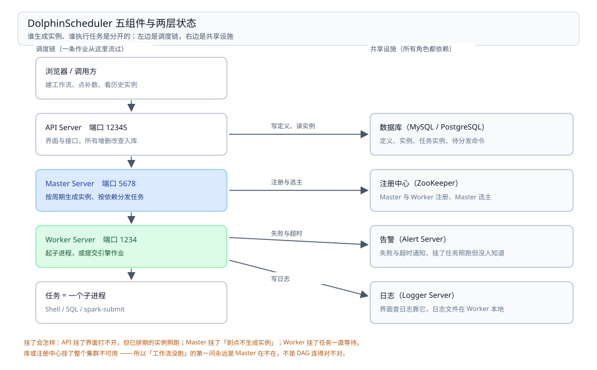

# DolphinScheduler

> 覆盖：DolphinScheduler 在作业编排这一层里的真实身份——它把「一批有依赖的任务」变成**每天一个实例**，并且记得每个实例跑到哪；五组件各管一段、三层模型（工作流定义 / 实例 / 任务实例）怎么对应、时间参数与内置参数取的是**调度日期而不是当前时间**、补数为什么必须串行或限并发、实例没跑 / 任务卡住 / 补数写重了按什么顺序查。
>
> 不覆盖：它与其他编排器怎么选、「逻辑时间」这条分水岭见 [作业编排选型对比.md](作业编排选型对比.md)；七层职责见 [大数据选型对比.md](../大数据选型对比.md)；**这条批链路怎么切 DAG、补数四条纪律**见 [Spark批处理与调度.md](../../../04-架构与系统/系统设计/大数据平台/Spark批处理与调度.md)；**业务定时任务**见 [xxl-job.md](../../中间件/任务调度/xxl-job.md)。
>
> 内容整理自个人学习笔记，并参考 DolphinScheduler 官方文档。⚠️ **本篇没有任何本机读数**——本机没有长期运行的调度环境，而编排器的行为（补数、重跑、漏跑、Master 切换）**只有跑上几天才看得出来**，几小时的实验只能证明「能启动」，证明不了「编排对不对」，按纪律不写。文中组件名、端口、参数名按 3.x 陈述，**未在本机核对**，以现场 `conf/` 与官方文档为准。

---

## 一、一句话定位：把「一批任务」变成「每天一个实例」

**本节要点**：DolphinScheduler 的分水岭不是「能不能拖拽建图」，而是**它把「工作流」和「某一天的工作流」分成了两个东西**——前者是模板，后者是实例。补数、重跑、查历史，全都建在这个区分上。

| 它做的事 | 意味着什么 |
| --- | --- |
| 按调度周期为每个逻辑时间创建一个**工作流实例** | ⭐ 「昨天跑成功了吗」有地方可查 |
| 按 DAG 放行任务，记录每个**任务实例**的状态与日志 | 失败能定位到「哪一天、哪个节点」 |
| 补数 = 按日期区间批量创建实例 | ⭐ 重跑的单位是「一天」，不是一个动作 |
| 任务只负责「提交 / 执行」，算在外部引擎 | 它不搬数据、不算数据 |

⭐ 三条推论：

1. **没有逻辑时间就没有补数**——这是它与业务定时器最本质的区别；
2. **实例状态在库里**，所以「跑过没」不靠日志猜，靠查表；
3. **它的执行体是 Worker，不是容器**——任务在 Worker 进程里拉起子进程（Shell / SQL / `spark-submit`），所以 Worker 的环境就是任务的环境。

⚠️ 常见误判：把它当成「带界面的 crontab」。crontab 只知道「到点了」，不知道「这是哪一天的数据」；DolphinScheduler 的三层模型与补数能力，全是围绕「哪一天」建的。

## 二、核心概念：五对象与三个参数族

**本节要点**：对象只有五个，但**参数有三族且优先级不同**——时间参数、全局参数、任务局部参数，搞错优先级会出现「补数时参数还是今天」。

| 对象 | 是什么 | 排查时的意义 |
| --- | --- | --- |
| 工作流定义（工作流模板） | DAG 的形状：有哪些任务、谁依赖谁 | 改这里影响**以后**的所有实例，不影响已生成的 |
| 工作流实例 | 某个逻辑时间上的一次运行 | ⭐ 「昨天跑了没」查这一层 |
| 任务实例 | 实例里的一个节点 | 失败日志、重试次数在这一层 |
| 租户（tenant） | 任务以哪个 Linux 用户执行 | ⚠️ HDFS 权限不对，多半是租户配错 |
| Worker 分组 / 环境 | 任务落在哪批 Worker、用哪套环境变量 | 引擎命令找不到，先查环境 |

| 参数族 | 写法示例 | 作用域 | 取的是 |
| --- | --- | --- | --- |
| ⭐ 时间参数 | `$[yyyyMMdd-1]` | 任务内 | **调度日期**（不是 `now()`） |
| 内置参数 | `${system.biz.date}` 一类 | 任务内 | 调度日期，格式由系统给定 |
| 全局参数 | 工作流级定义，任务里引用 | 整个工作流 | 定义时的值，补数时随实例 |
| 局部参数 | 任务级定义 | 单个任务 | 覆盖全局同名参数 |

⭐ **时间参数是这一层最该背下来的东西**：它按**调度日期**渲染，不是按运行时刻。10 月 26 日补 10 月 20 日的数，`$[yyyyMMdd-1]` 在整个补数批次里渲染成 `20261019`，而不是 `20261025`——这正是补数能对的原因，也是「手工传参」永远做不对的原因。

⚠️ 优先级：**局部 > 全局 > 内置**。所以补数时参数没变，第一件事是查任务里有没有写死一个局部参数。

## 三、整体架构：五个进程、一个注册中心、一个库

**本节要点**：它不是一个单体——**API、Master、Worker、Alert、Logger 是五个可以分开部署的进程**，靠注册中心选主、靠数据库共享状态。



图要读出的是**「谁生成实例、谁执行任务」是分开的**：Master 只负责「到点了，创建实例、按依赖发任务」，Worker 只负责「拿到任务，起一个子进程跑」。所以「工作流没跑」查 Master，「任务卡住」查 Worker 与队列。

| 组件 | 职责 | 挂了会怎样 |
| --- | --- | --- |
| API Server | 界面与接口，所有增删改查入库 | 界面打不开，但**已排期的实例照跑** |
| Master Server | ⭐ 按调度周期生成实例、按依赖分发任务 | 到点不生成实例；多 Master 靠注册中心选主 |
| Worker Server | ⭐ 执行任务（起子进程 / 提交引擎作业） | 任务一直排队，状态停在「等待」 |
| Alert Server | 发告警（邮件 / 钉钉 / 企微等） | 任务照跑，失败没人知道 |
| Logger Server | 日志查询服务 | 界面看不到日志，日志文件仍在 Worker 本地 |
| 注册中心（ZooKeeper） | Master / Worker 注册与选主 | ⚠️ 整个集群不可用 |
| 数据库 | 工作流定义、实例、任务实例、队列命令 | ⚠️ 整个集群不可用 |

三层状态落在哪里，是排查的入口：

| 层 | 落在哪 | 典型问题 |
| --- | --- | --- |
| 定义 | 库里的工作流定义表 | 改了模板，历史实例不变 |
| ⭐ 实例 | 库里的实例表（工作流实例 / 任务实例） | 「昨天跑了没」查这里 |
| 运行态 | 注册中心（谁在线）+ 库里的命令队列 | 「任务为什么一直等待」查这里 |

## 四、部署：最小可运行配置与启动检查

**本节要点**：单机版（standalone）把五个角色装进一个进程、元数据落内嵌库，**能验证「编排逻辑对不对」，不能验证「高可用」**。生产必须是 Master / Worker 分开 + 外部库 + 注册中心。

单机版起法（3.x）：

```bash
# 依赖：JDK 8+；单机版自带内嵌元数据库，不需要外部 MySQL
cd apache-dolphinscheduler-*-bin
./bin/dolphinscheduler-daemon.sh start standalone-server

# 环境变量集中在 conf/dolphinscheduler_env.sh：
# JAVA_HOME、以及各引擎的 PATH（spark-submit / hive / flink 都在这里配）
```

分布式部署要改的只有三处（`conf/` 下）：

```properties
# 1) 元数据库：换成 MySQL / PostgreSQL（单机版是内嵌 H2，数据在本地文件里）
spring.datasource.url=jdbc:mysql://mysql:3306/dolphinscheduler
spring.datasource.username=ds
spring.datasource.password=***

# 2) 注册中心：ZooKeeper
registry.plugin.name=zookeeper
registry.plugin.zookeeper.quorum=zk1:2181,zk2:2181,zk3:2181

# 3) 各角色的监听端口（默认值，冲突时才改）
master.listen.port=5678
worker.listen.port=1234
server.port=12345
```

启动检查按四层往下查，任一层不过就不用往下走：

| 层 | 怎么查 | 通过的标准 |
| --- | --- | --- |
| 库 | `mysql -e "select count(*) from t_ds_process_definition"` | 表已建（`install.sh` 建表成功） |
| 注册中心 | 用 `zkCli` 列节点 | 能看到 master / worker 的临时节点 |
| 进程 | `ps -ef \| grep -E "MasterServer\|WorkerServer\|ApiServer"` | 三个进程都在 |
| 接口 | 浏览器打开 `http://<api>:12345/dolphinscheduler/ui` | 能登录，首页有项目 |

⚠️ 最常见的部署坑不是端口，而是**`dolphinscheduler_env.sh` 里的引擎路径没配**：界面正常、工作流能建，一到提交 `spark-submit` 就报「command not found」。第四条检查之后必须再跑一个 **Shell 任务 `echo $PATH`**，确认 Worker 看到的环境与登录 shell 一致。

## 五、使用一：定义一个最小工作流

**本节要点**：最小闭环是「两个任务 + 一条依赖」——先 Shell 造数据，再 SQL 校验。跑通之后再谈补数与告警。

在界面上建一个工作流，拖两个节点：

| 节点 | 类型 | 内容 |
| --- | --- | --- |
| `gen` | Shell | 调外部脚本产出当天分区（`dt=$[yyyyMMdd-1]`） |
| `check` | SQL | 查产出的行数，为 0 则失败 |

任务之间的连线就是依赖：`gen` 成功才放行 `check`。对应的库内对象（排查时用得上）：

| 界面上的东西 | 库里对应 | 说明 |
| --- | --- | --- |
| 工作流定义 | `t_ds_process_definition` | 存 DAG 的 JSON 与调度周期 |
| 一次运行 | `t_ds_process_instance` | 每个逻辑时间一条，带状态 |
| 一个节点的一次运行 | `t_ds_task_instance` | 失败与重试看这一层 |
| 待分发的任务 | `t_ds_command` | ⚠️ 任务「一直等待」时看这里有没有堆积 |

⭐ 表名沿用旧称（工作流在早期版本叫「流程」），**3.2 之后界面用词变了、表名没变**。查库时按表名找，别按界面用词找。

跑通之后要确认三件事：

| 要确认的 | 怎么看 | 正常形态 |
| --- | --- | --- |
| 实例生成了吗 | 工作流实例列表 | 有一条「成功」，逻辑时间 = 昨天 |
| 参数渲染对吗 | 任务实例的日志开头 | 日志里出现的是 `20261025`，不是 `20261026` |
| 依赖真的生效了吗 | 两个任务的开始时间 | `check` 的开始时间晚于 `gen` 的结束时间 |

⚠️ 第三条最容易被跳过：**依赖连了不等于生效**。如果两个任务几乎同时开始，说明依赖没连上（或连错了方向），此时「看起来成功」只是因为 `check` 恰好没查到问题。

## 六、使用二：参数与时间表达式

**本节要点**：时间参数是**按调度日期渲染**的，不是按运行时刻。这一条决定了补数能不能对，也决定了「补昨天的数却读到今天的分区」这类事故会不会发生。

| 写法 | 含义 | 补 10-20 的数据时渲染成 |
| --- | --- | --- |
| `$[yyyyMMdd]` | 调度日期当天 | `20261020` |
| `$[yyyyMMdd-1]` | 调度日期前一天 | `20261019` |
| `$[yyyyMM-1]` | 上一月 | `202609` |
| `$[HHmmss]` | 时分秒 | 该实例的调度时刻 |
| `${system.biz.date}` 一类 | 内置业务日期 | 由系统按调度日期给定 |

⭐ **最常用的组合是「跑昨天」**：调度周期设成每天凌晨，任务里用 `$[yyyyMMdd-1]`。这样「今天凌晨跑的」与「补 10 月 20 日的」用的是同一套参数，只是调度日期不同。

三族参数的关系：

```text
内置参数（system.*）   ← 系统按调度日期给，任务里可直接引用
     ↑ 可被覆盖
全局参数（工作流级）   ← 定义时固定，补数时随实例带过去
     ↑ 可被覆盖
局部参数（任务级）     ← ⚠️ 优先级最高，补数不生效多半是这里写死了
```

⚠️ 两个必踩的坑：

- **在 SQL 里写 `current_date`**：补数时它永远返回「今天」，与调度日期无关。必须改成参数化（`dt = '$[yyyyMMdd-1]'`）；
- **局部参数把全局参数盖住**：改了全局参数却「补数还是旧值」，去任务级查同名局部参数。

## 七、使用三：补数、重跑与失败策略

**本节要点**：补数就是**按日期区间批量创建实例**；三种重跑（补数 / 重跑失败 / 从失败处继续）**影响的范围完全不同**，混用会写重数据。

| 操作 | 做了什么 | 影响范围 | 什么时候用 |
| --- | --- | --- | --- |
| ⭐ 补数 | 按区间为每个调度日期创建一个实例 | 整个工作流，多天 | 历史区间漏跑 |
| 重跑 | 把已有实例重置为「等待」，重新跑一遍 | 整个工作流，一天 | 某天整体失败 |
| 从失败处继续 | 只重跑失败及其下游节点 | 工作流内部分任务 | 前面已成功、不想重算 |

⚠️ **补数的并行开关是这一层最危险的一个按钮**：并行补 10 天时，10 个实例同时跑，下游可能读到上游还没写完的分区。选并行必须满足两个前提——**每份任务只读写自己那天的分区**、**写入是幂等的**。否则串行，慢但不会错。

失败策略分三级，配在哪一级决定「谁兜底」：

| 级别 | 配什么 | 典型值 |
| --- | --- | --- |
| 任务级 | 重试次数、重试间隔 | 3 次 / 5 分钟（⚠️ 只对**可重试的失败**有意义，参数错误重试 100 次也没用） |
| 任务级 | 超时告警 / 超时失败 | 超时失败比告警更该配，否则卡死的任务会占着 Worker |
| 工作流级 | 失败策略（继续 / 结束） | 默认结束；分支互不相关时可继续 |

⭐ 配超时的经验判据：**按正常耗时的 2~3 倍设**。设成 24 小时等于没设——那已经是下一个调度周期了，两个实例会撞在一起。

## 八、验证与排查：三张表

**本节要点**：排查必须分清「实例没生成」「任务没分发」「任务跑失败」三段——它们的入口分别是 Master 日志、库里的命令队列、任务实例日志。

### 8.1 先确认系统在正常工作

| 要确认的事 | 怎么查 | 正常形态 |
| --- | --- | --- |
| 工作流**上线**了吗 | 工作流定义列表的状态列 | ⚠️ 必须「上线」，草稿状态不会排期 |
| 调度周期对吗 | 定义里的 cron | 与预期一致，且时区正确 |
| Master 在吗 | 注册中心节点 / Master 进程 | 至少一个在线 |
| Worker 在吗 | 注册中心节点 / Worker 进程 | 至少一个在线且在目标分组里 |
| 实例生成过吗 | 工作流实例列表 | 有对应逻辑时间的记录 |

⚠️ 排在第一行的「上线」是最常见的「工作流不跑」原因：**建好了、没上线、永远不会排期**。它不报错，只是什么都不发生。

### 8.2 故障速查：实例层

| 症状 | 先查什么 |
| --- | --- |
| 到点了没有任何实例 | ⚠️ 工作流是否「上线」；调度周期与生效时间；Master 是否在线 |
| 有实例，但状态一直「等待」 | Worker 是否在线、任务是否落在不存在的 Worker 分组 |
| 实例创建了又立刻失败 | 定义里的参数解析失败（引用了不存在的参数名） |
| 补数跑了一部分就停了 | 串行补数时中间某天失败，后面全部没跑（看是否配了「失败继续」） |
| 同一个逻辑时间有两个实例 | 手工重跑与调度撞车，或补数区间包含了已调度的日期 |

### 8.3 故障速查：任务层

| 症状 | 先查什么 |
| --- | --- |
| `command not found` | `dolphinscheduler_env.sh` 里引擎路径没配（第四节） |
| 任务报权限错误（HDFS / 本地目录） | ⚠️ 租户配错，任务以错误的 Linux 用户执行 |
| SQL 任务连不上库 | 数据源配在「数据源中心」，不是任务参数里 |
| 任务超时被杀 | 超时阈值太小，或任务确实卡住（看 Worker 上的子进程） |
| 日志在界面上打不开 | Logger 服务不可用，去 Worker 本地日志目录找 |
| 任务成功但数据不对 | 参数渲染错（第六节）——**先看日志开头的日期，再查 SQL** |

### 8.4 排查顺序

1. 工作流上线了吗、周期对吗 —— 决定「该不该有实例」；
2. 实例生成了吗 —— 决定是 Master 侧还是 Worker 侧；
3. 任务是「等待」还是「失败」—— 等待查分发与 Worker，失败查日志；
4. 看日志开头的**参数渲染结果** —— 日期对不对，比 SQL 写没写对更常见；
5. 最后才看 SQL / 脚本本身。

⭐ 第 4 步是本篇最想强调的一条：**编排器上的错误，八成不是代码错误，是参数错误。** 而参数错误在界面上看不出来，只在日志开头那一行。

## 九、校验口径

> ✅ **本篇没有任何本机读数**（本机无长期运行的调度环境）：

- **未实测，原因**：编排器的核心行为——按周期生成实例、补数、重跑、Master 选主、失败重试——**需要跨多个调度周期才可观测**。起一个容器跑几小时只能证明「能启动、能跑一个工作流」，证明不了「编排逻辑对」，而这正是本篇的内容，按纪律不写读数。
- **组件名、端口、配置项**：按 3.x 陈述（`master.listen.port=5678`、`worker.listen.port=1234`、`server.port=12345`、`registry.plugin.name=zookeeper`），**未在本机核对**，以现场 `conf/` 为准。
- **表名**（`t_ds_process_definition` / `t_ds_process_instance` / `t_ds_task_instance` / `t_ds_command`）：按既有版本陈述，**未验证 3.2+ 是否改名**；界面用词已从「流程」改为「工作流」，**表名未变**是推断，需现场核对。
- **时间参数**（`$[yyyyMMdd-1]`、`$[yyyyMM-1]`）：写法按官方文档陈述，**未实测渲染结果**；`${system.biz.date}` 一类内置参数的确切格式**未逐一核对**，本篇只断言「取的是调度日期」这一点。
- **单机版起法**（`dolphinscheduler-daemon.sh start standalone-server`）：⚠️ **未执行**，3.x 各小版本可能不同。
- **补数并行与串行的行为差异**：按「并行会产生多实例并发」推导，**未实测**。
- **`t_ds_command` 堆积与「任务一直等待」的因果关系**：按架构推导，**未在本机复现**。

| 依赖 | 状态 |
| --- | --- |
| JDK 8+ | 本机有，但未部署 DS |
| MySQL / PostgreSQL | 未部署 |
| ZooKeeper | 未部署 |
| DolphinScheduler 本体 | 未部署 |
| 外部引擎（Spark / Hive） | 未接 |

## 延伸追问

- **它和 Airflow 最本质的差别是什么？** → DAG 存在哪、谁能改。DS 存在库里、界面上改，业务同学能自己动手，代价是**改了什么没人知道**（要导出 JSON 进 Git 才可追溯）；Airflow 存在代码仓库，能 review 能回滚，代价是改一次要发版。这不是功能差异，是**协作模式**的差异，选型时按团队决定。
- **为什么补数要按「调度日期」而不是「执行时刻」渲染参数？** → 因为补数的目的是「把那天该产出的数据产出来」。如果参数跟着执行时刻走，补 20 号的数据就会读到今天的源表，产出一个错的分区。**参数必须由逻辑时间决定，这是幂等的前提。**
- **Master 挂了会怎样？** → 已生成的实例状态在库里，不会丢；但「到点创建实例」这件事会停，直到另一个 Master 选主成功。所以 Master 的高可用不是「性能问题」，是**「会不会漏掉一个调度周期」**的问题。
- **任务能跑在 Kubernetes 上吗？** → 它自己不是 K8s 原生调度器，任务是通过 Worker 起的子进程。想跑在 K8s 上，常见做法是 Worker 部署在 K8s 里、任务以 `kubectl` 或引擎自身的 K8s 提交方式执行——**资源层换成 K8s，编排层仍是 DS**，两者不冲突（见 [资源调度选型对比.md](../资源调度/资源调度选型对比.md)）。
- **工作流定义能进 Git 吗？** → 可以但要自己做：界面支持导出 JSON，导出后提交到仓库，改的时候导入。⚠️ 它不像 Airflow 那样天然是代码，**两边同时改会冲突且没有合并能力**，这是它最大的工程短板。

## 关联

- **上游/总纲**：[作业编排选型对比.md](作业编排选型对比.md) — 五个候选的分水岭（逻辑时间）与判据表
- **上游/总纲**：[大数据选型对比.md](../大数据选型对比.md) — 七层职责与本目录在其中的位置
- **对照/互补**：[资源调度选型对比.md](../资源调度/资源调度选型对比.md) — 编排决定「什么时候跑」，资源层决定「跑在哪」
- **对照/互补**：[xxl-job.md](../../中间件/任务调度/xxl-job.md) — 业务定时器：没有逻辑时间、没有补数
- **对照/互补**：[Spark批处理与调度.md](../../../04-架构与系统/系统设计/大数据平台/Spark批处理与调度.md) — 这条链路的 DAG 粒度与补数四条纪律
- **下游机制**：[计算引擎选型对比.md](../计算引擎/计算引擎选型对比.md) — 它调起的那个作业，算在谁那里
