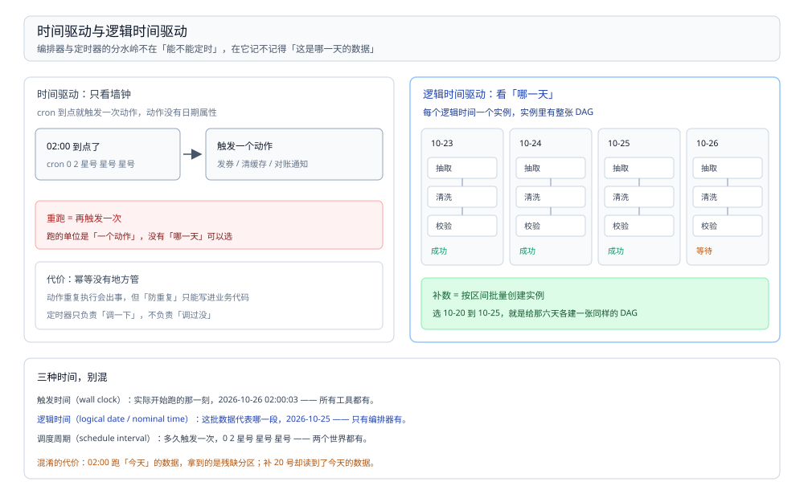

# 作业编排选型对比

> 覆盖：本目录的**总纲兼导读**。任务「什么时候跑、按什么顺序跑、跑失败了从哪重来」这一层里，五个候选——DolphinScheduler、Airflow、XXL-JOB、Oozie、Azkaban——按**有没有「逻辑时间」这个概念**这条分水岭怎么分；三种时间概念怎么区分、跨系统依赖靠什么判定、「重跑某一天」五种做法、编排器与计算引擎的边界。本篇同时承担本目录的入口：**本目录不设目录级 `README.md`**。
>
> 不覆盖：七层职责怎么分见 [大数据选型对比.md](../大数据选型对比.md)；DolphinScheduler 的组件、部署、时间参数与补数操作见 [DolphinScheduler.md](DolphinScheduler.md)；**这条批链路怎么切 DAG、补数四条纪律、选哪个调度器**见 [Spark批处理与调度.md](../../../04-架构与系统/系统设计/大数据平台/Spark批处理与调度.md)（那里是「我这条链路怎么摆」，这里是机制与选型）；**业务定时任务**（跑业务方法、不跑数据）见 [xxl-job.md](../../中间件/任务调度/xxl-job.md)；**数据怎么定时同步进来**见 [定时同步/README.md](../../数据存储/数据同步/定时同步/README.md)。
>
> 内容整理自个人学习笔记，并参考各家官方文档。⚠️ **本篇没有任何本机读数**——本机没有长期运行的调度环境，而编排器的价值恰恰是「跑上几个月之后的补数、重跑、漏跑」，几小时的实验观测不到。文中配置与命令为**形状示例**，**未在本仓运行**，版本行为以官方文档为准。

---

## 一、这五款的分水岭在哪？

**本节要点**：不看「能不能定时触发」，看**它有没有「这批数据代表哪一天」这个概念**。这一个问题决定它能不能补数、能不能重跑、能不能回答「昨天的任务到底跑成功没有」。

| 分水岭 | DolphinScheduler | Airflow | XXL-JOB | Oozie | Azkaban |
| --- | --- | --- | --- | --- | --- |
| 有没有逻辑时间 | ⭐ 有（调度日期 + 补数区间） | ⭐ 有（`logical_date` / data interval） | ⚠️ **没有**，只有触发时刻 | ⭐ 有（nominal time） | 没有 |
| 依赖靠什么判定 | 工作流内的任务依赖 + 跨工作流依赖 | 任务状态 + Sensor / Dataset | 只有「子任务」，成功后串一个 | 工作流内的控制节点 + coordinator | 工作流内的 `dependsOn` |
| DAG 怎么写 | Web 可视化拖拽 | ⭐ **Python 代码**（DAG 文件） | 控制台配 Cron + 子任务 | XML（`workflow.xml`） | ZIP 里的 `.job` 文件 |
| 状态存哪 | 关系库（MySQL / PostgreSQL）+ 注册中心存 Master 选举 | 元数据库（PostgreSQL / MySQL） | 调度中心的库 | 关系库 + HDFS | 关系库 |
| 补数怎么做 | ⭐ 内置「补数」（选日期区间） | `backfill`（按 data interval 逐段） | 没有这个概念 | `coordinator -rerun` 指定 nominal time | 没有 |
| 现状 | 活跃，国产，中文文档最好 | 活跃，生态最大 | 活跃，国内业务系统常用 | ⚠️ 多年不活跃，随 Hadoop 生态淡出 | ⚠️ 已停更 |

⭐ **一句话记忆**：**DolphinScheduler 与 Airflow 记得「哪一天」，XXL-JOB 只记得「几点几分」，Oozie 记得但没人维护了，Azkaban 已经停了。**

⚠️ 一句纠偏：这五个不是「同一件事的五种实现」。**XXL-JOB 根本不是数据编排器**——它没有依赖图、没有逻辑时间、没有补数，它是「到点了调一下这个接口」的业务定时器。把它放到数据链路上，你会得到一堆跑在半夜、彼此不知道对方成没成功、坏了只能人工重跑的作业。这一条是本篇最该记住的判断。

## 二、五个候选各自回答什么问题？

**本节要点**：每个候选只解决一类问题，判据是「把它换掉，这段话还成立吗」——成立的部分才是它的灵魂。

### 2.1 DolphinScheduler：可视化 DAG + 分布式 Master/Worker

它的设计目标很明确：**让不写代码的人也能拖出一张有依赖的数据流水线，并且能对「某一天」补数**。

| 擅长 | 不擅长 |
| --- | --- |
| 拖拽建 DAG，任务类型覆盖 SQL / Spark / Flink / Shell / 存储过程 | DAG 存在库里，**版本管理弱**（要自己导出 JSON 进 Git） |
| ⭐ 内置补数：选区间、串行或并行，直接按调度日期跑 | 复杂分支与动态任务生成不如代码式灵活 |
| Master / Worker 分离，靠注册中心选主，能水平扩 | 组件多（API / Master / Worker / Alert / Logger + 注册中心 + 库） |
| 中文文档与社区，国内团队上手快 | ⚠️ 二次开发要读它的模型（工作流定义 / 实例 / 任务实例三层） |

⭐ 它的核心资产不是「拖拽」，是**三层模型**：工作流定义（模板）→ 工作流实例（一次运行）→ 任务实例（一次运行里的一个节点）。**补数就是「按日期批量创建实例」**——理解这一句，它的所有行为都解释得通。

### 2.2 Airflow：DAG 即代码 + 调度器与执行器分离

它的设计目标反过来：**让 DAG 成为可以被 review、可以被版本控制的代码**。

| 擅长 | 不擅长 |
| --- | --- |
| DAG 是 Python 文件，能用 Git 管、能写测试、能生成 | ⚠️ 团队必须有 Python 能力，SQL 工程师上手慢 |
| 生态最大：几百个 provider，几乎所有系统都有 hook / operator | 部署组件多：scheduler、webserver、executor、元数据库 |
| ⭐ 时间语义最严谨：`logical_date` + data interval | ⚠️ scheduler 要不停解析 DAG 文件，DAG 多了解析开销明显 |
| 重跑与回填成熟（`backfill` 按区间逐段） | Sensor 会占住 worker 槽位等（经典坑） |

⭐ **它最值得学的是时间语义**：一个 DAG run 的 `logical_date` 不是「它什么时候跑的」，而是「它代表哪一段时间的数据」。这个区分是所有数据编排器的地基——把它和「触发时间」混为一谈，就会出现「补昨天数据却读到了今天的分区」这类事故。

### 2.3 XXL-JOB：业务定时，不是数据编排

它解决的是另一类问题：**到点了，把某个业务方法调一下**。调度中心决定「何时、按什么策略、调到哪台机器」，执行器只负责跑。

| 擅长 | 不擅长 |
| --- | --- |
| 轻量、单库即可、控制台好用、路由策略丰富 | ⚠️ **没有逻辑时间**，重跑就是「再触发一次」 |
| 业务代码零侵入（不用继承 Job 基类） | ⚠️ **没有 DAG**，只有「子任务」串成一条链 |
| 失败重试、告警、日志查看齐备 | ⚠️ **没有补数**，历史区间要自己写循环 |
| 跨语言（HTTP 触发，Go / Python 都能接） | 不做数据依赖判定，不知道上游表到没到 |

⭐ 判据一句话：**它的任务是「有副作用的动作」（发券、清缓存、对账通知），不是「产出一个分区」。** 前者重跑一次没所谓，后者重跑要幂等、要按天、要串依赖——那是另一个物种。

### 2.4 Oozie 与 Azkaban：Hadoop 时代的 DAG，随生态淡出

| | Oozie | Azkaban |
| --- | --- | --- |
| 出身 | Apache，Hadoop 原生 | LinkedIn |
| DAG 形态 | XML（`workflow.xml`）+ coordinator 按时间片生成实例 | ZIP 包里的 `.job` 文件 |
| 它的历史贡献 | ⭐ 第一个把「逻辑时间」做实的产品（nominal time） | 把「依赖」变成配置文件里的一行 |
| 现状 | ⚠️ 多年不活跃 | ⚠️ 已停更 |

新项目不该再选这两款，但**Oozie 的 coordinator 模型值得知道**：`workflow` 是「一张图」，`coordinator` 是「按时间片不断实例化这张图」，`bundle` 是「一批 coordinator」。今天 DolphinScheduler 的三层模型与 Airflow 的 DAG + run 是同一个思路的两种说法。

## 三、横向对比：哪些维度必须并排看？

### 3.1 定位速览

| 维度 | DolphinScheduler | Airflow | XXL-JOB | Oozie |
| --- | --- | --- | --- | --- |
| 主要使用者 | 数据平台 / 数仓团队 | 数据工程团队（Python） | 业务后端 | Hadoop 老栈 |
| DAG 定义位置 | 数据库（可视化编辑） | 代码仓库（Python 文件） | 控制台（无 DAG） | 文件系统（XML） |
| 调度单位 | 工作流实例（按日期） | DAG run（按 data interval） | 一次触发 | workflow 实例（按 nominal time） |
| 执行体 | Worker（长驻） | Executor（Local / Celery / K8s） | 执行器（长驻） | YARN 上的 launcher |
| 水平扩展 | Master / Worker 都能扩 | scheduler 需谨慎（元数据库锁） | 调度中心可集群 | 受 YARN 限制 |

### 3.2 三种时间概念，别混

**本节要点**：编排器上几乎所有「数据跑错了」的事故，都能归到**把两种时间当成一种**。三种时间必须分开叫名字。



图要读出的是**「重跑的单位不同」**：左边重跑的是「一个动作」，右边重跑的是「某一天的那批数据」。所以左边不需要幂等设计，右边必须有。

| 概念 | 英文常见叫法 | 含义 | 例子 |
| --- | --- | --- | --- |
| 触发时间 | wall clock / run time | 实际开始跑的那一刻 | 2026-10-26 02:00:03 |
| ⭐ **逻辑时间** | logical date / data interval / nominal time | 这批数据**代表哪一段** | `2026-10-25` 这一天 |
| 调度周期 | schedule interval | 多久触发一次 | `0 2 * * *` |

⚠️ 三个必踩的坑，全部源于混淆：

- **在 02:00 跑「今天」的数据**：今天的业务还没结束，数据是残缺的。正确做法是跑**昨天**的分区（逻辑时间 = 触发时间 − 1 天）；
- **补数时用了 `now()`**：补 10 月 20 日的数据，SQL 里 `where dt = current_date` 读到的是今天。逻辑时间必须作为参数传进任务；
- **重跑产生重复数据**：因为「重跑一个动作」没有幂等，覆盖写还是追加写取决于代码，而不是编排器。

⭐ 这一节的实用价值：**任何一个编排器上手第一件事，是找到「怎么把逻辑时间传进任务」**。DolphinScheduler 是时间参数（如 `$[yyyyMMdd-1]`），Airflow 是模板变量（data interval 的起止），Oozie 是 `${nominalTime}`。找不到这个，后面全是手工传参。

### 3.3 「重跑某一天」五种做法

**本节要点**：这是区分「数据编排器」与「定时器」最硬的一张表——**同一个需求，五种工具的做法差一个数量级的工作量**。

| 工具 | 怎么重跑某一天 | 要做多少手工 |
| --- | --- | --- |
| ⭐ DolphinScheduler | 补数：选日期区间，串行或并行 | 点几下 |
| ⭐ Airflow | `backfill` 指定起止区间，按 data interval 逐段生成 run | 一条命令 |
| Oozie | `coordinator -rerun` 指定 nominal time 列表 | 一条命令，但要算 nominal time |
| XXL-JOB | ⚠️ 没有这个概念：手工触发一次，参数自己传 | 每个任务手工点一遍，顺序自己记 |
| 自建 cron + 水位表 | 靠业务代码判断「这天跑过没」 | 全部自己写 |

⚠️ 反面教训：**用 XXL-JOB 串一条 8 个任务的数据链路**。表现是：日常跑没问题（子任务串起来了），一旦要补 10 天的数，就得手工点 80 次，而且中间任何一个失败，剩下 79 次全部要人盯着。这不是工具的问题，是**选错了物种**——它本来就不解决这个问题。

### 3.4 跨系统依赖靠什么判定

**本节要点**：同一个 DAG 内的依赖谁都会做；真正难的是**「上游那张表写完了没有」这种跨系统的依赖**——三种判定方式，可靠性差一个量级。

| 判定方式 | 怎么做 | 可靠性 |
| --- | --- | --- |
| 等上游**任务状态** | 编排器之间互相查（Airflow 的 Sensor、DS 的跨工作流依赖） | 中：上游换了编排器就断 |
| 等上游**产物** | 检查分区目录 / `_SUCCESS` 文件 / 表里有没有数据 | ⭐ 高：与谁产出的无关 |
| 等**固定时间** | 上游 3 点跑完，我 4 点开始 | ⚠️ 低：上游一慢就出错，且没人知道 |

⭐ **最可靠的是「等产物」**：上游写完数据后落一个 `_SUCCESS`（Hadoop 惯例）或写一条水位记录，下游轮询这个标记。这条做法的好处是**解除编排器之间的耦合**——上游换工具、换人、换集群，下游不用改。

⚠️ Sensor 类做法的经典坑：**它在等的时候占着执行槽位**。十几个 sensor 同时等，worker 就被占满了，真正的任务反而排不上。Airflow 提供了「等到时释放槽位、到点再重新排队」的模式（`mode='reschedule'`），DolphinScheduler 的依赖节点则是把等待放在 Master 侧。用之前先问清「等待占不占资源」。

## 四、怎么选？

**本节要点**：先问一个二选一的问题——**你的任务有没有「某一天」**。没有，它就不是数据编排，别用编排器。

### 4.1 第一个问题：有没有逻辑时间

| 你的任务 | 结论 |
| --- | --- |
| 「每天凌晨把昨天的数据加工成一张分区表」 | ⭐ 有逻辑时间 → 数据编排器（DS / Airflow） |
| 「每天 10 点给用户发优惠券」 | ⚠️ 没有逻辑时间 → 业务定时器（[xxl-job.md](../../中间件/任务调度/xxl-job.md)） |
| 「每 5 分钟同步一张小表」 | 看要不要依赖上游 → 不要依赖就用业务定时器或同步工具自带调度 |

### 4.2 第二个问题：团队写什么语言 ⭐

| 团队画像 | 选 | 理由 |
| --- | --- | --- |
| 数据工程师为主，写 Python，用 Git 管一切 | ⭐ **Airflow** | DAG 即代码，能 review 能测试 |
| 数仓 / 分析团队为主，写 SQL，偏可视化 | ⭐ **DolphinScheduler** | 拖拽建图，中文文档，补数内置 |
| 已有 Hadoop 老栈，作业全是 Oozie | 先迁移，别新建 | Oozie 不再活跃，新作业别往上加 |
| 只有几个业务定时任务 | XXL-JOB | 别为 3 个任务引一套大数据编排 |

⚠️ 反面教训：**「哪个 Star 多选哪个」**。Airflow 的生态确实最大，但一个只会写 SQL 的团队引入它，结果通常是「一个人写 DAG、其他人排队等他改」——编排器成了瓶颈，比没有更糟。**DAG 的表达方式决定了谁能维护它**，这比功能表重要。

### 4.3 编排器不负责算

**本节要点**：编排器只做三件事——**按时创建实例、按依赖放行、记录结果**。它不搬数据、不算数据。

| 这件事 | 归谁 |
| --- | --- |
| 什么时候跑、跑完没、失败了要不要重试 | ⭐ 编排器 |
| 数据怎么算 | Spark / Flink / Trino（[计算引擎选型对比.md](../计算引擎/计算引擎选型对比.md)） |
| 数据怎么搬进来 | DataX / SeaTunnel / Flume（[数据集成与采集选型对比.md](../数据集成与采集/数据集成与采集选型对比.md)） |
| 跑在谁的资源上 | YARN / K8s（[资源调度选型对比.md](../资源调度/资源调度选型对比.md)） |

⚠️ 常见越界：**在编排器里写业务逻辑**（在 Shell 节点里塞几百行 Python）。后果是这段逻辑既没有测试、也没有版本管理、还只在那台 worker 上跑得通。正确做法是「编排器只负责调一个脚本 / 提交一个作业」，逻辑放进能进 Git 的代码里。

### 4.4 什么时候不该引入这一层

- **只有一两个任务**：`crontab` 或业务定时器就够，编排器的价值在「依赖 + 补数 + 可视化」，任务太少这些都用不上；
- **全是实时链路**：Flink 作业自己管 checkpoint 与重启，不需要「按天编排」；
- **同步工具自带调度**：DataX 的 cron、SeaTunnel 的定时、CDC 的常驻，都不必再包一层；
- **托管平台已经给了**：云上的数据工厂 / 托管 Airflow，别自建一套再和它对接。

### 4.5 选型评估清单

1. 任务有没有「逻辑时间」？（没有 → 直接排除编排器）
2. DAG 谁来写、谁来改？团队的语言与工具链支持哪一种？
3. 补数的频率有多高？（每周都要补 → 补数能力是硬指标）
4. 跨系统的依赖怎么判定？有没有 `_SUCCESS` / 水位这类产物标记？
5. 编排器自己的高可用谁维护？（scheduler 挂了，谁来发现？）
6. 要不要与现有权限体系打通？（谁能看、谁能改、谁能重跑）

## 五、三方划界：本目录 / 04 平台册 / 中间件任务调度

**本节要点**：判据还是那句话——**把产品名删掉，这段话还成立吗**。成立的是链路设计（04）或业务动作（中间件），不成立的是编排机制（这里）。

| 问题 | 归哪 | 例子 |
| --- | --- | --- |
| 工作流实例与任务实例怎么存、Master 怎么选主、补数怎么生成实例 | ⭐ **本篇 / [DolphinScheduler.md](DolphinScheduler.md)** | 三层模型、注册中心、时间参数 |
| 这条批链路怎么切 DAG、选哪个调度器、补数四条纪律 | [Spark批处理与调度.md](../../../04-架构与系统/系统设计/大数据平台/Spark批处理与调度.md) | 「一张目标表一个分区」的粒度、水位表、并发上限 |
| 业务定时任务（发券、清缓存、对账通知） | [xxl-job.md](../../中间件/任务调度/xxl-job.md) | 调度中心 + 执行器、路由策略、失败重试 |
| 数据怎么定时同步进来（全量 / 增量 / 水位） | [定时同步/README.md](../../数据存储/数据同步/定时同步/README.md) | 时间戳边界、幂等与断点 |

⚠️ 一句话：**04 讲「我这条链路的 DAG 怎么切」，这里讲「编排器凭什么知道该跑了、跑到哪了」。** 两者共用同一个 DolphinScheduler，但一个在讲设计，一个在讲机制。

## 使用：本目录怎么读

**本节要点**：按你手上的问题选入口，不按目录树顺序读。

| 你在问什么 | 看哪里 |
| --- | --- |
| 编排器与定时器到底差在哪 | ⭐ **本篇第 3.2、3.3 节**（三种时间 + 重跑五种做法） |
| Airflow / DolphinScheduler / XXL-JOB 怎么选 | ⭐ **本篇第 4.1、4.2 节的判据表** |
| DolphinScheduler 有哪些组件、怎么部署 | [DolphinScheduler.md](DolphinScheduler.md) 第三、四节 |
| 补数怎么做、时间参数怎么写 | [DolphinScheduler.md](DolphinScheduler.md) 第六、七节 |
| 工作流一直没跑 / 任务卡在等待 / 补数重复写 | [DolphinScheduler.md](DolphinScheduler.md) 第八节 |
| 这条批链路的 DAG 粒度与补数纪律 | [Spark批处理与调度.md](../../../04-架构与系统/系统设计/大数据平台/Spark批处理与调度.md) 第五、六节 |
| 业务定时任务怎么做 | [xxl-job.md](../../中间件/任务调度/xxl-job.md) |
| 七个职责层怎么分 | [大数据选型对比.md](../大数据选型对比.md) |

**读序**（前一篇的概念是后一篇的前提）：

```text
本篇（分水岭与判据）──> DolphinScheduler.md（一个具体实现怎么跑）
                     └─> 04 Spark批处理与调度.md（这条链路怎么设计）
```

**目录怎么分**：本层只有 1 个落地的产品篇（DolphinScheduler），与 `资源调度/` 只落 YARN 一致——**层内候选的对照写在总纲，不每个候选都开一篇**。XXL-JOB 已在 `中间件/任务调度/` 有独立篇（它是业务调度，不属于本层），此处只做分水岭对照、不再重写。

## 延伸追问

- **为什么「逻辑时间」这么重要？** → 因为数据是有「所属日期」的。10 月 25 日这一天的订单，无论你在 26 日凌晨跑还是在 28 日补跑，产出的都该是同一个分区。**逻辑时间是这段数据的身份证**，没有它就无法回答「这个分区是哪天跑出来的、重跑会不会改变结果」。业务定时器没有这个概念，因为「发券」这个动作没有日期属性。
- **Sensor 与「等产物」有什么区别？** → Sensor 是**编排器之间互相看**（Airflow 查 Airflow 的任务状态），「等产物」是**看数据本身**（分区在不在、`_SUCCESS` 有没有）。前者耦合两个编排器，后者只耦合数据契约。跨团队、跨工具时只有后者可行。
- **DolphinScheduler 与 Airflow 最大的差别是什么？** → DAG 存在哪。DS 存在数据库里、用 UI 编辑，好处是业务同学能自己改，坏处是**改了什么没人知道**（要走导出 JSON 进 Git 才可追溯）；Airflow 存在代码仓库里，好处是 review 与回滚，坏处是改一次要发版。这不是功能差异，是**协作模式的差异**。
- **补数为什么必须串行或限并发？** → 因为下游要读上游的分区。并行补 10 天时，第 3 天的下游可能在第 2 天写完之前就启动了。DS 提供串行与并行两种模式，选并行就必须保证每个任务只读自己那天的分区——**幂等与分区隔离是并行的前提**，不是编排器能替你保证的。
- **这套东西会不会被「数据资产 / 血缘平台」取代？** → 不会，但会被它包一层。编排器负责「跑」，血缘平台负责「谁依赖谁」。今天很多团队的做法是编排器照跑、把 DAG 元数据同步到血缘系统，两边各管一段。

## 关联

- **上游/总纲**：[大数据选型对比.md](../大数据选型对比.md) — 七层职责与本目录在其中的位置
- **下游机制**：[DolphinScheduler.md](DolphinScheduler.md) — 本层唯一落地的产品：五组件、三层模型、补数与时间参数
- **对照/互补**：[资源调度选型对比.md](../资源调度/资源调度选型对比.md) — **「什么时候跑」与「跑在谁的资源上」是两件事**
- **对照/互补**：[xxl-job.md](../../中间件/任务调度/xxl-job.md) — 业务定时器，没有逻辑时间
- **对照/互补**：[Spark批处理与调度.md](../../../04-架构与系统/系统设计/大数据平台/Spark批处理与调度.md) — 这条链路怎么切 DAG、补数四条纪律
- **下游机制**：[计算引擎选型对比.md](../计算引擎/计算引擎选型对比.md) — 编排器调起的那个作业，算在谁那里
