# 大数据选型对比

> 覆盖：本目录的总纲 —— 大数据组件按**四层**（文件系统 / 表格式 / Catalog / 引擎）怎么分，连接这四层的是**四根接口**、各自落在哪个配置项上，以及本目录与 `04` 的大数据平台册、与 `数据存储/` 的边界。
>
> 不覆盖：为什么按数据形态分层、按量级该选哪个产品，见 [总体架构与选型.md](../../04-架构与系统/系统设计/大数据平台/总体架构与选型.md)；每个产品怎么装、怎么配、报错长什么样，见本目录各层篇。
>
> 内容整理自个人学习笔记，素材见 [素材清单.md](../../素材清单.md)。⚠️ 本篇是导读与判据，**不含实测**；各层篇的实测边界各自写在篇首引语与 `## 校验口径` 里。

---

## 一、这四层各自负责什么？

**本节要点**：分层的判据不是「谁更底层」，而是**它给上层提供了哪种语义**。四层各多给一层东西，缺任何一层都会有一种具体的错法。

| 层 | 一句话职责 | 落地件 | 缺了这一层会怎样 |
|---|---|---|---|
| **引擎** | 谁来算 | Spark（批）/ Flink（流）/ Trino（联邦查询）/ Hive（HQL） | 只能手工跑脚本，没有 SQL、没有分布式执行 |
| **Catalog** | 表名怎么找到表 | Hive Metastore / Iceberg REST / Nessie / AWS Glue | 表名只存在于某个引擎的会话里，换引擎就找不到表 |
| **表格式** | 文件怎么算「一张表」 | Iceberg / Paimon / Hudi / Delta Lake | 只有目录和文件，没有 schema、没有快照、没有并发提交 |
| **文件系统** | 字节存在哪 | HDFS / S3 / OSS / MinIO | 没有地方放文件 |



图怎么读：左边四个引擎都从 Catalog 取「表在哪」，Catalog 里存的是表名到元数据位置的映射；右边表格式把文件系统上的 Parquet / ORC 文件加上 schema、分区与快照；最下面是文件系统，只认字节和目录。图上标了 ①②③④ 四处接口，配置项见下一节。

⭐ **一句话记忆**：**文件系统只管字节，表格式才把它变成表，Catalog 只管名字，引擎只管算**。四层里最容易搞混的是「表格式」和「文件系统」—— 因为 Iceberg 的分区看起来像目录、数据看起来在 HDFS 上，很容易被当成同一层。它们不是：Iceberg 自己一行数据都不存。

---

## 二、四层之间靠哪四根接口连起来？

**本节要点**：四层不是靠「装在一起」连的，是靠**四个配置项**连的。排查「两个引擎读同一张表却看到不同数据」「换了引擎表就找不到了」，先回到这四根线上逐个确认。

### 2.1 引擎 → Catalog：`metastore.uris` 指向谁

四个引擎各自的写法不同，但指向的是同一个 Thrift 端口（默认 `9083`）：

| 引擎 | 配置项 | 备注 |
|---|---|---|
| Spark | `spark.sql.catalogImplementation=hive`<br>`spark.hadoop.hive.metastore.uris=thrift://hms:9083` | 两个都要设，只设 uris 不会切到 Hive 实现 |
| Flink | catalog 定义里的 `hive-conf-dir` | 用 `hive-site.xml` 承载，不直接写 uris |
| Trino | `etc/catalog/hive.properties` 的 `hive.metastore.uri` | 按 catalog 文件隔离，多个 Metastore 就多份文件 |
| Iceberg REST | `spark.sql.catalog.lake.type=rest`<br>`spark.sql.catalog.lake.uri=http://rest:8181` | 这时的 Catalog 不是 HMS，是 REST 服务 |

⚠️ **最常见的错**：把 HMS 跑在内嵌模式（Derby）上，然后指望别的进程连进来。内嵌模式**不监听端口**，`thrift://...:9083` 一定连不上；报错是连接被拒，不是认证失败，看到 `Connection refused` 就该查「HMS 到底起没起 Thrift 服务」，而不是查账号。

### 2.2 Catalog → 表格式：`warehouse` 与 `type`

Catalog 里存两样东西：表名，以及**表的元数据在哪个路径**。这个路径由 `warehouse` 给出：

```text
# Spark + Iceberg（REST Catalog）
spark.sql.catalog.lake.warehouse = s3a://lake/warehouse

# Spark + Hive 表
spark.sql.warehouse.dir = hdfs://nn:8020/user/hive/warehouse
```

⚠️ **第二个错**：`warehouse` 的协议前缀必须和文件系统侧完全一致。`s3://` 与 `s3a://` 在 Spark 里是两套 `FileSystem` 实现，混用会报 `No FileSystem for scheme "s3"` —— 这时不是权限问题，也不是桶不存在，是**协议名没对上**。`type` 也要显式写：不写 `type` 时 Spark 默认按 `hive` 处理，你以为在连 REST Catalog，实际连的是 HMS。

### 2.3 表格式 → 文件系统：路径协议与访问凭据

表格式最终要把文件读写落到文件系统上，这一段在 Spark 里走的是 `spark.hadoop.*` 前缀的 Hadoop 配置：

```properties
# MinIO / S3 兼容存储
spark.hadoop.fs.s3a.endpoint=http://minio:9000
spark.hadoop.fs.s3a.path.style.access=true
spark.hadoop.fs.s3a.access.key=minioadmin
spark.hadoop.fs.s3a.secret.key=minioadmin

# HDFS
spark.hadoop.fs.defaultFS=hdfs://nn:8020
```

⚠️ **第三个错**：`fs.s3a.path.style.access` 不设成 `true`，客户端会按「桶名 + endpoint」拼域名（`lake.minio`）去解析，在 MinIO 上直接 `UnknownHostException`。这个配置项在对象存储文档里常被写成「可选」，在自建 MinIO 上是**必填**。

### 2.4 引擎 → 文件系统：绕开 Catalog 直读文件的坑

可以直接 `spark.read.parquet("s3a://lake/warehouse/db/table/data/...")`，跳过 Catalog 与表格式。这条路径能跑通，但拿到的东西不一样：

| 走 Catalog | 直读文件 |
|---|---|
| 表语义：schema、分区裁剪、快照隔离 | 只有目录和文件，读到的是**抓取那一刻的目录列表** |
| 并发写入时读到一个一致的快照 | 别人正在提交时，可能读到「一半新一半旧」 |
| 改列名、改分区后仍能读历史 | 目录结构一变，路径就失效 |

⭐ 判据：**只要这张表还会被多个人、多个引擎写，就不要直读文件**。直读只适合「临时看几眼」「导出到别处」这类一次性动作。

---

## 三、同一层有多个候选时，判据落在哪？

**本节要点**：四层各有自己的判据维度，**不要用上层的判据去选下层**（用「SQL 好不好写」去选表格式，一定会选错）。3.1 给每一层的判据维度，3.2 给表格式层已落地的三款机制分叉 —— 那是目前唯一有三款可比的一层。

### 3.1 四层各自的判据维度

| 层 | 判据维度 | 不该拿什么来选 |
|---|---|---|
| **引擎** | 时效要求（批 / 流 / 都要）、SQL 覆盖面、状态规模上限、团队已有栈 | 「哪个更流行」 |
| **表格式** | 并发提交模型（乐观锁 / 锁服务）、更新能力（copy-on-write / merge-on-read）、增量读、引擎兼容广度 | 「谁的文件更小」 |
| **Catalog** | 要不要跨引擎共享、要不要分支与版本化、有没有存量 HMS、要不要走网络服务 | 「谁装起来简单」 |
| **文件系统** | 读延迟敏感度、是否要追加写、单位容量成本、是否已有对象存储 | 「谁的吞吐高」 |

⭐ **一条跨层判据**：**越靠下的层，选错了越难改**。文件系统和表格式的选择决定了写入逻辑，改它们要重写全部写链路；引擎和 Catalog 换起来只是换配置。所以「先想清楚」「先跑起来试试」这两句话，该分配给不同的层。

### 3.2 表格式层的三款机制分叉：Iceberg / Paimon / Hudi

**本节要点**：三款都在解决「文件之上没有表」，分水岭在**更新怎么做**与**谁家的引擎**。这里只说机制，怎么套到自己的场景见 3.1 的判据维度。

| 维度 | Iceberg | Paimon | Hudi |
|---|---|---|---|
| **元数据组织** | metadata.json → manifest list → manifest → data | snapshot → manifest → LSM 文件 | timeline（instant 序列）→ 文件组 |
| **更新实现** | v2 的 position delete / equality delete 文件，读时合并 | ⭐ LSM 树，写入时就按主键合并 | COW 重写整个文件 / MOR 写增量日志 |
| **主键 upsert** | 需要 merge-on-read + 定期 rewrite | ⭐ 原生支持，写入即合并 | 原生支持，靠索引定位记录所在文件 |
| **增量读** | 支持（两个快照之间的差异） | 支持（snapshot 之间的 changelog） | ⭐ 最成熟，timeline 天生就是增量流 |
| **引擎广度** | ⭐ 最广：Spark / Flink / Trino / Presto / Doris / StarRocks 都能读 | 以 Flink、Spark 为主 | Spark / Flink / Trino |
| **与 Flink 的契合** | 一般（实时写需要额外调） | ⭐ 母项目就是 Flink，实时入湖最顺 | 好 |

⭐ **三条判据**（不是结论，是「看哪个维度」）：

1. **表以「追加」为主还是以「按主键改」为主** —— 前者 Iceberg 足够；后者先看 Paimon / Hudi，因为它们的更新路径是一等公民，而不是「读时合并 + 定期 rewrite」。
2. **谁在读** —— 读的人越多、引擎越杂，Iceberg 的兼容广度越占优；读的人只在 Flink 里，Paimon 的链路更短。
3. **增量消费是不是核心需求** —— 下游要按「变更流」消费，Hudi 的 timeline 语义最直接；只要「某个时间点的快照」，Iceberg 的快照隔离更清晰。

⚠️ **只有 Iceberg 有实测**（见 [Iceberg.md](表格式/Iceberg.md)），Paimon 与 Hudi 是纯机制对照、未起服务 —— 判据可以用，读数要等补篇。

---

## 四、本目录与 04 的大数据平台册，边界在哪？

**本节要点**：同一个产品名会在两个地方出现，判据还是那一刀 —— **换掉产品，这段话还成立吗**。

| 主题 | 04 的大数据平台册写什么 | 本目录写什么 |
|---|---|---|
| Spark | 15 分钟微批在这套架构里怎么切、`spark-submit` 的旋钮怎么配、补数怎么跑 | RDD 血缘与 DAG 切分、shuffle 为什么落盘、内存模型（[5 篇](计算引擎/Spark/README.md)） |
| Flink | 水位线对业务时效意味着什么、checkpoint 策略怎么选、反压怎么处置 | 水位线怎么推进与取最小、barrier 与状态快照、结果分区与缓冲池的反压（[4 篇](计算引擎/Flink/README.md)） |
| Trino | 三层查询（明细 / 汇总 / 联邦）里联邦这一层怎么摆、慢查询按什么顺序查 | 五层对象与 stage 切分、连接器三件事与下推边界、资源组与错误码分层（[4 篇](计算引擎/Trino/README.md)） |
| Iceberg | 15 分钟微批怎么写不写坏、小文件什么时候合、回滚窗口留多久 | manifest 结构、快照隔离、并发提交怎么判冲突 |
| Hive | 只作为「已有 HMS 存量」的迁移备选提一句 | HMS 的三种部署形态与客户端版本对齐（[HiveMetastore.md](Catalog/HiveMetastore.md)）、HQL 到执行的完整路径（[4 篇](计算引擎/Hive/README.md)） |

换句话说：**04 回答「这套平台怎么拼、拼错了业务上会怎样」，本目录回答「这个组件自己为什么这样设计、参数改了会发生什么」**。两边的篇目互链，不重复讲同一段。

---

## 五、本目录与 `数据存储/` 的边界在哪？

**本节要点**：`数据存储/` 按「数据形态」分七类，是**存好了怎么查**；本目录按「数据怎么被组织与计算」，是**文件怎么变成表、表怎么被算**。

| 容易混的两组 | 分水岭 |
|---|---|
| `数据存储/对象存储/` ↔ `HDFS.md` | 对象存储讲**产品选型**（S3 / OSS / MinIO 的语义与成本差异）；HDFS 讲**分布式文件系统的读写模型**（块、副本、机架感知），以及它与对象存储的模型差异 |
| `数据存储/列式数据库/` ↔ `表格式.md` | 列式库**自己有存储引擎**（数据进来就按列组织、自己管索引与合并）；表格式**没有存储引擎**，数据仍是 Parquet 文件，它只负责「这些文件算哪张表」。这是两者最硬的分水岭 |
| `数据存储/数据同步/CDC/` ↔ 本目录 | CDC 讲数据**怎么进来**；本目录讲进来之后**怎么组织成表、怎么被算** |

---

## 使用：本目录怎么读

**本节要点**：按你手上的问题选入口，不按目录树顺序读。

| 你在问什么 | 看哪里 |
|---|---|
| 引擎、表格式、Catalog、文件系统到底谁管什么 | ⭐ **本篇第一节** |
| 两个引擎读同一张表却看到不同数据 / 换引擎表就找不到了 | ⭐ **本篇第二节**，逐个接口核对配置项 |
| Hive 的元数据服务（HMS）怎么部署、怎么被多引擎共享 | [HiveMetastore.md](Catalog/HiveMetastore.md) |
| HQL 与 Spark SQL 的语法差异、分区裁剪与分桶 | [Hive 册](计算引擎/Hive/README.md) — 四篇的分工与读序 |
| Spark 自己怎么跑、作业为什么慢、参数该调哪个 | [README.md](计算引擎/Spark/README.md) — 五篇的分工与读序 |
| Flink 的窗口为什么不触发、作业为什么提交不上、反压从哪看 | [README.md](计算引擎/Flink/README.md) — 四篇的分工与读序 |
| Trino 自己没有存储怎么查多源数据、联邦查询为什么只搬小侧、查询慢在哪一层 | [README.md](计算引擎/Trino/README.md) — 四篇的分工与读序 |
| 四个计算引擎怎么选、要不要同时上、各自不该拿来做什么 | [计算引擎选型对比.md](计算引擎/计算引擎选型对比.md) — 四问决策树 + 一条链上的组合分工 |
| 五款采集工具怎么选，位点记在哪、崩了回到哪 | ⭐ [数据集成与采集选型对比.md](数据集成与采集/数据集成与采集选型对比.md) — 五工具分水岭 + 四问决策树 |
| DataX / Flume / SeaTunnel 某一个怎么跑、报错怎么查 | [DataX 册](数据集成与采集/DataX/README.md) · [Flume 册](数据集成与采集/Flume/README.md) · [SeaTunnel 册](数据集成与采集/SeaTunnel/README.md) |
| 存量 Sqoop 作业还要不要留、集群没 YARN 怎么办 | [Sqoop.md](数据集成与采集/Sqoop.md) — 退役判据只有一条 |
| HDFS 和对象存储到底差在哪，为什么现在都往对象存储迁 | [HDFS.md](文件系统/HDFS.md) |
| Iceberg 凭什么「只写文件 + 换快照」 | [Iceberg.md](表格式/Iceberg.md) |
| Paimon / Hudi 与 Iceberg 差在哪 | ⭐ **本篇第 3.2 节** |
| 这套平台整体怎么搭、量级怎么估 | [README.md](../../04-架构与系统/系统设计/大数据平台/README.md) |

**读序**（前一篇的概念是后一篇的前提）：

```text
文件系统（HDFS）──> 表格式（Iceberg / Paimon）──> Catalog（HMS / REST）──> 引擎（Spark / Flink / Trino）
```

**目录怎么分**：第一层是**职责**，第二层是**产品** —— 同一个目录里的任意两篇必须能回答「什么场景选 A 不选 B」，能互相替换、也能随技术演进被整体换掉。

| 职责层 | 它解决什么 | 层内候选（可互相选型） | 已落地 |
|---|---|---|---|
| `数据集成与采集/` | 数据怎么搬进来 | DataX / Flume / SeaTunnel / Sqoop | DataX、Flume、SeaTunnel、Sqoop（Canal 另见数据同步册） |
| `文件系统/` | 字节存在哪 | HDFS / S3 / OSS / MinIO | HDFS |
| `表格式/` | 文件怎么成为一张表 | Iceberg / Paimon / Hudi / Delta | Iceberg |
| `Catalog/` | 表名怎么找到表 | HMS / Iceberg REST / Nessie / Glue | HiveMetastore |
| `计算引擎/` | 谁来算 | Spark / Flink / Trino / Hive / MapReduce | Hive、Spark、Flink、Trino |
| `资源调度/` | CPU 与内存分给谁 | YARN / K8s / Mesos | 待补 |
| `作业编排/` | 任务按依赖与时间触发 | DolphinScheduler / Airflow / XXL-JOB | 待补 |

⭐ 前四层（文件系统 → 表格式 → Catalog → 计算引擎）是**数据组织主链**，按依赖顺序叠起来：上层要用下层，A 没有 B 就跑不起来 —— 所以它们必然分在不同目录。后三层是**横切支撑线**，装在主链旁边而不是里面：数据集成负责把外部数据搬进来，资源调度决定作业跑在谁的资源上，作业编排决定什么时候跑。

⚠️ 目前落了**三十八篇**内容文件（不含本总纲）：数据集成与采集 13 篇 —— 选型总纲 1 篇（`数据集成与采集选型对比.md`，兼该目录导读），DataX 4 篇、Flume 4 篇、SeaTunnel 4 篇（各含 `README.md` 导读），Sqoop 1 篇；文件系统 1 篇（HDFS）、表格式 1 篇（Iceberg）、Catalog 1 篇（HiveMetastore）；计算引擎 22 篇 —— 选型总纲 1 篇（`计算引擎选型对比.md`），Hive 5 篇，以及 Spark 6 篇、Flink 5 篇、Trino 5 篇（各含 `README.md` 导读）。资源调度、作业编排两层仍待补 —— 引擎层的落地写法在 04 的册里已有，但机制说明归本目录。

---

## 延伸追问

- **为什么不能把「表格式」并进「文件系统」一起讲？** → 因为它们的替换代价差一个数量级。换文件系统只要改 `fs.defaultFS` 与环境变量；换表格式要重写所有写入逻辑，因为分区从「目录约定」变成了「元数据」，快照从「没有」变成了「要维护」。多个产品能同时读同一个文件系统，但不能同时维护同一张表的两种表格式。
- **Hive 到底还算不算「计算引擎」？** → 它有三重身份，今天只有 HMS 还在一线。HQL 经 MR / Tez 执行的那条路在生产上基本被 Spark 与 Trino 取代，但它作为**元数据服务**被所有引擎共用，作为**分层建模规范**（ODS / DWD / DWS / ADS）仍然是数仓的通用语言。本目录也按这两半分成了 [HiveMetastore.md](Catalog/HiveMetastore.md)（Catalog 层）与 [Hive 册](计算引擎/Hive/README.md)（引擎层）。
- **Catalog 能不能省掉，直接按路径读？** → 小规模能，超过「一个人、一个引擎、一张表」就不行。省掉 Catalog 等于把「表名」降级成「路径」，路径一变所有下游全断，而且没有任何地方记录「这张表有哪些列、哪个版本是谁改的」。
- **四层里哪一层最该在第一天就定死？** → 文件系统与表格式。这两层的选择会渗进写入代码、分区策略与运维手册；引擎和 Catalog 换起来只是改配置，晚点换代价可控。

---

## 关联

- **上游/总纲**：[README.md](../../README.md) — 全仓分区地图与「换掉产品还成立吗」这条总判据
- **横切/下游**：[数据集成与采集选型对比.md](数据集成与采集/数据集成与采集选型对比.md) — 数据怎么搬进这四层；五款工具的位点记法、时效与失败恢复单位
- **场景侧姊妹册**：[README.md](../../04-架构与系统/系统设计/大数据平台/README.md) — 同一批组件在一套 15 分钟时效平台里的拼装方式、篇目分工与实测坐标
- **对照/互补**：[数据库选型对比.md](../数据存储/数据库选型对比.md) — 存储侧按「数据形态」分七类；本目录按「数据怎么被组织与计算」分层，两者互为对照
- **对照/互补**：[中间件选型.md](../中间件/中间件选型.md) — 中间件按「系统职责」分五族，是 03 下与本目录并列的另一层
- **下游机制**：[HiveMetastore.md](Catalog/HiveMetastore.md) — Catalog 层最主要的落地件：HMS 存什么、三种部署形态、各引擎怎么接
- **下游机制**：[Hive 册](计算引擎/Hive/README.md) — 引擎层的 HQL 那一半：编译链路、分区与分桶、与 Spark SQL 的四处不兼容
- **下游机制**：[HDFS.md](文件系统/HDFS.md) — 文件系统层，与对象存储的读写模型差异
- **下游机制**：[Iceberg.md](表格式/Iceberg.md) — 表格式层的主篇：元数据四层、快照与时间旅行、最小可跑配置
- **运维/配置**：[K8s部署与运维.md](../../04-架构与系统/系统设计/大数据平台/K8s部署与运维.md) — 这些组件在 K8s 上怎么摆、资源怎么分
- **素材来源**：[素材清单.md](../../素材清单.md) — 素材来源登记
