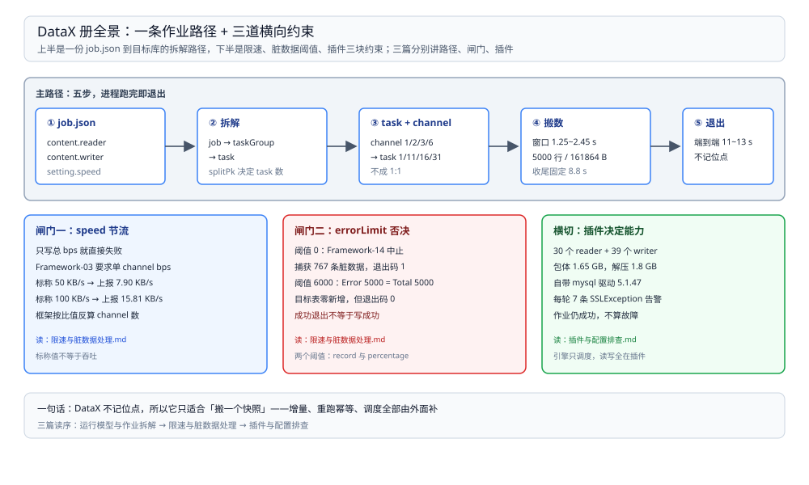

# DataX 目录导读

> 覆盖：DataX 自己怎么跑起来——一个 `job.json` 怎么变成 task、`channel` 与 taskGroup 各管什么、限速为什么要写两处、脏数据阈值怎么决定作业的退出码，以及插件目录、驱动版本与报错原文，共 **3 篇零件**。
>
> 不覆盖：与 Flume / SeaTunnel / Sqoop 的分工与选型见 [数据集成与采集选型对比.md](../数据集成与采集选型对比.md)；CDC 这条「读日志跟位点」的路线见 [README.md](../../../数据存储/数据同步/CDC/README.md)（CDC 册）；同步完之后怎么对账见 [README.md](../../../数据存储/数据同步/数据对比与对账/README.md)（对账册）。
>
> 内容整理自个人学习笔记。本册读数全部来自本机 `eclipse-temurin:8-jdk`（**1.8.0_504**）容器里直接跑 **DataX 202308 包（`DATAX-OPENSOURCE-3.0`）**，源与目标都是 `mysql:8.0`（**8.0.46**）同一实例（共享 netns、`127.0.0.1:3306`）；容器内无 python，调用的是 `com.alibaba.datax.core.Engine` 本身。数据规模 5,000 行 / 161,864 bytes，各篇逐处标注实测与文档口径。

---

## 一、一句话定位：一次性进程，没有位点

**本节要点**：DataX 与采集器、CDC 的分水岭不在「能不能搬」，而在**谁记住搬到哪了**——DataX 不记。它起一个进程、按你给的 SQL 条件捞一遍、跑完退出；位点、增量、重跑幂等全部由外面的调度补。

| 维度 | DataX | 常驻采集器（Flume） | CDC（Canal） | 集成引擎（SeaTunnel） |
| --- | --- | --- | --- | --- |
| 进程 | 一作业一进程，跑完退出 | 常驻 agent | 常驻服务端 | 常驻引擎（local 模式一个 JVM） |
| 数据来源 | SQL 查询（`where` / `querySql`） | 文件、端口、日志 | binlog / WAL | 插件决定的源 |
| 位点 | **没有**，靠外部传条件 | channel + 文件重命名 | 服务端位点 | checkpoint |
| 时效 | 批（分钟~小时） | 近实时 | 秒级 | 批或流 |
| 典型位置 | 日批、整表迁移、补数 | 日志落地 | 增量同步 | 多源整库同步 |

⭐ 记住这一句：**要「搬一个快照」用 DataX，要「一直跟着变」用 Flume / Canal / SeaTunnel**。用 DataX 硬做增量，等于自己在外面重写一套位点。

## 二、三篇分工

**本节要点**：三篇各回答一个独立的问题——作业怎么被拆开跑、跑快了或跑错了由谁决定、插件与配置出问题去哪查。

图上半是从配置到执行的路径，下半是三道横向约束——限速、脏数据阈值、插件与驱动。三篇分别对应「路径」「闸门」「插件」三块，互不重叠。

| 篇 | 回答什么 | 本册的关键读数 |
| --- | --- | --- |
| ① [运行模型与作业拆解.md](运行模型与作业拆解.md) | job / taskGroup / task / channel 四层对象、一次运行的六个阶段、切分片由谁决定、加 channel 为什么没变快、固定开销有多大 | channel 1/2/3/6 → **1/11/16/31 个 task**；channel=1 传输 **1.25~2.45 s**、端到端 **11~13 s**；收尾 **8.8 s** |
| ② [限速与脏数据处理.md](限速与脏数据处理.md) | `speed` 三个字段、为什么只写总 bps 会报 Framework-03、实测限速与耗时、`errorLimit` 两个阈值、脏数据长什么样、退出码 0 却一条没写 | `Framework-03` 原文；50 KB/s → **4.62~5.40 s**、100 KB/s → **2.54~2.68 s**；`Framework-14` 捕获 **767** 条；阈值放大后 `Error 5000 = Total 5000` 而**退出码 0** |
| ③ [插件与配置排查.md](插件与配置排查.md) | 插件目录怎么组织、装插件等于做什么、mysql reader/writer 参数的不对称、驱动 5.1.47 与 MySQL 8、不起 Launcher 直接跑 Engine、报错速查 | **30 个 reader + 39 个 writer**；包体 **1.65 GB**、解压 **1.8 GB**；每轮 **7 条** `SSLException` 告警但作业成功 |

## 三、阅读路线

| 顺序 | 篇 | 视角 | 什么时候读 |
| --- | --- | --- | --- |
| ① | [运行模型与作业拆解.md](运行模型与作业拆解.md) | ⭐ **主线 / 原理** | 第一次用：作业怎么拆、为什么跑得比预期慢、channel 该给多少 |
| ② | [限速与脏数据处理.md](限速与脏数据处理.md) | 可靠性 / 正确性 | 要保护目标库、或遇到「作业成功但数据不对」时 |
| ③ | [插件与配置排查.md](插件与配置排查.md) | 配置 / 排障 | 换源或换目标、驱动不对、插件加载失败时 |

### 依赖关系

| 本篇 | 建议先读 | 为什么 |
| --- | --- | --- |
| 限速与脏数据处理.md | 运行模型与作业拆解.md | 限速会**改写 channel 数**，不知道 task/channel 的关系就看不懂「我写 1 为什么起了 2」 |
| 插件与配置排查.md | 运行模型与作业拆解.md | 插件产出的是 task，插件的 `splitPk` 决定 task 数 |

> ⭐ **两条线**：**原理线**（① → ② → ③）回答「它怎么跑、会被什么拦住」；**问题线**按现象直达——「作业成功但没数据」看 ② 5.2 节，「报 Framework-03」看 ② 2.1 节，「找不到插件」看 ③ 6.2 节。

## 四、本轮实测坐标

| 项 | 值 |
| --- | --- |
| 包 / 版本 | `datax.tar.gz`（202308）→ `DATAX-OPENSOURCE-3.0`，1,649,070,902 B，解压 1.8 GB |
| 运行时 | `eclipse-temurin:8-jdk`（OpenJDK **1.8.0_504**），容器内无 python |
| 调用方式 | `java ... com.alibaba.datax.core.Engine -mode standalone -jobid -1 -job <json>` |
| 数据源 / 目标 | `mysql:8.0`（**8.0.46**），共享 netns；源表 `src_db.orders` 5,000 行、目标表 `dst_db.orders` |
| 驱动 | 包内自带 `mysql-connector-java-5.1.47.jar`；账号用 `mysql_native_password` |
| 内存参数 | `-Xms512m -Xmx1g` |

六条最值得记住的读数：

| 读数 | 值 | 出处 |
| --- | --- | --- |
| 切分片数随 channel 变，且不成 1:1 | channel 1/2/3/6 → task **1/11/16/31**；channel=6 起 **2 个** taskGroup | [运行模型与作业拆解.md](运行模型与作业拆解.md) 第四节 |
| 小数据量加 channel 不提速 | channel=1 窗口 **1.25~2.45 s**；channel=3 窗口 **4.11~10.87 s** | [运行模型与作业拆解.md](运行模型与作业拆解.md) 第五节 |
| 固定开销占大头 | JVM 启动 **2.1~3.4 s**、收尾 **8.8 s**、搬数 **1.25~2.45 s** | [运行模型与作业拆解.md](运行模型与作业拆解.md) 第六节 |
| 限速要写两处，否则直接失败 | `Framework-03 ... 单个channel的bps值不能为空` | [限速与脏数据处理.md](限速与脏数据处理.md) 第二节 |
| 限速值与吞吐不是同一口径 | 标称 50 KB/s → 上报 **7.90 KB/s**；标称 100 KB/s → 上报 **15.81 KB/s** | [限速与脏数据处理.md](限速与脏数据处理.md) 第三节 |
| 退出码 0 不代表写成功 | `errorLimit=6000` → `Error 5000 = Total 5000`，目标表零新增 | [限速与脏数据处理.md](限速与脏数据处理.md) 第五节 |

> ⚠️ **未实测项**：`-mode cluster` 与调度中心、DataX-Web、第三方插件安装、`caching_sha2_password` 账号、`percentage` 的临界行为、`record`（条/秒）限速、按主键断点续跑、HDFS / Hive 等非 MySQL 插件。原因是本机只拉了 MySQL 一种源与目标，且 DataX 不做分布式调度，多机行为起不来。

## 五、本册的边界

| 本册收 | 不收（在哪） |
| --- | --- |
| DataX 的执行模型：四层对象、切分、限速、脏数据 | **批 / 流 / CDC 三类工具怎么选** → [数据集成与采集选型对比.md](../数据集成与采集选型对比.md) |
| 参数名、报错原文、驱动版本这类可复现的事实 | **同步语义：位点、投递、幂等、对账** → [数据同步方式选型对比.md](../../../数据存储/数据同步/数据同步方式选型对比.md) |
| 单机 standalone 行为 | **集群与调度平台形态** → 04 的 [大数据平台册](../../../../04-架构与系统/系统设计/大数据平台/README.md) |
| MySQL 源与目标 | **binlog 本身怎么记** → [日志与持久化.md](../../../数据存储/关系型/MySQL/日志与持久化.md) |

## 延伸追问

- **DataX 和 Sqoop 有什么区别？** → 都做批搬运，Sqoop 生成 MapReduce 作业、依赖 Hadoop，DataX 是独立 JVM 进程、插件式读写；判据在「集群里有没有 YARN」这一条，详见 [Sqoop.md](../Sqoop.md) 与总纲第四节。
- **只想搬一张表，最短路径是什么？** → 抄 [插件与配置排查.md](插件与配置排查.md) 第三节那份 JSON，改 `jdbcUrl` / `table` / `column` 三处，`channel` 留 1，先跑一次看 `Total N records` 是否等于源表行数。
- **为什么本册没有吞吐数字的结论？** → 本机 5,000 行规模下，传输只占端到端的五分之一，任何「每秒多少行」的结论都会被固定开销和同机其它容器污染；只给窗口与趋势。
- **DataX 能不能只跑增量？** → 能按条件捞（`where` 写范围，外部传参），不能跟位点。真正的增量见 [README.md](../../../数据存储/数据同步/CDC/README.md)（CDC 册）。
- **这套实测怎么复现？** → 起 `eclipse-temurin:8-jdk` 容器（`--network container:<mysql容器>` 共享 127.0.0.1），下载 202308 包、解压到 `/opt/datax`，用第四节那条 java 命令跑 [插件与配置排查.md](插件与配置排查.md) 的 JSON。

## 关联

- **上游/总纲**：[数据集成与采集选型对比.md](../数据集成与采集选型对比.md) — 五款工具的分水岭（谁记住搬到哪了）与四种批搬运的定位
- **上游/总纲**：[大数据选型对比.md](../../大数据选型对比.md) — 本目录在七层职责里的位置
- **对照/互补**：[Sqoop.md](../Sqoop.md) — 同为批搬运，但生成 MR 作业、依赖 Hadoop
- **对照/互补**：[SeaTunnel 册](../SeaTunnel/README.md) — 同样是插件式，但有引擎、有 checkpoint
- **下游**：[README.md](../../../数据存储/数据同步/数据对比与对账/README.md)（对账册） — 搬完怎么证明一致
