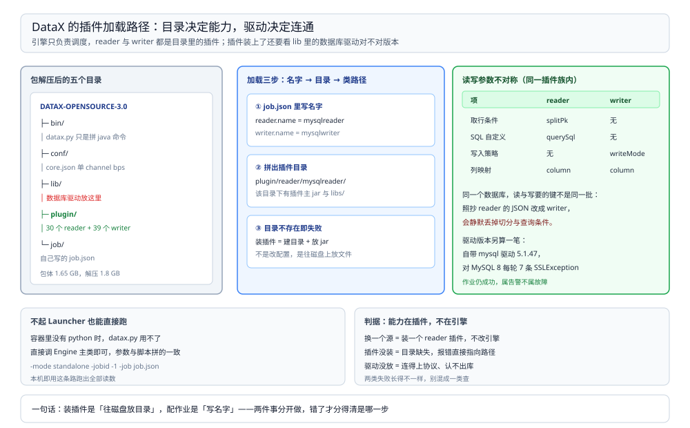

# 插件与配置排查

> 覆盖：DataX 的插件目录长什么样、装一个新插件等于做什么、mysqlreader / mysqlwriter 两套参数的不对称、驱动版本与 MySQL 8 的兼容坑、不起 Launcher 直接跑 `Engine` 的命令，以及常见报错的速查表。
>
> 不覆盖：作业怎么拆 task、限速与脏数据阈值见 [运行模型与作业拆解.md](运行模型与作业拆解.md) 与 [限速与脏数据处理.md](限速与脏数据处理.md)。
>
> 内容整理自个人学习笔记。本篇读数来自本机 `eclipse-temurin:8-jdk`（**1.8.0_504**）容器内跑 **DataX 202308 包（`DATAX-OPENSOURCE-3.0`）** + `mysql:8.0`（**8.0.46**）。包体 **1,649,070,902 B**、解压 **1.8 GB**、内置 **30 个 reader + 39 个 writer** 插件。

---

## 一、一句话定位：引擎只做调度，读写能力全在插件

**本节要点**：DataX 内核只有「拆作业 + 通道 + 限速 + 统计 + 脏数据」，具体怎么读源、怎么写目标，全部由 `plugin/` 下的插件决定。所以「DataX 支不支持 X」= 「`plugin/` 里有没有 X 的 reader / writer」。

| 目录 | 内容 | 本机计数 |
| --- | --- | --- |
| `bin/` | `datax.py`（启动脚本）、`dyu.py` 等 | — |
| `conf/` | `core.json`（引擎默认值）、`logback.xml` | 2 个 |
| `lib/` | 引擎 jar 与公共依赖（含 `datax-core`、`datax-common`、druid、guava 等） | 23 个 |
| `plugin/reader/` | 每种源的 reader 插件 | **30 个** |
| `plugin/writer/` | 每种目标的 writer 插件 | **39 个** |
| `job/` | 示例作业 JSON | 若干 |
| `script/` | 辅助脚本 | 若干 |



图里上半是安装目录的六块，下半是「作业里的 `name` → 插件目录 → jar + libs」这条解析链。**插件名就是目录名**，写错一个字符报的是「找不到插件」，而不是「参数错」。

## 二、装一个新插件等于做什么

**本节要点**：把插件目录整个放进 `plugin/reader/` 或 `plugin/writer/`，不需要注册、不需要改配置——引擎按作业里的 `name` 去找同名目录。

| 步骤 | 动作 | 验证 |
| --- | --- | --- |
| ① | 拿到插件目录（形如 `mysqlreader/`，内含 `<name>-0.0.1-SNAPSHOT.jar` 与 `libs/`） | 目录名 = 作业里的 `name` |
| ② | 拷到 `plugin/reader/`（或 `writer/`） | 目录名出现在 `ls plugin/reader` 的输出里 |
| ③ | 插件自带的依赖放 `libs/` 下 | 缺依赖时启动阶段抛 `NoClassDefFoundError` |
| ④ | 用 `conf/job/` 里的示例作业改一份，跑一次 | 日志出现 `DataX Reader.Job [<name>] do prepare work` |

⚠️ 本机**未做第三方插件安装实测**（只用了包里自带的 30/39 个）；以上是目录结构与类加载顺序的读法，装法以官方文档为准。

## 三、`mysqlreader` 与 `mysqlwriter` 参数不对称

**本节要点**：同一份作业里，reader 的 `jdbcUrl` 必须是**数组**（为分库分表留的位置），writer 的 `jdbcUrl` 写**字符串**即可；这个不对称不影响运行，但换插件时最容易抄错。

```json
{
  "job": {
    "setting": {
      "speed": { "channel": 1 },
      "errorLimit": { "record": 0, "percentage": 0 }
    },
    "content": [
      {
        "reader": {
          "name": "mysqlreader",
          "parameter": {
            "username": "datax",
            "password": "datax123",
            "column": ["id", "order_no", "amount", "status", "created_at"],
            "splitPk": "id",
            "connection": [
              {
                "table": ["orders"],
                "jdbcUrl": ["jdbc:mysql://127.0.0.1:3306/src_db?useUnicode=true&characterEncoding=utf8"]
              }
            ]
          }
        },
        "writer": {
          "name": "mysqlwriter",
          "parameter": {
            "username": "datax",
            "password": "datax123",
            "column": ["id", "order_no", "amount", "status", "created_at"],
            "preSql": ["truncate table orders"],
            "writeMode": "insert",
            "connection": [
              {
                "table": ["orders"],
                "jdbcUrl": "jdbc:mysql://127.0.0.1:3306/dst_db?useUnicode=true&characterEncoding=utf8"
              }
            ]
          }
        }
      }
    ]
  }
}
```

| 参数 | reader | writer | 说明 |
| --- | --- | --- | --- |
| `jdbcUrl` | **数组** | **字符串** | reader 一个 `table` 可对多个 url（分库分表） |
| `table` | 数组 | 数组 | 与 `jdbcUrl` 的下标对应关系由插件处理 |
| `column` | 必填 | 必填 | 两侧顺序必须一致，类型由插件做映射 |
| `splitPk` | 可选 | — | 写了才会切分片，见运行模型篇第四节 |
| `where` | 可选 | — | 增量同步靠它，不是位点 |
| `preSql` / `postSql` | — | 可选 | 本机用 `truncate table orders` 保证重跑幂等 |
| `writeMode` | — | `insert` / `replace` / `update` | `insert` 遇主键冲突即脏数据 |
| `batchSize` | — | 可选 | 每批写多少条，影响事务大小 |

## 四、驱动版本：5.1.47 与 MySQL 8

**本节要点**：包里自带 `mysql-connector-java-5.1.47.jar`，连 MySQL 8 能跑，但**每轮都会刷 SSL 收尾告警**；账号认证方式也不能用 MySQL 8 默认的 `caching_sha2_password`。

| 项 | 本机情况 |
| --- | --- |
| 自带驱动 | `plugin/reader/mysqlreader/libs/mysql-connector-java-5.1.47.jar` |
| 目标库 | MySQL 8.0.46 |
| 账号 | 本机建的是 `IDENTIFIED WITH mysql_native_password` |
| 告警 | 每轮 7 条 `SSLException: closing inbound before receiving peer's close_notify`，作业仍成功 |
| 消除办法 | jdbcUrl 加 `useSSL=false`（本篇配置未加，留着看告警） |

告警原文：

```text
WARN: Establishing SSL connection without server's identity verification is not recommended.
...
WARN: Caught while disconnecting...
javax.net.ssl.SSLException: closing inbound before receiving peer's close_notify
```

⚠️ 用 `caching_sha2_password` 账号会怎样**未实测**；按驱动版本推论会认证失败（5.1.x 不认识该插件），遇到时要么改账号认证方式，要么把 `libs/` 里的驱动换成 8.x。**不要把 SSL 告警当成失败**——它出现在连接关闭阶段，作业统计仍是 5,000 行成功。

## 五、不起 Launcher，直接跑 Engine

**本节要点**：`bin/datax.py` 只做两件事——拼一条 java 命令、解析参数；**镜像里没有 python 时可以直接调 `Engine`**，参数与脚本拼出来的完全一致。

```bash
cd /opt/datax && java -server -Xms512m -Xmx1g \
  -Dfile.encoding=UTF-8 \
  -Dlogback.statusListenerClass=ch.qos.logback.core.status.NopStatusListener \
  -Djava.security.egd=file:///dev/urandom \
  -Ddatax.home=/opt/datax \
  -Dlogback.configurationFile=/opt/datax/conf/logback.xml \
  -classpath '/opt/datax/lib/*:.' \
  com.alibaba.datax.core.Engine -mode standalone -jobid -1 -job /opt/lab/job-c1.json
```

| 参数 | 为什么必须有 |
| --- | --- |
| `-Ddatax.home=/opt/datax` | 引擎靠它定位 `conf/core.json` 与 `plugin/`；不设会找不到插件 |
| `-classpath '/opt/datax/lib/*:.'` | 脚本里拼的就是 `lib/*` + 当前目录；少一段就抛 `NoClassDefFoundError` |
| `-mode standalone` | 单机模式；`cluster` 模式需要调度中心（本机未实测） |
| `-jobid -1` | standalone 下无调度中心分配 id |

⚠️ `bin/datax.py` 是 Python 2 语法（脚本头部 `#!/usr/bin/env python`、`string.Template` 拼命令），Python 3 下同样能跑；**本机容器里没有 python，所以走的是上面的直调方式**，两者的引擎行为一致。

## 六、验证与排查

**本节要点**：插件类问题的判据是「插件有没有被加载」；连接类问题的判据是「驱动报的原文」。

### 6.1 先确认插件生效

| 检查项 | 命令 | 期望 |
| --- | --- | --- |
| 插件存在 | 列 `plugin/reader` 目录计数 | 本机 30（writer 39） |
| 作业里名字对得上 | `ls /opt/datax/plugin/reader/mysqlreader` | 有 jar 与 `libs/` |
| 插件被加载 | 日志 `DataX Reader.Job [mysqlreader] do prepare work` | 名字与作业一致 |
| 数据落地 | 目标库行数 | 与源表一致 |

### 6.2 常见故障速查

| 症状 | 先查什么 |
| --- | --- |
| 启动即 `NoClassDefFoundError` / `ClassNotFoundException` | 插件 `libs/` 缺依赖，或 `-classpath` 少了一段 |
| `找不到插件` / `plugin not found` | 作业里的 `name` 与 `plugin/reader` 或 `plugin/writer` 下的目录名不一致 |
| `Access denied for user ...` | 账号密码或授权库；MySQL 8 还可能是认证插件不匹配 |
| `Communications link failure` | 主机端口通不通（共享 netns 时是 `127.0.0.1:3306`） |
| 大量 `SSLException ... close_notify` | 5.1.47 驱动 + MySQL 8 的收尾告警，不是失败；加 `useSSL=false` |
| 时间字段变成数字 / 时区偏 8 小时 | `conf/core.json` 的 `common.column.timeZone` 与 `dateFormat` |
| 作业成功但目标表空 | 看 `Error N` 与 `errorLimit`，见限速篇 5.2 节 |

## 七、校验口径

| 内容 | 状态 |
| --- | --- |
| 目录结构、`lib` 23 个、reader 30 / writer 39 | ✅ 本机实测（`ls` 计数） |
| 包体 1,649,070,902 B、解压 1.8 GB | ✅ 本机实测 |
| 第三节作业 JSON 跑通（5,000 行，退出码 0） | ✅ 本机实测 |
| 直调 `Engine` 的命令（无 python 环境） | ✅ 本机实测，与 `datax.py` 拼出的参数一致 |
| 自带驱动 `mysql-connector-java-5.1.47.jar`、每轮 7 条 SSL 告警 | ✅ 本机实测 |
| `caching_sha2_password` 账号的失败形态 | ⚠️ **未实测**：本机账号建的是 `mysql_native_password` |
| 第三方插件安装 | ⚠️ **未实测**：只用自带插件 |
| `-mode cluster` / DataX-Web 调度 | ⚠️ **未实测** |

---

## 延伸追问

- **为什么 `datax.py` 要 Python？** → 历史原因：脚本负责解析 `-j` 参数、拼 JVM 参数、按 `core.json` 的 `entry.jvm` 起进程。它不参与数据搬运，所以没有 python 也能直接调 `Engine`。
- **能不能一个作业里读 A 写 B、再读 C 写 D？** → 可以，`job.content` 是数组，每项是一对 reader/writer；它们共用一个 channel 额度池，按 task 排队。
- **`querySql` 和 `column` 能同时用吗？** → 用 `querySql` 时按查询结果列顺序做映射，`column` 与 `splitPk` 的语义会变（切分要自己写 `where` 包裹），本机未实测这条路径。
- **插件目录能不能多个版本共存？** → 不能，目录名即插件名；升级插件就是替换目录内容。
- **DataX 支不支持写入时不建表？** → 默认不建，目标表必须预先存在；建表属于调度平台或 DDL 脚本的事。

---

## 关联

- [README.md](README.md) — 本册导读：三篇分工与读序
- [运行模型与作业拆解.md](运行模型与作业拆解.md) — **上游**：插件产出的 task 怎么被调度
- [限速与脏数据处理.md](限速与脏数据处理.md) — **对照**：配置错误里最常遇到的两类失败
- [数据集成与采集选型对比.md](../数据集成与采集选型对比.md) — **上游总纲**：DataX 与 Flume / SeaTunnel / Sqoop 的分工
- [日志与持久化.md](../../../数据存储/关系型/MySQL/日志与持久化.md) — **对照**：MySQL 侧的日志与复制机制
