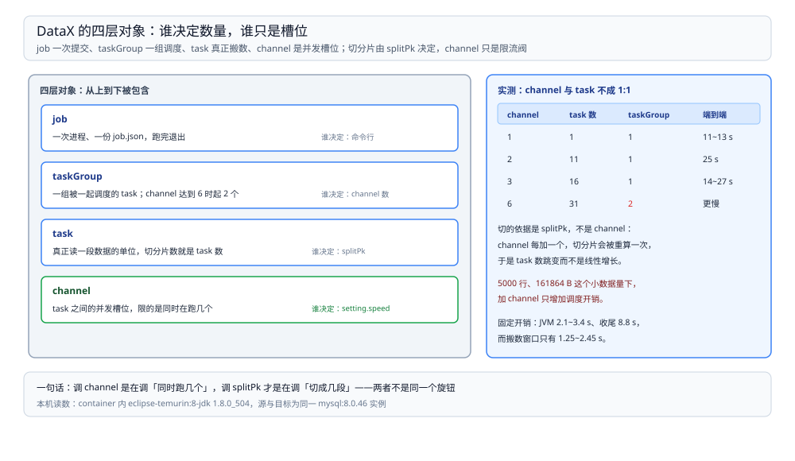

# 运行模型与作业拆解

> 覆盖：DataX 一次运行的生命周期（起进程 → 拆作业 → 调度 → 收尾）、`job` / `taskGroup` / `task` / `channel` 四层对象各管什么、切分片数由谁决定、为什么加 `channel` 反而更慢，以及「端到端 11~13 秒里只有 1~2.5 秒在搬数」这笔固定开销。
>
> 不覆盖：限速与脏数据阈值的两道闸门见 [限速与脏数据处理.md](限速与脏数据处理.md)；插件参数、驱动版本与报错速查见 [插件与配置排查.md](插件与配置排查.md)；与 Flume / SeaTunnel / Sqoop 的分工与选型见 [数据集成与采集选型对比.md](../数据集成与采集选型对比.md)。
>
> 内容整理自个人学习笔记。本篇读数来自本机 `eclipse-temurin:8-jdk`（**1.8.0_504**）容器内直接跑 **DataX 202308 包（`DATAX-OPENSOURCE-3.0`）**，源与目标都是 `mysql:8.0`（**8.0.46**）的同一个实例（共享 netns，`127.0.0.1:3306`）；源表 5,000 行、上报 **161,864 bytes**（32.4 B/行）。日志、时间戳与作业配置见第七节。

---

## 一、一句话定位：一个 job.json 换一次进程

**本节要点**：DataX 不是常驻服务，是**命令行进程**——提交一次作业起一个 JVM，跑完退出。所以它的成本结构是「固定开销 + 线性搬运」，短作业的时间大半不在搬数据上。

| 维度 | DataX 的做法 |
| --- | --- |
| 进程模型 | 一作业一进程，`java ... com.alibaba.datax.core.Engine -mode standalone -jobid -1 -job x.json` |
| 作业描述 | 一个 JSON：`job.setting`（限速、脏数据容忍）+ `job.content[]`（reader / writer 成对） |
| 并发单位 | `channel`（通道），不是线程数也不是核数 |
| 数据流 | reader 分片 → 内存通道（`MemoryChannel`）→ writer，同进程内传递 |
| 状态 | 无持久化位点；失败了就整条重跑，断点续传要自己按主键切范围 |
| 收尾 | 等一个上报周期（`reportInterval`，默认 10,000 ms）再退出 |

⭐ 记住这一句：**DataX 是「批处理搬运工」，不是「同步服务」**。它没有守护进程、没有位点、没有增量语义；这些都得由外面的调度系统补。

## 二、核心概念：四层对象各管一段

**本节要点**：`job` 是配置，`taskGroup` 是调度单元，`task` 是「一个 reader 分片 + 一个 writer 分片」的配对，`channel` 是 taskGroup 内同时能跑几个 task 的位置。

| 层 | 由谁产生 | 管什么 | 本机实测 |
| --- | --- | --- | --- |
| job | 你写的 JSON | 数据从哪到哪、限速、脏数据阈值 | 1 个 job → 1 个 JVM |
| taskGroup | JobContainer 按 `core.container.taskGroup.channel`（`core.json` 里是 5）切 | 一批 task 的调度容器 | channel ≤ 3 时 **1 个**；channel=6 时 **2 个** |
| task | Reader 的 split 结果 × Writer 的 split 结果配对 | 一段可独立执行的范围查询 + 一段写入 | 1 / 11 / 16 / 31 个（随 channel 变） |
| channel | `job.setting.speed.channel` | taskGroup 内并发执行的 task 数 | 1 / 2 / 3 / 6 |

图里左侧是配置层（一个 JSON），中间是调度层（taskGroup 拿着 channel 额度轮流跑 task），右侧是每个 task 内部的 reader → channel → writer 三段。**channel 只决定「同时跑几个 task」，不改变 task 怎么切**，所以加 channel 既可能提速也可能纯粹增加调度开销。

## 三、一次运行要过哪几个阶段

**本节要点**：日志里能对上号的六个阶段，从起进程到退出，每个阶段都有固定的耗时来源。

| 阶段 | 日志特征 | 做什么 |
| --- | --- | --- |
| ① 起进程 | 第一行 `Engine - DataX starts to work` 前后 | JVM 启动、logback 初始化、插件 classloader 加载 |
| ② init | `DataX Reader.Job [mysqlreader] do prepare work` | 连接源与目标、执行 `preSql`（如 `truncate`） |
| ③ split | `jobContainer starts to do split ...` | 按 `splitPk` 把源切成若干 task |
| ④ schedule | `Job set Channel-Number to N channels` / `Scheduler starts [M] taskGroups` | 建 taskGroup、分配 task |
| ⑤ 搬运 | `TaskGroupContainer - start [C] channels for [T] tasks` | 并发跑 task，边读边写边上报 |
| ⑥ 收尾 | `JobContainer - DataX jobId [0] completed successfully` | 等上报周期、统计汇总、GC 信息 |

本机一段真实的阶段时间（channel=1、不超速）：

| 时点 | 事件 | 距起点 |
| --- | --- | --- |
| 16:42:25 | 进程启动（`任务启动时刻`） | 0 s |
| 16:42:27.9 | taskGroup 拿到 1 个 channel、1 个 task | +2.9 s |
| 16:42:28.208 | `taskId[0] is successed, used[1233]ms` | +3.2 s |
| 16:42:36.976 | `jobId [0] completed successfully` | **+12.0 s** |

⚠️ 最后一个 task 在 **28.2 s** 就完成了，job 到 **37.0 s** 才退出——中间 8.8 秒是在等上报周期与收尾。这不是卡住，是固定节奏。

## 四、切分片从哪来：`splitPk` 决定 task 数

**本节要点**：不写 `splitPk`，reader 只切 1 个 task；写了 `splitPk` 且 `channel > 1`，reader 才把表切成多个范围查询。**切分片数不等于 channel 数**。

同一个 5,000 行表、同一个 `splitPk: "id"`，只改 `speed.channel`：

| `speed.channel` | taskGroup 数 | task 数 | 日志原文 |
| --- | --- | --- | --- |
| 1 | 1 | **1** | `start [1] channels for [1] tasks` |
| 2 | 1 | **11** | `start [2] channels for [11] tasks` |
| 3 | 1 | **16** | `start [3] channels for [16] tasks` |
| 6 | **2** | **31** | `start [3] channels for [16] tasks` + `start [3] channels for [15] tasks` |

现象与判读：

- `channel = 1` 时 reader 直接返回单个 task，不做范围切分——**小表或无法切分的表（没有数值主键）就是这个形态**；
- `channel ≥ 2` 时切出 5 × channel + 1 个左右的分片（11、16、31），每个分片一条带 `WHERE id BETWEEN ...` 的查询；
- taskGroup 数 = channel 数 ÷ `core.container.taskGroup.channel`（`core.json` 里是 5）向上取整：channel=6 时切成 2 个 taskGroup、每个 3 个 channel；
- 分片数超过 channel 数，后面的 task 排队等 channel 空出来——**队列在每个 taskGroup 内**，组与组之间并行。

⚠️ 「5 × channel + 1」是本机两次读数归纳出来的现象，**没有读 reader 的分片源码**，换版本不保证成立；能确定的是「切分片数由 reader 的 split 逻辑决定，与 channel 不成 1:1」。

## 五、加 channel 为什么没有变快

**本节要点**：5,000 行这种量级，多 channel 的收益被「切分查询 + 并发写同一张表」抵消；本轮三次重复里，channel=3 反而稳定更慢。

| 配置 | task 数 | 传输窗口（三次） | 端到端（三次） |
| --- | --- | --- | --- |
| channel=1 | 1 | **1.25 / 1.72 / 2.45 s** | 11 / 12 / 13 s |
| channel=3 | 16 | **4.11 / 5.19 / 10.87 s** | 14 / 17 / 27 s |

「传输窗口」= 日志里 taskGroup 第一行 `start [...] channels` 到最后一条 `is successed` 的时间差；端到端 = 进程启动到退出。

三点判读：

1. **channel=1 时整表一条查询顺序读出，没有切分开销**，本机 1.25~2.45 s 就搬完；
2. **channel=3 切出 16 个分片，每个分片一次连接、一条范围查询**，连接建立与并发写同一张目标表的行锁竞争把收益吃掉；
3. 三次读数的离散度很大（4.11~10.87 s），因为同一时刻本机还跑着 Kafka、Canal、Flume 几个容器——**只能断言「没有可重复的提速」，不能断言具体秒数**。

⭐ 判据：**channel 该按「源端能不能并行读、目标端能不能并行写」来定，不是越大越快**。表小、单实例目标库、单主键范围查询这三条同时成立时，channel=1 往往更快。

## 六、固定开销：11 秒里只有 1~2.5 秒在搬数

**本节要点**：一次运行的成本 = JVM 启动（2~3 s）+ 搬数（线性）+ 收尾（≈ 一个上报周期 10 s）。搬的数越少，固定开销占比越高。

| 成本项 | 本机读数 | 说明 |
| --- | --- | --- |
| JVM 启动到 task 开始 | **2.1 / 2.6 / 3.4 s** | 含 logback、插件 classloader |
| 搬 5,000 行 | **1.25 / 1.72 / 2.45 s** | channel=1 |
| 最后 task 完成到进程退出 | **8.8 s** | 等 `reportInterval`（10,000 ms）与统计汇总 |
| 端到端 | **11~13 s** | 上述三项之和 |

⭐ 这条读数决定了 DataX 的适用位置：**日批、百万行级的整表同步**，固定开销可以被摊薄；**每分钟跑一次、每次几百行**的同步用它会有一半时间耗在启动和收尾上，应该换常驻的采集器或 CDC。

## 七、验证与排查

**本节要点**：先确认「作业真的按你写的配置跑了」，再按日志里的关键行定位。

### 7.1 先确认作业生效

| 检查项 | 看哪一行 | 期望 |
| --- | --- | --- |
| channel 生效 | `Job set Channel-Number to N channels` | N 等于你写的值（被限速改写时会不同，见限速篇） |
| 切分生效 | `start [C] channels for [T] tasks` | T > 1 说明切了分片 |
| 数据落地 | `Total 5000 records, 161864 bytes` | 行数等于源表行数 |
| 真的写到目标 | 目标库 `SELECT COUNT(*)` | 与源表一致（本机 5,000 / 5,000，`SUM(amount)` 都是 2,477,240.00） |

### 7.2 常见故障速查

| 症状 | 先查什么 |
| --- | --- |
| 作业跑完但目标表没数据 | `Error N records` 是否等于 `Total`（见 [限速与脏数据处理.md](限速与脏数据处理.md) 第五节） |
| 明明给了 `channel` 却起了别的数 | 是否同时设了 `speed.byte`：框架按 `总 bps / 单 channel bps` 重算 channel |
| 切分片数远多于 channel，任务排队 | 正常现象；想减少分片就去掉 `splitPk` 或降 channel |
| 结束时「卡」了 8~10 秒 | 等上报周期，不是挂起 |
| 日志全是 `SSLException ... close_notify` | 5.1.47 驱动连 MySQL 8 的收尾告警，jdbcUrl 加 `useSSL=false` |

| 排查项 | 命令 |
| --- | --- |
| 目标表行数与金额合计 | `SELECT COUNT(*), SUM(amount) FROM dst_db.orders;` |
| 源表对照 | `SELECT COUNT(*), SUM(amount) FROM src_db.orders;` |
| 本次作业配置 | `cat job-c1.json`（作业文件本身没有版本管理，建议随调度入库） |

## 八、校验口径

| 内容 | 状态 |
| --- | --- |
| 1 / 11 / 16 个 task 与 `start [C] channels for [T] tasks` 原文 | ✅ 本机实测（`202308` 包，MySQL 8.0.46，5,000 行） |
| channel=6 → 2 个 taskGroup、3 + 3 个 channel、16 + 15 个 task | ✅ 本机实测 |
| channel=1 传输窗口 1.25 / 1.72 / 2.45 s，端到端 11 / 12 / 13 s | ✅ 本机实测，三次重复 |
| channel=3 传输窗口 4.11 / 5.19 / 10.87 s，端到端 14 / 17 / 27 s | ✅ 本机实测，三次重复；**同时有其它容器在跑，离散度大** |
| JVM 启动 2.1 / 2.6 / 3.4 s、收尾 8.8 s | ✅ 本机实测（日志时间戳相减，非外部计时） |
| `Total 5000 records, 161864 bytes`、目标库 5,000 行且金额合计一致 | ✅ 本机实测 |
| 「5 × channel + 1 个分片」 | ⚠️ 现象归纳，**未读分片源码**，仅两次读数支撑 |
| 多机分布式 `-mode cluster`、`jobid` 与调度中心 | ⚠️ **未实测**：本机只跑 `standalone`、`jobid -1` |
| 断点续传 / 按主键续跑 | ⚠️ **未实测**：DataX 本身不保存位点，本篇不作能力断言 |

---

## 延伸追问

- **为什么 `taskGroup` 只有一个？** → channel 不超过 5 时只有一个。taskGroup 的切法是「channel 数 ÷ `core.container.taskGroup.channel`（`core.json` 里是 5）」向上取整：实测 channel=6 切成 2 个 taskGroup（3 + 3 个 channel）。
- **task 数比 channel 多，是不是浪费？** → 不浪费，但会排队。task 多了启动与连接开销多、并行度不变；分片太碎时反而更慢（本机 channel=3 的 16 个分片就是这样）。
- **DataX 能不能做增量？** → 能「按条件捞」不能「跟位点」。用 `where` 写时间或 id 范围由调度系统传参，位点在外面维护；真正的增量跟 binlog 要走 CDC，见 [CDC 目录](../../../数据存储/数据同步/CDC/README.md)。
- **作业跑一半失败，会写进去一部分吗？** → 会。DataX 没有跨 task 的事务，已提交的批次留在目标表；重跑要保证幂等（`preSql` 清表，或 `writeMode` 用 `replace` / `update`，配合主键）。
- **`-jobid -1` 是什么意思？** → standalone 模式下没有调度中心分配 id，固定写 `-1`；接 DataX-Web 之类的调度平台后由平台分配，用来查历史作业。

---

## 关联

- [README.md](README.md) — 本册导读：三篇分工与读序
- [限速与脏数据处理.md](限速与脏数据处理.md) — **下游机制**：`speed` 两道闸门与脏数据阈值
- [插件与配置排查.md](插件与配置排查.md) — **对照**：插件目录、驱动版本与报错速查
- [数据集成与采集选型对比.md](../数据集成与采集选型对比.md) — **上游总纲**：批同步这一格由谁承担
- [大数据选型对比.md](../../大数据选型对比.md) — **上游总纲**：本目录在七层职责里的位置
