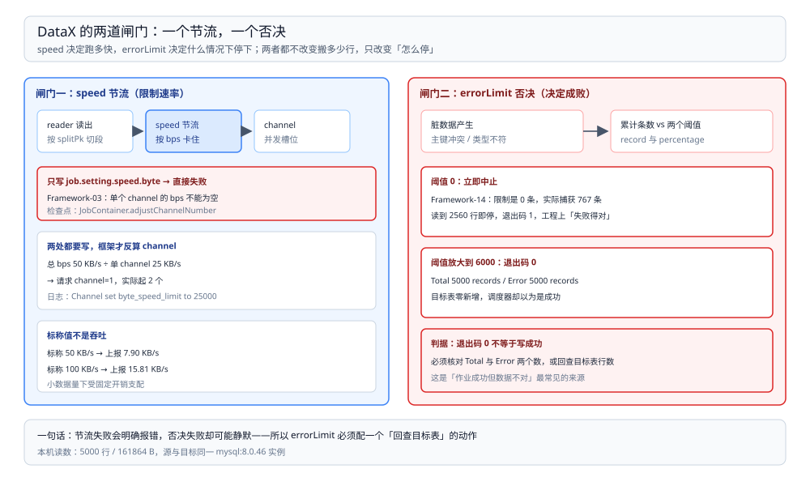

# 限速与脏数据处理

> 覆盖：`job.setting` 里的两道闸门——`speed`（节流）与 `errorLimit`（否决）怎么配、为什么只写总 bps 会直接报错、实测的限速与耗时关系、脏数据长什么样、以及「退出码 0 但一条都没写进去」这条最容易误判的路径。
>
> 不覆盖：作业怎么拆 task、channel 怎么影响耗时见 [运行模型与作业拆解.md](运行模型与作业拆解.md)；jdbcUrl 与驱动报错见 [插件与配置排查.md](插件与配置排查.md)。
>
> 内容整理自个人学习笔记。本篇读数来自本机 `eclipse-temurin:8-jdk`（**1.8.0_504**）容器内直接跑 **DataX 202308 包（`DATAX-OPENSOURCE-3.0`）**，源表与目标表都是 `mysql:8.0`（**8.0.46**）的 5,000 行 `orders`，上报总量 **161,864 bytes**。全部读数与报错原文见第六节。

---

## 一、一句话定位：一个节流、一个否决

**本节要点**：`speed` 决定「跑多快」，`errorLimit` 决定「错多少就停」。两者都写在 `job.setting` 里，但生效位置不同——前者作用在 channel 层，后者作用在作业汇总层。

| 闸门 | 配置位置 | 作用 | 超了会怎样 |
| --- | --- | --- | --- |
| 节流 `speed` | `job.setting.speed` | 限制 channel 数与每秒字节/记录数 | 变慢，不报错 |
| 否决 `errorLimit` | `job.setting.errorLimit` | 累计脏数据条数或占比的上限 | 作业失败，退出码 1 |

⭐ 判据：**限速是「软」的，脏数据阈值是「硬」的**。前者配错了只是慢，后者配错了要么误杀作业，要么把失败当成功。

## 二、`speed` 有三个字段，能设的只有一个

**本节要点**：`channel` 是并发额度，`byte` 与 `record` 是**全作业总量**上限；后两者必须配套在 `conf/core.json` 里写单个 channel 的额度，否则作业在 split 阶段就失败。

| 字段 | 含义 | 单位 | 本机默认 |
| --- | --- | --- | --- |
| `channel` | 并发 task 数 | 个 | 由 job 指定，未写则 `core.json` 的 `taskGroup.channel`=5 兜底 |
| `byte` | 全作业每秒字节上限 | B/s | `-1`（不限） |
| `record` | 全作业每秒记录数上限 | 条/s | `-1`（不限） |

### 2.1 只写总量：Framework-03

`job.setting.speed` 里只加 `"byte": 50000`、`core.json` 保持 `"byte": -1`，作业在 `jobContainer starts to do split ...` 之后立刻失败：

```text
com.alibaba.datax.common.exception.DataXException: Code:[Framework-03],
Description:[DataX引擎配置错误，该问题通常是由于DataX安装错误引起，请联系您的运维解决 .].
 - 在有总bps限速条件下，单个channel的bps值不能为空，也不能为非正数
	at com.alibaba.datax.core.job.JobContainer.adjustChannelNumber(JobContainer.java:430)
```

原因是框架要用「总量 ÷ 单 channel 额度」反算 channel 数，单 channel 额度没给就没法算。**这不是安装错误**，报错描述里的「请联系您的运维」会把人带偏。

### 2.2 补上单 channel 额度：channel 被反算改写

在 `conf/core.json` 的 `core.transport.channel.speed.byte` 填 25000（单 channel 25 KB/s），job 里写总量 50000，则：

```text
Job set Channel-Number to 2 channels
Channel - Channel set byte_speed_limit to 25000
```

⚠️ 注意 job 里写的是 `"channel": 1`，**实际起了 2 个 channel**——`adjustChannelNumber` 用 `总 bps / 单 channel bps` 重算，把用户写的 channel 覆盖掉了。想控制并发又限速时，这两个数要一起算。

## 三、实测：限速生效，但标称值不等于吞吐

**本节要点**：限速确实按比例拉长传输窗口，但**日志最终报出的「任务平均流量」与标称 bps 不是同一口径**，做容量规划只能以实测为准。

同一份数据（5,000 行 / 161,864 B），单 channel 额度分别是总量的一半，各跑三次：

| 标称总速 | 实际 channel | 传输窗口（三次） | 端到端（三次） | 最终上报「任务平均流量」 |
| --- | --- | --- | --- | --- |
| 不限 | 1 | **1.25 / 1.72 / 2.45 s** | 11 / 12 / 13 s | 15.81 KB/s |
| 50 KB/s | 2 | **4.62 / 5.40 / 10.52 s** | 12 / 13 / 27 s | 7.90 KB/s |
| 100 KB/s | 2 | **2.54 / 2.68 / 6.28 s** | 11 / 12 / 16 s | 15.81 KB/s |



图上半是两道闸门的位置与判据（speed 只减速、errorLimit 中止作业），下半是两种典型结局：脏数据在阈值内时作业退出码为 0 但可能一条没写，超阈值时退出码为 1 且目标表留下已提交的部分数据。

三点判读：

1. **限速翻倍，窗口减半**（50 KB/s → 4.6~5.4 s；100 KB/s → 2.5~2.7 s），方向与比例都对得上；
2. **标称 50 KB/s 跑出的是 161,864 B ÷ 10.5 s ≈ 15.4 KB/s**，约标称值的三分之一；100 KB/s 那档同理。限速器计的数与最终上报的 `bytes` 不是同一口径（上报值 32.4 B/行），**本仓未查限速器的计数实现，因此只给读数对照、不给换算结论**；
3. 端到端时间受 JVM 启动与 10 s 上报周期支配，**限速只影响中间那段传输窗口**——给 5,000 行加限速，端到端只从 11 s 涨到 12~16 s，因为固定开销本来就有 8~10 s。

## 四、`errorLimit` 有两个阈值

**本节要点**：`record` 与 `percentage` 任一被突破都会失败；`percentage` 的分母是「已读记录数」，不是总记录数。

| 字段 | 判据 | 本机实测 |
| --- | --- | --- |
| `record` | 累计脏数据条数 > 该值 → 失败 | 设 0 时，读到 2,560 行、捕获 767 条脏数据即中止 |
| `percentage` | 脏数据条数 ÷ 已读条数 > 该值 → 失败 | 本篇均设 0，未单独测占比边界 |

⚠️ `percentage` 随读随算：作业早期几条失败就可能是很大的占比，**长期跑大批量时用 `percentage` 会比 `record` 更容易误杀**；本仓没有单独测它的临界点。

## 五、实测：脏数据的两种结局

**本节要点**：同一次「目标表已有主键」的重复写入，`errorLimit` 设 0 时作业失败并列出脏数据；设 6,000 时作业**成功退出**，但一条也没写进去。

### 5.1 阈值 0：Framework-14，列出脏数据

目标表 `dst_db.orders` 里已有 5,000 行，再去 `insert` 同主键：

```text
[0-0-0-writer] ERROR StdoutPluginCollector - 脏数据:
{"exception":"Duplicate entry '1' for key 'orders.PRIMARY'","record":[{"byteSize":1,"index":0,"rawData":1,"type":3},{"byteSize":10,"index":1,"rawData":"NO00000001","type":5},{"byteSize":5,"index":2,"rawData":"11.13","type":4},{"byteSize":4,"index":3,"rawData":"PAID","type":5},{"byteSize":8,"index":4,"rawData":1767196807000,"type":7}],"type":"writer"}

Total 2560 records, 82326 bytes | Error 767 records, 24103 bytes | Percentage 0.00%
Code:[Framework-14], Description:[DataX传输脏数据超过用户预期, ...] - 脏数据条数检查不通过，限制是[0]条，但实际上捕获了[767]条.
```

字段含义：

| 字段 | 含义 |
| --- | --- |
| `exception` | 真实原因，这里是主键冲突原文 |
| `record[].index` | 列序号，对应 `column` 数组下标 |
| `record[].type` | 值类型：3 = Long、4 = Decimal/Double、5 = String、7 = Date（本机观测到这四种） |
| `type` | `writer` 表示失败发生在写出侧（reader 侧解析失败也会进这里） |

⚠️ 报出的是 **2,560 行读、767 条脏**，不是全量 5,000——**触发阈值就中止**，别把这两个数当成「全表只有 767 行有问题」。

### 5.2 阈值放大：退出码 0，实际 0 条落地

把 `errorLimit.record` 改成 6,000 再跑同一作业：

```text
Total 5000 records, 161864 bytes | Error 5000 records, 161864 bytes
读出记录总数                    :                5000
读写失败总数                    :                5000
```

进程退出码 **0**，汇总里 `Error 5000` 与 `Total 5000` 相等。目标表**一条新数据都没有**。

⭐ 这是 DataX 运维里最危险的一条：**退出码只表示「脏数据没超阈值」，不表示「数据写成功了」**。调度系统必须以「`Error` 计数 + 目标表行数核对」为准，不能只看退出码。

## 六、验证与排查

**本节要点**：先把「配了什么」和「实际起了什么」对齐，再判断失败是节流、脏数据还是连接问题。

### 6.1 先确认配置生效

| 检查项 | 看哪一行 | 期望 |
| --- | --- | --- |
| channel 是否被改写 | `Job set Channel-Number to N channels` | 与 job 里写的一致；不一致说明设了 `speed.byte` |
| 单 channel 额度 | `Channel set byte_speed_limit to N` | N = `core.json` 里填的值；`-1` 表示未开限速 |
| 脏数据阈值 | `Error N records` | 与 `errorLimit.record` 比较 |
| 真正落地 | 目标表 `SELECT COUNT(*)` | 与源表一致才算成功 |

### 6.2 常见故障速查

| 症状 | 先查什么 |
| --- | --- |
| `Framework-03 ... 单个channel的bps值不能为空` | job 里写了 `speed.byte` / `record`，`conf/core.json` 没写单 channel 额度 |
| 设了 `channel: 1` 却起了 2 个 | 同上：`总 bps ÷ 单 channel bps` 反算覆盖了 channel |
| `Framework-14 ... 限制是[0]条，但实际上捕获了[N]条` | 脏数据超阈值；先看 `exception` 原文，主键冲突就改用 `replace`/`update` 或先清表 |
| 退出码 0 但目标表没数据 | 看 `Error N` 是否等于 `Total N`；`errorLimit` 放得太宽 |
| 作业「卡」很久才结束 | 限速 + 10 s 上报周期；看 `byte_speed_limit` 与最后一条 task 完成时间 |

| 排查项 | 命令 |
| --- | --- |
| 目标表行数 | `SELECT COUNT(*) FROM dst_db.orders;` |
| 主键冲突定位 | `SELECT id, COUNT(*) FROM dst_db.orders GROUP BY id HAVING COUNT(*) > 1;` |
| 单 channel 额度当前值 | `grep -n -A3 '"speed"' conf/core.json` |

## 七、校验口径

| 内容 | 状态 |
| --- | --- |
| `Framework-03` 原文与 `JobContainer.adjustChannelNumber` 行号 | ✅ 本机实测（202308 包、JDK 1.8.0_504） |
| 单 channel 25 KB/s + 总量 50 KB/s → 实际 2 个 channel、`byte_speed_limit to 25000` | ✅ 本机实测 |
| 不限 / 50 KB/s / 100 KB/s 三档的传输窗口与端到端时间 | ✅ 本机实测，每档三次；**同时有其它容器在跑，离散度大**，只断言趋势 |
| 限速器计数口径与上报 `bytes` 的差异 | ⚠️ **只给读数对照**：未读限速器实现，不给换算公式 |
| `errorLimit=0` → `Framework-14`、2,560 读 / 767 脏、退出码 1 | ✅ 本机实测 |
| 脏数据 JSON 的字段与 `type` 码（3/4/5/7） | ✅ 本机实测，仅覆盖这四种类型 |
| `errorLimit=6000` → 退出码 0、`Error 5000 = Total 5000`、目标表无新增 | ✅ 本机实测 |
| `percentage` 的临界行为 | ⚠️ **未实测**：两轮都设 0 |
| `record` 限速（条/秒） | ⚠️ **未实测**：只测了 `byte` |

---

## 延伸追问

- **为什么限速要写在 `core.json` 而不是 job 里？** → 总量是 job 的语义，单 channel 额度是引擎的语义（同一台机器上所有作业共用）。DataX 把两者分开放在 `conf/core.json` 与 job 里，代价就是「只改 job 会直接报错」。
- **限速该配多少？** → 按源库与目标库能承受的写入峰值倒推，再留 50% 余量；本机 5,000 行规模下，50 KB/s 与 100 KB/s 的端到端只差 4~5 秒，**限速对短作业的意义主要是保护目标库，不是压时间**。
- **脏数据阈值设多少合适？** → 首选 `record` 而不是 `percentage`，并配合「目标表行数核对」；`percentage` 在作业早期波动大。阈值本身应当是一个需要人介入的信号，不是让作业跑下去的开关。
- **能否把脏数据单独收集下来事后补？** → DataX 只把脏数据打到日志（`StdoutPluginCollector`，`core.json` 里 `maxDirtyNumber` 控制打印条数）。要落地必须自己接 collector 或用调度平台的重跑机制，本仓未做。
- **`writeMode` 怎么选？** → `insert` 遇主键冲突即脏数据；`replace` 按主键覆盖（幂等重跑友好）；`update` 只更新已存在的行。三者语义不同，别把 `replace` 当 `insert` 用——它会静默改掉目标表已有行。

---

## 关联

- [README.md](README.md) — 本册导读：三篇分工与读序
- [运行模型与作业拆解.md](运行模型与作业拆解.md) — **上游**：channel 与 taskGroup 的关系、固定开销
- [插件与配置排查.md](插件与配置排查.md) — **对照**：驱动版本、jdbcUrl 与连接侧报错
- [数据集成与采集选型对比.md](../数据集成与采集选型对比.md) — **上游总纲**：批同步工具的横向对比
- [README.md](../../../数据存储/数据同步/数据对比与对账/README.md)（对账册） — **下游**：写完怎么证明两边一致
