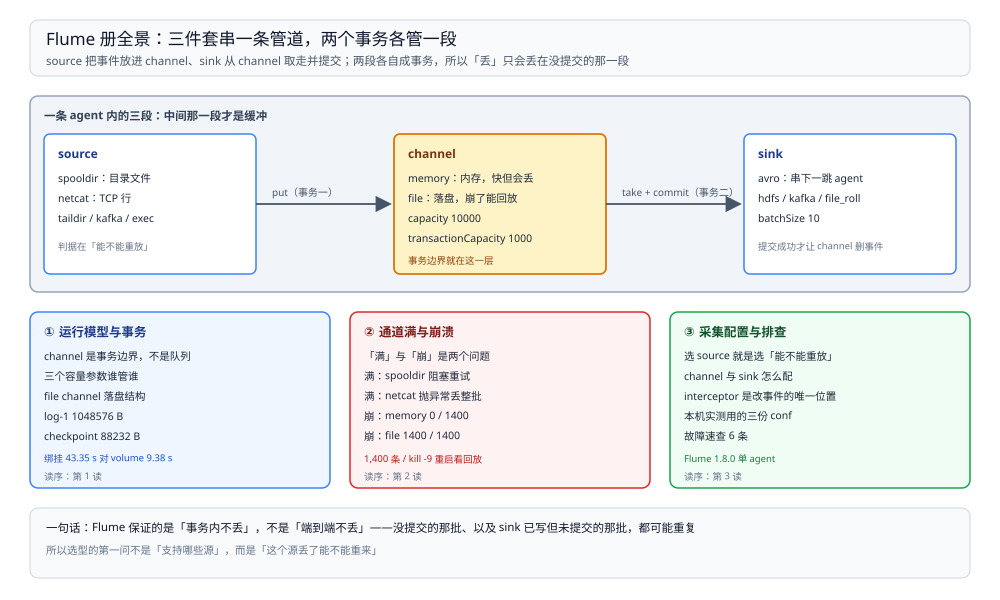

# Flume 目录导读

> 覆盖：Flume agent 自己怎么跑起来——三件套与两段事务、三个容量参数谁管谁、memory 与 file channel 在崩溃时差多少、通道满了谁丢谁不丢、以及 source / sink / interceptor 的选型与配置，共 **3 篇零件**。
>
> 不覆盖：与其他采集 / 同步工具的分工见 [数据集成与采集选型对比.md](../数据集成与采集选型对比.md)；binlog 解析这条路线见 [README.md](../../../数据存储/数据同步/CDC/README.md)（CDC 册）；日志落到后端之后怎么查见 [日志系统选型对比.md](../../../中间件/可观测性/日志系统/日志系统选型对比.md)。
>
> 内容整理自个人学习笔记。本册读数全部来自本机 `dockerproxy.net/probablyfine/flume:latest` 容器（Flume **1.8.0**、JDK **1.8.0_171**）；sink 故意指向死端口 `127.0.0.1:41414` 制造积压，`capacity=10000`、`transactionCapacity=1000`、source / sink `batchSize` 为 500 / 10，每个场景灌入 1,400 条。各篇逐处标注实测与文档口径。

---

## 一、一句话定位：它只保证「搬」，不保证「算」

**本节要点**：Flume 的能力边界很窄——**把事件从 source 搬到 sink，中间靠 channel 做事务与缓冲**。它没有 SQL、没有 transform 引擎、没有 checkpoint，也没有 binlog 解析；换来的是极简的部署与明确的丢 / 不丢语义。

| 维度 | Flume | SeaTunnel | DataX | Canal |
| --- | --- | --- | --- | --- |
| 形态 | 常驻 agent | 常驻引擎（local / 集群） | 一次性进程 | 常驻服务端 |
| 有没有计算 | ❌ 只有 interceptor | ✅ transform / SQL | ❌ 只有列映射 | ❌ 只解析日志 |
| 位点 | channel（file 可回放） | checkpoint | 无 | 服务端位点 |
| 事件来源 | 文件、端口、avro、kafka | 插件（70+） | SQL 查询 | MySQL binlog |
| 出事时问什么 | **这批事件在 channel 里吗** | 上次 checkpoint 在哪 | 重跑哪个条件 | 位点从哪续 |

⭐ 记住这一句：**Flume 的可靠性问题只有一个——「这批事件现在在哪」**。在 channel 里就能救，被 sink 提交就结束了，被 source 丢掉就永远没了。

## 二、三篇分工

**本节要点**：三篇按「结构 → 故障 → 配置」排开：先知道事件走哪两段事务、再知道两段各在什么条件下丢、最后才是具体组件怎么配。

图上半是一条事件从 source 到 sink 的两段事务路径，下半是两篇故障篇各自的判据（满看 source、崩看 channel），最右侧是配置篇覆盖的三类组件。**三篇讲的是同一根管道的三个切面**，不重叠。

| 篇 | 回答什么 | 本册的关键读数 |
| --- | --- | --- |
| ① [运行模型与事务.md](运行模型与事务.md) | 三件套各管什么、两段事务的边界、三个容量参数的约束、memory 与 file 的差别、file channel 在磁盘上留下什么 | `log-1` **1,048,576 B**、`checkpoint` **88,232 B**、`inflightputs/takes` 各 **32 B**；绑定挂载 **43.35 s** vs volume **9.38 s** |
| ② [通道满与崩溃.md](通道满与崩溃.md) | 通道满谁丢、崩溃谁丢、重启回放看哪个数、怎么按「源能不能重放」选组合 | `spooldir` 满 → 阻塞重试**不丢**；`netcat` 满 → `ChannelFullException`**丢整批**；memory 崩 → **0/1400**；file 崩 → **1400/1400** |
| ③ [采集配置与排查.md](采集配置与排查.md) | source / channel / sink 的选择判据、完整配置与启动命令、interceptor 的位置、报错速查 | 配置在本机 1.8.0 跑通；`spooldir` 读完改名 `.COMPLETED` |

## 三、阅读路线

| 顺序 | 篇 | 视角 | 什么时候读 |
| --- | --- | --- | --- |
| ① | [运行模型与事务.md](运行模型与事务.md) | ⭐ **主线 / 原理** | 第一次用：事件怎么走、容量参数怎么配、磁盘上那些文件是什么 |
| ② | [通道满与崩溃.md](通道满与崩溃.md) | 可靠性 | 要回答「会不会丢」「重启后会不会重」时 |
| ③ | [采集配置与排查.md](采集配置与排查.md) | 配置 / 排障 | 换 source、挂 interceptor、agent 起不来时 |

### 依赖关系

| 本篇 | 建议先读 | 为什么 |
| --- | --- | --- |
| 通道满与崩溃.md | 运行模型与事务.md | 「满」与「崩」分别落在两段事务上，不知道边界就分不清丢在哪一段 |
| 采集配置与排查.md | 运行模型与事务.md | 配置里 `capacity` / `transactionCapacity` / `batchSize` 的约束关系在那篇第三节 |

> ⭐ **两条线**：**原理线**（① → ②）回答「它怎么保证不丢」；**问题线**按现象直达——「source 卡住」看 ② 第三节，「重启丢数据」看 ② 第四节，「agent 起不来」看 ③ 6.2 节。

## 四、本轮实测坐标

| 项 | 值 |
| --- | --- |
| 镜像 / 版本 | `dockerproxy.net/probablyfine/flume:latest`（Flume **1.8.0**、JDK **1.8.0_171**） |
| 容器 | `int-flume`，单 agent，配置与数据目录经 Docker volume / 绑定挂载提供 |
| sink | `avro` 指向 `127.0.0.1:41414`（无监听），`batchSize=10` |
| channel | `capacity=10000`、`transactionCapacity=1000` |
| source | `spooldir`（目录文件）与 `netcat`（TCP 行）各一组 |
| 灌入量 | 每场景 **1,400** 条 |
| 崩溃方式 | `docker exec ... kill -9 <flume pid>`，重启后看 `Queue Size after replay` |

六条最值得记住的读数：

| 读数 | 值 | 出处 |
| --- | --- | --- |
| memory channel 崩一次全丢 | **0 / 1400**，重启队列 0 | [通道满与崩溃.md](通道满与崩溃.md) 第四节 |
| file channel 崩一次全回放 | `Queue Size after replay: 1400`，最终 **1400 / 1400** | [通道满与崩溃.md](通道满与崩溃.md) 第四节 |
| 通道满时 `spooldir` 不丢 | 每 1000 ms 重试，文件保持原名、不改 `.COMPLETED` | [通道满与崩溃.md](通道满与崩溃.md) 第三节 |
| 通道满时 `netcat` 丢整批 | `ChannelFullException: Space for commit to queue couldn't be acquired` | [通道满与崩溃.md](通道满与崩溃.md) 第三节 |
| file channel 的落盘结构 | `log-1` **1,048,576 B** + `checkpoint` **88,232 B** + 4 个元信息文件 | [运行模型与事务.md](运行模型与事务.md) 4.1 节 |
| 数据目录位置改变落盘速度 | 绑定挂载 **43.35 s** vs Docker volume **9.38 s**（≈4.6×） | [运行模型与事务.md](运行模型与事务.md) 4.2 节 |

> ⚠️ **未实测项**：`taildir` / `exec` / `kafka` source，`hdfs` / `kafka` / `file_roll` sink，interceptor 四件套，`syncPerTx` / `checkpointInterval` 调优，多 agent 串联（avro sink → avro source），「sink 已写成功、提交前崩溃」的重复投递，断电（非进程崩溃）场景。原因统一是本机只跑了单容器单 agent、只挂了两类 source，其余要么需要多进程对接、要么需要物理断电。

## 五、本册的边界

| 本册收 | 不收（在哪） |
| --- | --- |
| Flume 自身机制：事务、channel、容量、丢与不丢 | **采集工具横向选型** → [数据集成与采集选型对比.md](../数据集成与采集选型对比.md) |
| 可复现的配置、日志原文与文件布局 | **日志后端的存储与查询** → [日志系统选型对比.md](../../../中间件/可观测性/日志系统/日志系统选型对比.md) |
| 单 agent 的采集管道 | **多 agent 汇聚与跨机房传输** → 本册未覆盖，见 [跨城传输全链路-TCP篇.md](../../../../02-计算机基础/网络/跨城传输全链路-TCP篇.md)（仅网络侧） |
| 文件 / 端口两类 source | **数据库变更** → [README.md](../../../数据存储/数据同步/CDC/README.md)（CDC 册）|

## 延伸追问

- **Flume 和 Filebeat / Vector 怎么选？** → Flume 的强项是「事务 + 可持久化 channel + 拓扑串联」；Filebeat 更轻、更贴日志场景；Vector 有 transform 能力。判据在「需不需要 agent 之间串联」与「丢了能不能重来」，三者细节见 [日志系统选型对比.md](../../../中间件/可观测性/日志系统/日志系统选型对比.md)。
- **只想保证不丢，最短配置是什么？** → `file` channel + 可重放的 source（`taildir` / `spooldir` / `kafka`）+ 幂等 sink；三样缺一，本册第二篇的某种丢法就会出现。
- **为什么本册没有吞吐数字？** → 本机 sink 是死端口，吞吐由「失败重试节奏」而不是 Flume 能力决定；4.2 节的 43.35 s / 9.38 s 只用来对比落盘位置，不代表采集吞吐。
- **Flume 还值得学吗？** → 值得了解它的语义（事务 + channel），这是所有采集器的共同问题；但新项目更常见的选择是 Filebeat / Vector / SeaTunnel，见总纲的选型判据。
- **这套实测怎么复现？** → 起一个 Flume 1.8.0 容器，把第四节的配置挂进去，`flume-ng agent -n agent -c ... -f ...`,再灌文件或用 `nc` 发 TCP 行，最后 `kill -9` 看重启日志。

## 关联

- **上游/总纲**：[数据集成与采集选型对比.md](../数据集成与采集选型对比.md) — 采集、批同步、CDC 三类工具的分工
- **上游/总纲**：[大数据选型对比.md](../../大数据选型对比.md) — 本目录在七层职责里的位置
- **对照/互补**：[SeaTunnel 册](../SeaTunnel/README.md) — 同为常驻形态，但有引擎与 checkpoint
- **对照/互补**：[README.md](../../../数据存储/数据同步/CDC/README.md)（CDC 册）— 从数据库变更拿事件的另一条路
- **下游**：[日志系统选型对比.md](../../../中间件/可观测性/日志系统/日志系统选型对比.md) — 采集到的日志落到哪、怎么查
