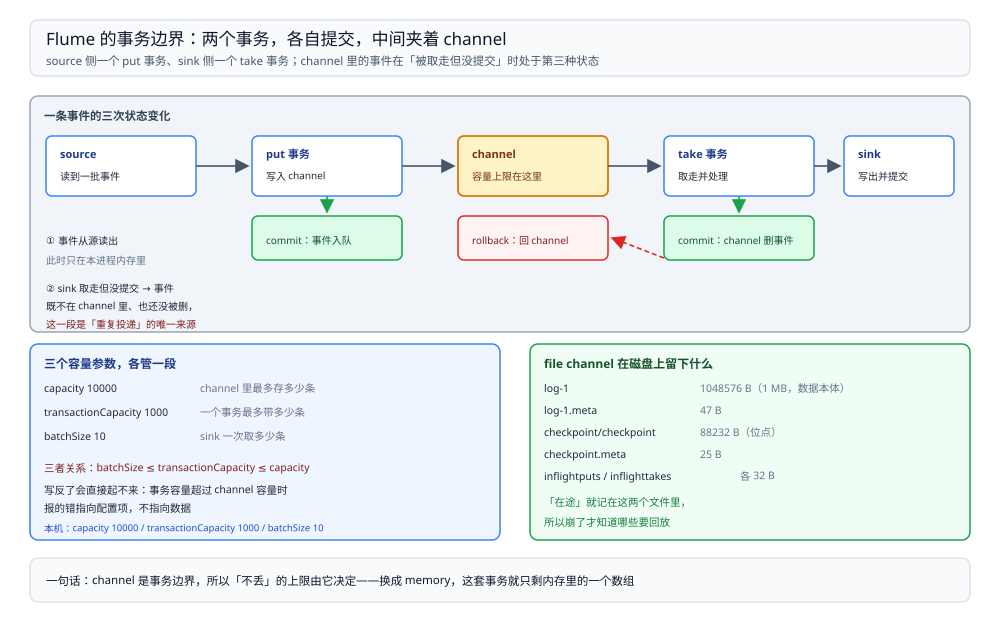

# 运行模型与事务

> 覆盖：Flume agent 的三件套（source / channel / sink）与它们之间的事务边界、三个容量参数谁管谁、memory channel 与 file channel 的差别（含 file channel 在磁盘上留下的每一类文件）、以及事件从进 channel 到被确认的完整路径。
>
> 不覆盖：崩溃后到底丢多少、通道满了谁会丢见 [通道满与崩溃.md](通道满与崩溃.md)；source / sink / interceptor 的选型与报错见 [采集配置与排查.md](采集配置与排查.md)。
>
> 内容整理自个人学习笔记。本篇读数来自本机 `dockerproxy.net/probablyfine/flume:latest` 容器（Flume **1.8.0**、JDK **1.8.0_171**），数据由本地脚本灌入，channel 容量 `capacity=10000`、`transactionCapacity=1000`、source/sink `batchSize` 分别 500 / 10；磁盘文件清单来自 `file` channel 运行期的 `docker exec ls -l`。

---

## 一、一句话定位：channel 是事务边界，不是队列

**本节要点**：Flume 的可靠性全部来自「source 与 channel 之间」「channel 与 sink 之间」这两段**事务**。channel 只是承载事务的存储——它是不是持久化，决定了进程崩溃时在途数据会不会消失。

| 段 | 谁发起事务 | 提交条件 | 失败了会怎样 |
| --- | --- | --- | --- |
| source → channel | source 每批 `put` | 整批放进 channel 才提交 | 回滚，这批事件重放（或按 source 语义丢弃，见可靠性篇） |
| channel → sink | sink 每批 `take` | sink 写成功后才提交 | 回滚，事件放回 channel，重试 |

⭐ 记住这句：**Flume 不丢数据的前提是「channel 持久化 + sink 失败回滚」同时成立**。memory channel 只有后者，进程一死事务日志就没了；file channel 两个都有，代价是每条事件都要写盘 + 刷盘。

## 二、三件套各管什么

**本节要点**：source 决定「从哪读、读多快」，channel 决定「能缓冲多少、能不能扛崩溃」，sink 决定「写到哪、写多快」，三者靠 `channels` 字段连起来。

| 组件 | 职责 | 本机用到的形态 | 关键参数 |
| --- | --- | --- | --- |
| source | 采集，产出事件并放进 channel | `spooldir`（目录文件）、`netcat`（TCP 行） | `batchSize`、`channels` |
| channel | 缓冲 + 事务存储 | `memory`、`file` | `capacity`、`transactionCapacity` |
| sink | 从 channel 取事件并写出 | `avro`（本机故意指向死端口 41414） | `batchSize`、`channel` |

本机之所以让 sink 指向一个**死端口**：这样 sink 永远写不成功、永远不会提交，channel 只会被填满，便于观察「通道满」与「进程崩溃」两件事。真实的 HDFS / Kafka sink 只是把「写成功」换成了另一个判断。

图里两段实线是事务范围：左侧 source 的 `put` 与右侧 sink 的 `take/commit` 各自成事务，中间 channel 的存储形态（内存或磁盘）决定崩溃时这批事件还在不在。**sink 写失败时事件回滚回 channel，不会跳过**——这就是「死端口」能让 channel 一直涨的原因。

## 三、三个容量参数，谁管谁

**本节要点**：`capacity` 是 channel 总容量，`transactionCapacity` 是单事务上限，`batchSize` 是一次取/放的条数。约束关系是 **batchSize ≤ transactionCapacity ≤ capacity**。

| 参数 | 属于谁 | 含义 | 本机取值 | 超了会怎样 |
| --- | --- | --- | --- | --- |
| `capacity` | channel | channel 最多存多少条 | 10000 | `put` 阻塞（或抛异常，看 source） |
| `transactionCapacity` | channel | 一个事务最多取/放多少条 | 1000 | 启动时校验失败或运行时截断 |
| `batchSize` | source / sink | 一次事务处理多少条 | source 500 / sink 10 | 大于事务容量会被截断到事务容量 |

⚠️ 常见配置错误是「`batchSize` 写成 5000、`transactionCapacity` 还是默认 100」，结果实际每批只有 100 条——**吞吐上不去，但日志不报错**。本机 sink 的 `batchSize=10` 是有意压慢，用来制造积压。

## 四、memory channel 与 file channel

**本节要点**：两者对上层的接口完全一样，区别只在「事件存在哪」——内存里的 `LinkedBlockingQueue`，还是本地磁盘上的 data + checkpoint 两套文件。

| 维度 | memory | file |
| --- | --- | --- |
| 存储 | JVM 堆内队列 | 本地磁盘（`dataDirs` + `checkpointDir`） |
| 崩溃后 | **在途事件全部丢失** | 从 checkpoint + data 回放 |
| 吞吐 | 高（纯内存） | 受 fsync 与磁盘影响，本机比内存慢一个量级 |
| 容量上限 | 受堆与 `byteCapacity` 限制 | 受磁盘限制 |
| 适合 | 可丢的日志、下游自带重放 | 计费、审计、不能重放的源 |

### 4.1 file channel 在磁盘上留下什么

本机 `file` channel（`capacity=10000`、`transactionCapacity=1000`）跑起来后，目录结构如下：

| 路径 | 大小 | 作用 |
| --- | --- | --- |
| `data/log-1` | **1,048,576 B** | 事件数据文件，按固定大小滚动（本机 1 MB 一个） |
| `data/log-1.meta` | 47 B | 该数据文件的元信息 |
| `checkpoint/checkpoint` | **88,232 B** | 检查点主体，记录「哪些事件已提交」 |
| `checkpoint/checkpoint.meta` | 25 B | 检查点文件的元信息 |
| `checkpoint/inflightputs` | 32 B | 正在 `put` 的事务标记 |
| `checkpoint/inflighttakes` | 32 B | 正在 `take` 的事务标记 |
| `checkpoint/queueset/` | — | 队列集合（多队列时每个队列一份） |
| `in_use.lock` | — | 进程占用锁，防止两个 agent 抢同一个 channel 目录 |

⭐ 判读：**`log-*` 是数据，`checkpoint/` 是「谁已经确认过」**。崩掉重启时，Flume 用 checkpoint 决定从哪继续，再把 data 里没用完的部分读回来；所以「重启后还能看到事件」不是从日志重放，而是从 data + checkpoint 恢复队列状态。

### 4.2 落盘位置会显著改变速度

同一份配置，`dataDirs` 与 `checkpointDir` 放在 **Windows 绑定挂载**上 vs 放在 **Docker volume** 里：

| 落盘位置 | 处理完 1400 条耗时 |
| --- | --- |
| Windows 绑定挂载（`-v D:/tmp/...:/opt/flume-data`） | **43.35 s** |
| Docker volume | **9.38 s** |

差约 **4.6 倍**。原因是每次事务提交都要 fsync，而 Windows 绑定挂载的 fsync 语义要跨一层文件系统转换；**这不是 Flume 的问题，是「容器里跑持久化组件时数据目录该放哪」的问题**。

## 五、一条事件的完整路径

**本节要点**：从 source 读到 sink 提交，一条事件要经过「读 → put 事务 → channel 存储 → take 事务 → 写 → 提交」六个动作；任何一个提交点之前的崩溃，结果都由 channel 形态决定。

| 步骤 | 动作 | 崩溃在这里会怎样（file channel） |
| --- | --- | --- |
| ① | source 读源（读文件一行 / 收一行 TCP） | 源侧没消费标记，重启重读 |
| ② | `put` 事务开始，事件进 channel | `inflightputs` 里有标记，重启回滚 |
| ③ | `put` 提交 | 事件已在 data + checkpoint 里，重启保留 |
| ④ | sink `take` 事务取一批 | `inflighttakes` 有标记，重启回滚 |
| ⑤ | sink 写出（本机：连不上的 avro） | 事务不提交，事件回滚 |
| ⑥ | sink 提交，checkpoint 前进 | 已确认，不再重放 |

⚠️ 本机只验证了「`put` 已提交、`take` 未提交」这一种崩溃点（channel 满 + `kill -9`），其余提交点的行为按上表由 checkpoint 机制推出，**未逐点实测**。

## 六、验证与排查

**本节要点**：先确认 channel 里到底堆了多少，再看事务有没有提交。

### 6.1 先确认状态

| 检查项 | 怎么看 | 期望 |
| --- | --- | --- |
| channel 积压 | 日志 `Channel ... queue size` 行 / sink 日志 | 随 source 灌入而上涨 |
| 事务是否提交 | sink 侧是否出现写成功日志 | 死端口测试里**永远不出现** |
| 落盘是否生效 | `ls -l` 数据目录 | 出现 `log-*` 与 `checkpoint/` |
| 重启是否回放 | 启动日志 `Queue Size after replay: N` | N > 0 说明有未消费事件 |

### 6.2 常见故障速查

| 症状 | 先查什么 |
| --- | --- |
| channel 一直满、source 卡住 | sink 是否写不出去（本机死端口的形态）；`batchSize` 是否被 `transactionCapacity` 截断 |
| 重启后数据没了 | channel 是不是 `memory` |
| 重启后事件重复 | sink 已写成功但提交前崩溃；下游需要幂等 |
| 吞吐远低于预期 | 数据目录是否在绑定挂载上；`transactionCapacity` 是否太小；`syncPerTx` 是否每次提交都 fsync |
| 两个 agent 抢同一目录 | 有没有残留 `in_use.lock` |

## 七、校验口径

| 内容 | 状态 |
| --- | --- |
| Flume 1.8.0 / JDK 1.8.0_171、`capacity=10000` / `transactionCapacity=1000` | ✅ 本机实测（容器内 `flume-ng version`） |
| file channel 的 8 类文件与大小（`log-1` 1,048,576 B、`checkpoint` 88,232 B 等） | ✅ 本机实测（运行期 `ls -l`） |
| 绑定挂载 43.35 s vs Docker volume 9.38 s | ✅ 本机实测，各一轮；**未做多轮取平均**，只断言量级差 |
| 事务边界的两段（source→channel、channel→sink） | 官方文档口径 + 日志行为一致；**未在其余提交点逐点实测** |
| `batchSize > transactionCapacity` 的实际截断值 | ⚠️ **未实测**：本机 batchSize 都小于事务容量 |
| HDFS / Kafka sink 的提交语义 | ⚠️ **未实测**：本机用死端口 avro sink 制造失败 |

---

## 延伸追问

- **channel 能不能不配置？** → 不能。每对 source / sink 至少要连一个 channel；`channels` 字段写成逗号分隔可以接多个，但 source 会按轮询或复制策略分发，语义要显式选。
- **`transactionCapacity` 调大有什么代价？** → 单事务内存与写盘量变大，失败回滚的粒度也变大；file channel 下还会拉长单次提交的 fsync 时间。
- **`file` channel 的 `capacity` 和磁盘空间什么关系？** → 容量按「条数」算，磁盘占用按事件大小算；本机 1 MB 一个 data 文件滚动，实际占用看 `log-*` 数量。
- **memory channel 真的完全不能用于生产吗？** → 可以，前提是「丢了能重来」：源可重读（如可回放的 Kafka）、或下游允许缺数据。计费、审计这类不能重放的场景必须用 file。
- **为什么 sink 失败不直接丢弃事件？** → 因为事务没提交，事件仍在 channel 里。丢弃只能由 sink 自己决定（例如写日志后抛异常放弃），Flume 不替你丢。

---

## 关联

- [README.md](README.md) — 本册导读：三篇分工与读序
- [通道满与崩溃.md](通道满与崩溃.md) — **下游**：同样两个 channel，崩一次与满一次分别丢多少
- [采集配置与排查.md](采集配置与排查.md) — **对照**：source / sink / interceptor 的选型与报错
- [数据集成与采集选型对比.md](../数据集成与采集选型对比.md) — **上游总纲**：采集器这一格由谁承担
- [README.md](../../../数据存储/数据同步/CDC/README.md)（CDC 册）— **对照**：另一条「跟着变」的路线
