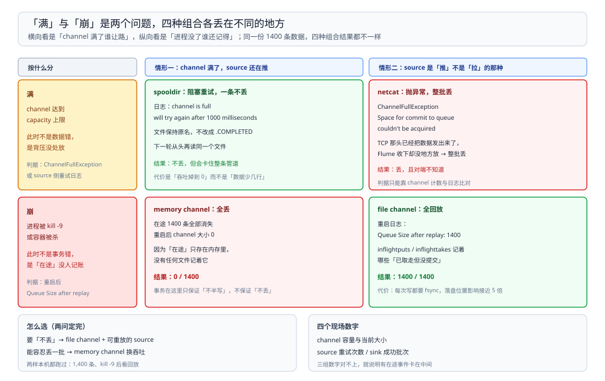

# 通道满与崩溃

> 覆盖：两件常被混为一谈的事——**channel 满了谁来背压、谁丢批**，以及**进程崩溃时在途事件还在不在**。前者是 source 的语义问题，后者是 channel 的持久化问题，四个组合的实测读数都在本篇。
>
> 不覆盖：事务边界与 file channel 的磁盘布局见 [运行模型与事务.md](运行模型与事务.md)；source / sink 的完整选型见 [采集配置与排查.md](采集配置与排查.md)。
>
> 内容整理自个人学习笔记。本篇读数来自本机 `dockerproxy.net/probablyfine/flume:latest`（Flume **1.8.0**、JDK **1.8.0_171**）单容器；sink 故意指向死端口 `127.0.0.1:41414` 制造堆积，每个场景灌入 **1400 条**事件后再分别制造「满」与「崩溃」。

---

## 一、一句话定位：满与崩是两个问题

**本节要点**：channel 满的时候，数据丢不丢由 **source 类型**决定；进程崩溃的时候，数据丢不丢由 **channel 类型**决定。两者正交，必须分开测。

| 场景 | 决定因素 | 本机结论 |
| --- | --- | --- |
| channel 满 | source 的 put 语义 | `spooldir` 阻塞重试**不丢**；`netcat` 抛异常**丢整批** |
| 进程崩溃 | channel 是否持久化 | `memory` 在途 **1400 条全丢**；`file` 重启回放 **1400 条** |

⭐ 记住：**「Flume 不丢数据」这句话只在「file channel + 可重试的 source」这个组合里成立**。换掉任一半，结论就变。

## 二、实验怎么造出「满」和「崩」

**本节要点**：让 sink 永远写不出去，channel 就只会被填满；此时再分别触发 `kill -9`，就能把两个变量拆开。

| 变量 | 设置 |
| --- | --- |
| sink | `avro` 指向 `127.0.0.1:41414`（无监听），`batchSize=10` |
| channel | `capacity=10000`、`transactionCapacity=1000` |
| source | `spooldir`（读目录文件）或 `netcat`（收 TCP 行） |
| 数据量 | 1400 条 |
| 观测 | source 日志、channel 积压、`ls` 文件重命名、重启日志 |



图里横轴是「通道满」，纵轴是「进程崩溃」，四个格子对应四种组合。**只有右下角（file + 可重试 source）是两端都不丢的组合**，其余三格都各丢一段。

## 三、通道满时：两种 source 的差别

**本节要点**：`spooldir` 在 put 之前就知道「这批放不进去」，于是阻塞等待；`netcat` 拿到事件后才发现放不进去，只能把这一批扔掉。

### 3.1 `spooldir`：阻塞重试，文件不重命名

channel 满之后的日志：

```text
The channel is full, and cannot write data now. The source will try again after 1000 milliseconds.
```

现场表现：

| 观察项 | 结果 |
| --- | --- |
| source 行为 | 每 1000 ms 重试一次 put，不退出 |
| 已读文件 | **保持原名**，不会被重命名成 `.COMPLETED` |
| 数据 | 一条不丢：文件还在原地，重启或腾出空间后继续读 |

⭐ 判据：**看目录里有没有 `.COMPLETED`**。文件还在原名上 = 这批还没进去，Flume 会重读；已经改名 = 内容已完整进 channel。

### 3.2 `netcat`：抛异常，整批丢弃

channel 满之后的日志：

```text
org.apache.flume.ChannelFullException: Space for commit to queue couldn't be acquired. Sinks are likely not keeping up with sources, or the buffer size is too tight
```

这一批事件**没有回滚到 source**——netcat 的「源」是 TCP 连接，Flume 无法让发送方重发，所以：

| 观察项 | 结果 |
| --- | --- |
| source 行为 | 抛 `ChannelFullException`，该批事件丢失 |
| 上游 | 发送方通常不知道丢了（TCP 已 ack） |
| 数据 | **这一批丢了**，不重试 |

还有一个容易踩的细节：**客户端立刻关闭连接会丢尾部**。同一脚本发 1000 行后马上 `close`，只落 230 行；发完 `sleep` 一段时间再关，增量 500 行全部落地。原因是行还没被 source 读走，连接已经断了。

## 四、进程崩溃时：memory 与 file 的差别

**本节要点**：`kill -9` 之后，memory channel 的在途 1400 条全部消失；file channel 重启时把 1400 条全部回放出来，再次消费 1400/1400。

| channel | `kill -9` 前在途 | 重启后 | 最终处理 |
| --- | --- | --- | --- |
| `memory` | 1400 | channel 空（0 条） | **0 / 1400** |
| `file` | 1400 | `Queue Size after replay: 1400` | **1400 / 1400** |

重放日志原文（file channel 版本）：

```text
Queue Size after replay: 1400
```

三点判读：

1. **memory 丢的是「channel 里还没被 sink 提交的全部」**，不是只有正在处理的那几条；
2. **file channel 的回放单位是「整个队列状态」**，从 checkpoint 与 data 文件恢复，不是重读源；
3. 本机实测里 file channel 重启后再次消费，计数 1400/1400 全对——**没有出现重复**，因为崩溃发生在 sink 提交之前（提交之后才会重放缺失的部分）。

⚠️ 崩溃点在「sink 已写成功、提交之前」时会重复投递，这一点本机**没有单独制造**，属于机制推论。

## 五、现场：崩溃前后要看的四个数

**本节要点**：判断「丢没丢、重没重」不看日志结论，看这四个数。

| 数 | 从哪看 | 说明 |
| --- | --- | --- |
| 在途条数 | channel 积压 / sink 日志 | 崩溃前 channel 里有多少 |
| 重启回放 | `Queue Size after replay: N` | 只对 file channel 出现 |
| 落盘文件 | `log-*`、`checkpoint/checkpoint` 的大小 | file channel 才有；memory 没有这两个目录 |
| 最终消费 | sink 实际收到条数 | 与灌入条数比较 |

## 六、怎么选

**本节要点**：按「源能不能重放」与「丢一条的代价」两问来定，不按吞吐定。

| 源能否重放 | 丢一条的代价 | 建议 |
| --- | --- | --- |
| 能（Kafka、可重跑的文件） | 低 | `memory` channel + 监控积压 |
| 能 | 高 | `file` channel（宁可慢也要确认） |
| 不能（netcat、syslog UDP） | 任意 | `file` channel + **换掉不可重放的 source**（改 `spooldir` 或前面加一层可回放的缓冲） |

⭐ 第三行是很多事故的真正原因：**source 本身不可重放，channel 再持久也救不回来**。netcat 丢了那一批，file channel 也无从回滚。

## 七、验证与排查

**本节要点**：按「先分清是满还是崩」定位，两类问题的处置完全不同。

### 7.1 先确认是哪一类

| 现象 | 类别 | 判据 |
| --- | --- | --- |
| source 停住但进程在 | 满 | 日志 `The channel is full`；文件没改名 |
| source 抛 `ChannelFullException` | 满 | 该批丢失，需要上游补 |
| 进程没了 / 重启后 channel 空 | 崩 | 重启日志有没有 `Queue Size after replay` |

### 7.2 常见故障速查

| 症状 | 先查什么 |
| --- | --- |
| 吞吐突然归零但进程在 | sink 是否写不出去（网络、权限、目标不可用） |
| 重启后事件重复 | 崩溃点在 sink 提交前；下游做幂等 |
| `spooldir` 目录里文件一直不 `.COMPLETED` | 通道满或在重试；看 source 日志 |
| `netcat` 收不全 | 客户端关闭太早；发完要等 source 读走 |
| `kill -9` 后 memory channel 全空 | 正常行为，不是 bug |

## 八、校验口径

| 内容 | 状态 |
| --- | --- |
| `spooldir` 满 → `The channel is full... will try again after 1000 milliseconds`、文件不重命名 | ✅ 本机实测 |
| `netcat` 满 → `ChannelFullException: Space for commit to queue couldn't be acquired`、该批丢失 | ✅ 本机实测 |
| netcat 客户端立即关闭丢尾部（1000 行只落 230；加 `sleep` 后增量 500 全落） | ✅ 本机实测 |
| memory channel `kill -9` → 1400 条全丢、重启队列 0 | ✅ 本机实测 |
| file channel `kill -9` → `Queue Size after replay: 1400`、最终 1400/1400 | ✅ 本机实测 |
| 「sink 已写成功、提交前崩溃」导致重复 | ⚠️ 机制推论，**未单独制造该崩溃点** |
| 多 agent 组网（avro source + sink 串联）的端到端不丢 | ⚠️ **未实测**：单容器单 agent |

---

## 延伸追问

- **`spooldir` 文件为什么不重命名？** → 重命名 `.COMPLETED` 是「文件内容全部进入 channel 且事务提交」之后的动作；通道满时事务没开始或没提交，所以保持原名。
- **file channel 会不会丢？** → 正常 `kill -9` 不丢（本机 1400/1400）；丢在极端情况：磁盘写坏、`dataDirs` 与 `checkpointDir` 被清、或 `fsync` 没落盘就断电。本机只测了进程崩溃，**没测断电**。
- **memory channel 的容量怎么估？** → `capacity × 平均事件大小`，还要留出 `transactionCapacity` 的余量；本机 10000 条容量只用到了 1400 条就崩了，容量不是瓶颈。
- **能不能同时用两种 channel？** → 可以，一个 source 配多个 channel（复制或轮询），但事务是**每个 channel 各自一段**，一个成功一个失败时不会互相回滚，要靠 sink 侧补齐。
- **为什么 sink 要故意指向死端口？** → 只有让 sink 永远不提交，channel 才会稳定涨到满；换成真 HDFS sink，数据很快被消费掉，就观察不到「满」。

---

## 关联

- [README.md](README.md) — 本册导读：三篇分工与读序
- [运行模型与事务.md](运行模型与事务.md) — **上游**：两段事务的边界、file channel 的磁盘布局
- [采集配置与排查.md](采集配置与排查.md) — **对照**：可重放 / 不可重放的 source 有哪些
- [数据集成与采集选型对比.md](../数据集成与采集选型对比.md) — **上游总纲**：采集器与 CDC、批同步的边界
- [README.md](../../../中间件/消息队列/Kafka/README.md)（Kafka 册）— **对照**：换成一个可重放的源，位点语义由谁负责
