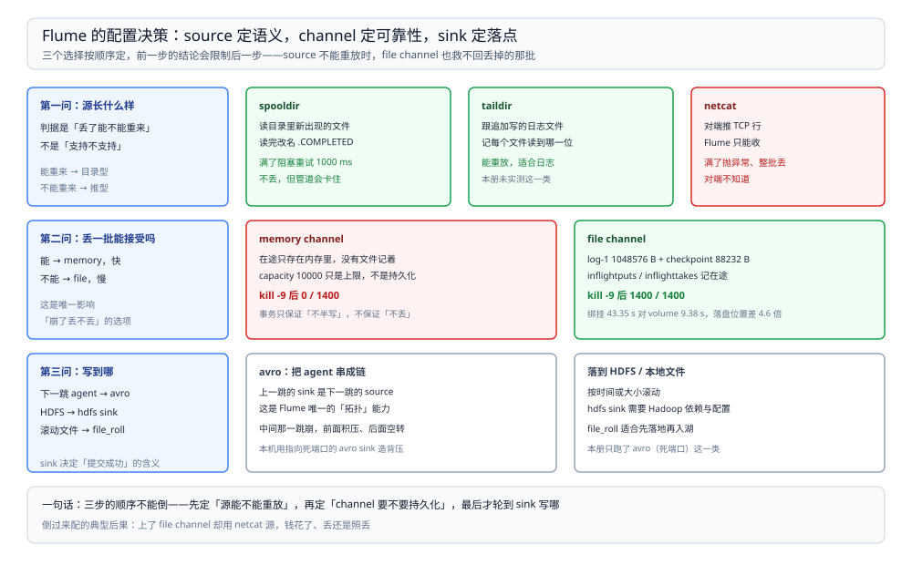

# 采集配置与排查

> 覆盖：source / channel / sink 三类组件的选择判据、本机实测用的完整配置文件、启动命令与日志位置、interceptor 的作用位置，以及常见报错速查。
>
> 不覆盖：事务边界与磁盘布局见 [运行模型与事务.md](运行模型与事务.md)；通道满与崩溃的实测见 [通道满与崩溃.md](通道满与崩溃.md)。
>
> 内容整理自个人学习笔记。本篇配置文件在本机 `dockerproxy.net/probablyfine/flume:latest`（Flume **1.8.0**、JDK **1.8.0_171**）容器里跑通；其中 `spooldir` / `netcat` / `avro` 三种组件有实测，`taildir` / `exec` / `kafka` 等**未实测**，只给判据。

---

## 一、一句话定位：选 source 就是选「能不能重放」

**本节要点**：Flume 配置的难点不在语法，在**语义**——每个 source 的可重放性不同，决定了丢一条的代价；每个 sink 的提交语义不同，决定了上游要不要幂等。

| 组件类 | 选择判据 | 一句话 |
| --- | --- | --- |
| source | **源能不能重读** | 能重读的（文件、可回放队列）才配得上「不丢」的承诺 |
| channel | **崩了能不能接受丢** | 能接受用 `memory`，不能接受用 `file` |
| sink | **写成功怎么判定** | 事务提交点不同，重复投递的窗口就不同 |



图从左到右是三列决策：先问源能否重读（决定有没有「不丢」的资格），再问进程崩了能否接受丢（决定 channel 类型），最后问写成功的判定（决定下游要不要幂等）。**三列都是语义问题，不是性能问题**。

## 二、source 怎么选

**本节要点**：`spooldir` 是最稳的「文件进、事件出」入口；`netcat` 只能做实验；生产里的日志落地优先 `taildir`。

| source | 从哪读 | 可重放 | 本机实测 | 注意 |
| --- | --- | --- | --- | --- |
| `spooldir` | 目录里新出现的文件，读完改名 `.COMPLETED` | ✅ 文件还在就不丢 | ✅ 用了 | 文件**写完才能放进来**，正在写的文件读不全 |
| `netcat` | TCP 端口，按行 | ❌ 客户端 ack 后即不可恢复 | ✅ 用了 | 通道满抛 `ChannelFullException` 丢批；客户端早关丢尾部 |
| `taildir` | 按文件追加读，记 inode + offset | ✅ 有 position 文件 | ⚠️ **未实测** | 日志落地的主力，支持新文件发现与轮转 |
| `exec` | 执行命令的 stdout | ❌ 命令输出不可回放 | ⚠️ **未实测** | 只适合一次性命令 |
| `avro` | 另一个 agent 发来的事件 | 取决于上游 | ⚠️ **未实测** | 多 agent 串联时用 |
| `kafka` | Kafka topic，按 offset | ✅ 位点可提交 | ⚠️ **未实测** | 与 `kafka` sink 组成桥接 |

⭐ 判据顺序：**先看源能不能重读，再看要不要按文件跟读**。源本身不可重放（netcat、exec），channel 再持久也补不回来——丢的那一刻上游已经认为送达了。

## 三、channel 与 sink 怎么选

**本节要点**：channel 只有两种（内存 / 磁盘），sink 的差别主要在「提交点」。

| channel | 关键参数 | 适合 |
| --- | --- | --- |
| `memory` | `capacity`、`transactionCapacity`、`byteCapacity` | 可丢、追求吞吐 |
| `file` | 上述 + `dataDirs`、`checkpointDir`、`checkpointInterval`、`syncPerTx` | 不能丢、可接受慢 |

| sink | 提交点 | 适合 |
| --- | --- | --- |
| `logger` | 打印到日志后提交 | 联调 |
| `avro` | 对端 ack 后提交 | agent 串联 |
| `hdfs` | 文件关闭 / 批次刷写后提交 | 离线落地（有临时文件与滚动策略） |
| `kafka` | producer 确认后提交 | 进消息队列（⚠️ 本机未实测） |
| `file_roll` | 写本地文件后提交 | 兜底落盘（⚠️ 本机未实测） |

⚠️ 本机只实测了 `avro` 指向死端口的失败形态与 `logger` 之外的打印行为，**HDFS / Kafka sink 的提交语义按文档口径写**。

## 四、本机实测用的配置

**本节要点**：一份最小可跑的 `spooldir → file channel → 死端口 avro` 配置，通道满与崩溃两组实验都用它。

```properties
agent.sources.s1.type = spooldir
agent.sources.s1.spoolDir = /opt/flume-spool
agent.sources.s1.channels = c1
agent.sources.s1.batchSize = 500

agent.channels.c1.type = file
agent.channels.c1.checkpointDir = /opt/flume-data/checkpoint
agent.channels.c1.dataDirs = /opt/flume-data/data
agent.channels.c1.capacity = 10000
agent.channels.c1.transactionCapacity = 1000

agent.sinks.k1.type = avro
agent.sinks.k1.channel = c1
agent.sinks.k1.hostname = 127.0.0.1
agent.sinks.k1.port = 41414
agent.sinks.k1.batchSize = 10
```

启动（容器内，`MSYS_NO_PATHCONV=1` 避免 Git Bash 改写容器内绝对路径）：

```bash
docker exec -d int-flume /opt/flume/bin/flume-ng agent \
  -n agent -c /opt/flume/conf -f /opt/flume-lab/flume-file.conf \
  -Dflume.root.logger=INFO,console
```

| 参数 | 说明 |
| --- | --- |
| `-n agent` | agent 名，必须与配置文件前缀 `agent.` 对应 |
| `-f` | 配置文件路径 |
| `-c` | 配置目录（log4j 等） |
| `-Dflume.root.logger=INFO,console` | 日志打到控制台；容器里用 `docker logs` 看 |
| `spoolDir` 文件命名 | 已处理文件会加 `.COMPLETED` 后缀，同名前缀重复投放会被拒 |

⚠️ `spoolDir` 里的文件**写完之后必须原子改名或移动进来**，否则 source 读到一半就按当前长度收尾，后半段丢失。

## 五、interceptor：改事件的唯一位置

**本节要点**：interceptor 挂在 source 上，在事件进 channel 之前改 header 或 body；**它不参与事务**，改坏了无法回滚。

| interceptor | 作用 | 典型用途 |
| --- | --- | --- |
| `timestamp` | 加 `timestamp` header | 下游按时间分区 |
| `host` | 加 `host` header | 多机汇聚时区分来源 |
| `static` | 加固定 key/value | 打标（环境、业务线） |
| `regex_filter` | 按正则丢弃事件 | 过滤噪音 |

```properties
agent.sources.s1.interceptors = i1 i2
agent.sources.s1.interceptors.i1.type = timestamp
agent.sources.s1.interceptors.i2.type = host
agent.sources.s1.interceptors.i2.hostHeader = source_host
```

⚠️ 本机**未实测 interceptor**（配置里没挂）；以上为文档口径。要注意 `regex_filter` 是**丢弃**语义，丢在进 channel 之前，file channel 也救不回来。

## 六、验证与排查

**本节要点**：先确认配置被解析（agent 起得来），再从「source 有没有产事件」「channel 有没有涨」「sink 有没有提交」三段定位。

### 6.1 先确认配置生效

| 检查项 | 怎么看 | 期望 |
| --- | --- | --- |
| agent 启动 | `docker logs` 里 `Component type: SOURCE, name: s1 started` | 三类组件各一行 |
| source 读到文件 | `spoolDir` 里出现 `.COMPLETED` | 说明整批已进 channel |
| channel 有数据 | 日志 `Queue Size` / `Channel size` | 随灌入上涨 |
| sink 提交 | sink 侧有写出成功 | 死端口场景**永远没有** |

### 6.2 常见故障速查

| 症状 | 先查什么 |
| --- | --- |
| agent 起不来、报 `No channel` | source / sink 的 `channels` / `channel` 字段名写错（一个复数、一个单数） |
| `spoolDir` 文件被读一半 | 文件不是原子移动进来的；应写完再 `mv` |
| 同一文件投放被拒 | 已有同名 `.COMPLETED`，换个文件名或清理 |
| 事件里没有时间 / 主机 | interceptor 没挂或挂错位置（必须挂在 source 上） |
| 落盘慢得离谱 | `dataDirs` 在绑定挂载上（本机实测差 4.6 倍） |
| 容器内路径被 Git Bash 改写 | docker 命令前加 `MSYS_NO_PATHCONV=1` |

## 七、校验口径

| 内容 | 状态 |
| --- | --- |
| 第四节配置在本机跑通（Flume 1.8.0 / JDK 1.8.0_171） | ✅ 本机实测 |
| `spooldir` 的 `.COMPLETED` 重命名行为 | ✅ 本机实测（通道满时保持原名） |
| `netcat` 丢批与丢尾部 | ✅ 本机实测（见 [通道满与崩溃.md](通道满与崩溃.md)） |
| 启动命令与 `-n / -c / -f` 三个参数 | ✅ 本机实测 |
| `taildir` / `exec` / `kafka` source、`hdfs` / `kafka` / `file_roll` sink | ⚠️ **未实测**：只用 `spooldir` / `netcat` / `avro` / `logger` |
| interceptor（timestamp / host / static / regex_filter） | ⚠️ **未实测**：配置里没挂 |
| `syncPerTx`、`checkpointInterval` 的调优取值 | ⚠️ **未实测**：用默认值 |

---

## 延伸追问

- **`spooldir` 和 `taildir` 该用哪个？** → 文件「整份到达」用 `spooldir`（读完改名，语义干净）；文件「持续追加」用 `taildir`（记 offset，支持轮转）。日志场景几乎都是后者。
- **一个 agent 能配几个 source / sink？** → 任意多个，靠 `channels` 字段连线；同一 source 复制到两个 channel 时，事务各自独立，不是全局一致。
- **sink 批量大一点是不是更快？** → 是，但受 `transactionCapacity` 截断，且单批越大失败回滚的代价越大；本机 sink 故意设 10 条来制造积压。
- **为什么容器里的 Flume 版本是 1.8.0 而不是最新？** → 官方 tar 包下载超时，改用镜像内置的 1.8.0；新版本（1.11）的差异本仓未覆盖。
- **能不能用 Flume 做 CDC？** → 不能。它没有 binlog 解析能力，`taildir` 读的是日志文件不是数据库日志；数据库变更走 [README.md](../../../数据存储/数据同步/CDC/README.md)（CDC 册）。

---

## 关联

- [README.md](README.md) — 本册导读：三篇分工与读序
- [运行模型与事务.md](运行模型与事务.md) — **上游**：事务边界与容量参数的约束关系
- [通道满与崩溃.md](通道满与崩溃.md) — **下游**：本机配置在满与崩两种场景下的读数
- [数据集成与采集选型对比.md](../数据集成与采集选型对比.md) — **上游总纲**：采集器与 SeaTunnel、Sqoop 的分工
- [README.md](../../../数据存储/数据同步/CDC/README.md)（CDC 册）— **对照**：数据库变更这条通道
