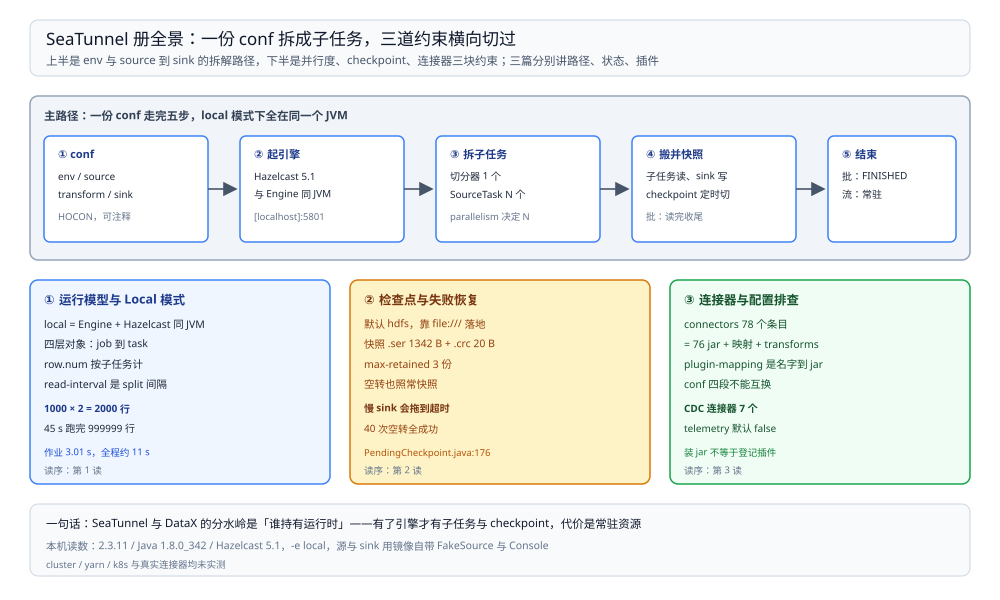

# SeaTunnel 目录导读

> 覆盖：SeaTunnel 自己怎么跑起来——它和 DataX、Flume 的分水岭在哪，`local` 模式里到底是哪几个进程，`row.num` 与 `read-interval` 这两个最容易读错的参数各是什么意思，checkpoint 存在哪、长什么样、什么时候会超时，以及连接器目录与配置从哪查起，共 **3 篇零件**。
>
> 不覆盖：五个采集 / 同步工具怎么选见 [数据集成与采集选型对比.md](../数据集成与采集选型对比.md)；DataX 与 Flume 的机制见 [DataX 册](../DataX/README.md) 与 [Flume 册](../Flume/README.md)；CDC 这条「读日志跟位点」的路线见 [README.md](../../../数据存储/数据同步/CDC/README.md)（CDC 册）。
>
> 内容整理自个人学习笔记。本册读数全部来自 `dockerproxy.net/apache/seatunnel:2.3.11` 容器（**2.3.11**，Java **1.8.0_342**，Hazelcast IMDG **5.1**），**local 模式**（`-e local`），源与 sink 都是镜像自带的 `FakeSource` / `Console`；日志与配置留在 `D:\tmp\st-lab\`。批作业与两个流作业各跑一次，未做多轮取波动。

---

## 一、一句话定位：它是「有引擎的 DataX」

**本节要点**：SeaTunnel 与 DataX 的分水岭不在「能读多少种源」，而在**谁持有运行时**——DataX 一个作业起一个裸 JVM、跑完退出；SeaTunnel 起的是一个**引擎**，作业只是提交给它的任务，因此它才有 checkpoint、有并行子任务、有失败恢复。

| 维度 | DataX | Flume | **SeaTunnel** | Canal |
| --- | --- | --- | --- | --- |
| 运行时 | 一作业一 JVM，跑完退出 | 常驻 agent | **常驻引擎（local 模式也是一个引擎实例）** | 常驻服务端 |
| 位点 / 状态 | 无 | channel + 文件重命名 | **checkpoint（可落 HDFS 或本地）** | 服务端位点 |
| 并行单位 | task / channel | 单 agent 内多 channel | **并行子任务（`parallelism`）** | 单实例多线程 |
| 批流 | 只批 | 只流 | **批流一体（`job.mode` 切换）** | 只流 |
| 拓扑串联 | 无 | source → channel → sink 可串 agent | 无（一份配置多 source / sink） | 无 |

⭐ 记住这一句：**DataX 是「跑一个快照的工具」，Flume 是「一直搬的管道」，SeaTunnel 是「能把两者都当作业提交的引擎」**。所以「要不要 checkpoint」「要不要常驻」这两问一分，选型基本就定了。

## 二、三篇分工

**本节要点**：三篇各回答一个独立的问题——作业怎么被拆成子任务跑、状态存在哪与什么时候会崩、连接器与配置从哪查。

图上半是从 conf 到子任务的拆解路径，下半是三条横向约束——`parallelism` 决定拆几个子任务、checkpoint 决定崩了回到哪、连接器目录决定能读什么能写什么。三篇分别对应「路径」「状态」「插件」三块。

| 篇 | 回答什么 | 本册的关键读数 |
| --- | --- | --- |
| ① [运行模型与Local模式.md](运行模型与Local模式.md) | `local` 模式里跑着什么、四层对象（job / pipeline / taskGroup / task）、批作业经过哪几步、`row.num` 为什么不是总量、`read-interval` 为什么不是行间隔 | `row.num=1000` × `parallelism=2` → Console **2000 行**；`read-interval=200` 下 **45 s 跑完 999,999 行**（约 2.2 万行/秒） |
| ② [检查点与失败恢复.md](检查点与失败恢复.md) | checkpoint 存哪（默认 `type: hdfs` 却靠 `file:///` 走本地）、快照文件多大、稳态留几份、空转能不能快照、什么时候会超时 | 快照 `.ser` **1342 B** + `.crc` **20 B**；`max-retained: 3` → 稳态 **3 份**；空转 **40 次 checkpoint** 全成功；60 s 内写不完即 `Checkpoint expired`（`PendingCheckpoint.java:176`） |
| ③ [连接器与配置排查.md](连接器与配置排查.md) | `connectors/` 目录里 78 个条目是什么、`plugin-mapping.properties` 干什么、配置文件四段结构、报错从哪查 | **76 个 `connector-*.jar`** + 1 个映射文件 + transforms；其中 `connector-cdc-*` **7 个** |

## 三、阅读路线

| 顺序 | 篇 | 视角 | 什么时候读 |
| --- | --- | --- | --- |
| ① | [运行模型与Local模式.md](运行模型与Local模式.md) | ⭐ **主线 / 原理** | 第一次用：一个 conf 怎么变成几个子任务、参数为什么和直觉不一样 |
| ② | [检查点与失败恢复.md](检查点与失败恢复.md) | 可靠性 / 正确性 | 作业反复重启、想知道崩了会回到哪、或遇到 checkpoint 超时 |
| ③ | [连接器与配置排查.md](连接器与配置排查.md) | 配置 / 排障 | 换源或换 sink、插件找不到、配置项不知道写在哪一段 |

### 依赖关系

| 本篇 | 建议先读 | 为什么 |
| --- | --- | --- |
| 检查点与失败恢复.md | 运行模型与Local模式.md | checkpoint 的快照单位是**子任务**，不知道 `parallelism` 怎么拆就看不懂「每个子任务各存一份状态」 |
| 连接器与配置排查.md | 运行模型与Local模式.md | 连接器产出的是 split，split 怎么分给子任务决定读到的行数 |

> ⭐ **两条线**：**原理线**（① → ② → ③）回答「它怎么跑、状态存在哪、插件从哪来」；**问题线**按现象直达——「行数比预期多一倍」看 ① 第四节，「作业反复重启」看 ② 第五节，「找不到连接器」看 ③ 第六节。

## 四、本轮实测坐标

| 项 | 值 |
| --- | --- |
| 镜像 / 版本 | `dockerproxy.net/apache/seatunnel:2.3.11`（SeaTunnel **2.3.11**），Java **1.8.0_342** |
| 容器 | `st-check`，`--entrypoint sh -c "sleep 7200"` 保持存活，再 `docker exec` 进去跑作业 |
| 跑法 | `SEATUNNEL_HOME=/opt/seatunnel sh bin/seatunnel.sh --config <conf> -e local` |
| 引擎 | Hazelcast IMDG **5.1**，`local` 模式下与 Engine **同 JVM** |
| source / sink | `FakeSource`（镜像自带）/ `Console`（镜像自带） |
| 作业数 | 1 个批（`parallelism=2`）+ 2 个流（`parallelism=1`，其中一个慢源） |

七条最值得记住的读数：

| 读数 | 值 | 出处 |
| --- | --- | --- |
| `row.num` 是每个并行子任务的行数 | `row.num=1000` × `parallelism=2` → **2000 行**（两个子任务各 1000） | [运行模型与Local模式.md](运行模型与Local模式.md) 第四节 |
| `read-interval` 是 split 之间的间隔 | `200 ms` 下 **45 s 跑完 999,999 行**，约 2.2 万行/秒 | [运行模型与Local模式.md](运行模型与Local模式.md) 第五节 |
| `local` 模式 = Engine + Hazelcast 同 JVM | 作业提交到 `[localhost]:5801`，日志里没有独立集群 | [运行模型与Local模式.md](运行模型与Local模式.md) 第二节 |
| 批模式有收尾 checkpoint | `wait checkpoint completed: 9223372036854775807`（`Long.MAX_VALUE`） | [检查点与失败恢复.md](检查点与失败恢复.md) 第六节 |
| 默认 checkpoint 存储写着 hdfs 却能跑 | `storage.type: hdfs` + `fs.defaultFS: file:///tmp/` → 走**本地文件**，不装 HDFS 也能跑 | [检查点与失败恢复.md](检查点与失败恢复.md) 第二节 |
| 快照文件大小与保留份数 | `.ser` **1342 B** + `.crc` **20 B**；`max-retained: 3` → 稳态 **3 份**，写入瞬间 **4 份** | [检查点与失败恢复.md](检查点与失败恢复.md) 第三节 |
| 空转也照常快照 | 源只有 5 行、之后无数据，**40 次 checkpoint** 每 2.0 s 一次全成功 | [检查点与失败恢复.md](检查点与失败恢复.md) 第四节 |

> ⚠️ **未实测项**：`-e cluster`（需要 Hazelcast 集群成员与外部资源）、`-e yarn` / `-e k8s`、真实 MySQL / Kafka / HDFS 连接器（只用镜像自带的 Fake / Console）、`connector-cdc-*` 七个 CDC 连接器一条都没跑、checkpoint 存到真的 HDFS、`savepoint`、作业重启后的**状态恢复**（本轮只验证「快照能写」，未制造失败再恢复）、`dynamic-slot` 扩缩容。原因是本机只起了单容器单引擎，且没有 `int-mysql` 之外的目标端。

## 五、本册的边界

| 本册收 | 不收（在哪） |
| --- | --- |
| SeaTunnel 自身的执行模型：local 模式、子任务、`row.num` 与 `read-interval` | **五个工具怎么选** → [数据集成与采集选型对比.md](../数据集成与采集选型对比.md) |
| checkpoint 的落点、文件形态、超时判据 | **同步语义：位点、投递、幂等、对账** → [数据同步方式选型对比.md](../../../数据存储/数据同步/数据同步方式选型对比.md) |
| 连接器目录、配置四段结构、报错速查 | **集群部署形态与资源分配** → 04 的 [大数据平台册](../../../../04-架构与系统/系统设计/大数据平台/README.md) |
| 镜像自带 Fake / Console 两类插件 | **每个连接器的参数表** → 官方文档；本册只给结构与方法 |

## 延伸追问

- **SeaTunnel 能替代 DataX 吗？** → 能覆盖它的场景，但代价不同：DataX 一个作业一个进程，跑完就释放；SeaTunnel 起引擎，常驻资源更多、换来 checkpoint 与并行。判据在「任务频率」——一天几次的批没必要养引擎。
- **`local` 模式能不能上生产？** → 能跑，但没有 HA：引擎与 Hazelcast 在同一个 JVM，进程一挂作业全丢。它适合开发调试与单机小任务；生产用 `cluster`（本册未实测）。
- **为什么 `row.num=1000` 打出了 2000 行？** → 因为它按**每个子任务**算。改成 `parallelism=1` 才是 1000 行；这正是 ① 第四节那条读数要纠正的地方。
- **checkpoint 存本地会不会把磁盘写满？** → 有 `max-retained` 兜着（本机 3 份），但总量还取决于状态大小。稳态 3 份 × 1342 B 是 Fake 作业的空状态，真实作业的状态量级完全不同。
- **这套实测怎么复现？** → 起 2.3.11 容器、`--entrypoint sh -c "sleep 7200"`，把 [运行模型与Local模式.md](运行模型与Local模式.md) 第三节那份 `batch.conf` 挂进去，用第四节那条 `seatunnel.sh` 命令跑。

## 关联

- **上游/总纲**：[数据集成与采集选型对比.md](../数据集成与采集选型对比.md) — 四工具对照表与本册在其中的位置
- **上游/总纲**：[大数据选型对比.md](../../大数据选型对比.md) — 本目录在七层职责里的位置
- **对照/互补**：[DataX 册](../DataX/README.md) — 同为插件式批搬运，但没有引擎、没有位点
- **对照/互补**：[Flume 册](../Flume/README.md) — 同为常驻形态，但只有单 agent 拓扑、没有并行子任务
- **对照/互补**：[README.md](../../../数据存储/数据同步/CDC/README.md)（CDC 册）— 从数据库变更拿事件的另一条路，SeaTunnel 的 CDC 连接器就站在这一层上
- **下游机制**：[总体架构与选型.md](../../../../04-架构与系统/系统设计/大数据平台/总体架构与选型.md) — 采集入口在这套平台里排第几
