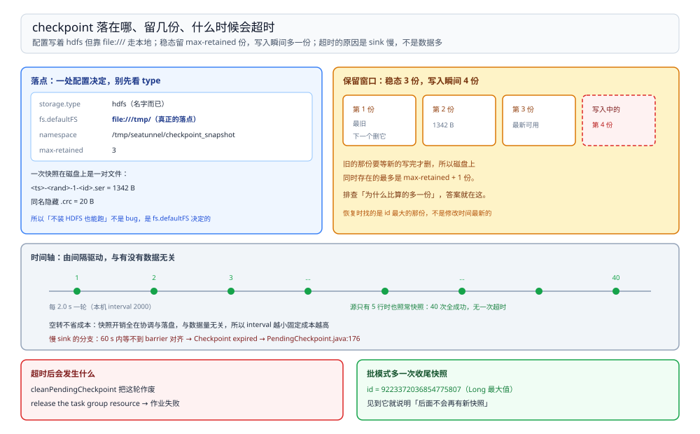

# 检查点与失败恢复

> 覆盖：SeaTunnel 的 checkpoint 存在哪、配置文件里那几个键各管什么、快照文件长什么样、保留几份、空转的时候会不会快照、什么时候会超时，以及批模式那次「用 `Long.MAX_VALUE` 当 id」的收尾快照。
>
> 不覆盖：作业怎么拆成子任务见 [运行模型与Local模式.md](运行模型与Local模式.md)；连接器与配置段见 [连接器与配置排查.md](连接器与配置排查.md)；「位点、投递、幂等」这类同步语义见 [数据同步方式选型对比.md](../../../数据存储/数据同步/数据同步方式选型对比.md)。
>
> 内容整理自个人学习笔记。本篇读数来自 `dockerproxy.net/apache/seatunnel:2.3.11` 容器（SeaTunnel **2.3.11**、Java **1.8.0_342**）`-e local` 模式的三个作业，日志见 `D:\tmp\st-lab\batch-rerun.log`、`stream.log`（含超时那轮）、`stream2.log`（慢源那轮）。

---

## 一、一句话定位：checkpoint 回答「崩了回到哪」，不回答「一定不丢」

**本节要点**：checkpoint 是**周期性的一致性快照**，作用是把「作业恢复到某个时刻」这件事变成可能。它不等于「至少一次」，也不等于「不丢」——那是 sink 侧幂等与两阶段提交的事。

| checkpoint 保证的 | checkpoint 不保证的 |
| --- | --- |
| 崩了能回到**某个已完成快照**的状态 | 快照之间的数据不丢（要看 source 能不能重放） |
| 快照之间不会撕裂（同一时刻对齐） | sink 侧不重复写（要看 sink 是否幂等 / 两阶段） |
| 能说出「恢复到第几号快照」 | 状态本身有多大、要不要限流（那是作业自己的事） |

⭐ 所以「开了 checkpoint 就安全」是错的：它只把「恢复点」这件事从无到有。真正的不丢要看**源能不能重放 + sink 能不能幂等**，这两条都在工具外面。

## 二、存哪：配置写着 HDFS，实际靠 `file:///` 走本地

**本节要点**：SeaTunnel 的镜像默认配置里 `storage.type: hdfs`，但同时把 `fs.defaultFS` 指到了 `file:///tmp/`——于是**不装 HDFS 也能跑**，快照落本机磁盘。

`config/seatunnel.yaml` 里与本篇相关的原文（照抄，未改）：

```yaml
checkpoint:
  interval: 10000
  timeout: 60000
  storage:
    type: hdfs
    max-retained: 3
    plugin-config:
      namespace: /tmp/seatunnel/checkpoint_snapshot
      fs.defaultFS: file:///tmp/
```

| 键 | 本机值 | 管什么 |
| --- | --- | --- |
| `interval` | `10000` | 两次快照间隔（毫秒）；作业里 `checkpoint.interval = 2000` 会覆盖它 |
| `timeout` | `60000` | 单次快照最长等多久，超时即判失败 |
| `storage.type` | `hdfs` | 存储插件选谁。⚠️ **名字叫 hdfs，但真正的路径由下一项决定** |
| `max-retained` | `3` | 保留几份历史快照 |
| `namespace` | `/tmp/seatunnel/checkpoint_snapshot` | 快照目录 |
| `fs.defaultFS` | `file:///tmp/` | ⭐ **决定落到哪个文件系统**。写 `file:///` 就是本地磁盘 |

⚠️ **这一条最容易误判**：看到 `type: hdfs` 就以为必须装 Hadoop，于是花时间搭 HDFS——实际上 `fs.defaultFS` 是 `file:///`，快照稳稳落在容器里的 `/tmp`。**判据：先看 `fs.defaultFS`，再看 `storage.type`**；前者是「写到哪个文件系统」，后者是「用哪套实现去写」。

## 三、快照文件长什么样、留几份

**本节要点**：一次快照在磁盘上是一对文件——`.ser` 本体加同名 `.crc` 校验。**稳态留 `max-retained` 份，写入瞬间会多出一份**。

本机流作业跑出来的目录：

```text
/tmp/seatunnel/checkpoint_snapshot/<jobId>/
  ├─ <ts>-<rand>-1-<checkpointId>.ser        1342 B
  ├─ .<ts>-<rand>-1-<checkpointId>.ser.crc     20 B
  └─ ……（稳态共 3 组，写入瞬间 4 组）
```

| 观察 | 读数 |
| --- | --- |
| 快照本体 | **1342 B** |
| 同名校验文件 | **20 B**（隐藏文件，`ls -a` 才看得到） |
| 稳态份数 | **3 份**（`max-retained: 3` 生效） |
| 写入瞬间 | **4 份**（新的一份写完、旧的还没删） |

⭐ 文件名里的四段各有用处：`<ts>` 是时间戳、`<rand>` 防重名、`-1-` 是 pipeline id、`<checkpointId>` 是递增编号。**恢复时找的是最后那个编号**，不是文件修改时间——所以判断「恢复到哪」要读 `checkpointId`。

⚠️ **1342 B 是空状态**。`FakeSource` 不携带任何 keyed state，所以快照几乎是空的。真实作业的状态量级完全不同（几十 MB 到几 GB 都正常），`max-retained: 3` 在真实作业里意味着「三倍状态大小的磁盘占用」，这一条不要拿本机数字外推。



图要读出的结论是**「保留份数是一个环形窗口」**：新快照写进去、最旧的那份才被删，所以 `max-retained: 3` 在磁盘上同时存在的最多不是 3 份而是 4 份。排查「磁盘为什么比算的多一份」时，这个瞬间值就是答案。

## 四、空转也能快照：40 次全成功

**本节要点**：checkpoint 由**时间**驱动，不由数据驱动。源没有数据可读时，快照照常一轮轮完成——所以「空转时 checkpoint 应该停」是错的。

慢源那轮的 conf 关键项：`row.num = 5`、`split.read-interval = 2000`、`checkpoint.interval = 2000`、`checkpoint.timeout = 20000`。

实测：

| 观察 | 读数 |
| --- | --- |
| 5 行吐完的时刻 | `08:05:58,614 ~ 618`，**一次性同一批**（不是每 2 秒一行） |
| 之后还有数据吗 | 没有 |
| 快照区间 | `08:05:52` → `08:07:16` |
| 完成的 checkpoint 次数 | **40 次**，间隔 **2.0 s**，**无一次超时** |

⭐ 这两件事要一起看：

1. **`read-interval` 不影响「5 行一次吐完」**——它约束的是 split 之间的间隔，5 行在同一个 split 里，所以同一毫秒全出来（与 [运行模型与Local模式.md](运行模型与Local模式.md) 第五节同一条判据）；
2. **源空转不影响快照**——40 次全成功说明快照的成本几乎全在「协调 + 落盘」，与有没有数据无关。

## 五、什么时候会超时：不是数据多，是 sink 慢

**本节要点**：`timeout` 等的是**所有子任务把 barrier 对齐**那一刻。只要有一个 sink 写不动，整轮快照就等不到，`timeout` 一到直接判失败并让作业退出。

本机触发的那次，源是 `Console` sink 打到日志文件——同一个源在另一轮 45 秒能跑完 999,999 行，这一轮却被打印拖住，60 秒内只推进到 `rowIndex≈54,253`。原文：

```text
ERROR [.s.e.s.c.CheckpointCoordinator] [seatunnel-coordinator-service-9] - trigger checkpoint failed
org.apache.seatunnel.engine.server.checkpoint.CheckpointException:
  Checkpoint expired before completing. Please increase checkpoint timeout in the seatunnel.yaml or jobConfig env.
	at ...PendingCheckpoint.abortCheckpoint(PendingCheckpoint.java:176)
	at ...CheckpointCoordinator.lambda$cleanPendingCheckpoint$20(CheckpointCoordinator.java:807)
	at ...CheckpointCoordinator.cleanPendingCheckpoint(CheckpointCoordinator.java:805)
	at ...CheckpointCoordinator.handleCoordinatorError(CheckpointCoordinator.java:296)
```

| 关键信息 | 含义 |
| --- | --- |
| `Checkpoint expired before completing` | 快照在 `timeout` 内没对齐完成 |
| `PendingCheckpoint.java:176` | 抛出点是**挂起快照被中止**，不是「写盘失败」 |
| `cleanPendingCheckpoint(:805)` | 由清理动作触发，即「这轮作废」 |
| 之后 `release the task group resource` | 超时被当成作业失败，资源被释放、作业退出 |

⭐ 判据反过来用：**看到这个异常先找慢 sink，不要先调大 `timeout`**。调大只是把「60 秒等不到」变成「120 秒等不到」，根因仍在 sink 的写入速率；正确的动作是给 sink 加 batch / 降 `parallelism` 的写压力，或者把 `Console` 换成真正的写入端。

⚠️ 另一面：**调小 `timeout` 更危险**。快照本身要时间，`timeout` 逼近 `interval` 时会变成「每轮都超时」，作业起不来。

## 六、批模式有一次收尾快照，id 是 `Long.MAX_VALUE`

**本节要点**：批作业读完之后会做**最后一次快照**再退出，这次快照的 id 固定是 `9223372036854775807`（`Long.MAX_VALUE`）——它是「终结标记」，不是编号溢出。

本机批作业的两行日志：

```text
11:28:39,543 INFO - wait checkpoint completed: 9223372036854775807
11:28:40,546 INFO - Job (1167062219289001985) end with state FINISHED
```

| 模式 | checkpoint id 形态 | 作业会不会自己退出 |
| --- | --- | --- |
| `BATCH` | 跑到收尾时出现 `9223372036854775807` | **会**，收尾快照完成即 `FINISHED` |
| `STREAMING` | 从 1 起递增（本机跑到 36） | **不会**，源读完了也继续挂着 |

⭐ 这个 id 的用处：看日志时**见到它就说明这是最后一次快照**，后面不会再有新的。排查「批作业为什么停在最后一步不动」，就去看这个 id 之后有没有 `end with state FINISHED`——有 id 没有 FINISHED，说明卡在收尾。

## 七、验证与排查

**本节要点**：先确认「快照真的在写」，再判断「为什么超时」。前者看目录，后者看 sink 速率。

### 7.1 先确认快照在写

| 要确认的事 | 命令 | 正常形态 |
| --- | --- | --- |
| 落在哪个文件系统 | `grep -A6 "^checkpoint:" $SEATUNNEL_HOME/config/seatunnel.yaml` | 看 `fs.defaultFS`，不是看 `storage.type` |
| 有多少份 | `ls -a /tmp/seatunnel/checkpoint_snapshot/<jobId>/ \| grep -c '\.ser$'` | ≤ `max-retained`，写入瞬间 +1 |
| 快照多大 | `ls -l .../*.ser` | 空状态约 1.3 KB；真实作业按状态量 |
| 快照推进到几号 | `grep "completed" 日志` | id 递增；批模式末次为 `9223372036854775807` |
| 有没有超时 | `grep "Checkpoint expired" 日志` | 无输出为正常 |

### 7.2 常见故障速查

| 症状 | 先查什么 |
| --- | --- |
| `Checkpoint expired before completing` | sink 写入速率（第五节），不是 `timeout` 不够 |
| 磁盘份数比 `max-retained` 多一份 | 写入瞬间的正常重叠（第三节） |
| 以为要装 HDFS 才能跑 | 看 `fs.defaultFS: file:///`（第二节） |
| 批作业卡在最后不动 | 有没有收尾 id `9223372036854775807`，之后有没有 `FINISHED`（第六节） |
| 流作业一直不退出 | 正常行为，第六节 |
| 恢复到哪一号说不清 | 读文件名里的 `<checkpointId>`，不看文件修改时间 |

## 八、校验口径

| 内容 | 状态 |
| --- | --- |
| `seatunnel.yaml` 的六个键与默认值 | ✅ 本机实测（原文照抄） |
| 快照 `.ser` 1342 B + `.crc` 20 B | ✅ 本机实测（`/tmp/seatunnel/checkpoint_snapshot/<jobId>/` 下 `ls`） |
| 稳态 3 份、写入瞬间 4 份 | ✅ 本机实测（`max-retained: 3`） |
| 空转 40 次 checkpoint 全成功、间隔 2.0 s | ✅ 本机实测（`stream2.log`，慢源那轮） |
| 5 行在同一毫秒附近一次吐完 | ✅ 本机实测（`08:05:58,614~618`） |
| 超时原文与四层调用点 | ✅ 本机实测（`stream.log:54550` 起） |
| 批模式收尾 id = `Long.MAX_VALUE` | ✅ 本机实测（`batch-rerun.log`） |
| 流模式 id 递增到 36 | ✅ 本机实测，单轮 |
| **作业失败后从快照恢复** | ⚠️ **未实测**：只验证「快照能写」，未制造失败再 `-r` 恢复，所以「恢复到哪个 id、恢复后是否重复」没有读数 |
| checkpoint 存到真 HDFS | ⚠️ **未实测**：`fs.defaultFS` 是 `file:///`，未搭 HDFS |
| `savepoint` 手动触发 | ⚠️ **未实测** |
| 真实作业的状态大小与落盘耗时 | ⚠️ **未实测**：Fake 源无状态，1342 B 不可外推 |

## 延伸追问

- **`storage.type: hdfs` 与 `fs.defaultFS: file:///` 冲突吗？** → 不冲突，是两层：`type` 选实现，`fs.defaultFS` 定协议与根路径。写 `file:///` 时那套 HDFS 实现退化成读写本地文件，所以不装 Hadoop 也能跑。
- **为什么不把 `max-retained` 设成 1 省磁盘？** → 设成 1 就没有「上一份」可回。恢复时至少要能取到最近一份**完整**快照，写入瞬间的重叠就是为了这个——旧的在新的写完之前不能删。
- **checkpoint 会不会拖慢作业？** → 会，但本机的空状态看不出来（1342 B）。真实作业的同步开销与状态大小成正比，这也是 Flink 里要把大状态放到 RocksDB 的原因。
- **空转还在快照，是不是浪费？** → 是固定成本。`interval` 越小成本越高，而空转时快照毫无信息量——但引擎判断不了「这次快照有没有用」，只能按时间走。
- **这套实测怎么复现？** → 起 2.3.11 容器，用 [运行模型与Local模式.md](运行模型与Local模式.md) 第五节的 `stream-slow.conf`（`row.num=5`、`read-interval=2000`、`timeout=20000`）跑，就能复现「空转 40 次全成功」；把 `Console` 换成慢写入端并保持默认 `timeout=60000` 就能复现超时。

## 关联

- **上游/总纲**：[README.md](README.md) — 本册定位与三篇分工
- **上游/总纲**：[数据集成与采集选型对比.md](../数据集成与采集选型对比.md) — 有 checkpoint 与没有 checkpoint 的工具差在哪
- **对照/互补**：[运行模型与Local模式.md](运行模型与Local模式.md) — 快照的单位是子任务，先看它怎么拆
- **对照/互补**：[状态与检查点.md](../../计算引擎/Flink/状态与检查点.md) — Flink 侧同一件事的完整机制：barrier 对齐、状态后端、精确一次
- **下游机制**：[数据同步方式选型对比.md](../../../数据存储/数据同步/数据同步方式选型对比.md) — 位点、幂等、对账：checkpoint 之外的三件事
