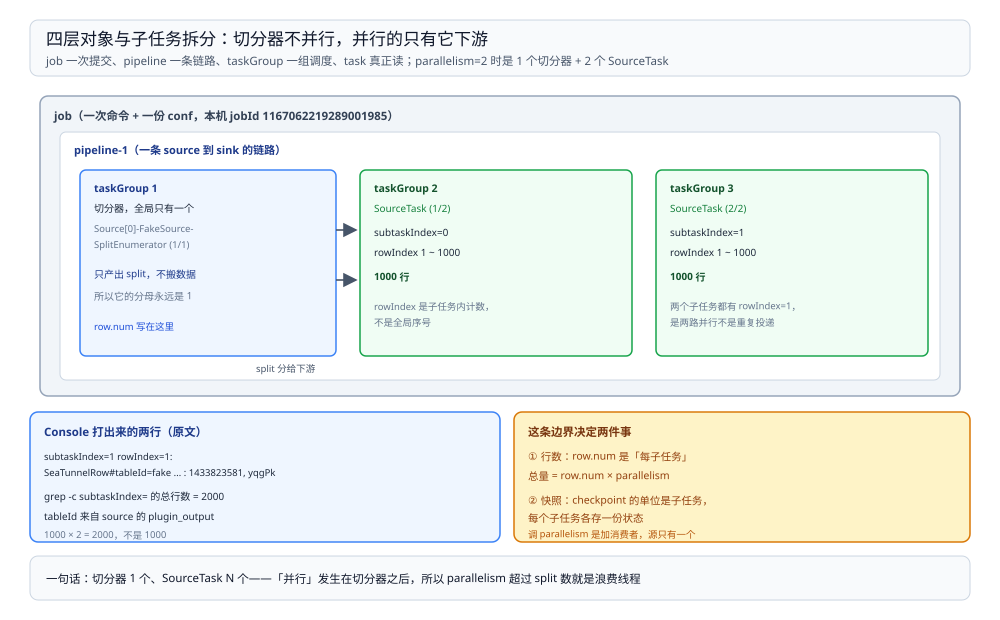

# 运行模型与 Local 模式

> 覆盖：SeaTunnel 在 `local` 模式下到底是什么在跑、一份 conf 怎么被拆成 job / pipeline / taskGroup / task 四层、一次批作业经过哪几步、以及两个最容易读错的参数——`row.num` 为什么不是总行数、`read-interval` 为什么不是每行间隔。
>
> 不覆盖：checkpoint 的落点、文件形态与超时见 [检查点与失败恢复.md](检查点与失败恢复.md)；连接器目录与配置段见 [连接器与配置排查.md](连接器与配置排查.md)；三个工具怎么选见 [数据集成与采集选型对比.md](../数据集成与采集选型对比.md)。
>
> 内容整理自个人学习笔记。本篇读数在 `dockerproxy.net/apache/seatunnel:2.3.11`（SeaTunnel **2.3.11**、Java **1.8.0_342**、Hazelcast **5.1**）容器内 `-e local` 跑出，日志见 `D:\tmp\st-lab\batch-rerun.log` 与 `stream.log`。

---

## 一、一句话定位：`local` 模式是「引擎 + Hazelcast 在同一个 JVM」

**本节要点**：`-e local` 不是「不起引擎」，而是**引擎跑在你自己的 JVM 里、Hazelcast 也在这个 JVM 里当协调者**。所以它没有外部集群可连，也没有第二个进程可以接管——进程一挂，作业连同状态一起消失。

```text
docker exec → sh bin/seatunnel.sh --config batch.conf -e local
   └─ 同一个 JVM 里有三样东西
        ├─ Hazelcast IMDG 5.1   协调者（成员发现、任务分发）→ 监听 5801
        ├─ SeaTunnel Engine     调度与 checkpoint 协调
        └─ 作业的子任务          按 parallelism 拆开，跑在这里的线程池里
```

日志里能直接看到这个形态：任务被「部署」到一个只在本机存在的成员上，成员地址是 `[localhost]:5801`。

```text
[localhost]:5801 [seatunnel-224312] [5.1] deploying TaskGroup TaskGroupLocation{jobId=1167062219289001985, pipelineId=1, taskGroupId=2}
```

⭐ 判据：**出现 `[localhost]:5801` 加一个 Hazelcast 版本号，就是 local 模式**。如果换成 `-e cluster`，同一行会变成别的成员地址，而协调者也不再是本进程——本册未实测那条路。

## 二、四层对象各管一段

**本节要点**：一份 conf 落到运行时是四个层次的对象，**拆分的边界在 taskGroup 与 task**：`parallelism` 决定子任务数，`plugin_output` 决定数据的 `tableId`。

| 层 | 是什么 | 由谁决定 | 本机实例 |
| --- | --- | --- | --- |
| **job** | 一次提交 | 一条命令行 + 一份 conf | `SeaTunnel_Job (1167062219289001985)` |
| **pipeline** | 一条 source → sink 的链路 | conf 里 source / sink 的配对 | `pipeline-1`，只有 1 条 |
| **taskGroup** | 可被一起调度的任务组 | 每个并行子任务一个 | `taskGroupId` 依次 1、2、3 |
| **task** | 真正干活的线程 | 插件在 `parallelism` 下拆出的子任务 | `SourceTask (1/2)`、`SourceTask (2/2)` |

本机批作业（`parallelism=2`）的 taskGroup 正好印证了这条边界：

| taskGroupId | 它是什么 | 日志里的名字 |
| --- | --- | --- |
| 1 | 切分器，**全局只有一个** | `Source[0]-FakeSource-SplitEnumerator (1/1)` |
| 2 | 第 1 个并行子任务 | `SourceTask (1/2)` |
| 3 | 第 2 个并行子任务 | `SourceTask (2/2)` |

⚠️ 这一点最容易想反：**切分器不是并行单位**。它的分母永远是 `(1/1)`，因为它负责「产出 split 分给下游」，自己不做搬运；真正并行的只有它下游的 task。



图要读出的结论是**「并行发生在切分器之后」**：`parallelism=2` 拿到的是两个 `SourceTask`，切分器只有一个。所以调 `parallelism` 是在加「消费者」，不是加「生产者」——源只有一个，它产出多少 split 才是上限。

## 三、一次批作业经过哪几个阶段

**本节要点**：一次批作业从提交到 `FINISHED` 分四步——起引擎、建 checkpoint 协调器、部署 taskGroup、跑完收尾快照。**起引擎那一步占了大头**，真正的搬运不到 1 秒。

本机用的是最小 conf，源与 sink 都用镜像自带的插件：

```hocon
env {
  parallelism = 2
  job.mode = "BATCH"
}

source {
  FakeSource {
    plugin_output = "fake"
    row.num = 1000
    schema = {
      fields {
        id = "int"
        name = "string"
      }
    }
  }
}

sink {
  Console {}
}
```

日志时间线（`batch-rerun.log`，同一个 jobId `1167062219289001985`）：

| 时刻 | 事件 | 间隔 |
| --- | --- | --- |
| 11:28:37,523 | `Create CheckpointCoordinator for job(...)` | — |
| 11:28:37,625 | 三个 `TaskGroupLocation` 排进 `will be executed` | +0.10 s |
| 11:28:37,829 | `deploying TaskGroup` 到 `[localhost]:5801` | +0.20 s |
| 11:28:39,543 | `wait checkpoint completed: 9223372036854775807` | +1.71 s（Console 打印 2000 行） |
| 11:28:40,546 | `Job (...) end with state FINISHED` | +1.00 s（收尾） |
| — | **提交到结束合计 3.01 s** | 脚本全程含 Hazelcast 启动约 **11 s** |

⭐ **两段账要分开记**：作业本身 **3.01 s**，但从敲命令到进程退出约 **11 s**——差的 8 秒是 Hazelcast 启动与 JVM 起来。这与 DataX 的固定开销是同一个性质的问题：小批量下，「引擎起不来」比「数据搬不动」更影响体感。

## 四、`row.num` 是每个并行子任务的行数，不是总量

**本节要点**：`row.num` 写在 source 里，但它按**子任务**计。`row.num=1000` 加 `parallelism=2`，读出来是 **2000 行**，不是 1000 行。

Console 输出逐行带 `subtaskIndex` 与 `rowIndex`，两个子任务各从 `rowIndex=1` 数到 1000：

```text
subtaskIndex=1  rowIndex=1:  SeaTunnelRow#tableId=fake SeaTunnelRow#kind=INSERT : 1433823581, yqgPk
subtaskIndex=1  rowIndex=2:  SeaTunnelRow#tableId=fake SeaTunnelRow#kind=INSERT : 1434208854, qIrPI
```

| 观察 | 读数 |
| --- | --- |
| `grep -c "subtaskIndex="` 的总行数 | **2000** |
| `subtaskIndex=0` 的行数 | **1000**（`rowIndex` 1 ~ 1000） |
| `subtaskIndex=1` 的行数 | **1000**（`rowIndex` 1 ~ 1000） |
| `tableId` 的来源 | source 里 `plugin_output = "fake"` 的值 |

⭐ **所以「行数」有两个口径**：`row.num` 是**每子任务**，总量是 `row.num × parallelism`。做数据量估算时按前者写配置、按后者算落库量，否则会差一个 `parallelism` 的倍数。

⚠️ 另一条容易漏的：`rowIndex` 是**每个子任务各自的计数**，不是全局序号。看到两个子任务都有 `rowIndex=1` 不是重复投递，是两路并行。

## 五、`read-interval` 是 split 之间的间隔，不是每行间隔

**本节要点**：`split.read-interval` 控制的是**两次读 split 之间的等待**，单位毫秒。按名字理解成「每行间隔」会把耗时估成几十小时。

本机流作业的 conf 关键三行：

```hocon
env {
  parallelism = 1
  job.mode = "STREAMING"
  checkpoint.interval = 2000
}

source {
  FakeSource {
    plugin_output = "fake"
    row.num = 999999
    split.read-interval = 200
    schema = {
      fields {
        id = "int"
        name = "string"
      }
    }
  }
}
```

实测：**45 秒跑完 999,999 行**，日志 192 MB，约 **2.2 万行/秒**。

| 两种理解 | 推算耗时 | 实测 |
| --- | --- | --- |
| 若 `200` 是「每行 200 ms」 | 999,999 × 0.2 s ≈ **55.5 小时** | ❌ |
| 若 `200` 是「两次读 split 间隔 200 ms」 | 取决于 split 有多少个 | ✅ **45 秒** |

⭐ 判据很简单：**数量级对不上就不是那个意思**。`read-interval=200` 若真是行间隔，1M 行要跑两天半，而实测 45 秒——这个反证比读文档更快。

⚠️ 还有一条与它配套的现象：**源跑完后作业不退出**。流作业在 45 秒读完之后仍然挂着，`checkpoint` 继续每 2.0 s 一轮（本机 id 跑到 36）。这是 `STREAMING` 模式的正常行为——「源没数据了」不等于「作业该结束了」，这与批模式 `row.num` 读完就 `FINISHED` 完全不同。

## 六、验证与排查

**本节要点**：先确认「作业真的跑起来了」，再用故障速查表定位。判据全在日志的固定字段上。

### 6.1 先确认作业生效

| 要确认的事 | 命令 / 看哪里 | 正常形态 |
| --- | --- | --- |
| 是 local 还是 cluster | 日志首屏 | `[localhost]:5801 ... [5.1]` = local |
| 拆了几个子任务 | `grep "TaskGroupLocation" 日志` | `parallelism=N` 时 taskGroup 至少 N+1 个（含切分器） |
| 读到多少行 | `grep -c "subtaskIndex=" 日志` | 等于 `row.num × parallelism` |
| 作业成功了吗 | `grep "end with state" 日志` | 末行 `end with state FINISHED` |
| 批模式收尾了没有 | `grep "wait checkpoint completed" 日志` | id 是 `9223372036854775807` |

### 6.2 常见故障速查

| 症状 | 先查什么 |
| --- | --- |
| 行数是预期的 2 倍 / N 倍 | `parallelism` 与 `row.num` 的口径（第四节），不是数据重复 |
| 耗时估成几十小时但实际很快 | 是不是把 `read-interval` 当成了行间隔（第五节） |
| 批作业跑完不退出 | `job.mode` 是不是写成了 `STREAMING` |
| 流作业读完了也不退出 | 正常行为，第五节末尾；要退出用批模式或外部停止 |
| 找不到 `seatunnel.sh` 或 `SEATUNNEL_HOME` | 镜像里要用 `SEATUNNEL_HOME=/opt/seatunnel` 前缀 |
| 作业提交后一直不动 | 看有没有 `deploying TaskGroup`；没有就是切分器没产出 split |

| 排查项 | 命令 |
| --- | --- |
| 版本 | `docker exec <容器> sh -c "cat \$SEATUNNEL_HOME/config/seatunnel.yaml \| head -5"` |
| 子任务分发 | `grep "deploying TaskGroup" 日志` |
| 行数核对 | `grep -c "subtaskIndex=" 日志` |
| 结束状态 | `grep "end with state" 日志` |

## 七、校验口径

| 内容 | 状态 |
| --- | --- |
| `local` 模式与 Hazelcast 同 JVM、监听 5801 | ✅ 本机实测（日志首屏与 `deploying` 行） |
| 四层对象与 taskGroup 的对应（切分器 1/1 + 子任务 N/2） | ✅ 本机实测（`batch-rerun.log` 三行 `TaskGroupLocation`） |
| 批作业三段耗时（3.01 s / 收尾 1.00 s / 全程约 11 s） | ✅ 本机实测，单轮未取波动 |
| `row.num` 按子任务计（1000 × 2 = 2000 行） | ✅ 本机实测（`subtaskIndex=` 计数） |
| `read-interval` 是 split 间隔（45 s / 999,999 行） | ✅ 本机实测，**由耗时反证**；未读到官方对「split 间隔」的定义原文 |
| `rowIndex` 按子任务各自从 1 开始 | ✅ 本机实测 |
| `-e cluster` / `yarn` / `k8s` | ⚠️ **未实测**：本机无集群成员与外部资源管理器 |
| 真实连接器的 split 切分（MySQL / Kafka） | ⚠️ **未实测**：只用镜像自带的 Fake / Console |
| 作业失败后的状态恢复 | ⚠️ **未实测**：只验证「快照能写」，未制造失败再恢复（见 [检查点与失败恢复.md](检查点与失败恢复.md)） |

## 延伸追问

- **为什么切分器不算并行？** → 它只产出 split 不搬数据，`(1/1)` 的分母固定。并行度加在消费者上，源端只有一份——所以 `parallelism` 超过 split 数就是浪费线程。
- **`local` 模式为什么还要 Hazelcast？** → 因为引擎的调度、任务分发、checkpoint 协调都建在 Hazelcast 的成员与分布式数据结构上。local 只是「成员只有我自己」，不是「不用这套机制」。
- **批与流在本篇的差别只体现在哪？** → `job.mode` 与「读完之后退不退出」。批模式读完触发收尾快照并 `FINISHED`；流模式读完之后作业继续挂着，checkpoint 继续。
- **`plugin_output` 为什么不叫 table 名？** → 它只是给下游标注来源用的标签，Console 打印成 `tableId=fake`。真正的多表路由要用 `plugin_input` / `plugin_output` 配对，本册未展开。
- **这套实测怎么复现？** → 起 2.3.11 容器并 `--entrypoint sh -c "sleep 7200"`，把第三节那份 `batch.conf` 挂进去，`SEATUNNEL_HOME=/opt/seatunnel sh bin/seatunnel.sh --config batch.conf -e local`。

## 关联

- **上游/总纲**：[README.md](README.md) — 本册的定位、三篇分工与实测坐标
- **上游/总纲**：[数据集成与采集选型对比.md](../数据集成与采集选型对比.md) — 三个工具的分水岭
- **对照/互补**：[检查点与失败恢复.md](检查点与失败恢复.md) — 状态存在哪、什么时候会超时
- **对照/互补**：[运行模型与作业拆解.md](../DataX/运行模型与作业拆解.md) — DataX 的同一层视角：四层对象、切分、加 channel 为什么没变快
- **下游机制**：[大数据选型对比.md](../../大数据选型对比.md) — 本目录在七层职责里的位置
