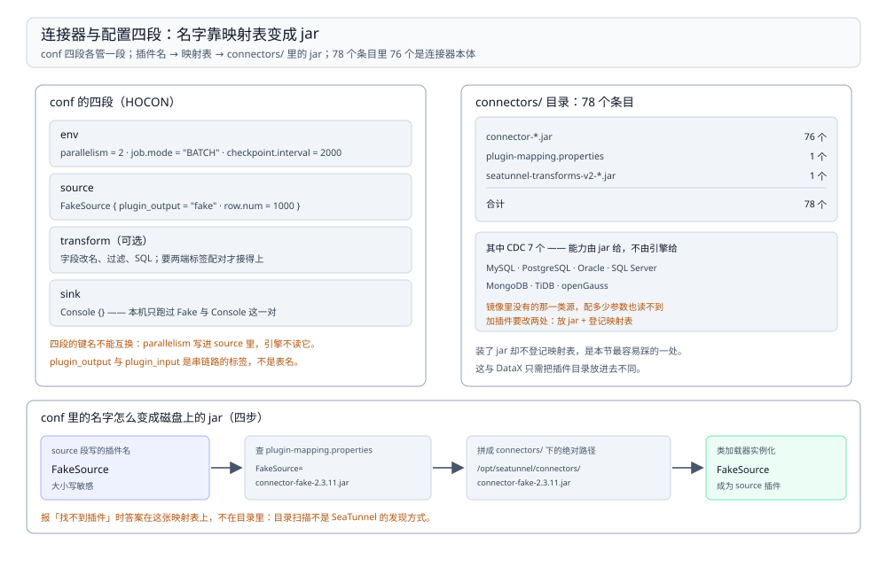

# 连接器与配置排查

> 覆盖：镜像里 `connectors/` 那 78 个条目分别是什么、`plugin-mapping.properties` 管什么、一份作业配置的四段结构各写什么、以及 `seatunnel.yaml` 里几个会静默生效的默认值。
>
> 不覆盖：作业怎么拆成子任务见 [运行模型与Local模式.md](运行模型与Local模式.md)；checkpoint 的落点与超时见 [检查点与失败恢复.md](检查点与失败恢复.md)；各连接器的完整参数表以官方文档为准，本篇只给结构与查法。
>
> 内容整理自个人学习笔记。本篇读数来自 `dockerproxy.net/apache/seatunnel:2.3.11` 容器（SeaTunnel **2.3.11**、Java **1.8.0_342**）内的 `ls` 与 `cat`，非推断。

---

## 一、一句话定位：引擎只做调度，能读能写全看连接器

**本节要点**：SeaTunnel 的引擎不认识任何数据源。它只负责「拆任务、定快照、分资源」；**能读什么、能写什么，完全由 `connectors/` 目录里有哪些 jar 决定**。

| 归引擎管 | 归连接器管 |
| --- | --- |
| 并行拆几个子任务、跑在哪 | 源怎么切 split、sink 怎么攒批 |
| checkpoint 什么时候做、存在哪 | 状态里存什么、能不能提交事务 |
| 失败重试几次、成员怎么发现 | 参数名与类型、报错原文 |
| 类型系统（`SeaTunnelRow`）与序列化 | 与外部系统的协议、驱动版本 |

⭐ 判据：**报「找不到插件」是连接器问题，报「checkpoint 超时」是引擎问题，报「参数 xxx 不是合法值」是连接器问题**。三类的排查入口完全不同。

## 二、`connectors/` 的 78 个条目分别是什么

**本节要点**：78 个条目不是 78 个连接器——其中 **76 个是 `connector-*.jar`**，另外两个是映射文件与 transforms 包。

```text
/opt/seatunnel/connectors/
  ├─ connector-*.jar                    76 个
  ├─ plugin-mapping.properties          1 个（插件名 → jar 名）
  └─ seatunnel-transforms-v2-*.jar      1 个（transform 插件的公共包）
= 78 个条目
```

| 类别 | 数量 | 说明 |
| --- | --- | --- |
| `connector-*.jar` | **76** | 源与 sink 的插件本体 |
| `plugin-mapping.properties` | 1 | 把 conf 里的插件名映射到 jar 文件名 |
| `seatunnel-transforms-v2-*` | 1 | transform 类插件共用的执行框架 |
| **合计** | **78** | 与 `ls \| wc -l` 对上 |

CDC 这一类单独数出来是 **7 个**：

| CDC 连接器 | 对应源 |
| --- | --- |
| `connector-cdc-mysql` | MySQL（binlog） |
| `connector-cdc-postgres` | PostgreSQL（WAL） |
| `connector-cdc-oracle` | Oracle（LogMiner / XStream） |
| `connector-cdc-sqlserver` | SQL Server（CDC 表） |
| `connector-cdc-mongodb` | MongoDB（oplog / change stream） |
| `connector-cdc-tidb` | TiDB（TiCDC） |
| `connector-cdc-opengauss` | openGauss |

⭐ 这 7 个就是「SeaTunnel 能当 CDC 工具用」的物理依据——**能力是 jar 给的，不是引擎给的**。镜像里没有的那一类源，装多少配置也读不到。

## 三、`plugin-mapping.properties` 干什么

**本节要点**：conf 里写的是**插件名**（`Jdbc`、`FakeSource`），磁盘上是**jar 文件名**（`connector-jdbc-2.3.11.jar`）。映射文件就是这两者之间的对照表。

```properties
# 简化示意，实际是 key=value 一行一条
FakeSource=connector-fake-2.3.11.jar
Jdbc=connector-jdbc-2.3.11.jar
Kafka=connector-kafka-2.3.11.jar
```

| 现象 | 说明 |
| --- | --- |
| conf 里写 `Jdbc {}` 能跑 | 映射表里能查到 `Jdbc` |
| 自己丢了一个 jar 进 `connectors/`，conf 里写同名插件却报找不到 | **只放 jar 不够，没在映射表里登记** |
| 两个 jar 声明同一个插件名 | 后加载的覆盖先加载的，且不报错 |

⚠️ 「装了 jar 就生效」是最常见的误判。**SeaTunnel 的插件发现走映射表，不走目录扫描**——这与 DataX 只需把插件目录放进去不同，是两套工具最容易混的一处。

## 四、一份作业配置的四段结构

**本节要点**：conf 是 HOCON 格式，固定四段：`env` 定并行与模式、`source` 定从哪读、`transform`（可选）定怎么改、`sink` 定写到哪。四段的键名不能互换。

```hocon
env {
  parallelism = 2
  job.mode = "BATCH"
  checkpoint.interval = 2000
}

source {
  FakeSource {
    plugin_output = "fake"
    row.num = 1000
    schema = {
      fields {
        id = "int"
        name = "string"
      }
    }
  }
}

sink {
  Console {}
}
```

| 段 | 必填 | 写什么 | 常见错 |
| --- | --- | --- | --- |
| `env` | 是 | `parallelism`、`job.mode`、`checkpoint.*` | 把 `parallelism` 写进 source 里，不生效 |
| `source` | 是 | 插件名 + 该插件的参数 | 插件名大小写写错（映射表区分大小写） |
| `transform` | 否 | 字段改名、过滤、SQL | 写了但没在 source 里 `plugin_output`，链路断在中间 |
| `sink` | 是 | 插件名 + 参数 | 一个 sink 接多个 source 时没写 `plugin_input` |

⭐ **`plugin_output` 与 `plugin_input` 是串链路的两个标签**，不是表名。本机 `plugin_output = "fake"`，Console 就打 `tableId=fake`（见 [运行模型与Local模式.md](运行模型与Local模式.md) 第四节）。多源多 sink 时靠这两个标签配对，写错了不报错、只是数据流不到目标。

## 五、几个会静默生效的默认值

**本节要点**：`seatunnel.yaml` 里这几个默认值不会在作业日志里提示，但它们决定资源怎么用、指标从哪看。

| 键 | 本机默认值 | 影响 |
| --- | --- | --- |
| `slot-service.dynamic-slot` | `true` | 槽位按需扩，`parallelism` 调大不用重启引擎 |
| `queue-type` | `blockingqueue` | 子任务之间的队列实现；换成别的要确认版本支持 |
| `classloader-cache-mode` | `true` | 插件类加载器复用，省内存但改 jar 后要重启 |
| `retry-times` | `3` | 失败重试次数，作业级 |
| `print-job-metrics-info-interval` | `60` | 指标打印间隔（秒），排查慢作业时先把它调小 |
| `http.enable-http` / `port` | `true` / `8080` | 内置 HTTP 服务，看运行状态用 |
| `telemetry.metric.enabled` | `false` | **指标默认不开**，要看指标得先打开 |

⚠️ 最后一行最容易踩：**默认没有指标**。不是采集器没接对，是这个开关本来就是 `false`。



图要读出的结论是**「conf 里的名字与磁盘上的 jar 之间隔着一张映射表」**：左边写的是插件名，右边是 jar 文件名，中间那一跳就是 `plugin-mapping.properties`。所以「jar 已经放进去了却报找不到插件」的答案落在这张表上，不在目录里。

## 六、验证与排查

**本节要点**：先确认「插件真的被认出来」，再看配置四段有没有接错。

### 6.1 先确认插件生效

| 要确认的事 | 命令 | 正常形态 |
| --- | --- | --- |
| 有多少连接器 | `ls $SEATUNNEL_HOME/connectors \| wc -l` | **78** |
| 其中多少个 jar | `ls $SEATUNNEL_HOME/connectors/connector-*.jar \| wc -l` | **76** |
| 有没有 CDC | `ls $SEATUNNEL_HOME/connectors \| grep -c 'connector-cdc'` | **7** |
| 插件名登记了没有 | `grep -i '^Jdbc=' $SEATUNNEL_HOME/connectors/plugin-mapping.properties` | 有对应 jar 名 |
| 指标开没开 | `grep -A3 telemetry $SEATUNNEL_HOME/config/seatunnel.yaml` | `enabled: false` 就是没开 |

### 6.2 常见故障速查

| 症状 | 先查什么 |
| --- | --- |
| `Plugin not found` / 找不到插件 | 映射表里有没有这个名字（第三节），不是目录里有没有 jar |
| 自己加的 jar 不生效 | 少登记 `plugin-mapping.properties`；或 `classloader-cache-mode: true` 需重启 |
| 改了 jar 但行为没变 | 类加载器缓存（第五节） |
| `parallelism` 改了没变化 | 写在了 `env` 之外，引擎不读（第四节） |
| 多源数据流不到某个 sink | `plugin_output` / `plugin_input` 没配对 |
| 指标面板全空 | `telemetry.metric.enabled` 默认 `false` |

## 七、校验口径

| 内容 | 状态 |
| --- | --- |
| `connectors/` 78 个条目 = 76 jar + 映射文件 + transforms | ✅ 本机实测（`ls` + `wc -l`） |
| CDC 连接器 7 个及其覆盖的源 | ✅ 本机实测（按 jar 名计数） |
| `plugin-mapping.properties` 是名字到 jar 的映射 | ✅ 本机实测（读文件内容）；⚠️ 第三节的三行是**简化示意**，不是原文 |
| conf 四段结构与本机三份 conf 的实际写法 | ✅ 本机实测（`batch.conf` / `stream.conf` / `stream-slow.conf`） |
| `seatunnel.yaml` 的七项默认值 | ✅ 本机实测（原文读取） |
| 映射表缺失时的真实报错原文 | ⚠️ **未实测**：未故意删登记项去触发 |
| 各连接器的完整参数表 | ⚠️ **不覆盖**：以官方文档为准；本机只跑过 Fake / Console |
| `-e cluster` 下的插件分发 | ⚠️ **未实测** |

## 延伸追问

- **为什么不扫目录自动发现插件？** → 一个 jar 里可能有多个插件、一个插件也可能有多个版本，靠文件名猜不可靠。显式映射表能把「用哪个版本」写死，代价是加插件必须改两处。
- **`connectors/` 有 76 个 jar，是不是都能用？** → 能不能用还取决于目标端有没有驱动。JDBC 类连接器要额外放 JDBC 驱动（这是 DataX 与 SeaTunnel 共同的坑，DataX 侧见 [插件与配置排查.md](../DataX/插件与配置排查.md) 第三节）。
- **transform 段为什么常常是空的？** → 因为多数清洗在 SQL 或 sink 侧做。SeaTunnel 的 transform 能力比 Flink SQL 弱，复杂逻辑一般交给下游。
- **`dynamic-slot` 开着会不会把资源吃满？** → 它按需扩，但上限还是宿主机资源；本机单容器看不出来。
- **这套实测怎么复现？** → 起 2.3.11 容器，`docker exec` 进去 `ls $SEATUNNEL_HOME/connectors` 与 `cat $SEATUNNEL_HOME/config/seatunnel.yaml`，两个命令就能复现本篇全部读数。

## 关联

- **上游/总纲**：[README.md](README.md) — 本册定位与三篇分工
- **上游/总纲**：[数据集成与采集选型对比.md](../数据集成与采集选型对比.md) — 连接器数量不是选型依据的理由
- **对照/互补**：[运行模型与Local模式.md](运行模型与Local模式.md) — `plugin_output` 打到哪里、四层对象怎么拆
- **对照/互补**：[插件与配置排查.md](../DataX/插件与配置排查.md) — DataX 的插件目录与参数不对称，与 SeaTunnel 的映射表是两套机制
- **下游机制**：[CDC工具选型.md](../../../数据存储/数据同步/CDC/CDC工具选型.md) — 七个 CDC 连接器背后对应的工具路线
