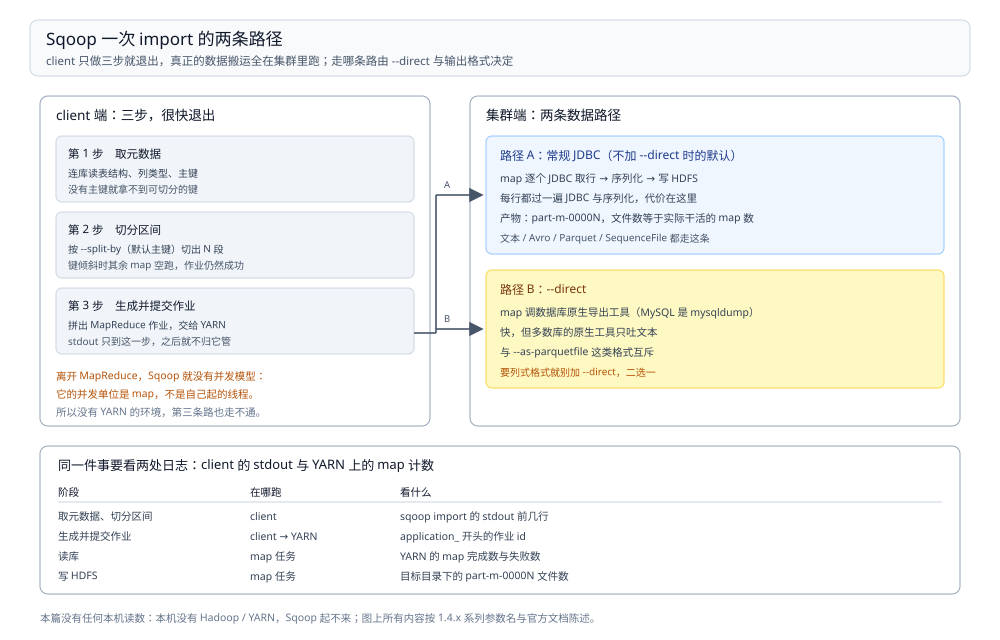

# Sqoop

> 覆盖：Sqoop 在数据集成这一层里的真实身份——它是**MapReduce 作业生成器**，不是一个独立的搬运工具；`--split-by` 与 `-m` 怎么决定并发、`--incremental` 的两种增量各靠什么、`sqoop job` 把位点存在哪、导进 Hive 要过哪几步，以及出问题时按什么顺序查。
>
> 不覆盖：五个工具怎么选与 Sqoop 的退役判据见 [数据集成与采集选型对比.md](数据集成与采集选型对比.md) 第 2.4、4.3 节；DataX 的同类能力见 [DataX 册](DataX/README.md)；同步语义（位点、幂等、对账）见 [数据同步方式选型对比.md](../../数据存储/数据同步/数据同步方式选型对比.md)。
>
> 内容整理自个人学习笔记，并参考 Sqoop 官方文档。⚠️ **本篇未做任何容器实测**——本机没有 Hadoop / YARN 集群，而 Sqoop 的并发、失败形态、`--direct` 的走法全都依赖 MapReduce，脱离集群跑不出有效读数。文中命令为**可运行骨架**，参数名按 1.4.x 系列陈述，具体版本行为**以官方文档与 `sqoop help` 为准**。

---

## 一、一句话定位：它是 MapReduce 作业生成器

**本节要点**：Sqoop 的分水岭不是「能不能搬库表」，而是**搬的动作由谁执行**——它自己不搬，它生成一个 MapReduce 作业交给 YARN，由 map 任务去拉数据。

| 谁在执行 | 意味着什么 |
| --- | --- |
| Sqoop client（提交端） | 只做三件事：连数据库拿元数据、切分区间、拼出 MR 作业 |
| YARN + map 任务 | 真正读库、写 HDFS |
| HDFS / Hive | 数据落点 |

⭐ 所以三条推论直接成立：

1. **没有 YARN 就跑不起来**——这不是「配置麻烦」，是缺执行体；
2. **并发单位是 map**——`-m` 与 `--split-by` 决定切几段，与 DataX 的 `channel`、SeaTunnel 的 `parallelism` 不是一回事；
3. **失败形态是 MR 作业的失败形态**——重试、推测执行、`application_` 日志，全都看 YARN。

⚠️ 常见误判：把 Sqoop 当成「重一点的 DataX」。两者最根本的差别在位点与执行体：DataX 一个进程自己搬、搬完退出；Sqoop 生成作业交出去、自己很快就退出，真正的搬运在集群里。

## 二、核心概念：四个对象与三个参数族

**本节要点**：Sqoop 的概念很少，但参数分三族且互相牵连——**连接族**定位库表、**切分族**决定并发、**增量族**决定读哪些行。

| 对象 / 参数 | 作用 | 关联 |
| --- | --- | --- |
| `--connect` + `--username` / `--password` | 连到关系库 | 驱动 jar 要放进 `lib/`，否则报 `No suitable driver` |
| `--table` / `--columns` / `--where` | 选表、选列、筛行 | 与 `--query` 互斥 |
| `--query` + `$CONDITIONS` | 用自定义 SQL 代替 `--table` | ⭐ 必须写 `$CONDITIONS`，否则切分失效或直接报错 |
| `--target-dir` / `--warehouse-dir` | HDFS 落点 | `--warehouse-dir` 会自动加一层表名子目录 |
| `-m` / `--split-by` | map 数与切分键 | 不写 `--split-by` 时按主键切；没有主键就只能 `-m 1` |
| `--split-by` 的键类型 | 决定切分是否均匀 | 非数值 / 分布倾斜的键会把活压到一个 map |
| `--incremental append` | 只读 `--check-column` 大于 `--last-value` 的行 | 适合自增主键 |
| `--incremental lastmodified` | 只读修改时间晚于 `--last-value` 的行 | 要配 `--check-column` 的时间列 + `--merge-key` |
| `--direct` | 用数据库原生导出工具（MySQL 是 `mysqldump`） | ⚠️ 与 `--as-parquetfile` 等格式互斥 |
| `--hive-import` / `--create-hive-table` | 直接落到 Hive 表 | 需要 `HIVE_HOME` 与 HMS 可达 |

⭐ **三族里最容易出问题的是切分族**：`-m` 写大了但 `--split-by` 选了个倾斜的列，实际并发只有 1 在干活，其余 map 空跑——这比「报错」更难发现，因为作业是成功的。

## 三、整体架构：一次 import 的两条路径

**本节要点**：一次 import 在 client 侧只走三步（取元数据 → 切区间 → 生成作业），之后数据走哪条路由 `--direct` 与输出格式决定。



图要读出的是**「client 很快退出」**：左边三步都在提交端完成，右边两条数据路径都在集群里跑。所以看日志要分两处——client 的 stdout 只告诉你作业提交成不成，真正搬了多少要看 YARN 上的 map 计数。

| 阶段 | 在哪跑 | 看什么 |
| --- | --- | --- |
| 取元数据、切分区间 | client | `sqoop import` 的 stdout 前几行 |
| 生成并提交作业 | client → YARN | `application_...` 的 id |
| 读库 | map 任务 | YARN 的 map 完成数、失败数 |
| 写 HDFS | map 任务 | 目标目录下的 `part-m-0000N` 文件数 |

| 路径 | 触发 | 数据格式 | 代价 |
| --- | --- | --- | --- |
| 常规 JDBC | 默认 | 文本 / Avro / Parquet / SequenceFile | 每行都过 JDBC 与序列化 |
| `--direct` | 显式加 | 文本（多数库只支持文本） | 快，但**不能同时要 Parquet** |

## 四、部署：最小可运行配置与启动检查

**本节要点**：Sqoop 的部署只有一件事——**让它找到 Hadoop 与 Hive**。配错的表现是「命令能跑、作业提交失败」，所以启动检查必须查到 YARN 那一层。

最小配置（`$SQOOP_HOME/conf/sqoop-env.sh`）：

```bash
# 只列必需的几项，其余按发行版默认
export HADOOP_COMMON_HOME=/opt/hadoop
export HADOOP_MAPRED_HOME=/opt/hadoop
export HIVE_HOME=/opt/hive
export HIVE_CONF_DIR=/opt/hive/conf
```

```bash
# 驱动：Sqoop 不自带数据库驱动，必须手工放
cp mysql-connector-java-8.0.33.jar $SQOOP_HOME/lib/
```

启动检查按四层往下查，任一层不过就不用往下走：

| 层 | 命令 | 通过的标准 |
| --- | --- | --- |
| Sqoop 自己 | `sqoop version` | 打印版本号**且**列出 Hadoop / Hive 路径 |
| Hadoop 客户端 | `hdfs dfs -ls /` | 能列目录（说明 `core-site.xml` 生效） |
| YARN | `yarn node -list` | 至少一个 RUNNING 节点 |
| Hive（要用 `--hive-import` 才查） | `beeline -e "show databases"` | 能连上 HMS |

⚠️ 最常见的部署坑不是 Sqoop 本身，而是**`HADOOP_MAPRED_HOME` 没配**：`sqoop version` 正常，一提交就报找不到 `hadoop-mapreduce-client-core`。所以第四条检查一定要做到 `yarn node -list`。

## 五、使用一：把一张表导到 HDFS

**本节要点**：最小的一条 import 只有五个参数——连、表、落点、并发。先用 `-m 1` 跑通，再谈切分。

```bash
sqoop import \
  --connect jdbc:mysql://mysql:3306/src_db \
  --username reader --password '***' \
  --table orders \
  --target-dir /warehouse/src_db/orders \
  -m 1
```

跑通之后要确认三件事：

| 要确认的 | 怎么看 | 正常形态 |
| --- | --- | --- |
| 行数对不对 | `hdfs dfs -cat /warehouse/src_db/orders/part-m-* \| wc -l` | 等于源表行数 |
| map 数对不对 | `hdfs dfs -ls /warehouse/src_db/orders/part-m-*` | 文件数 = `-m` |
| 切分是否均匀 | 各 `part-m-0000N` 的大小 | 大小接近才说明 `--split-by` 没选错 |

⭐ **文件数就是并发数**，这是判断「切分到底生效没有」最直接的一条。`-m 4` 却只生成一个 `part-m-00000`，说明切分退化了——去查 `--split-by` 与主键。

## 六、使用二：增量导入的两种模式

**本节要点**：`--incremental` 只有两种——`append` 认自增列、`lastmodified` 认时间列。**位点不在 Sqoop 里**，它靠你每次把 `--last-value` 传进去（除非用了 `sqoop job`）。

```bash
# 模式一：append，只读 id 大于上次的行
sqoop import \
  --connect jdbc:mysql://mysql:3306/src_db \
  --username reader --password '***' \
  --table orders --target-dir /warehouse/src_db/orders_inc \
  --incremental append --check-column id --last-value 5000 \
  -m 1
```

```bash
# 模式二：lastmodified，只读更新时间晚于上次的行，并按主键合并
sqoop import \
  --connect jdbc:mysql://mysql:3306/src_db \
  --username reader --password '***' \
  --table orders --target-dir /warehouse/src_db/orders_inc \
  --incremental lastmodified --check-column updated_at --last-value '2026-10-25 00:00:00' \
  --merge-key id -m 1
```

| 维度 | `append` | `lastmodified` |
| --- | --- | --- |
| 认什么列 | 只增不减的列（自增 id） | 时间列（`updated_at`） |
| 能捕捉 UPDATE 吗 | **不能**（只追加） | 能 |
| 要不要 `--merge-key` | 不要 | **要**（否则只追加不合并，产生重复行） |
| 时间精度 | 不涉及 | ⚠️ 同值行会被漏，见下 |

⚠️ 两个必须记住的边界：

- **`lastmodified` 的等值行会漏**：条件是「严格大于 `--last-value`」，同一时间戳的多行在下一轮会被跳过。要闭合这个窗口得用 `<` 与重跑上一秒，或让源表时间列带足够精度；
- **`--last-value` 不会自动推进**。用裸 `sqoop import` 时，你在命令里写死上次的值，下次要自己改成新的——这就是「位点在调度器上」。想让它自己记，用 `sqoop job --create`（下一节）。

## 七、使用三：`sqoop job` 与直接导进 Hive

**本节要点**：`sqoop job` 把一份命令存进 **metastore**，并在每次成功执行后**自动把 `--last-value` 推进**——这是 Sqoop 里唯一「记位点」的机制，代价是 metastore 本身成了要维护的东西。

```bash
sqoop job --create daily_orders -- import \
  --connect jdbc:mysql://mysql:3306/src_db \
  --username reader --password-file /etc/sqoop/reader.pass \
  --table orders --target-dir /warehouse/src_db/orders_inc \
  --incremental append --check-column id --last-value 0 -m 1

sqoop job --list
sqoop job --exec daily_orders
```

| 要点 | 说明 |
| --- | --- |
| metastore 是什么 | 默认是本地 HSQLDB（`metastore.db`），也可换 MySQL |
| 它记了什么 | 作业定义 + 每个作业的 `last-value` |
| ⚠️ 它的风险 | metastore 丢了 = **位点全丢**，只能人工定一个 `--last-value` |
| 密码怎么给 | 用 `--password-file`，不要明文写 `-P` 之外的形式进命令历史 |

导进 Hive 只多两个开关：

```bash
sqoop import \
  --connect jdbc:mysql://mysql:3306/src_db --username reader --password-file /etc/sqoop/reader.pass \
  --table orders --hive-import --create-hive-table \
  --hive-database ods --hive-table orders --m 1
```

⚠️ `--create-hive-table` 在表已存在时会**直接失败**（不是覆盖），重复执行要去掉它。

## 八、验证与排查：三张表

**本节要点**：Sqoop 的排查要分「提交层」与「执行层」——client 的 stdout 只覆盖前半段。

### 8.1 先确认提交生效

| 要确认的事 | 命令 | 正常形态 |
| --- | --- | --- |
| 版本与依赖路径 | `sqoop version` | 打印 Hadoop / Hive 路径 |
| 作业存进去了吗 | `sqoop job --list` | 列出作业名 |
| 提交成功了吗 | 看 stdout 末尾 | 出现 `Retrieved N records` |
| 集群里跑起来了吗 | `yarn application -list` | 有一个 RUNNING 的 `application_` |

### 8.2 常见故障速查

| 症状 | 先查什么 |
| --- | --- |
| `No suitable driver` | 驱动 jar 没放进 `$SQOOP_HOME/lib/` |
| 找不到 `hadoop-mapreduce-client-core` | `HADOOP_MAPRED_HOME` 没配（第四节） |
| `--query` 报错或只跑一个 map | SQL 里漏了 `$CONDITIONS` |
| `-m 4` 只生成一个 part 文件 | `--split-by` 没写且表没主键；或键分布倾斜 |
| `--as-parquetfile` 与 `--direct` 一起用报错 | 两者互斥，二选一 |
| `--create-hive-table` 报表已存在 | 已有表时去掉该开关 |
| 增量每轮都从头读 | 裸 `import` 不会推进 `--last-value`（第六节） |
| 增量漏了同时间戳的行 | `lastmodified` 用严格大于（第六节） |
| 作业一直 ACCEPTED 不动 | YARN 没有可用资源，查 `yarn node -list` |

### 8.3 排查顺序

1. `sqoop version` —— 依赖路径对不对；
2. 单条 `-m 1` 的 import —— 连得上、读得到吗；
3. 加 `-m` 与 `--split-by` —— 切分生效吗（看 `part-m-*` 个数与大小）；
4. 加 `--incremental` —— `--last-value` 传的对不对；
5. 换 `--hive-import` —— HMS 通不通。

⭐ 这个顺序的价值在于**每步只引入一个变量**。把「增量 + 多 map + Hive 目标」一次写完再调，报错会同时指向三个方向。

## 九、校验口径

> ✅ **本篇没有任何本机读数**（本机无 Hadoop / YARN / Hive 集群）：

- **未实测，原因**：Sqoop 的执行体是 MapReduce，没有 YARN 就没有并发、没有失败形态、没有 `--direct` 的真实走法。起一个假集群跑出来的数字不具参考价值，按纪律不写。
- **命令骨架**：第四、五、六、七节的命令按 1.4.x 系列参数名陈述，**未执行**。
- **参数名与互斥关系**（`--direct` 与 `--as-parquetfile`、`--query` 与 `$CONDITIONS`、`--create-hive-table` 的行为）：按官方文档陈述，**未逐一验证**。
- **`lastmodified` 的等值行漏读**：按「严格大于」的语义推导，**未实测**；不同数据库的时间精度会让边界不同。
- **metastore 默认实现**（HSQLDB / `metastore.db`）：按文档陈述，**未验证具体发行版是否改过默认值**。
- **版本时间线**：本篇不给 Sqoop 的版本发布时间与归档年份，**未做核实**，以官方仓库为准。

| 依赖 | 状态 |
| --- | --- |
| Hadoop / YARN | 本机无，未实测 |
| Hive / HMS | 本机无，未实测 |
| MySQL 驱动 | 未安装到 Sqoop `lib/`，未实测 |
| Sqoop 本体 | 未部署 |

## 延伸追问

- **Sqoop 能不能不用 Hadoop？** → 不能。它的并发模型、失败重试、输出文件都建在 MapReduce 上。想单机搬库表，用 DataX（[DataX 册](DataX/README.md)）。
- **`sqoop job` 的 metastore 丢了怎么办？** → 只能人工补一个 `--last-value`。这正是「位点放在工具里」的代价——它比放在调度器上更隐蔽，因为没人会在监控里盯 `metastore.db`。
- **为什么 `--direct` 快？** → 它绕过 JDBC，用数据库自己的导出工具（MySQL 是 `mysqldump`）直接产出文本。代价是格式受限、且不再是「每行一次 JDBC 调用」的可控路径。
- **Sqoop 和 Hive 的关系是什么？** → 只是「落点」关系：`--hive-import` 把数据放进 Hive 表目录并更新元数据。它不经过 HiveServer2 执行任何 SQL。
- **新项目还该学 Sqoop 吗？** → 学它的两个概念就够了：**切分键决定并发**、**位点可以放在工具里也可以放在外面**。这两个问题在所有采集工具里都存在，换成 SeaTunnel 的 `parallelism` 与 `checkpoint` 只是换名字。

## 关联

- **上游/总纲**：[数据集成与采集选型对比.md](数据集成与采集选型对比.md) — 五个工具的分水岭与 Sqoop 的退役判据
- **上游/总纲**：[大数据选型对比.md](../大数据选型对比.md) — 本目录在七层职责里的位置
- **对照/互补**：[DataX 册](DataX/README.md) — 同样不记位点，但自己搬、不依赖 Hadoop
- **对照/互补**：[运行模型与Local模式.md](SeaTunnel/运行模型与Local模式.md) — `parallelism` 与 `--split-by` 是同一个问题的两种解法
- **下游机制**：[数据同步方式选型对比.md](../../数据存储/数据同步/数据同步方式选型对比.md) — 位点、幂等、对账：`--last-value` 之外的三件事
