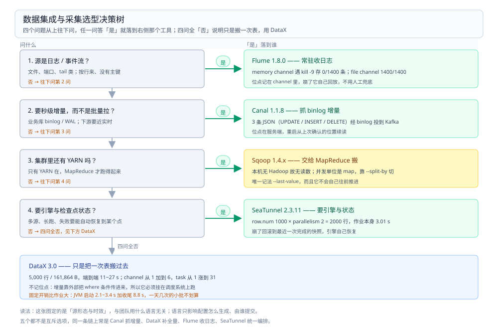

# 数据集成与采集选型对比

> 覆盖：本目录的**总纲兼导读**。数据怎么被搬进湖仓这一层里，五个候选——DataX、Flume、SeaTunnel、Sqoop、Canal——按**谁记住搬到哪了**这条分水岭怎么分；各自的定位与代价、同一类活怎么组合、Sqoop 的退役判据、以及「什么问题该问哪个工具」的决策路径与语言前提。本篇同时承担本目录的入口：**本目录不设目录级 `README.md`**。
>
> 不覆盖：七层职责（文件系统 / 表格式 / Catalog / 计算引擎 / 数据集成与采集 / 资源调度 / 作业编排）怎么分、跨层怎么选，见 [大数据选型对比.md](../大数据选型对比.md)；每款的机制细节、参数与报错原文见 [DataX 册](DataX/README.md)、[Flume 册](Flume/README.md)、[SeaTunnel 册](SeaTunnel/README.md) 与 [Sqoop.md](Sqoop.md)；Canal 的机制在存储侧，见 [CanalCDC.md](../../数据存储/数据同步/CDC/CanalCDC.md)。**同步语义**（位点、投递、幂等、对账）不在这里，见 [数据同步方式选型对比.md](../../数据存储/数据同步/数据同步方式选型对比.md)。
>
> 内容整理自个人学习笔记。⭐ 本篇是判据与对照，**不新增实测**；引用的读数全部来自三个册的实测坐标并注明出处。三册的工具、作业与数据规模各不相同，**不能横向比快慢**——第五节专门说这件事。

---

## 一、这五款的分水岭在哪？

**本节要点**：不看「能读多少种源」，看**谁记住搬到哪了**。这一个问题的答案，决定它能不能做增量、崩了要不要重跑、以及它该被谁调度。

| 分水岭 | DataX | Flume | SeaTunnel | Sqoop | Canal |
| --- | --- | --- | --- | --- | --- |
| 谁记位点 | **没人记**，靠外部传条件 | channel + 文件重命名 | **引擎的 checkpoint** | **没人记**，靠 `--last-value` | **服务端位点** |
| 运行时 | 一作业一 JVM | 常驻 agent | 常驻引擎 | MapReduce 作业 | 常驻服务端 |
| 时效 | 批（分钟~小时） | 近实时 | 批或流 | 批 | 秒级 |
| 依赖外部生态 | 无 | 无（hdfs sink 才要 Hadoop） | 无（cluster 模式要 Hazelcast 成员） | ⭐ **强依赖 Hadoop / YARN** | 无（投 Kafka 才要 Kafka） |
| 失败恢复单位 | 整条作业重跑 | 从 channel 里没提交的那批重来 | 从最近一次 checkpoint 回滚 | 整个 MR 作业重跑 | 从服务端位点续读 |
| 典型位置 | 日批、整表迁移、补数 | 日志落地 | 多源整库同步、批流一套配置 | 已上 Hadoop 的存量集群 | 增量同步的源头 |

⭐ **一句话记忆**：**DataX 搬一个快照、Flume 一直搬、SeaTunnel 把两者当作业提交、Sqoop 只会交给 MapReduce、Canal 只负责把 binlog 变成事件。**

⚠️ 一句纠偏：这五个不是「同一件事的五种实现」。Canal 不写目标端（它只产事件，谁写谁负责）；Flume 不做 SQL；Sqoop 离开 Hadoop 跑不起来；SeaTunnel 与 DataX 的边界只在「要不要引擎」。按「哪个更流行」选，五个里有四个会被用错地方。

## 二、五个候选各自回答什么问题？

**本节要点**：每个候选只解决一类问题，判据是「把它换掉，这段话还成立吗」——成立的部分才是它的灵魂。

### 2.1 DataX：一次性进程，没有位点

它起一个进程、按你给的 SQL 条件捞一遍、跑完退出。`job.json` 里的 `where` / `querySql` 决定读哪些行，增量与重跑幂等**全部由外面的调度补**。

| 它擅长 | 它不擅长 |
| --- | --- |
| 单表整表迁移、补数、按条件捞一段 | 持续增量（没有位点） |
| 单机 standalone，不依赖集群 | 分布式调度（要另外接 DataX-Web / 调度平台） |

本机读数：`channel` 从 1 加到 6，task 从 1 涨到 31，而端到端从 11 s 变成 25 s——**小数据量加 channel 只会更慢**（[运行模型与作业拆解.md](DataX/运行模型与作业拆解.md) 第五、六节）。

### 2.2 Flume：事务 + channel，只保证「搬」

它的三件套是 source → channel → sink，**channel 是事务边界**。所以它能在进程崩溃时不丢——前提是 channel 选了 `file` 而不是 `memory`。

| 它擅长 | 它不擅长 |
| --- | --- |
| 日志 / 文件 / 端口这类持续流入的文本 | 结构化表的同步（没有主键、没有 upsert） |
| 单 agent 拓扑串联（avro sink → avro source） | 并行子任务（只有单 agent 内多 channel） |

本机读数：`memory` channel 崩一次 **0/1400**（全丢），`file` channel **1400/1400**（全回放）（[通道满与崩溃.md](Flume/通道满与崩溃.md) 第四节）。

### 2.3 SeaTunnel：有引擎的 DataX

它起的是引擎，作业只是提交给它的任务。所以它才有 checkpoint、有并行子任务、有失败恢复——**代价是常驻资源**。

| 它擅长 | 它不擅长 |
| --- | --- |
| 一份配置切批 / 流（`job.mode`） | 单机小任务（养引擎不划算） |
| 多源多目标、连接器统一 | 复杂 transform（比 Flink SQL 弱） |
| 状态与失败恢复（checkpoint） | 无 HA 的 `local` 模式上生产 |

本机读数：`row.num=1000` × `parallelism=2` 打出 **2000 行**，因为 `row.num` 按子任务计（[运行模型与Local模式.md](SeaTunnel/运行模型与Local模式.md) 第四节）。

### 2.4 Sqoop：把数据库搬进 HDFS 的 MapReduce 外壳

它的本质是**生成一个 MapReduce 作业**：`--split-by` 决定切几个 map、每个 map 各拉一段，结果直接落 HDFS 或 Hive。所以它的能力上限、并发上限、失败形态，全都是 Hadoop 的。

| 它擅长 | 它不擅长 |
| --- | --- |
| 已上 Hadoop 的集群里做库表 ↔ HDFS 搬运 | 没有 YARN 的环境（根本跑不起来） |
| 与 Hive 元数据直接对接 | 非 Hadoop 目标端（对象存储 / 湖表要另想办法） |
| `--incremental append/lastmodified` 的简单增量 | 多源多目标统一编排 |

⚠️ 本篇**未做任何 Sqoop 实测**（本机无 Hadoop / YARN），机制按官方文档陈述，见 [Sqoop.md](Sqoop.md) 的校验口径。

### 2.5 Canal：只负责把 binlog 变成事件

它伪装成 MySQL 从库去读 binlog，把变更投成本地 TCP 流或 Kafka 消息。**它不写目标端**——写谁、怎么写、幂等怎么保，都是下游的事。

它的完整机制不在本目录：见 [CanalCDC.md](../../数据存储/数据同步/CDC/CanalCDC.md) 与 [README.md](../../数据存储/数据同步/CDC/README.md)（CDC 册）。本篇只把它放进这张对照表，因为**「要不要 CDC」是采集这一层绕不开的一问**。

| 它擅长 | 它不擅长 |
| --- | --- |
| 秒级增量的源头（UPDATE 带前值） | 全量快照（要另配一次全量） |
| 投递到 MQ 解耦 | 非 MySQL 的源（要换 Debezium） |

## 三、横向对比：哪些维度必须并排看？

**本节要点**：五个工具真正无法回避的差别只有三处——位点记在哪、失败后从哪重来、以及「谁来保证不重复」。其余都是参数层面的偏好。

### 3.1 定位速览

| 项 | DataX | Flume | SeaTunnel | Sqoop | Canal |
| --- | --- | --- | --- | --- | --- |
| 一句话 | 快照搬运工具 | 日志管道 | 集成引擎 | Hadoop 的搬运外壳 | 变更事件源 |
| 配置形态 | JSON（无注释） | `.conf` properties | HOCON（可注释、可继承） | 命令行参数 | properties |
| 并行单位 | task / channel | 单 agent 多 channel | 并行子任务 | map 数（由 `--split-by` 切） | 单实例多线程 |
| 需要写代码吗 | 不写（写 JSON） | 不写（写 conf） | 不写（写 HOCON） | 不写（拼命令） | 不写（写 properties） |
| 本仓实测 | ✅ | ✅ | ✅ | ⚠️ 未实测 | ✅（存储侧那篇） |

### 3.2 位点与状态：五种记法

| 记在哪 | 谁 | 崩了会怎样 | 重跑要做什么 |
| --- | --- | --- | --- |
| **不记** | DataX、Sqoop | 这次白跑 | 从头再跑一遍；增量靠外部传时间条件 |
| **channel 里** | Flume | `file` channel 回放未提交那批；`memory` 全丢 | 等它自己回放，不用人工介入 |
| **checkpoint 里** | SeaTunnel | 回滚到最近一次完成的快照 | 重启作业，引擎自己恢复 |
| **服务端位点** | Canal | 从上次确认的 binlog 位置续读 | 重启即可，位点在服务端 |
| **`--last-value` 传入** | Sqoop | 这次白跑 | 下次命令里把上次的值填进去 |

⭐ **这张表是全篇最该记住的一张**：它直接决定「这条链路要不要人工兜底」。不记位点的两种（DataX / Sqoop）必须挂在调度系统上，靠调度器补「跑到哪」；记位点的三种各自把这件事放在不同层——channel、checkpoint、服务端。

### 3.3 失败恢复：「重跑一遍」长得不一样

| 工具 | 最小的重跑单位 | 代价 |
| --- | --- | --- |
| DataX | 整个作业 | 大表要重头扫 |
| Flume | 未提交的那一批事件 | 可能重复投递（至少一次） |
| SeaTunnel | 从快照重来 | 快照之后的数据再走一遍 |
| Sqoop | 整个 MR 作业 | 所有 map 重跑 |
| Canal | 从位点续读 | 一般不重跑，但下游要幂等 |

⚠️ 五种恢复方式里**没有一种是「精确一次」**。要做到不重不漏，幂等键与对账这两件事必须由目标端与调度侧补上——那是 [数据同步方式选型对比.md](../../数据存储/数据同步/数据同步方式选型对比.md) 第五节与 [README.md](../../数据存储/数据同步/数据对比与对账/README.md)（对账册） 的内容。

## 四、怎么选？

**本节要点**：先按**契合语言**定「配置怎么写、谁来提交」，再按**数据形态与时效**定工具——顺序不能反，因为语言只影响接入形态，不影响工具的机制边界。



图从左到右是四个问题，每个「是」直接落到右侧对应的工具；四问全「否」说明只是「搬一次表」，那就用 DataX。图里每个工具卡片下标注的是本仓实测版本与一条关键读数。

### 4.1 先按契合语言定配置形态

| 团队主语言 | 配置怎么写 | 谁来提交 | 注意 |
| --- | --- | --- | --- |
| Java | 直接用；插件也能用 Java 写 | 自建调度 / 提交服务 | 五个都原生，选型只看数据形态 |
| Go | ⭐ 不写插件，只**生成配置 + 调命令行** | 外部调度器（cron / DolphinScheduler） | 作业日志与退出码要自己接 |
| PHP / 多语言 | 同上 | 交给调度系统 | 不要把提交面暴露给业务代码 |

> ⭐ **先说清**：主语言决定的是「配置怎么生成、谁来提交」，**不决定选哪个工具**。工具由源形态与时效决定，见 4.2 之后的判据。

### 4.2 契合语言与团队栈怎么选 ⭐

这五个全是 JVM 产品，**这一点换不掉**。语言差异只体现在「配置怎么写」和「出问题看哪一层」。

| 工具 | 服务端 | 配置语言 | 最契合语言 | Go 侧实际体验 | 外部运行时依赖 |
| --- | --- | --- | --- | --- | --- |
| DataX | JVM（裸进程） | JSON，**不支持注释** | Java（写 reader / writer 插件） | 只能生成 job.json 再 `java -jar`，拿不到进度 | 无 |
| Flume | JVM（agent） | `.conf` properties，平铺 | Java（写 source / sink） | 只能往 TCP 端口灌，或生成 conf 后起 agent | 无（hdfs sink 才要 Hadoop） |
| SeaTunnel | JVM（引擎） | HOCON，**可注释可继承** | Java（写 connector） | 只能生成 conf + 调 CLI / REST | 无（`cluster` 要 Hazelcast 成员） |
| Sqoop | JVM + Hadoop | 命令行参数，无配置文件 | Java（写连接器） | 拼命令即可，但**必须有 YARN** | ⭐ **强依赖 Hadoop** |
| Canal | JVM（服务端） | properties | Java（客户端协议） | 有第三方 client（本篇未实测） | 无（投 Kafka 才要 Kafka） |

> ⭐ **三条结论**：
> ① **Go 团队**：这五个都只能「生成配置 + 外部调度 + 读退出码」。别想着在 Go 里写插件——四款的插件接口都是 Java。Go 侧真正要做的是**把配置当产物管起来**（模板 + 参数注入 + 版本化），而不是找 SDK。
> ② **配置形态决定可维护性，比功能差异更影响日常**：DataX 的 JSON 不支持注释，一段「为什么这么写」的说明只能放外部文档；SeaTunnel 的 HOCON 能注释也能继承，多环境可以拆公共段。**同类活能用 HOCON 就别用 JSON**，这是长期成本。
> ③ **唯一强依赖外部生态的是 Sqoop**。其余四个都能在一个容器里独立跑起来；Sqoop 没有 YARN 就起不来，这一条经常在「以为能迁移」时才发现。

> ⚠️ **反面教训**：**把「插件数量」当成选型依据**。DataX 报 30 个 reader + 39 个 writer，SeaTunnel 镜像里 76 个 connector jar——数量多不等于能跑你的源：JDBC 类还要配对应驱动版本（DataX 自带的是 `mysql-connector-java-5.1.47`，对 MySQL 8 会每轮刷 7 条 `SSLException` 告警但作业成功），CDC 类还要源库开日志与复制权限。**正确的问法是「我这个源 + 这个目标端，有没有人跑通过」，不是「它支持多少种」。**

### 4.3 Sqoop 的退役判据

**本节要点**：Sqoop 只有一个判据——**集群里还有没有 YARN**。有，它可以继续用；没有，任何理由都不该选它。

| 场景 | 判断 |
| --- | --- |
| 已有 Hadoop / YARN，存量 Sqoop 作业在跑 | 留着，别动；收益不抵迁移风险 |
| 已有 Hadoop，但要写对象存储 / 湖表 | 不用 Sqoop，换 SeaTunnel 或 DataX |
| 没有 Hadoop，只是要搬库表 | **不选 Sqoop**，它不是「重量级的 DataX」，它是 MapReduce 生成器 |
| 新项目要选型 | 走 DataX（单机批）或 SeaTunnel（要引擎） |

⚠️ 两层口径要说清：

- **机制层面**：Sqoop 的并发单位是 map，`--split-by` 决定切几个、`--direct` 走数据库原生导出，这些都是 MapReduce 的属性。**离开 MapReduce，Sqoop 就没有并发模型**——它不是一个独立的数据集成工具。
- **项目层面**：Sqoop 长期没有新版本、社区活跃度低，**本篇未做版本时间线核实**，以官方仓库与发行说明为准。判断一个工具是否该退出，看的是「还有没有人修 bug」，不是「还能不能跑」。

### 4.4 组合用法：一条链上不止一个工具

五个不是互斥选项。同一条「业务库 / 日志 → 湖仓」的链路，常见摆法是：**Canal 抓增量、DataX 补全量与补数、Flume 收日志、SeaTunnel 做统一编排，Sqoop 只留在有 YARN 的存量集群**。

| 角色 | 什么时候跑 | 读什么 | 写什么 | 失败怎么办 |
| --- | --- | --- | --- | --- |
| Canal | 常驻 | MySQL binlog | Kafka（或本地 TCP） | 从服务端位点续读 |
| DataX | 日批 / 补数 | 业务库 | 湖表或另一库 | 整条重跑 |
| Flume | 常驻 | 日志文件 / 端口 | Kafka / HDFS | 回放未提交批次 |
| SeaTunnel | 常驻或定时 | 多源 | 湖表 / 多目标 | 从 checkpoint 恢复 |

⚠️ 这张表是**职责分工**，不是部署拓扑：本仓三册都在单容器里各自独立起，多工具协同、跨机部署、同一张表被两条链路同时写都未实测。

### 4.5 什么时候不该用

| 工具 | 不该用来做 | 为什么（带读数） |
| --- | --- | --- |
| DataX | 持续增量 | 没有位点，只能靠外部传 `where`，等于自己重写一套位点 |
| Flume | 结构化表同步 | 没有主键概念，做不了 upsert |
| SeaTunnel | 一天几次的小批 | 起引擎约 11 s，作业本身 3.01 s，固定开销比作业大 |
| Sqoop | 没有 YARN 的环境 | 起不来 |
| Canal | 全量快照 | 它是变更流，首屏全量要另配 |

### 4.6 选型评估清单

| 评估项 | 要问的问题 |
| --- | --- |
| 源形态 | 是表、日志、还是变更流？表的话有多少行、能不能按主键切？ |
| 时效 | 分钟级批够不够？还是要秒级？ |
| 位点 | 谁记住搬到哪？崩了能不能只重来一段？ |
| 目标端 | 湖表 / HDFS / 另一个库 / 消息队列？ |
| 重复是否可接受 | 至少一次够不够？目标端有没有幂等键？ |
| 外部依赖 | 有没有 YARN？能不能接受常驻引擎的内存？ |
| **契合语言 / 配置形态** ⭐ | 谁生成配置？JSON 还是 HOCON？多环境怎么管？ |
| 观测与排障 | 失败看哪一层日志？有没有退出码之外的进度可查？ |

---

## 五、这些读数能横向比快慢吗？

**本节要点**：不能。三册的作业不同、数据规模不同、运行模式也不同，读数只证明「机制确实如此」，不证明「谁更快」。

| 册 | 关键读数 | 那是什么作业 | 什么环境 |
| --- | --- | --- | --- |
| DataX | 5,000 行 / 161,864 B，端到端 11~27 s | 单表 MySQL → MySQL | `temurin:8-jdk` + `mysql:8.0.46`，同容器 127.0.0.1 |
| Flume | 1,400 条事件，`kill -9` 后看回放 | `spooldir` / `netcat` → `avro` 死端口 | Flume **1.8.0** 单 agent |
| SeaTunnel | `row.num` 1,000 × 2 = 2,000 行，3.01 s | `FakeSource` → `Console` | **2.3.11** `local`，Java 1.8.0_342 |
| Canal | 3 条 JSON（UPDATE / INSERT / DELETE） | MySQL 8 binlog → Kafka | `canal-server v1.1.8`，共享 netns |
| Sqoop | **无读数** | — | 本机无 Hadoop |

⭐ 三组数字放在一起看只有一个结论：**固定开销的占比决定体感**。DataX 搬 3 KB 级数据要 11 s 起（JVM 启动 + 收尾 8.8 s），SeaTunnel 起引擎约 11 s（Hazelcast + JVM），Flume 常驻所以没有启动成本但有小批次的延迟下限。**「哪个快」这个问题在 GB 级以下没有意义**。

## 六、三方划界：本目录 / 数据同步 / 平台册

**本节要点**：这三个目录都在讲「数据怎么流动」，但问的问题不一样——**本目录问选哪个产品、数据同步问语义怎么保、平台册问链路怎么拼**。

| 目录 | 它回答什么 | 典型句子 | 判据 |
| --- | --- | --- | --- |
| **本目录**（`大数据组件/数据集成与采集/`） | 同一类活该选哪个**产品**，各产品机制怎么跑 | 「`channel` 从 1 加到 6，task 从 1 涨到 31」 | 出现**产品名 + 配置键 + 报错原文** |
| [数据同步方式选型对比.md](../../数据存储/数据同步/数据同步方式选型对比.md) | **同步语义**怎么保：不丢、不重、不乱序、怎么对账 | 「水位只在成功后推进」 | 换掉工具仍然成立 → 这里 |
| [README.md](../../../04-架构与系统/系统设计/大数据平台/README.md)（大数据平台册） | 一条**链路**怎么拼：采集 → 入湖 → 分层 → 查询，代价落在哪 | 「15 分钟时效的链路里采集排第几」 | 出现**量级假设、链路排序、成本账** → 这里 |

⭐ 一条实操判据：**把产品名删掉，这段话还成立吗？** 成立 → 不在本目录。所以「位点、幂等、对账」不在本篇讲（那是同步语义），「日增 200 GB 怎么估」也不在本篇讲（那是平台册）。

⚠️ 一处需要说明的重叠：`数据同步方式选型对比.md` 里已经有「定时批量」这条路线，与本目录的 DataX 看起来撞题。**界在粒度**：那里比的是**三条方式**（读日志 / 双写 / 定时批量）怎么选、怎么组合；本篇比的是**同一方式下选哪个工具**。前者只有一句提到 DataX，后者不再重复「三种方式怎么比」。

## 使用：本目录怎么读

**本节要点**：按你手上的问题选入口，不按目录树顺序读。本篇兼本目录导读，目录下没有单独的 `README.md`。

| 你在问什么 | 看哪里 |
| --- | --- |
| 数据怎么搬进来这一层，五个工具到底差在哪 | ⭐ **本篇第一、三节** |
| 有一个明确的活，该选哪个工具 | ⭐ **本篇第四节**（决策树 + 契合语言表） |
| DataX 作业怎么拆、加 channel 为什么不变快、限速与脏数据 | [DataX 册](DataX/README.md) — 三篇的分工与读序 |
| 日志怎么持续收、崩了丢不丢、`file` 与 `memory` channel 怎么选 | [Flume 册](Flume/README.md) — 三篇的分工与读序 |
| 要引擎的那一类活：子任务怎么拆、checkpoint 存哪、插件从哪来 | [SeaTunnel 册](SeaTunnel/README.md) — 三篇的分工与读序 |
| 集群里还有 YARN，Sqoop 还能不能用 | [Sqoop.md](Sqoop.md) |
| 增量从哪来、binlog 怎么变成事件 | [CanalCDC.md](../../数据存储/数据同步/CDC/CanalCDC.md) 与 [README.md](../../数据存储/数据同步/CDC/README.md)（CDC 册）|
| 「不丢、不重、怎么对账」怎么保证 | [数据同步方式选型对比.md](../../数据存储/数据同步/数据同步方式选型对比.md) 第五、七节 |
| 这一层在一套平台里排第几、量级怎么估 | [大数据平台册](../../../04-架构与系统/系统设计/大数据平台/README.md) |
| 七层职责怎么分、跨层怎么选 | [大数据选型对比.md](../大数据选型对比.md) |

**读序**（前一篇的概念是后一篇的前提）：

```text
本篇（谁记位点）──> DataX（不记位点的代表）──> Flume（记在 channel 里）
                └─> SeaTunnel（记在 checkpoint 里）──> Sqoop（退化到 Hadoop 的 MapReduce）
                └─> Canal（记在服务端）→ 存储侧的 CDC 册
```

**目录怎么分**：第一层是**职责**，第二层是**产品**。`数据集成与采集/` 是横切支撑线里的一条，它不在四层主链上——主链是文件系统 → 表格式 → Catalog → 计算引擎，采集是「把外部数据搬进主链」的那一条。

## 延伸追问

- **为什么这一层要单独成一个目录，而不是并进 `数据存储/数据同步/`？** → 因为主链之外的三层（采集 / 资源调度 / 作业编排）都不是「存储」，而是「让主链转起来」的支撑。把它们塞进存储目录，会让「数据形态」这条分类轴失效。
- **Canal 为什么不重建一篇？** → 它的机制已经落在地盘上（`数据存储/数据同步/CDC/CanalCDC.md`），且那条路线的主问题是**同步语义**不是**采集工具**。本篇只在对照表里给它一格，避免同一机制两份。
- **`数据集成` 与 `数据采集` 是一个东西吗？** → 不完全是。**集成**偏「多源多目标、结构对齐」（DataX / SeaTunnel / Sqoop），**采集**偏「持续收文本流」（Flume）。合并成一层是因为它们共用同一批判断——位点、重试、幂等。
- **没有引擎的工具还能做增量吗？** → 能，但增量逻辑在工具外面：DataX 靠外部传时间条件、Sqoop 靠 `--last-value`。这等于把「位点」这件事挪到调度器上，代价是调度器必须知道每个作业跑到哪。
- **SeaTunnel 能不能替掉 Flume？** → 日志场景能替，但代价不同：Flume 常驻内存更轻、拓扑串联（avro）是它的强项；SeaTunnel 换来的是 checkpoint 与并行。判据在「要不要状态恢复」。

## 关联

- **上游/总纲**：[大数据选型对比.md](../大数据选型对比.md) — 七层职责与本目录在其中的位置
- **场景侧姊妹册**：[README.md](../../../04-架构与系统/系统设计/大数据平台/README.md)（大数据平台册） — 同一批组件在一条 15 分钟时效链路里的拼装方式
- **对照/互补**：[数据同步方式选型对比.md](../../数据存储/数据同步/数据同步方式选型对比.md) — 三条同步方式的族级横评与本篇的工具级对照互为上下层
- **下游机制**：[DataX 册](DataX/README.md) — 无位点、插件式批搬运的代表
- **下游机制**：[Flume 册](Flume/README.md) — 事务 + channel 的代表
- **下游机制**：[SeaTunnel 册](SeaTunnel/README.md) — 有引擎、有 checkpoint 的代表
- **下游机制**：[Sqoop.md](Sqoop.md) — 退化到 MapReduce 的搬运外壳
- **下游机制**：[CanalCDC.md](../../数据存储/数据同步/CDC/CanalCDC.md) — 增量同步的源头
- **素材来源**：[素材清单.md](../../../素材清单.md) — 素材来源登记
