# HDFS

> 覆盖：分布式文件系统这一层 —— **块与副本**怎么切、**写管道**为什么是链式、**NameNode 的账本**有多重、以及它与对象存储的分水岭（能不能追加写）。
>
> 不覆盖：四层怎么分工与接口配置见 [大数据选型对比.md](../大数据选型对比.md)；表格式如何把文件组织成表见 [Iceberg.md](../表格式/Iceberg.md)；列式库为什么不需要 HDFS 见 [列式数据库选型对比.md](../../数据存储/列式数据库/列式数据库选型对比.md)。
>
> 内容整理自个人学习笔记。本篇读数在 `dockerproxy.net/apache/hadoop:3.4.1` 单容器伪分布式（NameNode + DataNode 各一个）跑出，输出见第五节至第七节。**未实测**：多节点集群、机架感知的真实拓扑、HA（JournalNode + ZKFC）、纠删码、对象存储对照侧的任何读数。

---

## 一、一句话定位：HDFS 与对象存储的分水岭是「追加写」与「块」

**本节要点**：两者都叫「存文件」，但**修改模型**完全不同。这个差别决定了上层能不能用「目录 + 覆盖写」的方式组织数据。

| 维度 | HDFS | 对象存储（S3 / OSS / MinIO） |
|---|---|---|
| 数据单元 | **块**（默认 128 MB），块是复制与均衡的单位 | **对象**，一次写整个对象 |
| 修改 | ⭐ **支持追加写**（`append` / `hflush` / `hsync`） | ❌ 只支持整体覆盖，**不能追加** |
| 重命名目录 | 廉价的元数据操作 | copy + delete，大目录很慢 |
| 元数据 | NameNode 内存账本（受堆大小约束） | 服务端 KV，客户端无感 |
| 扩展方式 | 加 DataNode；**NameNode 是单点缩放瓶颈** | 近乎无限 |
| 成本结构 | 自建 + 3 副本 = 3 倍裸盘 | 按量计费，可换纠删码 |
| 读延迟 | 低（本地盘 + 就近读） | 高（HTTP + 网络往返） |

⭐ **判据**：**要不要就地追加或改写一个已有文件？** 要 → HDFS 这类文件系统；不要（只写不可变文件）→ 对象存储。这也是为什么**表格式在对象存储上强制「只写新文件、不改进旧文件」**：不是设计偏好，是被存储层的能力约束出来的。

⚠️ **成本上的一条反直觉**：对象存储看起来「便宜且无限」，但它把成本从「磁盘」转移到了「请求次数」。一个小文件一条 PUT、一次列目录一次 LIST，量大之后请求费用会超过存储费用。HDFS 没有这个问题，但你要自己为 3 副本付三倍磁盘。

---

## 二、核心概念：块、副本、NameNode、EditLog 与 FSImage

**本节要点**：HDFS 把「文件」拆成两层记账 —— **文件 → 块 → 副本位置**。NameNode 只记前两层，副本位置由 DataNode 上报。

| 概念 | 是什么 | 关键数字 |
|---|---|---|
| **块（Block）** | 文件被切成的固定大小片段 | 默认 `dfs.blocksize = 134217728`（128 MB） |
| **副本（Replica）** | 同一块在不同 DataNode 上的多份 | 默认 `dfs.replication = 3` |
| **NameNode（NN）** | 内存里的元数据账本：目录树、文件 → 块列表、块 → 副本所在 DN | 受堆内存约束 |
| **DataNode（DN）** | 真正存块，定期向 NN 发心跳与块报告 | 心跳间隔 3 秒，超时 10.5 分钟判死 |
| **EditLog** | 所有元数据变更的追加日志 | 每次 `mkdir` / `put` 都写一条 |
| **FSImage** | 元数据在某一时刻的完整快照 | 与 EditLog 合成才能还原当前状态 |

⭐ **必须记住的一条**：**NameNode 不记「块存在哪块磁盘」，只记「块在哪些 DataNode 上」**。差异由 DataNode 的块报告补齐。所以 NN 重启后要等 DN 上报完，集群才从「安全模式」出来 —— 这期间只能读、不能写。

---

## 三、整体架构：写管道与读就近

**本节要点**：HDFS 的写是**链式复制**，不是并行复制。这个设计让客户端只上传一份数据，代价是**末尾节点的延迟决定整次写入的完成时间**。



图怎么读：① 客户端写第一个块之前先问 NameNode「这个块放哪」，NN 按副本策略（默认 3、按机架打散）返回一组 DataNode；② 数据包沿 DN1 → DN2 → DN3 逐跳转发，每一跳先落盘再往下一跳发；③ ACK 沿反方向逐跳回传，客户端收到 DN1 的 ACK 才算这一包写完。任一跳失败，客户端跳过该节点、向剩余节点重试，事后把结果报给 NN 补副本。

**读**则是另一个方向：客户端向 NN 要「块 → DN 列表」，然后**就近读**（同机架优先，同节点优先）。读没有管道，哪个副本快读哪个，所以读路径比写路径容易扩容。

⭐ 两个由此推出的结论：

1. **副本数不足不会阻塞写入**，只会让集群长期处于 under-replicated 状态。实测见第七节：单 DataNode 上把副本数从 1 改成 2，`Under replicated blocks` 变成 1、`Missing replicas: 1 (50.0%)`，而 `Blocks queued for replication: 0` —— 没有别的节点可复制，队列就是空的，这个状态会一直挂着直到加节点。
2. **写延迟 ≈ 最慢那个副本的落盘时间**，不是平均值。副本数越多、跨机架越多，写的尾延迟越高。

---

## 四、部署：伪分布式的最小配置与三个必改项

**本节要点**：单容器跑通 HDFS 只要改两个文件、做一次 format。**三个必改项不改，容器里一定起不来**。

```xml
<!-- core-site.xml -->
<configuration>
  <property><name>fs.defaultFS</name><value>hdfs://localhost:8020</value></property>
  <property><name>hadoop.tmp.dir</name><value>/tmp/hadoop</value></property>
</configuration>
```

```xml
<!-- hdfs-site.xml：单 DataNode 必须把副本数改成 1 -->
<configuration>
  <property><name>dfs.replication</name><value>1</value></property>
  <property><name>dfs.namenode.name.dir</name><value>/tmp/hadoop/dfs/name</value></property>
  <property><name>dfs.datanode.data.dir</name><value>/tmp/hadoop/dfs/data</value></property>
</configuration>
```

```bash
# 一次 format，然后前台起两个进程（--daemon start 在容器里常因 PID 目录不可写而静默失败）
hdfs namenode -format -force -nonInteractive
hdfs namenode  > /tmp/nn.log 2>&1 &
hdfs datanode  > /tmp/dn.log 2>&1 &
```

⭐ **三个必改项**：

1. **`dfs.replication=1`**：默认 3，单 DN 上永远 under-replicated，`fsck` 一直报不健康，会让人误以为没起来。
2. **`hadoop.tmp.dir`** 指到可写目录：容器里 `/tmp` 之外常常不可写。
3. **用前台进程 + 就绪探测**，不要用 `hdfs --daemon start`：它需要 `HADOOP_PID_DIR` 可写，失败时**不报错**，只是 NN 没起来。实测里改成前台起 + 轮询 `hdfs dfs -ls /`，第 2 次探测就绪；DN 同理，第 2 次探测注册成功。

---

## 五、使用一：CLI 与「块」这笔账

**本节要点**：HDFS 的容量与性能都由块推出来。**看一个文件占多少块，比看它多大更有意义**。

### 5.1 基础命令

```bash
hdfs dfs -mkdir -p /data
hdfs dfs -put /tmp/small.bin /data/small.bin
hdfs dfs -ls /data
hdfs dfs -cat /data/a.txt
hdfs dfsadmin -report                 # 集群容量与副本健康
hdfs fsck /data/big.bin -files -blocks  # ⭐ 看这个文件被切成几个块
```

### 5.2 实测：1 MB 与 130 MB 的文件分别占几个块

```text
--- small.bin 1 MB ---
Status: HEALTHY
Total size:               1048576 B
Total blocks (validated): 1 (avg. block size 1048576 B)
Average block replication: 1.0

--- big.bin 130 MB ---
0. BP-...:blk_1073741826_1002 len=134217728 Live_repl=1
1. BP-...:blk_1073741827_1003 len=2097152   Live_repl=1
Total size:               136314880 B
Total blocks (validated): 2 (avg. block size 68157440 B)
```

⭐ 130 MB 被切成 **128 MB + 2 MB 两块**。注意 `Average block size 68157440`（约 65 MB）—— 这是个平均数，**不要拿它当块大小**，块大小看 `dfs.blocksize`。

### 5.3 块在磁盘上长什么样

```text
/tmp/hadoop/dfs/data/current/BP-.../current/finalized/subdir0/subdir0/
  blk_1073741825              1048576 bytes     ← 1 MB 的数据
  blk_1073741825_1001.meta       8199 bytes     ← 校验和
  blk_1073741826            134217728 bytes     ← 128 MB 的数据
  blk_1073741826_1002.meta    1048583 bytes     ← 校验和
  blk_1073741827              2097152 bytes     ← 2 MB 的数据
  blk_1073741827_1003.meta      16391 bytes     ← 校验和
```

每个块旁边都有一个 `.meta` 文件存校验和，大约是块数据的 1/128（每 512 字节一个 4 字节 CRC32）。⭐ 所以 **HDFS 的裸盘占用 ≈ 数据量 × 副本数 × 1.008**，不是正好 3 倍。

### 5.4 NameNode 的账本有多重

实测（4 个文件、3 个块）：

```text
/tmp/hadoop/dfs/name/current/
  VERSION                              212 bytes
  fsimage_0000000000000000000          401 bytes
  fsimage_0000000000000000000.md5       62 bytes
  edits_inprogress_0000000000000000001 1048576 bytes
  seen_txid                              2 bytes
```

⭐ **元数据只有 401 字节**（当时的快照）。这说明 NN 的元数据不在磁盘上「实时维护」，而是**内存一份 + 定期快照**。小文件问题的算法由此而来：

| 账目 | 业界经验值 | 1000 万个 1 KB 文件 |
|---|---|---|
| 每个 **inode**（文件 / 目录） | ≈ 150 B | 1.5 GB |
| 每个 **block**（每个小文件至少 1 个块） | ≈ 150 B | 1.5 GB |
| 合计 | — | ⚠️ **≈ 3 GB 堆内存，只为存 10 GB 数据** |

⚠️ 这两个数字是**业界经验估值，本轮未实测**（样本只有 3 个块，量不出斜率）。但结论是稳的：**HDFS 的容量上限由 NameNode 的堆决定，不是由磁盘决定**。一个 1 KB 的文件和一个 128 MB 的块，在 NN 里占的账目差不多。

---

## 六、使用二：追加写与 `hflush` / `hsync`

**本节要点**：追加写是 HDFS 相对对象存储**结构上给得了**的那项能力。它有语义档位，「写完了」到底指什么，决定了崩溃会不会丢数据。

最直接的一条：

```text
$ hdfs dfs -appendToFile /tmp/b.txt /data/a.txt
$ hdfs dfs -cat /data/a.txt
hello
world
```

底层 `FSDataOutputStream` 是三档语义，差别只在**什么时候算写完**：

| 调用 | 数据到哪了 | 谁看得见 | 类比 |
|---|---|---|---|
| `write()` | 客户端缓冲区 | 只有自己 | 写本地内存 |
| `hflush()` | 推到管道末端各 DataNode 的**页缓存** | 新的 reader 立刻能读到 | WAL 的 `write` 返回 |
| `hsync()` | 各 DataNode 已 **fsync 落盘** | 宕机也不丢 | WAL 的 `fsync` 返回 |

⭐ **为什么要分两档**：`hflush` 只保证「进程崩溃不丢」—— 机器没断电，数据还在页缓存里；`hsync` 才是「断电也不丢」，代价是每次都要等三个 DN 各自 fsync。所以写 WAL 用 `hsync`，写普通数据文件用 `hflush` 甚至不用。

⚠️ **本仓未实测 `hflush` / `hsync` 的延迟差异**（只有单 DN 伪分布式，量不出三跳 fsync 的代价），实测的只有 `appendToFile` 的结果。上表三档语义按 Hadoop 官方 `FSDataOutputStream` 契约写。

⭐ **这条能力直接决定上层的写法**：正因为 HDFS 能追加、对象存储不能，Flink / Spark 在对象存储上必须「一个 checkpoint 写一个新文件、再删旧的」，而在 HDFS 上可以持续追加同一个文件。表格式在对象存储上强制「只写新文件、不改进旧文件」，底层原因就在这里（见 [Iceberg.md](../表格式/Iceberg.md) 第三节）。

---

## 七、使用三：副本与块管理

**本节要点**：`setrep` 改的是**期望副本数**，不是「立刻复制几份」。把「期望值」和「实际值」分开看，才能分清「复制卡住了」和「根本没有目标节点」。

实测（单 DataNode 上，把小文件从 1 副本改成 2）：

```text
$ hdfs dfs -setrep 2 /data/small.bin
Replication 2 set: /data/small.bin

$ hdfs fsck /data/small.bin -files -blocks
Under replicated BP-...:blk_1073741825_1001.
  Target Replicas is 2 but found 1 live replica(s), 0 decommissioned replica(s).
Under-replicated blocks:      1 (100.0 %)
Missing replicas:             1 (50.0 %)
Blocks queued for replication: 0
```

⭐ 两个读数各说一件事：`Under-replicated blocks: 1 (100.0 %)` 说明**这个状态不影响读写**，只是不健康；`Blocks queued for replication: 0` 说明**没有别的 DN 可复制，队列压根没排** —— 很多人看到这条会以为「复制卡住了」，其实是没目标节点，加节点才会动。

管块与副本就四条命令：

| 命令 | 看什么 | 什么时候用 |
|---|---|---|
| `hdfs fsck /path -files -blocks -locations` | 每块落在哪几个 DN | 判断副本是不是真分散在不同机架 |
| `hdfs dfsadmin -report` | Live / Dead datanodes、容量、under-replicated 块数 | 集群级体检 |
| `hdfs balancer -threshold <百分比>` | 各 DN 磁盘使用率的差值 | 新加节点后把数据摊平 |
| `hdfs dfsadmin -refreshNodes`（配合 `dfs.hosts.exclude`） | 摘节点的进度 | 缩容 |

⚠️ **未实测**：`balancer` 与 decommission —— 单 DN 既没有「不平衡」可看，也没有第二个节点可摘。

---

## 八、验证与排查

**本节要点**：先看「块对不对」，再看「副本够不够」，最后才看数据。

### 8.1 三段确认

```bash
hdfs fsck /path -files -blocks          # 块数与每块大小
hdfs dfsadmin -report                   # Live datanodes / Under replicated
ls -l /tmp/hadoop/dfs/name/current/     # fsimage 与 edits 是否在长大
```

### 8.2 故障速查

| 症状 | 先查什么 |
|---|---|
| 客户端连不上 8020 | NN 进程真的起来了吗（用前台起 + 探测，别看 `--daemon start` 的返回码） |
| 集群一直处于 safe mode | 等 DN 上报；或 `hdfs dfsadmin -safemode get` 看原因 |
| `fsck` 一直 UNDER-REPLICATED | ⭐ 副本数是否大于 DN 数量；单 DN 上设 3 永远补不上 |
| 明明有空间却写不进去 | NameNode 堆 / 单目录文件数上限，不是磁盘 |
| 读很慢但写正常 | 就近读失效（`dfs.client.use.datanode.hostname`、机架映射配错） |
| 删了文件空间没释放 | 回收站（`fs.trash.interval`）没到期，`hdfs dfs -expunge` 手动清 |

---

## 九、校验口径

> ✅ 本篇代码的校验方式与范围（`apache/hadoop:3.4.1`，单容器伪分布式 NN + DN）：

- **真跑，容器内实测**：`hadoop 3.4.1` 单容器伪分布式（NN + DN 各一）；第五节的块切分（1 MB → 1 块、130 MB → 128 MB + 2 MB 两块）、磁盘上的 `blk_*` 与 `.meta` 大小、NameNode 的 `fsimage` 与 `edits` 文件清单、第六节的 `appendToFile` 结果、第七节的 `setrep` 与 `fsck` 读数。
- **未实测**：多 DataNode 集群与副本真实复制；机架感知拓扑（单容器无机架信息）；HA（JournalNode + ZKFC + 自动切换）；纠删码（EC）的容量读数；对象存储对照侧的任何数字；不同块大小（只测了默认 128 MB）；NameNode 堆占用与文件数的实际斜率；`hflush` / `hsync` 的延迟差异；`balancer` 与 decommission（单 DN 既无「不平衡」可看、也无第二个节点可摘）。
- **推算标注**：第五节 5.4 表格里「每 inode ≈ 150 B、每 block ≈ 150 B」是业界经验估值，本轮样本只有 3 个块，**未实测**；据此推的「1000 万小文件 ≈ 3 GB 堆」同属推算。
- **可复现性**：脚本在 `.workbuddy/tmp/bigdata-lab/hdfs_up.sh`（不入库）；⚠️ 该脚本必须用 LF 行尾挂进容器，CRLF 会让 bash 把每行末尾当命令执行，报 `$'\r': command not found` 且 `set -u` 失效。

| 依赖 | 实际版本 / 取值 |
|---|---|
| Hadoop | `apache/hadoop:3.4.1` |
| `dfs.blocksize` | `134217728`（128 MB） |
| `dfs.replication` | 1（单 DN 场景，默认 3） |
| 部署形态 | 伪分布式，NN 与 DN 同容器 |
| NameNode RPC | `hdfs://localhost:8020` |

---

## 延伸追问

- **HDFS 为什么不能只存 1 个副本省空间？** → 副本数决定「坏盘时数据还在不在」。3 副本能容忍 2 块盘同时坏；1 副本坏一块就丢。省下的两倍磁盘，抵不上一次数据重建的成本。真正想省空间且能接受重建代价时，用的是纠删码（EC），不是减副本。
- **对象存储这么方便，为什么还有人在自建 HDFS？** → 三个理由：① 低延迟的本地读（训练集、临时 shuffle 落盘）；② 追加写（日志、WAL）；③ 没有请求费用，小文件多的时候成本可预测。反过来，一旦数据是「一次写入、多次分析」的冷数据，对象存储的扩展性与成本都更优。
- **NameNode 是单点，为什么还能上生产？** → 靠 HA：两个 NN（Active / Standby）共享一组 JournalNode 存 EditLog，ZKFC 负责选主与切换。代价是多三台 JournalNode 与一套 ZooKeeper。
- **块大小能不能改大？** → 能，`dfs.blocksize` 是每文件可设的。改大的收益是减少 NN 记账（块少了）、减少寻址开销；代价是**最后一个块可能浪费**、小作业的并行度下降。HDFS 默认 128 MB 是「大文件顺序扫描」这个假设下的折中。
- **HDFS 上跑 Iceberg 和跑对象存储上有什么区别？** → 主要差在提交：HDFS 的 rename 是原子且廉价的，对象存储的 rename 是 copy + delete。所以在对象存储上 Iceberg 常配 REST Catalog，把提交集中到一个服务上，避开「客户端做 rename」这条路。

---

## 关联

- **上游/总纲**：[大数据选型对比.md](../大数据选型对比.md) — 四层分工，以及 HDFS 在「文件系统」层的位置
- **对照/互补**：[Iceberg.md](../表格式/Iceberg.md) — 表格式的数据文件落在 HDFS 上；HDFS 的追加写与对象存储的全量覆盖直接决定了提交策略
- **对照/互补**：[HiveMetastore.md](../Catalog/HiveMetastore.md) — Hive 表的 `LOCATION` 就是 HMS 里存的那个 HDFS 路径
- **对照/互补**：[对象存储选型对比.md](../../数据存储/对象存储/对象存储选型对比.md) — 文件存储的两条路线：自建分布式文件系统 vs 云对象存储
- **下游机制**：[海量数据存储设计.md](../../../04-架构与系统/系统设计/海量数据存储设计.md) — 按数据类型选存储的通用判据
- **运维/配置**：[K8s部署与运维.md](../../../04-架构与系统/系统设计/大数据平台/K8s部署与运维.md) — 这类有状态组件在 K8s 上怎么摆
- **素材来源**：[素材清单.md](../../../素材清单.md) — 素材来源登记

> 反向引用（本篇被下列文档引到）：[大数据选型对比.md](../大数据选型对比.md)、[Iceberg.md](../表格式/Iceberg.md)、[HiveMetastore.md](../Catalog/HiveMetastore.md)、[Hive.md](../计算引擎/Hive.md)
