# Iceberg

> 覆盖：**Iceberg 这一个表格式产品** —— 它凭什么把「表」从目录约定升级成一等元数据、元数据为什么是四层、一次提交到底写下哪几类文件、快照与时间旅行的实测读数，以及 Spark + Iceberg 的最小可跑配置。
>
> 不覆盖：四层怎么分工、四根接口的配置项，见 [大数据选型对比.md](../大数据选型对比.md)；Hive 把元数据放在 HMS 里的做法，见 [HiveMetastore.md](../Catalog/HiveMetastore.md)；**Paimon / Hudi 与本篇的机制分叉**见 [大数据选型对比.md](../大数据选型对比.md) 第 3.2 节；在一套 15 分钟时效平台里怎么分区、怎么合小文件，见 [数据湖与Iceberg表设计.md](../../../04-架构与系统/系统设计/大数据平台/数据湖与Iceberg表设计.md)。
>
> 内容整理自个人学习笔记。本篇代码在 `apache/spark:3.5.5-scala2.12-java17-python3-ubuntu` + `iceberg-spark-runtime-3.5_2.12:1.6.1` 容器里真跑过，读数见第三节与第五至七节。**未实测**：并发写入冲突的真实发生与重试；对象存储上的提交延迟；Hive / REST / Glue 三类 Catalog 的配置（只用了 `type=hadoop`）。

---

## 一、一句话定位：表格式补的是「文件系统之上没有表」

**本节要点**：文件系统只保证「一堆字节放在一个路径下」。**它不知道这些字节构成几张表、每张表什么 schema、哪个文件是最新版**。表格式就是把「表」这个概念从「目录约定」升级成「一等元数据」。

先把两层放一起看：

| 问题 | 只有文件系统 + Hive 元数据 | 有表格式 |
|---|---|---|
| 这张表有哪些文件？ | 扫目录（⚠️ 目录里混着别人的文件时无法区分） | ⭐ manifest 里逐条列着 |
| 现在读到的是哪个版本？ | 没有版本概念，读到的是「此刻的目录」 | 快照 ID，可指定读哪个 |
| 两个人同时写会怎样？ | 后写的覆盖先写的，无冲突检测 | 乐观锁，冲突的一方失败重试 |
| 改了列名，历史数据还能读吗？ | 不能，schema 只在 HMS 里有一份最新值 | 能，每个快照带着当时的 schema id |
| 删一行要重写整个文件吗？ | 是（分区级覆盖） | 不必，可以只写 delete 文件 |

⭐ **一句话记忆**：**Hive 表 = 目录约定 + HMS 里的一行；表格式 = 表目录里自带全部元数据**。前者换引擎要重新登记，后者换引擎只要给对路径。

---

## 二、核心概念：metadata.json / manifest list / manifest / data file 四层

**本节要点**：Iceberg 的元数据是**四层**，不是一层。理解这四层，才能明白「为什么一次写入会多出那么多文件」以及「小文件治理到底在合什么」。

| 层 | 文件形态 | 里面记什么 | 谁读它 |
|---|---|---|---|
| **表元数据（metadata.json）** | JSON，每写一次加一版 | schema 列表、分区规范、快照列表、当前快照 ID | 所有引擎，一次读取 |
| **清单列表（manifest list）** | Avro，文件名 `snap-<snapshotId>-*.avro` | 这个快照由哪几个 manifest 组成 | 规划扫描时读 |
| **清单（manifest）** | Avro，文件名 `*-m0.avro` | 每个数据文件一行：路径、格式、分区值、行数、大小、列级统计 | 分区裁剪与「跳过不相关文件」靠它 |
| **数据文件** | Parquet / ORC / Avro | 真数据 | 执行器读 |

⭐ **关键点**：**分区裁剪在 Iceberg 里有两道**。第一道看 `metadata.json` 里的分区规范，第二道看 **manifest 里记录的分区值与列级 min/max**。所以即使分区目录名跟 Hive 一样（实测里都是 `dt=2026-10-23`），Iceberg 也可以**不列目录**就知道该跳过哪些文件 —— 这一点在对象存储上尤其重要，因为列目录比读元数据贵得多。

---

## 三、整体架构：一次提交到底写下哪几类文件

**本节要点**：一次写入多出七八个文件，让很多人误以为「小文件很多」。**先看清这些文件各是什么**，再谈治理 —— 该合的是 `data/` 下的 Parquet，不是 `metadata/` 下的版本文件。

**每一次提交都是一个新快照，新快照要新增一个 manifest、一个 manifest list、一个 metadata.json**。三个 append 就是三套，加上建表那一版，文件数容易让人误以为「小文件很多」。

实测（建表 + 三次 append，每次 append 写 2 行）：

```text
表根目录：data/  metadata/
metadata/ 共 11 个文件：
  ab9bef5b-...-m0.avro          ← manifest（第 1 次 append）
  af61755b-...-m0.avro          ← manifest（第 3 次 append）
  bb720380-...-m0.avro          ← manifest（第 2 次 append）
  snap-2666418978202519925-1-ab9bef5b-...avro   ← manifest list（快照 1）
  snap-3732348560773106382-1-bb720380-...avro   ← manifest list（快照 2）
  snap-8194568739396355699-1-af61755b-...avro   ← manifest list（快照 3）
  v1.metadata.json  v2.metadata.json
  v3.metadata.json  v4.metadata.json
  version-hint.text
data/ 共 3 个：dt=2026-10-23  dt=2026-10-24  dt=2026-10-25
```

⭐ 读法：**快照 3 个，metadata.json 4 个** —— 建表时写 `v1`，之后每次 append 加一版。所以「元数据文件数 = 快照数 + 1」在纯 append 场景下成立；有回滚或 compaction 时会更多（那些也是 `vN`，但可能不产生新快照）。

⚠️ **别把 metadata 里的文件数当小文件问题**。真正的「小文件」指的是 `data/` 下的 Parquet 文件，实测只有 3 个。合并小文件（compaction）改的是 data 与 manifest，metadata.json 的版本还会继续增加 —— 它不会被清理，只受 `write.metadata.delete-after-commit.enabled` 与 `write.metadata.previous-versions-max` 控制。

那 Hive 表长什么样？对照实测（同样三个分区、同样 Parquet）：

```text
/warehouse/lab.db/orders/
  _SUCCESS
  dt=2026-10-23/part-00000-....snappy.parquet
  dt=2026-10-24/part-00000-....snappy.parquet
  dt=2026-10-25/part-00000-....snappy.parquet
```

⭐ **差别只有一处，但它是全部差别的起点**：Hive 表目录里**没有任何元数据文件**，元数据全在 HMS 的数据库里；Iceberg 表目录里**自带一份完整元数据**，HMS（或 REST Catalog）只记「表名 → 当前 metadata.json 的路径」。



图怎么读：左边 Hive 表的目录里只有 `_SUCCESS` 与按分区摆放的 Parquet 文件，元数据全在表外的 HMS；右边 Iceberg 表的 `metadata/` 里带着 `v4.metadata.json`、manifest list 与 manifest 三类文件。HMS 对 Iceberg 表只记「表名 → 当前 metadata.json 的路径」，所以换引擎只要给对路径。

⚠️ **一个反直觉的实测现象**：Iceberg 表的 `data/` 下**分区目录名和 Hive 一模一样**（`dt=2026-10-23`）。这不是遗留，是刻意的「文件布局仍按分区聚类，但语义由 manifest 决定」。后果是：**用 `spark.read.parquet(".../data/dt=...")` 直读这张 Iceberg 表，能读到数据、也能拿到分区列，但会读到被 delete 文件标记为已删除的行**。这是 [大数据选型对比.md](../大数据选型对比.md) 第 2.4 节「直读文件」在表格式上更危险的原因 —— Hive 表直读只是丢分区列，Iceberg 表直读会读到不该读的行。

---

## 四、部署：Spark + Iceberg 的最小可跑配置

**本节要点**：表格式**没有独立服务要装** —— 它是一组 jar 加三行 catalog 配置。两个坑都出在「jar 什么时候进 classpath」这一件事上，与 Iceberg 本身无关。

最小配置（`spark-defaults.conf`，或 `SparkSession.builder.config`）：

```properties
spark.sql.catalog.lake = org.apache.iceberg.spark.SparkCatalog
spark.sql.catalog.lake.type = hadoop
spark.sql.catalog.lake.warehouse = /lab/iceberg
```

jar 必须由 `spark-submit` 带进去：

```bash
spark-submit \
  --packages org.apache.iceberg:iceberg-spark-runtime-3.5_2.12:1.6.1 \
  --conf spark.jars.ivy=/tmp/ivy \
  app.py
```

⭐ **两个坑，报错原文都在**：

**① 把 `spark.jars.packages` 写进 `builder.config(...)` 不生效** —— classpath 在 JVM 启动时就固定了，运行时再声明包只会下载、不会加载：

```text
java.lang.ClassNotFoundException: org.apache.iceberg.spark.SparkCatalog
```

**② 容器里 `~/.ivy2` 不可写**（镜像的 `$HOME` 不存在或只读）—— 依赖在解析阶段就失败，还没走到加载这一步：

```text
java.io.FileNotFoundException: /home/spark/.ivy2/cache/resolved-....xml
```

加 `--conf spark.jars.ivy=/tmp/ivy` 换到可写目录即可。

启动检查按「能不能建出一张表」判，比 `SHOW CATALOGS` 更有效 —— 前者同时验证了 jar、catalog 实现类与 `warehouse` 路径三件事：

```sql
SHOW CATALOGS;                          -- 能看到 lake，说明 catalog 注册成功
CREATE DATABASE IF NOT EXISTS lake.db;  -- warehouse 路径可写
CREATE TABLE lake.db.probe (id INT) USING iceberg;  -- jar 真被加载了
DROP TABLE lake.db.probe;
```

⚠️ 未实测：Hive / REST / Glue 三类 Catalog 的配置（本轮只用 `hadoop` 类型，即 `type=hadoop` + 本地 `warehouse`）；对象存储上的 `warehouse` 与提交延迟。

---

## 五、使用一：建表与格式版本

**本节要点**：建表在表格式里不只是「给列名」，它是**定格式版本**的那一步 —— 版本决定了后面有没有行级 delete、有没有分区演化。

```sql
CREATE TABLE lake.db.orders (id INT, amt DOUBLE, dt STRING)
USING iceberg
PARTITIONED BY (dt);
```

实测的 `SHOW CREATE TABLE` 会补出一串默认属性：

```text
CREATE TABLE lake.db.orders (...)
USING iceberg
PARTITIONED BY (dt)
LOCATION '/lab/iceberg/db/orders'
TBLPROPERTIES (
  'current-snapshot-id' = 'none',
  'format' = 'iceberg/parquet',
  'format-version' = '2',
  'write.parquet.compression-codec' = 'zstd')
```

⭐ **`format-version` 要显式关注**：默认 2，v2 才有行级 delete；v1 只有快照与分区演化。`format` 默认是 `iceberg/parquet`，压缩默认 **zstd** 而不是 snappy —— 从 Hive 表迁过来时，这个差异会让「同样的数据，Iceberg 表体积更小」被误当成「压缩算法变强了」。

---

## 六、使用二：时间旅行与回滚

**本节要点**：快照让「读历史」变成一条 SQL，也让「回滚」变成改一个指针。**回滚不搬数据**，这是它比「备份 + 恢复」便宜一个数量级的原因。

```sql
SELECT count(*) FROM lake.db.orders VERSION AS OF <snapshot_id>;
SELECT count(*) FROM lake.db.orders TIMESTAMP AS OF '2026-10-25 00:00:00';
```

实测（三次 append，每次 2 行）：

```text
VERSION AS OF 2666418978202519925 -> 2 行
VERSION AS OF 3732348560773106382 -> 4 行
VERSION AS OF 8194568739396355699 -> 6 行
当前表行数                        = 6
```

⭐ 这里能看出「快照 = 一个不可变的表状态」。回滚就是把 `current-snapshot-id` 指回某个旧快照，**不搬数据**；旧数据文件要等过期清理才真正删除。

---

## 七、使用三：查元数据表

**本节要点**：Iceberg 把元数据本身也暴露成表，所以「表现在是什么状态」不需要去猜目录，一条 SQL 就能读出来。排查时最常用的是三张。

```sql
-- 快照序列
SELECT snapshot_id, committed_at, operation FROM lake.db.orders.snapshots ORDER BY committed_at;

-- 元数据文件的版本链（乐观锁的直接证据）
SELECT timestamp, file, latest_snapshot_id, latest_sequence_number
FROM lake.db.orders.metadata_log_entries;
```

实测的 `metadata_log_entries`：

```text
2026-10-25 16:25:26.916  v1.metadata.json  latest_snapshot_id=NULL                 seq=NULL
2026-10-25 16:25:40.862  v2.metadata.json  latest_snapshot_id=2666418978202519925   seq=1
2026-10-25 16:25:44.340  v3.metadata.json  latest_snapshot_id=3732348560773106382   seq=2
2026-10-25 16:25:48.562  v4.metadata.json  latest_snapshot_id=8194568739396355699   seq=3
```

⭐ **`latest_sequence_number` 就是并发提交的判据**：两个写入者都基于 seq=3 提交，先成功的那一个把当前版本推到 seq=4，后一个再提交时发现「我基于的版本已经不是最新」，于是失败重试或报冲突。这是**乐观锁**，不是加锁等待 —— 所以写入方必须能处理「提交失败后重算」这件事。

`orders.files` 与 `orders.manifests` 是另外两张常用表（前者列活跃数据文件，后者列 manifest），字段名随版本会变，用之前先 `DESCRIBE`。

---

## 八、验证与排查

**本节要点**：表格式的故障几乎都不是「报错」，而是「读到的数据不对」。先确认你查的是元数据还是目录。

### 8.1 三段确认

```sql
-- 1. 当前格式版本与压缩
SHOW TBLPROPERTIES lake.db.orders;

-- 2. 活跃文件与历史文件
SELECT count(*) FROM lake.db.orders.files;          -- 活跃数据文件
SELECT count(*) FROM lake.db.orders.snapshots;      -- 快照数

-- 3. 元数据版本链
SELECT * FROM lake.db.orders.metadata_log_entries ORDER BY timestamp;
```

### 8.2 故障速查

| 症状 | 先查什么 |
|---|---|
| 两个引擎读同一张表，行数不一样 | ⭐ 是不是有一个在直读 `data/` 目录（绕过 manifest），或是 Catalog 指向了不同快照 |
| 写入报「提交冲突 / Commit failed」 | 并发写同一个表；看 `metadata_log_entries` 的 `latest_sequence_number` 有没有被别人推进 |
| 表变小了但磁盘没变小 | 正常：回滚或 delete 只换快照，旧文件要等过期清理 |
| 小文件越合越多 | 合的是 `data/`；`metadata.json` 版本只增不减，需要用 `write.metadata.previous-versions-max` 控制 |
| 时间旅行查不到某个时间点 | 该快照已被过期清理；`history.expire.max-snapshot-age-ms` 之前要留够回滚窗口 |
| 换了 Catalog 后表还在但读不出来 | `metadata.json` 的路径引用是绝对的；跨环境迁移要一并改 warehouse 前缀 |

### 8.3 一个容易踩的路径坑

`warehouse` 与 `LOCATION` 同时存在时，谁生效取决于 Catalog 实现：REST Catalog 由服务端解析，HadoopCatalog 用本地 `warehouse` 拼。实测里 `LOCATION '/lab/iceberg/db/orders'` 是 Spark 显式写出来的，如果同一张表在另一个环境里 `warehouse` 指向不同根，就会出现「表能列出来、读的时候 404」。

---

## 九、校验口径

> ✅ 本篇代码的校验方式与范围（`apache/spark:3.5.5` + `iceberg-spark-runtime-3.5_2.12:1.6.1`，容器本地 `file://`）：

- **真跑，容器内实测**：第三节 3.1 的 metadata 目录清单（11 个文件逐个列名）与 Hive 表目录对照、第四节的 catalog 配置与两条报错原文、第五节的建表 DDL、第六节的三组时间旅行行数、第七节 `metadata_log_entries` 的四行版本链。
- **未实测**：Paimon 与 Hudi（3.2 全部为机制对照，未起服务，未取任何读数）；并发提交冲突的真实发生与重试行为（只从 `sequence_number` 推断机制）；对象存储上的提交延迟（本轮用本地文件系统，未接 MinIO/S3）；compaction 前后 metadata 版本的真实增量；Hive / REST / Glue 三类 Catalog 的配置（只用了 `type=hadoop`）。
- **口径说明**：`data/` 下实际 Parquet 文件数本轮**未单独计数**（脚本 glob 只匹配了 `data/*.parquet`，而文件在 `data/dt=*/` 子目录下），故文中只引用 `orders.files` 表的活跃文件数（3 个），不引用盘上文件数。
- **可复现性**：脚本在 `.workbuddy/tmp/bigdata-lab/iceberg_lab.py`（不入库）。

| 依赖 | 实际版本 |
|---|---|
| Spark | `apache/spark:3.5.5-scala2.12-java17-python3-ubuntu` |
| iceberg-spark-runtime | `org.apache.iceberg:iceberg-spark-runtime-3.5_2.12:1.6.1` |
| Catalog 类型 | `hadoop`（`spark.sql.catalog.lake.type=hadoop`） |
| 文件系统 | 容器本地 `file://`，非 HDFS / 非 S3 |
| 默认压缩 | `zstd`（实测 DDL 的 `write.parquet.compression-codec`） |

---

## 延伸追问

- **表格式能不能省掉，直接用 Parquet 目录？** → 单写入者、单引擎、只追加的场景可以。一旦出现「两个人同时写」或「两个引擎读」，就必须有一层能判定「当前版本是哪个」的东西，否则读到一半有人提交，结果就是半新半旧。
- **为什么 Iceberg 的分区目录名和 Hive 一样？** → 文件仍然按分区聚类存放（这样扫描时顺序读友好），但「哪些文件属于这个分区」由 manifest 记录，不由目录决定。所以分区演化（比如把 `dt` 从按天改成按月）时，老文件不用重写。
- **delete 文件会不会越积越多？** → 会。merge-on-read 的代价是读时合并，写入越频繁 delete 文件越多，读越慢。所以必须有定期的 rewrite（`rewrite_data_files` + `rewrite_position_delete_files`），这也是「表格式不是装上就不用管」的原因。
- **三个格式能不能互相读？** → 不能直接读，但可以迁移。Iceberg 有 `migrate` 与 `add_files` 两种路径：前者接管已有 Hive 表（只改元数据，不动数据文件），后者把散文件注册进来。⚠️ 迁移前要确认目标格式支持源表的所有类型，尤其是 Hive 的 `MAP` / `STRUCT`。
- **对象存储上为什么提交更慢？** → 因为提交要做「写临时文件 + 原子 rename」。对象存储的 rename 实际是 copy + delete，延迟比本地文件系统高一个数量级。这是 REST Catalog 存在的动因之一：把提交这个动作集中到一个有本地语义的服务上。

---

## 关联

- **上游/总纲**：[大数据选型对比.md](../大数据选型对比.md) — 四层分工、四根接口，以及「表格式与文件系统不是同一层」这条判据
- **对照/互补**：[HiveMetastore.md](../Catalog/HiveMetastore.md) — 元数据放在 HMS 的做法，与「元数据放在表目录」形成全篇对照
- **对照/互补**：[Hive 册](../计算引擎/Hive/README.md) — 分区靠目录 + HMS 行双份记录，与「分区值写在 manifest 里」是两条路
- **对照/互补**：[HDFS.md](../文件系统/HDFS.md) — 表格式的数据文件就落在它上面；HDFS 的追加写与对象存储的全量覆盖直接影响提交策略
- **下游机制**：[数据湖与Iceberg表设计.md](../../../04-架构与系统/系统设计/大数据平台/数据湖与Iceberg表设计.md) — 分区怎么选、15 分钟微批怎么写不坏、小文件什么时候合
- **下游机制**：[流批对账与数据质量.md](../../../04-架构与系统/系统设计/大数据平台/流批对账与数据质量.md) — 快照隔离对「两条链路结果对不上」的影响
- **对照/互补**：[列式数据库选型对比.md](../../数据存储/列式数据库/列式数据库选型对比.md) — 列式库自带存储引擎，表格式没有；这是两者的分水岭
- **素材来源**：[素材清单.md](../../../素材清单.md) — 素材来源登记

> 反向引用（本篇被下列文档引到）：[大数据选型对比.md](../大数据选型对比.md)、[HiveMetastore.md](../Catalog/HiveMetastore.md)、[Hive 册](../计算引擎/Hive/README.md)、[HDFS.md](../文件系统/HDFS.md)
