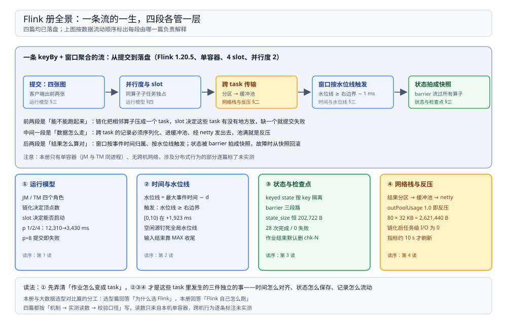

# Flink 目录导读

> 覆盖：Flink 自己怎么跑起来——JobManager 与 TaskManager 的分工、一段代码怎么变成 task、slot 为什么不是「排队」、水位线如何决定窗口何时触发、状态怎么被拍成快照、跨 task 的记录怎么走、以及反压从哪里看，共 **4 篇零件**。
>
> 不覆盖：四层（文件系统 / 表格式 / Catalog / 引擎）的分层关系与同层多候选的选型见 [大数据选型对比.md](../../大数据选型对比.md)；15 分钟微批在这套架构里怎么切、补数怎么跑见 [04 的大数据平台册](../../../../04-架构与系统/系统设计/大数据平台/README.md)。
>
> 内容整理自个人学习笔记。本册读数全部来自本机 `dockerproxy.net/apache/flink:1.20-scala2.12` 容器（运行时 **1.20.5**、Java 11），单容器、JM 与 TM 同进程、**4 个 slot**、默认并行度 2；作业用 `flink run -c FlinkLab /w/lab.jar <mode>` 提交，读数取自 REST 接口与作业内打印的时间戳，各篇逐处标注了实测与文档口径。

---

## 一、一句话定位：省掉的不是「延迟」，是「按批边界对齐」

**本节要点**：Flink 与 Spark 的分水岭不在「快多少」，而在**时间与状态归谁管**——Spark 的流是微批，时间由批边界给；Flink 的时间由数据自带的时间戳决定，状态是引擎内建的一等公民，随 barrier 一起拍快照。

| 维度 | Spark Structured Streaming | Flink |
| --- | --- | --- |
| 时间从哪来 | 微批的批边界（driver 侧时钟） | 数据自带的时间戳 + 水位线推进 |
| 状态 | 由 state store 维护，和批绑定 | 一等公民，按 key 隔离，随检查点快照 |
| 失败恢复 | 重跑批次 | 从检查点回滚，状态与输入位点一起回 |
| 延迟下限 | 一个微批间隔 | 一条记录 |
| 资源模型 | task 可以分波跑在少量核上 | 并行子任务必须各占一个 slot，不够就失败 |

> ⭐ 「Flink 就是更快的 Spark」这句最容易误导人。两者的差异从**窗口按什么关闭**开始，一路延伸到状态、恢复与资源模型；把 Flink 当微批引擎用，等于放弃了它唯一不可替代的部分。

## 二、四篇分工

**本节要点**：四篇按**一条流的一生**排开：先能被调度起来，再谈它里面发生的三件独立的事——时间怎么对齐、状态怎么保存、记录怎么流动。

图上半是一条真实的执行流水线（单容器、4 slot、并行度 2），每段下面标着由哪一篇负责解释；下半是四张卡片，列出每篇覆盖的机制与建议读序。

| 篇 | 回答什么 | 本册的关键读数 |
| --- | --- | --- |
| ① [运行模型.md](运行模型.md) | JobManager 与 TaskManager 各做什么、一段代码怎么变成 task、算子链与 slot 分别决定什么、提交之后去哪看 | 链化开 1 顶点 / 2 task，关 5 顶点 / 10 task；p=1/2/4 → 12,310 / 6,318 / 3,430 ms；p=8 提交失败 |
| ② [时间与水位线.md](时间与水位线.md) | 事件时间与处理时间的差别、水位线到底是什么承诺、窗口何时触发、迟到数据去哪、多个输入为什么会被一个空闲源拖住 | `[0,10)` 在 +1,923 ms 触发、`[30,40)` 等到 +6,860 ms；idle 模式下 `ts=200` 进旁路 |
| ③ [状态与检查点.md](状态与检查点.md) | keyed 与 operator state 的分界、一次检查点的 barrier 路径、统计字段怎么读、磁盘上留下什么、为什么作业一结束就没了 | 28 次完成 / 0 失败；`state_size` 恒 202,722 B；2 × 101,361 B + 2,013 B `_metadata` |
| ④ [网络栈与反压.md](网络栈与反压.md) | 一条记录跨 task 要过哪几层、缓冲池怎么分配、反压为什么体现成「池满」、链化后为什么连信号都看不到 | `outPoolUsage` 1.0；`numBytesOut` 均值 2,621,440 B = 80 × 32 KB；指标约 10 s 才刷新 |

## 三、阅读路线

| 顺序 | 篇 | 视角 | 什么时候读 |
| --- | --- | --- | --- |
| ① | [运行模型.md](运行模型.md) | ⭐ **主线 / 原理** | 第一次接触执行模型：谁在调度、task 怎么划分、为什么并行度 8 会直接失败 |
| ② | [时间与水位线.md](时间与水位线.md) | 原理 / 语义 | 写窗口时发现「结果不出来」或「结果是错的」，需要判断是时间语义还是数据问题 |
| ③ | [状态与检查点.md](状态与检查点.md) | 原理 / 可靠性 | 要回答「故障后会不会重算、会不会重复、状态存在哪」时 |
| ④ | [网络栈与反压.md](网络栈与反压.md) | 原理 / 性能 | 吞吐上不去、延迟抖动，需要判断瓶颈在上游、下游还是传输时 |

### 依赖关系

| 本篇 | 建议先读 | 为什么 |
| --- | --- | --- |
| 时间与水位线.md | 运行模型.md | 水位线按子任务各自推进、再取最小，不知道并行度就说不清「最小值」是谁的最小 |
| 状态与检查点.md | 运行模型.md | 状态按子任务分份、barrier 沿 task 边界流动，快照粒度由 task 划分决定 |
| 网络栈与反压.md | 运行模型.md | 有没有网络边由算子链决定；链化开着就看不到反压指标 |

> ⭐ **两条线**：**原理线**（① ② ③ ④）回答「它怎么跑、为什么这样设计」；**问题线**回答「慢和失败怎么定位」——每一类现象都能回到对应篇的机制小节，例如「窗口不触发」回 ② 第六节，「作业提交失败」回 ① 第四节。

## 四、本轮实测坐标

| 项 | 值 |
| --- | --- |
| 镜像 / 版本 | `dockerproxy.net/apache/flink:1.20-scala2.12`（运行时 **1.20.5**、Java 11） |
| 容器 | `flink-mech`，同进程起 JobManager 与 TaskManager，standalone 模式 |
| 资源 | 1 个 TM、**4 个 slot**；每 slot taskHeap 383 MB / managed 512 MB / network 128 MB；JM 1600m、TM 1728m |
| 作业提交 | `flink run -c FlinkLab /w/lab.jar <mode> [args]`，宿主目录 `D:\tmp\flinkmech` 挂到 `/w` |
| 观测手段 | REST（`/jobs/<jid>`、`/jobs/<jid>/checkpoints`、`/taskmanagers`、`/jobs/<jid>/vertices/<vid>/subtasks/metrics`）与作业内 `System.currentTimeMillis()` 打印 |
| 数据规模 | 300 ~ 300,000 条；反压场景每条 8,000 字符；检查点场景 100 个 key × 2,000 字符状态 |

六条最值得记住的读数：

| 读数 | 值 | 出处 |
| --- | --- | --- |
| slot 是硬上限，超了直接失败 | p=1/2/4 → **12,310 / 6,318 / 3,430 ms**；p=8 → `NoResourceAvailableException` | [运行模型.md](运行模型.md) 第四节 |
| 链化只改结构，不改「快慢」 | 开：**1 顶点 / 2 task**；关：**5 顶点 / 10 task**；耗时两轮方向相反，不作结论 | [运行模型.md](运行模型.md) 第三节 |
| 窗口触发晚于数据到达 | `[0,10)` 在 **+1,923 ms**；靠 MAX 收尾的两个窗口间隔 **12 ms** | [时间与水位线.md](时间与水位线.md) 第三、五节 |
| 空闲源能把水位线钉死 | stall 时 9 个窗口在 **19 ms** 内涌出；idle 时 `ts=200` 被判迟到 | [时间与水位线.md](时间与水位线.md) 第六节 |
| 检查点每份状态大小恒定 | `state_size` = `checkpointed_size` = **202,722 B**，28 次全量重写 | [状态与检查点.md](状态与检查点.md) 第四节 |
| 反压等于输出池占满 | `outPoolUsage` **1.0**、`numBuffersOut` 79~81、`numBytesOut` 均值 **2,621,440 B = 80 × 32 KB** | [网络栈与反压.md](网络栈与反压.md) 第四节 |

> ⚠️ **未实测项**：多 TaskManager 与跨机调度、资源不足后的排队、跨机 shuffle 的传输延迟与丢包、`allowedLateness` 的重复输出、RocksDB 状态后端与增量检查点、savepoint 改并行度、kill TM 后的故障恢复、无界源（Kafka）不发 MAX 水位线的行为。原因统一是**本机只有单容器、且镜像不含 RocksDB 的 jar**，这些行为都发生在多进程 / 多机之间或需要额外依赖。

## 五、本册的边界

| 本册收 | 不收（在哪） |
| --- | --- |
| Flink 自身的执行机制：调度、时间语义、状态、网络与反压 | **四层架构与引擎横向选型** → [大数据选型对比.md](../../大数据选型对比.md) |
| 「改了这个配置会发生什么」这类机制层面的因果 | **15 分钟微批怎么切、补数怎么跑** → [04 大数据平台册](../../../../04-架构与系统/系统设计/大数据平台/README.md) |
| 窗口、事件时间、检查点间隔在 Flink 侧的语义 | **这条链路里 Kafka 怎么保证不丢** → [Kafka 册](../../../中间件/消息队列/Kafka/README.md) |
| 状态快照与 checkpoint 存储的本地布局 | **表格式那一侧的元数据** → [Iceberg.md](../../表格式/Iceberg.md) |
| 流处理引擎的执行模型 | **批处理引擎的对照** → [Spark 册](../Spark/README.md) |

## 延伸追问

- **只想弄清「窗口为什么不触发」，最短路径是什么？** → 直接读 [时间与水位线.md](时间与水位线.md) 第六节（先看 `currentInputWatermark` 是否随数据推进），再回 [运行模型.md](运行模型.md) 第四节确认并行度与 slot 是否真的起了。
- **为什么这四篇不合成一篇？** → 它们回答四个互不推导的问题：怎么被调度、时间怎么对齐、状态怎么保存、记录怎么流动。合成一篇后最容易出现的结果是「知道有一堆配置项，但说不出哪个配置管哪一段」。
- **Flink 和 Spark 该学哪个？** → 不是二选一：本册与 [Spark 册](../Spark/README.md) 的差异全在「时间从哪来、状态归谁管」这两行，先把这两行弄清，再看 [大数据选型对比.md](../../大数据选型对比.md) 里的场景判据。
- **这套实测怎么复现？** → 起一个 `apache/flink:1.20-scala2.12` 容器常驻，把宿主目录挂到 `/w`，用 `flink run -c FlinkLab /w/lab.jar <mode>` 提交；检查点要显式配 `state.checkpoints.dir`，否则默认只留内存里的统计。
- **为什么读数都来自单容器？** → `docker network create` 在本机不可用，多容器互通起不来；单容器能覆盖调度、时间、状态与缓冲的全部机制，唯独覆盖不到跨机传输，所以那些项一律标未实测而不是猜。

## 关联

- **上游/总纲**：[大数据选型对比.md](../../大数据选型对比.md) — 四层分工、接口契约与引擎层候选
- **上游/总纲**：[04 大数据平台册](../../../../04-架构与系统/系统设计/大数据平台/README.md) — Flink 在这套平台里承担哪一段链路
- **对照/互补**：[Spark 册](../Spark/README.md) — 同为引擎层，微批与原生流式的执行模型差异
- **对照/互补**：[Kafka 册](../../../中间件/消息队列/Kafka/README.md) — 上游源：位点由谁保存、精确一次怎么闭环
- **下游机制**：[Iceberg.md](../../表格式/Iceberg.md) — Flink 写表时表格式那一侧的提交与元数据
