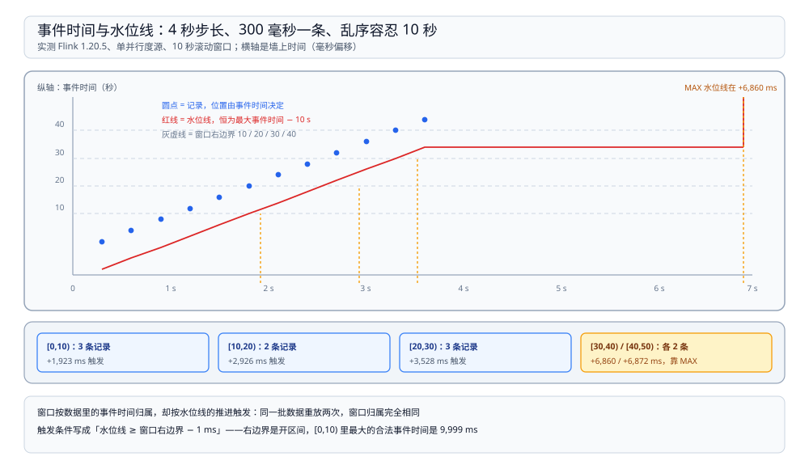
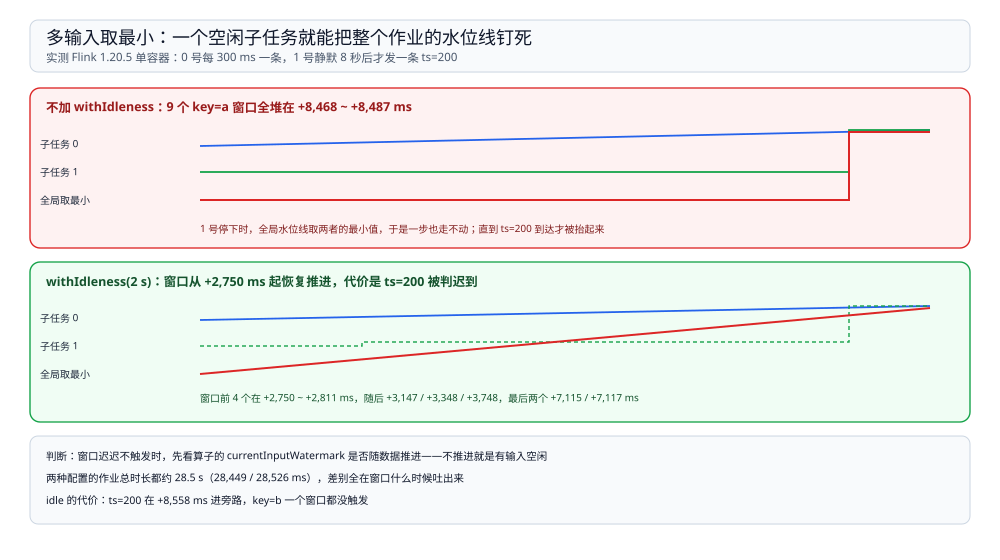

# 时间与水位线

> 覆盖：事件时间与处理时间差在哪、**水位线到底是一条什么样的「承诺」**、窗口在什么条件下触发、迟到数据为什么会掉进旁路、输入结束时剩下的窗口靠什么触发，以及**多个输入时一个空闲源为什么能把整个作业拖住**（含 `withIdleness` 的实测代价）。
>
> 不覆盖：作业怎么变成 task、算子链与 slot 见 [运行模型.md](运行模型.md)；窗口里的状态与检查点见 [状态与检查点.md](状态与检查点.md)；task 之间的传输与反压见 [网络栈与反压.md](网络栈与反压.md)。
>
> 内容整理自个人学习笔记。本篇读数来自本机 `dockerproxy.net/apache/flink:1.20-scala2.12`（**1.20.5**、Java 11）单容器、4 slot、默认并行度 2；时间全部由作业内 `System.currentTimeMillis()` 打印，再减去 REST 返回的作业 `start-time` 得到相对毫秒。**单次运行、未做多轮取区间**，只用来看顺序与量级。

---

## 一、一句话定位：水位线是「不会再有更早的数据」的承诺

**本节要点**：窗口要触发，必须先知道「时间走到哪了」。在无限流里没人能给出真实时钟，Flink 用的是**水位线**：一条随数据流动的特殊记录，含义是「**事件时间小于这个值的记录，我认为到齐了**」。窗口的触发条件是 `水位线 ≥ 窗口结束时间 − 1 ms`。

| 概念 | 含义 | 谁决定 |
| --- | --- | --- |
| 事件时间 | 数据里自带的时间戳 | 生产方（`timestampAssigner`） |
| 处理时间 | 机器墙上时钟 | 运行时 |
| 水位线 | 对事件时间进度的一个下界估计 | `WatermarkStrategy` |
| 窗口触发 | 水位线越过窗口右边界 | 运行时，不看墙上时钟 |

⭐ 记住这条因果：**窗口按数据里的事件时间切分，但按水位线的推进触发**。同一批数据重放两次，窗口归属完全相同；而水位线推进快慢取决于乱序容忍度与上游并行度，不取决于处理得多快。

## 二、为什么不能直接用处理时间

三条硬理由，都是本机实测能复现的：

1. **乱序**：同一秒内的事件可能差几秒到达。本机用 300 ms 一条、事件时间步长 4 s 的源模拟，事件时间与到达顺序都不单调。
2. **重放与补数**：从 Kafka 重放昨天的数据，处理时间全是「现在」，按处理时间开的窗口会把昨天的数据全算进同一个窗口。
3. **多个输入**：两条流的到达速度不同，处理时间对齐没有业务含义。

代价是**延迟**：窗口必须等水位线越过右边界才能触发，而水位线被乱序容忍度刻意压后。

## 三、水位线怎么推进：一条实测时间表

**本节要点**：`forBoundedOutOfOrderness(d)` 生成的水位线是「**目前已见的最大事件时间 − d**」。窗口在 `水位线 ≥ 窗口右边界` 时触发，所以它触发得比数据到达晚，晚多少由 d 与乱序程度共同决定。

实测配置：单并行度源，事件时间从 0 开始按 **4 s** 步长递增到 44，每条间隔 300 ms 发出；`forBoundedOutOfOrderness(Duration.ofSeconds(10))`；10 秒滚动窗口。作业 `start-time` 为基准，读数如下：

| 窗口 | 元素数 | 触发时刻 | 触发时水位线 |
| --- | --- | --- | --- |
| `[0,10)` | 3（ts 0/4/8） | **+1,923 ms** | ≥ 10（最大事件时间已到 20） |
| `[10,20)` | 2（ts 12/16） | **+2,926 ms** | ≥ 20（最大事件时间到 32） |
| `[20,30)` | 3（ts 20/24/28） | **+3,528 ms** | ≥ 30（最大事件时间到 40） |
| `[30,40)` | 2（ts 32/36） | **+6,860 ms** | 数据里最大只到 44 → 水位线 34，**只能等输入结束** |
| `[40,50)` | 2（ts 40/44） | **+6,872 ms** | 同上，作业在 +7,009 ms 结束 |

图里横轴是墙上时间（毫秒偏移），每根竖线是一条记录：上方标事件时间，下方是水位线（最大事件时间 − 10 秒）。前三个窗口的触发点都落在「水位线越过右边界」的那一刻；`[30,40)` 与 `[40,50)` 落在最右端，因为它们要等输入结束。

三点值得单独说：

1. **触发间隔不是等距的**。`[0,10)` → `[10,20)` 隔 1,003 ms，`[10,20)` → `[20,30)` 只隔 602 ms。原因是事件时间以 4 s 跳步、水位线跟着跳：从 20 跳到 32 一次越过两个窗口边界，所以第二个间隔反而短。
2. **窗口迟到不等于数据迟到**。窗口在事件时间 10 之后才触发，但它装的就是 0~8 的数据，结果正确。
3. **水位线落后多少与处理速度无关**。本机把每条间隔从 300 ms 调大也不会改变「水位线 = 最大事件时间 − 10 s」这个关系，只会把整个时间表拉长。

## 四、迟到数据：过了水位线就被分流

**本节要点**：记录到达时如果 `事件时间 ≤ 当前水位线`，它所属的窗口**已经触发过**，Flink 不会回头重算，而是把它交给你——不处理就丢。

实测：上面那条源在发完 ts=44 之后，立刻补发一条 **ts=5** 的记录：

| 时刻 | 事件 | 结果 |
| --- | --- | --- |
| +3,931 ms | 收到 ts=5 | 当前水位线 34，`[0,10)` 早已触发 → 进入 `sideOutputLateData` 指定的旁路标签 |
| +3,931 ms | 旁路输出 | `LATE ts=5 key=a seenAt=…`，主输出没有任何窗口再触发 |

处理迟到数据的三档手段，代价递增：

| 手段 | 做法 | 代价 |
| --- | --- | --- |
| 侧输出 | `sideOutputLateData(tag)`，事后单独补偿 | 要自己写补偿逻辑 |
| 允许窗口延迟 | `allowedLateness(d)`，窗口触发后仍留在状态里等 d 长 | 状态多留 d 时间，可能重复输出（需配合 `ProcessWindowFunction` 去重） |
| 加大乱序容忍 | 把 `forBoundedOutOfOrderness` 调大 | 所有窗口的触发都推迟同样的时长 |

⚠️ `allowedLateness` 本篇**没有实测**，只按官方文档口径陈述。

## 五、输入结束时：MAX 水位线替数据收尾

**本节要点**：有界源（文件、`for` 循环跑完的源）结束后会发出一个 **`Long.MAX_VALUE` 的水位线**，把剩下所有窗口强制触发。这也是为什么「离线跑一遍再看结果」的作业能拿到完整输出。

实测证据是上表最后两行：数据里最大事件时间只有 44，水位线最多到 34，`[30,40)` 永远等不到水位线越过 40；它们在 **+6,860 / +6,872 ms 同时触发**，12 ms 的间隔正对应「同一个 MAX 水位线流过两条窗口」。

⚠️ 这带来一个**容易误判的现象**：无界源（Kafka）不会发 MAX 水位线。同一份代码在无界源上，最后两个窗口会一直不触发——不是丢数据，是没到触发条件。

## 六、多个输入：水位线取最小，空闲源会拖住全场

**本节要点**：一个算子有多个输入时，它看到的水位线是**所有输入水位线的最小值**。只要有一个输入不推进，整个算子的水位线就不动。

实测设计：两个并行子任务。0 号每 300 ms 发一条，事件时间 0→88 步长 8 s；1 号**静默 8 秒**后才发一条 `ts=200`。两种配置：

| 配置 | 9 个 key=a 窗口的触发时刻 | key=b `[200,210)` | `ts=200` 的结局 |
| --- | --- | --- | --- |
| 不加 `withIdleness`（stall） | 全部堆在 **+8,468 ~ +8,487 ms**（19 ms 内） | **+28,420 ms**，作业结束时靠 MAX 才触发 | 正常进窗口 |
| `withIdleness(2 s)`（idle） | 前 4 个在 **+2,750 ~ +2,811 ms**，随后 +3,147 / +3,348 / +3,748，最后两个 +7,115 / +7,117 | **没有输出** | 被判迟到，进旁路 `LATE ts=200 key=b seenAt=+8,558 ms` |

图上半是 stall：两个子任务的水位线里，1 号一直停在起点，全局水位线取最小 → 一条也过不去，直到 8 秒后 `ts=200` 把最小值抬起来，九个窗口一次性涌出。图下半是 idle：`withIdleness(2 s)` 把 2 秒没数据的子任务排除在最小值计算之外，窗口恢复推进，代价是 1 号后来那条 `ts=200` 已经被越过的水位线甩在后面，只能进旁路。

三点判断：

1. **「窗口不触发」的第一嫌疑是多输入里有空闲源**，不是窗口写错了。判据：看该算子的 `currentInputWatermark`，如果它不随数据推进，就是这个原因。
2. **`withIdleness` 是取舍不是修复**。它让水位线恢复推进，但同时把这个源之后的数据变成迟到——上表第二行 `ts=200` 的结局就是代价。
3. **两种配置的作业总时长都是约 28.5 s**（28,449 / 28,526 ms），因为源里写了 20 秒的 `sleep`。**时长相同不等于行为相同**，差别全在「窗口什么时候吐出来」上。

## 七、校验口径

| 内容 | 状态 |
| --- | --- |
| 单源时间表：`[0,10)` +1,923 / `[10,20)` +2,926 / `[20,30)` +3,528 / `[30,40)` +6,860 / `[40,50)` +6,872 ms | ✅ 本机实测（单次运行，作业总长 7,009 ms） |
| 迟到 `ts=5` 在 +3,931 ms 进旁路，主输出不再触发 `[0,10)` | ✅ 本机实测 |
| 输入结束的 MAX 水位线让最后两个窗口同时触发（间隔 12 ms） | ✅ 本机实测 |
| stall：9 个窗口堆在 19 ms 内（+8,468 ~ +8,487）；key=b 窗口等到 +28,420 才触发 | ✅ 本机实测（作业 28,449 ms） |
| idle：`withIdleness(2 s)` 后窗口从 +2,750 ms 起陆续触发；`ts=200` 进旁路且 key=b 无输出 | ✅ 本机实测（作业 28,526 ms） |
| 「水位线 = 最大事件时间 − 乱序容忍」与「触发条件 = 水位线 ≥ 窗口右边界」 | ⚠️ 官方文档口径，**由实测时刻表反推验证，未读源码** |
| `allowedLateness` 的行为与重复输出 | ⚠️ **未实测** |
| 无界源（Kafka）不发 MAX 水位线 | ⚠️ 官方口径，**本机只有有界源** |
| 多输入来自不同 TaskManager 时的水位线传播延迟 | ⚠️ **未实测**：单容器内所有子任务同进程 |

---

## 延伸追问

- **为什么触发条件是 `≥ 结束时间 − 1 ms` 而不是 `≥ 结束时间`？** → 窗口的右边界是开区间，`[0,10)` 里最大的合法事件时间是 9,999 ms。用 `end − 1` 作阈值，水位线一旦到达 9,999 就可以安全确认这个窗口不会再收数据。
- **水位线是每条记录都发吗？** → 不是。默认按 `pipeline.auto-watermark-interval`（默认 200 ms）周期性发出，所以即使没有新数据，水位线也会按已有最大值重复发送。本机时间表里窗口触发时刻的抖动就来自这个周期。
- **加了 `withIdleness` 之后，那个源再发数据会不会补上？** → 不会。实测 `ts=200` 直接被判迟到。要兼顾就得再加 `allowedLateness` 或改用侧输出补偿。
- **能不能让窗口不等，来了就出结果？** → 那就是处理时间语义（`ProcessingTimeSessionWindows` 或 `TumblingProcessingTimeWindows`）。事件时间带来的确定性，代价就是这段等待。
- **怎么在 UI 上看水位线？** → 作业图上每个算子连线旁的数字就是 `currentOutputWatermark`；REST 里对应 `<算子名>.currentOutputWatermark`，本机读数可以直接对照上表。
- **乱序容忍调多大合适？** → 取决于数据源的实际乱序分布，不是越大越好：调大 1 秒，所有窗口的触发就晚 1 秒。本机用 10 s 是为了让迟到数据必然出现，不代表生产取值。

---

## 关联

- [README.md](README.md) — 本册导读：四篇分工与读序
- [运行模型.md](运行模型.md) — **上游**：并行度决定有几个水位线汇到一起取最小
- [状态与检查点.md](状态与检查点.md) — **下游**：窗口内容就是状态，检查点把它一起拍下来
- [网络栈与反压.md](网络栈与反压.md) — **对照**：水位线挤压的是时间，反压挤压的是缓冲
- [大数据选型对比.md](../../大数据选型对比.md) — **上游总纲**：为什么近实时场景要事件时间语义
- [04 大数据平台册](../../../../04-架构与系统/系统设计/大数据平台/README.md) — **项目落地**：15 分钟窗口在这套语义下怎么对齐
