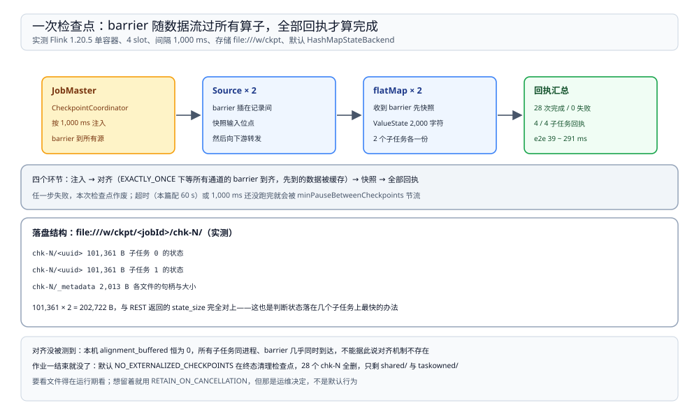

# 状态与检查点

> 覆盖：Flink 里的「状态」到底指什么、keyed state 与 operator state 的分界、**一次检查点从 barrier 注入到落盘的全过程**、检查点统计数据怎么读（含每项的含义与本机读数）、检查点文件在磁盘上长什么样、以及作业结束后它们为什么**默认会被删掉**。
>
> 不覆盖：水位线与窗口触发见 [时间与水位线.md](时间与水位线.md)；task 划分与 slot 见 [运行模型.md](运行模型.md)；task 之间的数据通道见 [网络栈与反压.md](网络栈与反压.md)。
>
> 内容整理自个人学习笔记。本篇读数来自本机 `dockerproxy.net/apache/flink:1.20-scala2.12`（**1.20.5**、Java 11）单容器、4 slot；检查点存储写在容器内 `file:///w/ckpt`（宿主 `D:\tmp\flinkmech\ckpt`）。⚠️ **只实测了默认的 HashMapStateBackend**：镜像 `/opt/flink/lib` 与 `/opt/flink/opt` 里都没有 RocksDB 的 jar，RocksDB 后端与增量检查点未实测。

---

## 一、一句话定位：检查点 = 状态 + 位点的一致快照

**本节要点**：流式作业的「记忆」有两份——**算子里存的状态**（窗口内容、去重表、累计值）与**输入位点**（读到 Kafka 哪个 offset）。检查点把这两份在**同一个逻辑时刻**拍下来，恢复时一起回滚，所以不会出现「状态回到过去、位点还在未来」。

| 份 | 存在哪 | 谁维护 |
| --- | --- | --- |
| 算子状态 | TaskManager 的堆内存（默认后端） | 算子自己通过 `ValueState` / `ListState` 读写 |
| 输入位点 | 源算子的状态里 | source 的 `snapshotState` |
| 快照本身 | 配置的检查点存储（本篇是 `file://`） | JobMaster 的 `CheckpointCoordinator` |

⭐ 记住这条因果：**检查点的频率决定「最多回退多少数据」，不决定正确性上限**。频率越高，故障时重放越少，但每次快照都要把状态写一遍（本篇实测：状态大小恒定，每次都是全量重写）。

## 二、两种状态：keyed 与 operator

**本节要点**：分界只看一件事——**有没有先 `keyBy`**。`keyBy` 之后拿到的状态按 key 隔离，每个 key 一份；没 `keyBy` 的算子只能拿算子级状态，所有数据共用一份。

| 类型 | 怎么拿到 | 隔离粒度 | 典型用途 |
| --- | --- | --- | --- |
| keyed state | `keyBy(...)` 之后 `getRuntimeContext().getState(...)` | 每个 key 一份 | 窗口聚合、去重、按用户累计 |
| operator state | 实现 `CheckpointedFunction` | 每个并行子任务一份 | source 的 offset、连接器缓冲 |

实测的写法与规模：`keyBy(k -> k % 100)` 之后在 `RichFlatMapFunction` 里维护一个 `ValueState<String>`，每次写入一个 2,000 字符的字符串。

| 项 | 值 |
| --- | --- |
| 输入记录数 | 20,000 条（每条间隔 1 ms，发完再睡 3 s） |
| key 数 | **100**（`k % 100`） |
| 每个 key 的状态 | 2,000 字符字符串 |
| keyed state 所在算子的并行度 | 2 |
| 作业总时长 | **28,530 ms** |

这就解释了后面那个恒定值：`100 key × 2,000 字符` 摊到 2 个并行子任务，每个子任务约 50 个 key、约 10 万字节。

## 三、一次检查点怎么发生

**本节要点**：barrier 是「快照分界线」，它随数据一起流动；每个算子收到 barrier 后**先把自己此刻的状态写出去**，再往下游转发 barrier。所有算子都写完，这一次检查点才算完成。

图上半是 barrier 的三段路：注入 → 算子快照 → 全部确认；下半是 `file:///w/ckpt/<jobId>/chk-N/` 的实测目录结构——两个状态文件（每个 101,361 B）加一个 `_metadata`（2,013 B），合计正好 202,722 B。

四个环节各自的含义：

| 环节 | 做什么 | 出错的后果 |
| --- | --- | --- |
| 注入 | `CheckpointCoordinator` 按间隔向所有源插入 barrier | 间隔太短 → 快照排队，触发 `minPauseBetweenCheckpoints` 节流 |
| 对齐（EXACTLY_ONCE） | 一个算子有多个输入时，等所有通道的 barrier 都到齐再快照；先到的通道数据被缓存 | 缓存过大 → `alignment_buffered` 上升，反压加剧 |
| 快照 | 状态写到检查点存储 | 写不进去 → 本次检查点失败，超时后作废 |
| 确认 | 所有子任务回执，JobMaster 记一次完成 | 一直有人没回执 → 检查点超时（本篇配 60 s） |

⚠️ 本篇**配的是默认的 `EXACTLY_ONCE`**，但实测 `alignment_buffered` **恒为 0**——本机所有子任务同进程、barrier 几乎同时到达，没有出现「一个通道先到、另一个还在传」的情形。**不能据此断言对齐机制不存在**，只能说本机没有触发到它。

## 四、检查点统计数据怎么读

**本节要点**：`GET /jobs/<jid>/checkpoints` 的 `summary` 里每一列都回答一个不同的问题，混着看会得出错误结论。

实测配置：间隔 **1,000 ms**、`minPauseBetweenCheckpoints` 200 ms、超时 60,000 ms、存储 `file:///w/ckpt`、后端默认。读数：

| 字段 | 实测值 | 回答什么问题 |
| --- | --- | --- |
| `counts.completed` / `failed` | **28 / 0** | 这段时间一共成功了几次（28.5 s ÷ 约 1.02 s ≈ 28，对得上） |
| `state_size`（min = max） | **202,722 B** | 状态有多大：**从头到尾一个字节没变** |
| `checkpointed_size`（min = max） | **202,722 B** | 本次实际写出去多少：等于状态大小，说明是**全量**而非增量 |
| `end_to_end_duration` | min **39** / p50 **50** / avg **66** / max **291** ms | 从注入到全部确认的耗时 |
| `alignment_buffered` | **0** | 对齐期间缓存了多少字节 |
| `num_subtasks` / `num_acknowledged_subtasks` | **4 / 4** | 有 4 个子任务参与（source 2 + flatMap 2），全部回执 |
| `processed_data` | max **738 B** | 两次检查点之间处理的数据量（本作业的心跳输出很小） |
| `persisted_data` | **0** | 需要额外持久化的数据（没有 changelog） |

三点读法：

1. **`state_size` 恒定 202,722 B 是「状态没有增长」的证据**，不是「检查点没生效」。状态里只有 100 个固定的 key，每个写同样的 2,000 字符，所以每次都一样大。
2. **`checkpointed_size == state_size` 说明每次都是全量写**。若开了增量检查点（RocksDB + `incremental`），`checkpointed_size` 会远小于 `state_size`。本机不具备该条件。
3. **`end_to_end_duration` 的 p50 只有 50 ms，max 291 ms**：偶发的慢检查点来自 JVM GC 与磁盘抖动，不是配置问题。判据是「max 远大于 p50 但 `failed` 为 0」——只影响延迟尖刺。

## 五、磁盘上留下什么，以及为什么作业一结束就没了

**本节要点**：一次检查点的落盘结构是「**一个目录 + 每个有状态的子任务一个文件 + 一份元数据**」；而**作业正常跑完或取消后，这些目录默认会被删掉**。

实测的目录结构（`file:///w/ckpt`）：

| 路径 | 大小 | 说明 |
| --- | --- | --- |
| `<jobId>/chk-N/` | — | 第 N 次检查点，N 从 1 开始 |
| `<jobId>/chk-N/<uuid>` | **101,361 B** | 一个并行子任务的状态文件，共 **2** 个 |
| `<jobId>/chk-N/_metadata` | **2,013 B** | 本次检查点的元信息（各文件的句柄与大小） |
| `<jobId>/shared/` `taskowned/` | 空目录 | 作业级与 task 级的本地状态目录 |

`101,361 × 2 = 202,722`，与 REST 的 `state_size` 完全对上——这也是判断「状态到底落在几个子任务上」最快的办法。

⚠️ **最容易被当成故障的现象**：作业跑完后去宿主目录看，只剩 `shared/` 与 `taskowned/`，28 个 `chk-N` 全没了。原因是默认保留策略 `execution.checkpointing.externalized-checkpoint-retention = NO_EXTERNALIZED_CHECKPOINTS`：**作业进入终态时清理检查点**。

| 想要的保留行为 | 配置 |
| --- | --- |
| 作业结束就删（默认） | `NO_EXTERNALIZED_CHECKPOINTS` |
| 取消时保留、失败时保留 | `RETAIN_ON_CANCELLATION` |
| 取消时删、失败时保留 | `DELETE_ON_CANCELLATION` |

确认文件确实写过、只是被删掉的方法：在**作业运行期间**看目录，能看到 `chk-2/`、`chk-3/` 与 `._metadata.inprogress.<uuid>` 这些中间产物；跑完再看就只剩空壳。

## 六、状态后端与恢复半径

**本节要点**：状态放哪由状态后端决定，它决定了「快照是复制还是增量」。默认的堆内后端简单但每次全量；RocksDB 后端支持增量，代价是序列化与磁盘 IO。

| 后端 | 状态存哪 | 检查点方式 | 适用 |
| --- | --- | --- | --- |
| HashMapStateBackend（默认） | TaskManager 堆内存 | 全量 | 状态小（GB 以内）、追求低延迟 |
| EmbeddedRocksDBStateBackend | 本地磁盘上的 RocksDB | 支持增量 | 状态大、接受额外的序列化开销 |

⚠️ 本机镜像里**没有** `flink-statebackend-rocksdb` 的 jar（`/opt/flink/lib` 与 `/opt/flink/opt` 均未找到），所以「增量检查点把 `checkpointed_size` 拉低」这一条**未实测**，只按官方文档陈述。

另外两个容易混的概念：

| 概念 | 由谁触发 | 用途 |
| --- | --- | --- |
| 检查点（checkpoint） | 运行时按间隔自动触发 | 故障自动恢复 |
| 保存点（savepoint） | 人工触发、可指定路径 | 升级、迁移、改并行度 |

⭐ 两者格式类似但**语义不同**：检查点属于运行时、可被清理；保存点属于运维、必须显式删除。改写并行度要靠保存点，检查点不能直接用于「2 并行改 4 并行」的恢复。

## 七、校验口径

| 内容 | 状态 |
| --- | --- |
| 28 次检查点、0 失败，间隔 1 s（28,530 ms 作业） | ✅ 本机实测（`/jobs/<jid>/checkpoints` 的 `counts`） |
| `state_size` = `checkpointed_size` = 202,722 B（min = max） | ✅ 本机实测 |
| `end_to_end_duration` 39 / 50 / 66 / 291 ms（min / p50 / avg / max） | ✅ 本机实测 |
| `alignment_buffered` = 0、`persisted_data` = 0、`num_subtasks` = 4 | ✅ 本机实测 |
| 落盘结构：2 个 101,361 B 状态文件 + 2,013 B `_metadata`，合计 202,722 B | ✅ 本机实测（运行期 `find` 与 `stat`） |
| 作业结束后 `chk-N` 被删除，只剩 `shared/` `taskowned/` | ✅ 本机实测 |
| 默认保留策略为 `NO_EXTERNALIZED_CHECKPOINTS` 及其清理时机 | ⚠️ 官方配置文档口径，**与实测的「目录被清空」一致，但未逐策略对照** |
| 对齐（alignment）的缓存行为 | ⚠️ **未触发**：本机 `alignment_buffered` 恒为 0 |
| RocksDB 后端、增量检查点、savepoint 恢复与改并行度 | ⚠️ **未实测**：镜像不含 RocksDB jar |
| 故障恢复（kill TM 后从检查点续跑） | ⚠️ **未实测**：单容器里杀 TM 会连带 JM |

---

## 延伸追问

- **检查点为什么要求「所有算子一起完成」？** → 它是分布式快照：任何一个算子用了旧状态、下游用了新状态，恢复出来的结果就会自相矛盾。要么全成，要么全废，所以有超时与整体重试。
- **`state_size` 一直不变，是状态写坏了吗？** → 不是。它反映的是「当前状态有多大」，只有 key 集合或值变大才会变。要判断状态有没有更新，看业务输出或 `numRecordsIn`，别看这个数。
- **检查点间隔调小会更安全吗？** → 恢复时重放的数据更少，但每次全量写状态的开销也跟着涨；间隔小于单次快照耗时时，`minPauseBetweenCheckpoints` 会把它们串起来排队。先算「单次耗时 × 频率」占多少 IO，再决定。
- **`chk-N` 里的 uuid 文件名对应哪个子任务？** → 对应关系记录在同目录的 `_metadata` 里，而不是靠文件名。要定位「哪个子任务的状态大」，优先看 UI 的检查点明细页，按 subtask 分组。
- **为什么保存点能改并行度、检查点不能？** → 保存点按算子与 key group 重新分配状态，是「迁移格式」；检查点是「就地恢复」用的内部格式，元数据里绑了当前的 task 划分。
- **作业失败重启，状态从哪来？** → 从最近一次**完成**的检查点；未完成的检查点不会被使用。这也是 `counts.restored` 在正常跑完的作业里恒为 0 的原因。

---

## 关联

- [README.md](README.md) — 本册导读：四篇分工与读序
- [运行模型.md](运行模型.md) — **上游**：子任务数与并行度决定状态分几份
- [时间与水位线.md](时间与水位线.md) — **上游**：窗口内容就是状态的一部分
- [网络栈与反压.md](网络栈与反压.md) — **对照**：barrier 与数据走同一条通道，所以对齐会被反压拖慢
- [大数据选型对比.md](../../大数据选型对比.md) — **上游总纲**：精确一次语义在各引擎的落地差异
- [04 大数据平台册](../../../../04-架构与系统/系统设计/大数据平台/README.md) — **项目落地**：整条链路里谁能保证端到端精确一次
