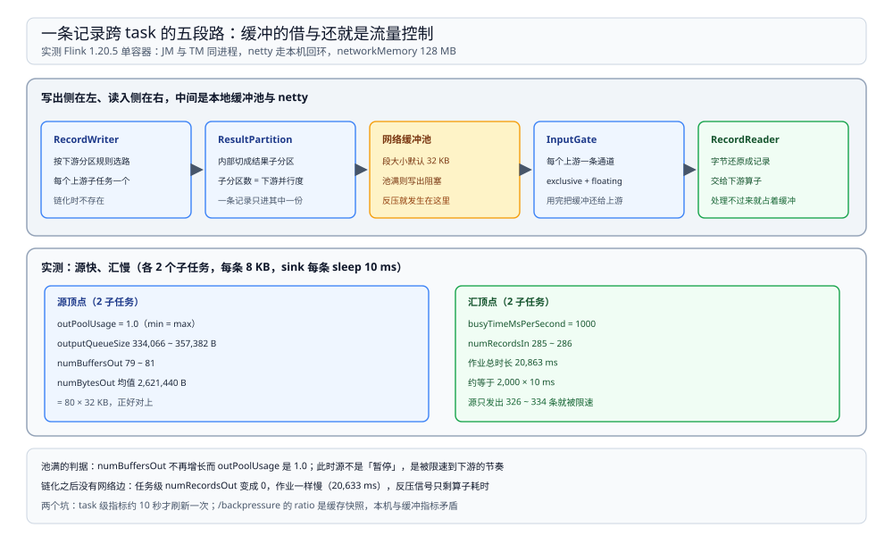

# 网络栈与反压

> 覆盖：一条记录从上游 task 写到下游 task 要过哪几层、**结果分区与网络缓冲池的关系**、exclusive 与 floating 两种缓冲、Flink 的反压为什么会体现成「输出池占满」、链化之后为什么连这个信号都看不到，以及 REST 里那几个反压指标到底该怎么读（含实测到的刷新间隔陷阱）。
>
> 不覆盖：算子链与 slot 的划分见 [运行模型.md](运行模型.md)；水位线见 [时间与水位线.md](时间与水位线.md)；barrier 与检查点见 [状态与检查点.md](状态与检查点.md)。
>
> 内容整理自个人学习笔记。本篇读数来自本机 `dockerproxy.net/apache/flink:1.20-scala2.12`（**1.20.5**、Java 11）单容器：JM 与 TM 同进程、4 slot、networkMemory 128 MB。**所有 task 都在同一台机器上**，netty 走的是本机回环，所以跨机传输耗时与网络丢包对反压的影响未实测。

---

## 一、一句话定位：反压不是「检测出来的」，是缓冲被写满

**本节要点**：Flink 没有一层专门「发现下游慢了」的组件。下游处理不过来 → 它的输入缓冲占着不还 → 上游没有可用缓冲 → 上游的 `collect()` 阻塞。**反压是资源耗尽后的自然结果**，所以它一定能从缓冲指标上看出来。

| 现象 | 直接原因 | 观测点 |
| --- | --- | --- |
| 上游 task 变慢、吞吐下降 | 输出缓冲池被占满，写不进去只能等 | `buffers.outPoolUsage` 接近 1.0、`buffers.outputQueueSize` 变大 |
| 下游 task 忙但没卡住 | 它就是瓶颈，一直在算 | `busyTimeMsPerSecond` 接近 1000 |
| 整条链一起变慢 | 链内共用一个线程，最慢的一步拖住全部 | 任务级指标看不出明细，要算子级 |

⭐ 记住这条因果：**看反压先看「谁的输出池满了」，再看「谁的 busy 满了」**。前者是被下游拖住，后者是自己算不过来。

## 二、一条记录要过哪几层

**本节要点**：上游的写出单位是**结果分区**，下游的读入单位是**输入通道**；两者之间是本地缓冲池 + netty 传输。

| 层 | 干什么 | 数量关系 |
| --- | --- | --- |
| `RecordWriter` | 按下游分区规则决定这条记录该给谁 | 每个上游子任务一个 |
| `ResultPartition` | 承载一个上游子任务的输出，内部再切成结果子分区 | 结果子分区数 = 下游并行度 |
| 网络缓冲池 | 装序列化后的字节，池满即阻塞 | 每个输出闸门一个本地池 |
| `InputGate` | 下游按上游子任务各开一个 `InputChannel` | 输入通道数 = 上游并行度 |
| `RecordReader` | 把字节还原成记录交给算子 | — |

图里上半是写出侧：一个上游子任务的输出被切成「下游并行度」份，先进本地缓冲池，再批量发出去；下半是读入侧：下游给每个上游子任务开一个输入通道，把拿到的缓冲还给上游的池子。**缓冲的「借」与「还」就是流量控制本身**。

## 三、两种缓冲：exclusive 与 floating

**本节要点**：一个输入通道能用的缓冲分两部分——**exclusive**（按通道固定预留，本机池里有几个通道就预留几份）与 **floating**（全闸门共用，谁需要谁拿）。这种分配方式让「慢的下游」不会把「快的下游」也卡死。

| 类型 | 归属 | 特点 |
| --- | --- | --- |
| exclusive | 固定给某个输入通道 | 保证每个通道至少有缓冲可用，防饿死 |
| floating | 闸门内共用 | 按需分配，吞吐高的通道能多拿 |

⚠️ 本机 `buffers.inputFloatingBuffersUsage` 与 `buffers.inputExclusiveBuffersUsage` **读数均为 0**（sink 一直有空间，没有积压），所以这两个指标「数值该在什么范围」本篇给不出参考值。**未改 `buffers-per-channel` / `floating-buffers-per-gate` 做对照**。

## 四、实测：把下游压到 10 ms 一条

**本节要点**：构造一个「源很快、汇聚很慢」的作业，反压会在 1 秒内把输出池打满，之后源的速度就**完全由下游决定**。

测试代码：源 2 个并行子任务、每个 2,000 条 8,000 字符的记录（约 8 KB/条），`rebalance()` 到 2 个并行度的 sink，sink 每条 `sleep 10 ms`。

| 观测点 | 源顶点（2 子任务） | 汇顶点（2 子任务） |
| --- | --- | --- |
| `buffers.outPoolUsage` | **1.0**（min = max） | 0.0 |
| `buffers.outputQueueSize` | **334,066 ~ 357,382 B**（avg 345,724） | 0.0 |
| `numBuffersOut` | **79 ~ 81** | 0 |
| `numBytesOut` | **2,588,672 ~ 2,654,208 B**（avg **2,621,440**） | 0 |
| `numRecordsOut` | **326 ~ 334**（总 2,000/子任务） | 0 |
| `busyTimeMsPerSecond` | `NaN` | **1000** |
| `numRecordsIn` | 0 | **285 ~ 286** |
| 作业总时长 | — | **20,863 ms** |

三点读数：

1. **`80 × 32 KB = 2,621,440 B`，与 `numBytesOut` 的均值一字不差**。默认段大小 32 KB（`taskmanager.memory.segment-size`），所以「用了 80 个缓冲」这个数可以从字节数反推出来。池满的判据就是这个乘关系：`numBuffersOut` 不再增长而 `outPoolUsage` 是 1.0。
2. **源只发出了 330/2,000 条就不再「自己想发多少发多少」了**。此后它的输出速度严格等于 sink 的消费速度（10 ms/条 × 2 个子任务）。**反压不是把源暂停，是把它限速到下游的节奏**。
3. **作业总时长 20.9 s ≈ 2,000 × 10 ms**，与 sink 的限速完全吻合。也就是说这条链路的吞吐上限由 sink 决定，源再快也没有意义。

⚠️ 上表的 `numRecordsOut = 326~334` 与 `numRecordsIn = 285~286` 来自**同一个快照**，两者相差约 45 条，正是「已经写进缓冲、下游还没来得及读」的那部分。别把这两个数当成时刻对齐的实时值。

## 五、链化之后，这个信号会消失

**本节要点**：完全链化的流水线没有网络边，**一条记录都不经过结果分区**，所以既没有缓冲可满，也没有反压可报。

实测：同一份数据、同样 10 ms 的 sink，只去掉 `rebalance()`：

| 配置 | 顶点数 | 任务级 `numRecordsOut` | 算子级 `Map.numRecordsOut` | 作业时长 |
| --- | --- | --- | --- | --- |
| `rebalance()` 后接 sink | **2** | 有值（见上表） | — | 20,863 ms |
| 不 `rebalance()`，全链化 | **1** | **0** | **300**（同一快照） | 20,633 ms |

**同样的慢、同样的时长，但任务级 I/O 指标是 0**。原因是任务级 `numRecordsOut` 统计的是「经过网络写出的记录」，链内传递不走网络就不计数；算子级的 `Map.numRecordsOut` 才记录算子实际吐出的条数。

⭐ 排障含义：**看到「任务级读写都是 0、作业却很慢」，先怀疑链化**，去看算子级指标或 UI 的算子明细，而不是以为没数据。

## 六、指标怎么读：两个已实测的坑

**本节要点**：REST 返回的反压相关数字**不是实时值**，读之前必须知道刷新节奏，否则会把「快照」当成「没有反压」。

坑一：**task 级指标约 10 秒才刷新一次**。同一作业里每 3 秒取一次 `numRecordsIn` 的合计：

| 取样时刻 | +3 s | +6 s | +9 s | +12 s | +15 s | +18 s |
| --- | --- | --- | --- | --- | --- | --- |
| `numRecordsIn`（两子任务合计） | 584 | **584** | **584** | **584** | **2,964** | **2,964** |

四个连续取样完全一样，第 5 次一次性跳了 2,380 条。**所以「两次取样没变化」不能证明没有进展**，只能证明刷新还没到。

坑二：`/backpressure` 端点给的是**采样快照**。同一作业间隔 3 秒查三次，`end-timestamp` 三次完全相同，`ratio` 恒 **0.0**，而同一时刻 `busyRatio` 是 **1.0**、源端 `outPoolUsage` 是 **1.0**。也就是说：

| 字段 | 实测值 | 能不能用来判断反压 |
| --- | --- | --- |
| `ratio` | 0.0 | ❌ 本机与缓冲指标矛盾，**不要单独看它** |
| `busyRatio` | 1.0 | ✅ 能说明该子任务在忙 |
| `end-timestamp` | 三次相同 | ⚠️ 说明这是缓存快照，不是实时 |

可靠的判据顺序：

| 顺序 | 看什么 | 结论 |
| --- | --- | --- |
| 1 | 谁的 `outPoolUsage` 接近 1.0 | 它是被下游拖慢的 |
| 2 | 谁的 `busyTimeMsPerSecond` 接近 1000 | 它是瓶颈 |
| 3 | 两者是同一个算子 | 该算子的下游就是瓶颈，往上找慢的那一步 |
| 4 | 任务级 I/O 全 0 但确实慢 | 链化把网络边消掉了，改看算子级指标 |

## 七、校验口径

| 内容 | 状态 |
| --- | --- |
| 源端 `outPoolUsage` = 1.0、`outputQueueSize` 334,066~357,382 B | ✅ 本机实测（作业运行期快照） |
| `numBuffersOut` 79~81、`numBytesOut` 2,588,672~2,654,208 B（avg 2,621,440） | ✅ 本机实测 |
| `80 × 32 KB = 2,621,440 B` 与 `numBytesOut` 均值相等 | ✅ 实测值反推，段大小取官方默认 32 KB |
| 汇端 `busyTimeMsPerSecond` = 1000、作业 20,863 ms ≈ 2,000 × 10 ms | ✅ 本机实测 |
| 链化后 1 个顶点、任务级 `numRecordsOut` = 0、算子级 300、作业 20,633 ms | ✅ 本机实测 |
| task 级指标约 10 秒刷新一次（584 → 2,964 的跳变） | ✅ 本机实测；**未查具体配置项名** |
| `/backpressure` 端点三次查询 `end-timestamp` 相同、`ratio` 恒 0.0 | ✅ 本机实测 |
| exclusive / floating 缓冲的分配规则、credit 机制 | ⚠️ 官方文档口径，**未改参数对照，两项 usage 读数恒为 0** |
| 跨机传输耗时、网络丢包对反压的影响 | ⚠️ **未实测**：所有 task 同容器同回环 |
| 网络内存调小后反压提前出现的临界点 | ⚠️ **未实测**：未改 `taskmanager.memory.network.*` |

---

## 延伸追问

- **反压和背压是一回事吗？** → 是同一个词（backpressure）。Flink 文档里两者混用，本册统一写「反压」。
- **`outPoolUsage = 1.0` 一定是下游慢吗？** → 不全是。写不出去也可能是网络本身慢或下游线程被占满；但在同一进程、回环传输的本机上，先按「下游慢」处理，再去下游看 `busyTimeMsPerSecond` 验证。
- **为什么 sink 的 `busyTimeMsPerSecond` 是 1000 而源端是 `NaN`？** → 源端在等缓冲，`busy` 的采样窗口里没攒到有效值就返回 `NaN`；它正是「不忙、在等」的表现，不是采集故障。
- **缓冲池多大才算够？** → 够的标准是「下游偶发抖动时源端不必停」。池越大越能吃抖动，代价是修内存；本机默认段 32 KB、池满 80 个段约 2.6 MB，只能当量级参考。
- **链化会不会让反压消失、问题被藏起来？** → 不会消失，只是观测点从「缓冲池」换成了「算子耗时」。所以调吞吐问题时先决定：要不要为了观测而临时关链。
- **水位线和反压是什么关系？** → 一个是时间的下界、一个是空间的余额。反压会让水位线推进变慢（数据到得慢），但水位线的值仍由最大事件时间决定，不会因为反压回退。

---

## 关联

- [README.md](README.md) — 本册导读：四篇分工与读序
- [运行模型.md](运行模型.md) — **上游**：算子链决定了有没有网络边，slot 决定了并行子任务数
- [状态与检查点.md](状态与检查点.md) — **对照**：barrier 与数据走同一条通道，反压会拉长检查点
- [时间与水位线.md](时间与水位线.md) — **对照**：反压改的是数据到达速度，不改事件时间
- [大数据选型对比.md](../../大数据选型对比.md) — **上游总纲**：流式引擎的吞吐上限由最慢算子决定
- [04 大数据平台册](../../../../04-架构与系统/系统设计/大数据平台/README.md) — **项目落地**：整条链路里反压最先出现在哪一段
