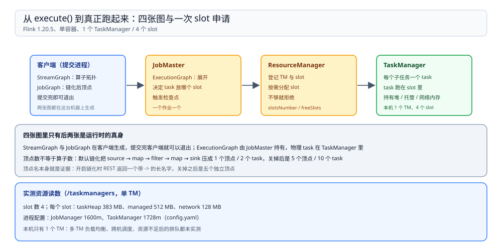
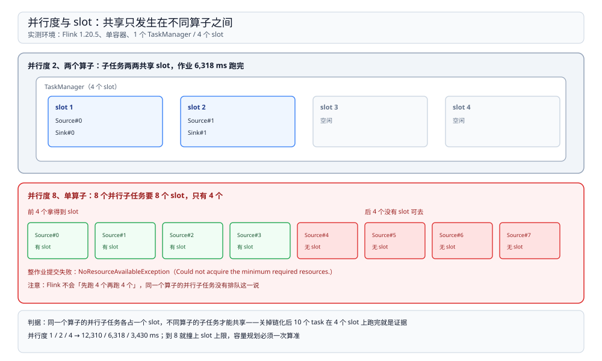

# 运行模型

> 覆盖：Flink 集群里有哪几个角色、一个作业从 `execute()` 到真正跑起来要经过哪几张图、**算子链与 slot 分别决定什么**、并行度超过 slot 数为什么不是「排队」而是直接失败，以及提交之后去哪看作业结构与资源占用。
>
> 不覆盖：水位线与窗口见 [时间与水位线.md](时间与水位线.md)；状态与检查点见 [状态与检查点.md](状态与检查点.md)；task 之间怎么传数据、反压怎么体现见 [网络栈与反压.md](网络栈与反压.md)；引擎横向选型见 [大数据选型对比.md](../../大数据选型对比.md)。
>
> 内容整理自个人学习笔记。本篇读数来自本机 `dockerproxy.net/apache/flink:1.20-scala2.12`（运行时 **1.20.5**、Java 11）单容器：同一进程里起 JobManager 与 TaskManager，TM 4 个 slot。**没有多 TM、没有跨机网络**，涉及分布式的部分只写机制并标注未实测。

---

## 一、一句话定位：Flink 的运行时只有两件事要记

**本节要点**：一条流在 Flink 里怎么跑，归结为两个决定——**哪些算子串成一个 task**（算子链），**这些 task 放进哪个 slot**（资源）。前者决定线程与序列化的开销，后者决定能不能跑起来。

| 决定 | 由谁做 | 改不动会怎样 |
| --- | --- | --- |
| 哪些算子链成一个 task | `JobGraph` 生成时的链化规则，可用 `disableOperatorChaining()` 整体关掉 | 链在一起省线程与序列化，但也让一个慢算子拖住整条链 |
| task 放进哪个 slot | 调度器按 slot 数与 slot 共享组分配 | 并行度超过可用 slot 时**直接提交失败**，不会排队等资源 |

⭐ 与 Spark 最容易被混淆的一点：Spark 的 8 个 task 可以放在 2 核上分 4 波跑完，Flink 的 8 个并行子任务必须找到 8 个 slot。判据是「**是不是同一个算子的并行子任务**」——同一个算子的子任务不能共享 slot，不同算子可以。

## 二、四个角色：谁提交、谁调度、谁执行

**本节要点**：作业提交后，真正长期活着的是 JobMaster 与 TaskManager；客户端在提交完成后就可以退出。

| 角色 | 职责 | 实测里怎么看到 |
| --- | --- | --- |
| Dispatcher | 接收提交请求、为每个作业拉起一个 JobMaster | 提交后 `JobID` 出现，即由它分配 |
| JobMaster | 一个作业一个，持有 ExecutionGraph、决定 task 放哪、触发检查点 | `/jobs/<jid>` 的 `vertices` 结构由它给出 |
| ResourceManager | 管 TaskManager 注册与 slot 分配 | `/taskmanagers` 返回 `slotsNumber` / `freeSlots` |
| TaskManager | 真正跑 task 的进程，持有堆内存、托管内存与网络缓冲 | 本文环境只有一个 TM，`slotsNumber: 4` |

图从左到右是提交路径：客户端只负责生成前两张图，JobMaster 负责把 JobGraph 展开成按并行度复制的 ExecutionGraph，再向 ResourceManager 要 slot，最后由 TaskManager 在 slot 内起 task。**四张图里只有后两张是运行时的真身**。

实测的资源读数（`/taskmanagers`，单 TM）：

| 项 | 值 |
| --- | --- |
| slot 数 | 4 |
| 每个 slot 的 `taskHeapMemory` | 383 MB |
| 每个 slot 的 `managedMemory` | 512 MB |
| 每个 slot 的 `networkMemory` | 128 MB |
| 进程配置 | JM `1600m`、TM `1728m`（`config.yaml`） |

## 三、一个作业怎么变成 task

**本节要点**：`execute()` 之后客户端产出两张图，JobMaster 再产出第三张；**顶点数不等于算子数**，因为链化会把相邻算子压成一个顶点。

### 3.1 四张图的分工

| 图 | 在哪生成 | 里面有什么 |
| --- | --- | --- |
| StreamGraph | 客户端 | 算子拓扑，未并行化 |
| JobGraph | 客户端 | 链化后的顶点（JobVertex）与中间结果 |
| ExecutionGraph | JobMaster | 每个顶点按并行度展开成子任务，含调度状态 |
| 物理执行 | TaskManager | 每个子任务一个 task，跑在 slot 里 |

### 3.2 链化：把相邻算子压进一个线程

判据（官方文档口径）：上下游**并行度相同**、走 `forward` / 同分区方式、且没有显式禁止时，Flink 会把它们链成一个 task。链内的记录直接交给下一个算子，不过网络、不序列化。

实测同一份代码（`source → map → filter → map → sink`、并行度 2、30 万条记录）只改链化开关：

| 配置 | 顶点数 | task 数 | 顶点名 |
| --- | --- | --- | --- |
| 默认（开启链化） | **1** | **2** | `Source: Custom Source -> Map -> Filter -> Map -> Sink: Unnamed` |
| `disableOperatorChaining()` | **5** | **10** | `Source: Custom Source` / `Map` / `Filter` / `Map` / `Sink: Unnamed` 各 2 个子任务 |

⭐ 顶点名本身就是证据：开启链化时 REST 返回的是一个带 `->` 的长名字，关掉之后是五个独立顶点。

⚠️ **耗时读数在这组实验里不可用**。两轮同样的对照给出了相反方向：第一轮 1 个顶点 3,846 ms、5 个顶点 2,693 ms；第二轮 646 ms 对 1,122 ms。两次都是单次运行、30 万条数据，差异被 JVM 预热与提交顺序主导。**可以确定的是结构（顶点数与 task 数），耗时不能拿来证明「链化更快或更慢」**。

### 3.3 为什么链化不是「性能开关」

链化省掉的是**线程切换与跨网络序列化**，代价是链内所有算子共享一个线程：链里最慢的那一步会拖住整条链。所以：

| 场景 | 建议 |
| --- | --- |
| 一串轻量转换（map / filter） | 保持链化，线程少、开销低 |
| 链里有一个重算子（同步 IO、大对象序列化） | 考虑在该算子前后断开，让它独立占一个 slot |
| 想按算子分别看吞吐与反压 | 关掉链化再测，否则指标都记在同一个 task 上 |

## 四、并行度与 slot：超了不是排队，是失败

**本节要点**：**同一个算子的并行子任务必须各占一个 slot**。slot 不够时作业提交直接抛异常；能共享 slot 的是不同算子的子任务。

实测：24 条记录、每条在 `run()` 里先 `sleep 500 ms`，把循环按子任务下标跨步分摊（`for (i = idx; i < n; i += 并行度)`），所以理想耗时是 `24 × 500 ms ÷ 并行度`：

| 并行度 | 作业耗时 | 说明 |
| --- | --- | --- |
| 1 | **12,310 ms** | 24 × 500 ms，单子任务全跑 |
| 2 | **6,318 ms** | 约一半 |
| 4 | **3,430 ms** | 约四分之一，正好用满 4 个 slot |
| 8 | **提交即失败** | `NoResourceAvailableException: Could not acquire the minimum required resources.` |

第 4 行是这篇最该记住的一条：**Flink 没有「跑一波再跑一波」的调度**。并行度 8 的子任务找不到 8 个 slot 时，作业不会先跑 4 个再跑 4 个，而是直接失败。

图上半是两个算子的正常情形：并行度 2、4 个 slot 时，两个算子的子任务可以两两共享 slot。下半是并行度提到 8 的情形：同一个算子的 8 个子任务需要 8 个 slot，只有 4 个就失败——**共享只发生在不同算子之间**。

⭐ 一个能自证的细节：关掉链化后有 **10 个 task**，而 cluster 只有 **4 个 slot**，作业仍然跑完了——说明这 10 个 task 确实共享了 slot（分属 5 个顶点）。同一个算子的 2 个子任务则各占一个 slot。

## 五、提交之后去哪看

**本节要点**：排查从三个只读接口开始，不需要先开 Web UI。

| 想看什么 | 接口 / 命令 | 关键字段 |
| --- | --- | --- |
| 有哪些作业、跑了多久 | `GET /jobs/overview` | `state`、`duration`、`tasks.total` |
| 作业里有几个顶点、各多少并行度 | `GET /jobs/<jid>` | `vertices[].name`、`parallelism` |
| 顶点级累计读写 | `GET /jobs/<jid>?` 同上 | `metrics.read-records` / `write-records` |
| 资源总量与剩余 | `GET /taskmanagers` | `slotsNumber`、`freeSlots`、`totalResource` |
| 检查点统计 | `GET /jobs/<jid>/checkpoints` | `counts`、`summary`（见 [状态与检查点.md](状态与检查点.md)） |

## 六、校验口径

| 内容 | 状态 |
| --- | --- |
| Flink 1.20.5、Java 11、单容器 JM + TM、4 个 slot | ✅ 本机实测（`flink --version`、`/taskmanagers`） |
| slot 资源：taskHeap 383 MB、managed 512 MB、network 128 MB | ✅ 本机实测（`/taskmanagers` 的 `totalResource`） |
| 链化开：1 个顶点 / 2 个 task；关：5 个顶点 / 10 个 task | ✅ 本机实测（`/jobs/<jid>` 与 `/jobs/overview`） |
| 链化耗时对照 | ⚠️ **两轮方向相反**（3,846 vs 2,693 ms；646 vs 1,122 ms），不作结论 |
| 并行度 1 / 2 / 4 → 12,310 / 6,318 / 3,430 ms | ✅ 本机实测（各一次运行） |
| 并行度 8 → `NoResourceAvailableException` | ✅ 本机实测，报错原文「Could not acquire the minimum required resources.」 |
| 10 个 task 跑在 4 个 slot 上（slot 共享确实发生） | ✅ 由 task 数与 slot 数反推，**未单独读 slot 分配明细** |
| 链化判据（并行度相同、forward、未禁止）与 slot 共享组规则 | ⚠️ 官方文档口径，**未逐条做对照实验** |
| 多 TaskManager、跨机调度、资源不足后的排队行为 | ⚠️ **未实测**：本机只有一个 TM，standalone 模式下 slot 不足直接失败 |

---

## 延伸追问

- **Flink 为什么不做 Spark 那种多波调度？** → 流式作业没有「一波结束」的边界，同一算子的子任务要长期驻留；给它排队等于让数据在队列里等，不如在提交阶段就报错。代价是容量规划必须一次算准。
- **链化开着的作业，怎么知道慢在链里哪一步？** → 链内所有算子共用一个 task，任务级指标只到 task 为止；先看算子级指标（`Map.numRecordsOut` 这类带算子名前缀的），或临时关掉链化重测。
- **`disableOperatorChaining()` 会影响检查点吗？** → 不影响语义，只改变 task 划分；状态仍按算子归属保存，barrier 的经过路径变长，反向传播的延迟会略增。
- **slot 共享默认开着，怎么关？** → `slotSharingGroup("名字")` 给不同算子设置不同的组，或 `disableChaining()` 单独断开某个算子；共享关闭后槽位需求会按顶点数上升，容易撞上 slot 不足。
- **一个 slot 能跑几个 task？** → 不限个数，只要它们来自不同的并行子任务（不同顶点）。真正的限制是同一个算子的子任务不能塞进同一个 slot。
- **`flink run` 的输出里有 `WARNING: Unknown module: jdk.compiler`，要管吗？** → 不用。这是客户端 JVM 参数与当前 JDK 模块名不匹配的告警，作业照常提交；本机每次提交都会打一遍。

---

## 关联

- [README.md](README.md) — 本册导读：四篇分工与读序
- [时间与水位线.md](时间与水位线.md) — **下游**：task 跑起来之后，窗口按什么时间对齐
- [状态与检查点.md](状态与检查点.md) — **下游**：task 里的状态怎么被拍成快照
- [网络栈与反压.md](网络栈与反压.md) — **下游**：task 之间的数据通道与背压
- [大数据选型对比.md](../../大数据选型对比.md) — **上游总纲**：流批引擎的接口契约与候选对比
- [04 大数据平台册](../../../../04-架构与系统/系统设计/大数据平台/README.md) — **项目落地**：近实时链路里 Flink 承担哪一段
