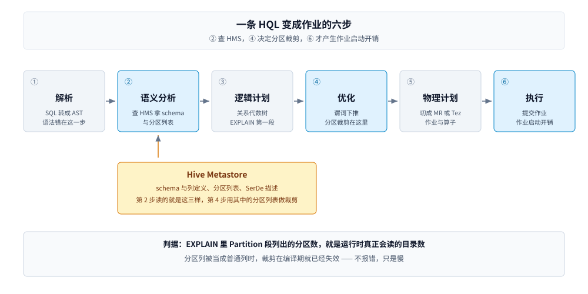

# Hive

> 覆盖：**HQL 这一个执行引擎** —— 一条 HQL 从解析到 MR / Tez 作业的编译链路、分区与分桶这两套「表外约定」怎么落地、分区裁剪与分桶的实测读数，以及 HQL 与 Spark SQL 的四处语法不兼容（带报错原文）。
>
> 不覆盖：HMS 存在哪、三种部署形态、各引擎怎么连它，见 [HiveMetastore.md](../Catalog/HiveMetastore.md)（同一个产品名的另一半）；四层怎么分工，见 [大数据选型对比.md](../大数据选型对比.md)；分区从「目录」变成「元数据」的另一种做法，见 [Iceberg.md](../表格式/Iceberg.md)；分层建模规范怎么落地，见 [分层建模与指标口径.md](../../../04-架构与系统/系统设计/大数据平台/分层建模与指标口径.md)。
>
> 内容整理自个人学习笔记。本篇代码在 `dockerproxy.net/apache/hive:4.0.0`（HiveServer2 + 内嵌 Derby）与 `dockerproxy.net/apache/spark:3.5.5-scala2.12-java17-python3-ubuntu` 两个容器里真跑过，读数与报错原文见第四节点至第七节。**未实测**：MR / Tez 执行引擎的实际作业耗时（只跑到编译计划，没提交真作业）、`hive.execution.engine=tez` 的容器池配置。

---

## 一、一句话定位：HQL 是 SQL-on-Hadoop 的第一代引擎

**本节要点**：HQL 的价值不在「现在还能跑」，而在**它是这套生态 SQL 语义的源头** —— Spark 的 Hive 兼容层、Trino 的 Hive connector 都在翻译同一套语义。当存量作业还没迁完时，它是必须读懂的东西；当团队从零开始时，它没有理由再被选中。

| 维度 | HQL 引擎 | 现在通常用什么替代 |
|---|---|---|
| 执行模型 | SQL → MR / Tez 作业 | Spark（批）、Trino（交互式查询） |
| 延迟量级 | 分钟级起步（MR 的作业启动开销） | Spark 秒级～分钟级，Trino 秒级 |
| 元数据 | 依赖 HMS（见 [HiveMetastore.md](../Catalog/HiveMetastore.md)） | 同一个 HMS，或 Iceberg REST Catalog |
| 语法 | `PARTITIONED BY` 不含分区列、`ROW FORMAT SERDE`、`LATERAL VIEW` | Spark SQL 是另一个方言，见第七节 |

⭐ **判据**：**没有存量 HQL 作业，就别新写 HQL**。但必须能读懂它 —— 你要迁的存量、要对照的 DDL、要解释的「为什么 Spark 建出来的表 Hive 读着不对」，都在这套语义里。

⚠️ 一个常见误判：把「装了 Hive 容器」当成「在用 HQL 引擎」。容器里的 HS2 起来、`CREATE TABLE` 能跑，不代表有人真在用它跑 MR 作业 —— 很多环境只是拿它当 HMS 的载体。

---

## 二、核心概念：分区、分桶、SerDe 三套「表外约定」

**本节要点**：这三个概念决定 HQL 的一切行为，而它们的共同点是 —— **都不在数据文件里**。分区靠目录名，分桶靠文件名，SerDe 靠 HMS 里的一行。理解这一点，才能明白为什么换个引擎写同一张表，语义会悄悄丢。

| 概念 | 落地形态 | 它决定什么 | 换引擎时最容易丢的地方 |
|---|---|---|---|
| **分区（Partition）** | 目录（`dt=2026-10-25/`） | 裁剪 —— 查询要读几个目录 | 分区列被当普通列 → 裁剪失效（7.1） |
| **分桶（Bucket）** | 文件（`000000_0`，桶号来自 `hash(key) % N`） | join 能不能做 map-side、采样是否均匀 | 写入端不分桶 → 表结构在、数据没分（6.2） |
| **SerDe** | HMS 里的一行（序列化类名） | 文件怎么被读成行 | DDL 里看不见 → 误以为丢了（7.4） |

⭐ **一句话记忆**：**Hive 的表 = HMS 里的一行 + 目录结构 + 文件命名约定**。三者任何一项对不上，表就「存在但读不对」。

### 2.1 分区是「逻辑 + 物理」双份的

Hive 的分区有两份记录：HMS 里的一行（逻辑存在性）与磁盘上的一个目录（物理存在性）。两者可以不一致 —— `ADD PARTITION` 会让逻辑先于物理存在，`MSCK REPAIR TABLE` 则是反方向补齐。**谁说了算、实测怎么验证，见 [HiveMetastore.md](../Catalog/HiveMetastore.md) 第 2.1 节**。

⚠️ 这与表格式的做法正相反：Iceberg 的分区值写在 manifest 里，**目录名只是聚类手段，语义由元数据决定**。所以 Iceberg 能改分区策略而不重写文件，Hive 不能。

### 2.2 分桶是「写入端约定」，读的时候验证不了

分桶的语义全在写入端：`CLUSTERED BY (id) INTO 4 BUCKETS` 建表时只是声明，真正决定数据落哪个桶的是**写入作业有没有按这个规则算 hash**。读的时候没有任何元数据能证明「这个文件里的 key 真的 hash 到了桶 0」—— 只能信写入端。

⭐ 这一条是第六节那个实测现象的根源：**Spark 写 Hive 分桶表不分桶，表结构还留着，数据却是散的**。

---

## 三、整体架构：一条 HQL 变成作业要过六步

**本节要点**：HQL 不是「解释执行」，它是**编译成作业**。六步里有一步要查 HMS（拿 schema 与分区列表）、一步决定分区裁剪、一步才落到 MR / Tez。排查「为什么这条 SQL 扫了全表」，要定位到第三步与第四步。



图怎么读：从左到右六步，第二步与第三步之间有一条查到 HMS 的支线 —— 这一步拿到表的 schema 与**分区列表**；第四步 Optimizer 里的「分区裁剪」用的就是这份列表加上 `WHERE` 条件，所以分区列没被识别成分区时，裁剪在编译期就已经失效了，不会等到执行才慢。最后一步落到 MR 或 Tez，作业启动开销就产生在这里。

| 步骤 | 做什么 | 出问题时看什么 |
|---|---|---|
| 1 Parse | SQL → AST | 语法错（`ParseException`）在这一步 |
| 2 Semantic Analyze | 查 HMS 拿 schema、分区、SerDe；解析列引用 | 表/列不存在；分区列识别 |
| 3 Logical Plan | 关系代数树 | `EXPLAIN` 的第一段 |
| 4 Optimize | 谓词下推、分区裁剪、join 重排 | ⭐ 裁剪是否生效看这里 |
| 5 Physical Plan | 切 MR / Tez 作业、定算子 | `EXPLAIN` 的 `Map Operator Tree` |
| 6 Execute | 提交作业、拉结果 | 作业耗时、容器资源 |

⭐ 一条实用判据：**`EXPLAIN` 里 `Partition` 段列出的分区数，就是运行时真正会读的目录数**。想验裁剪有没有生效，不用真跑，看计划就够。

---

## 四、部署：HiveServer2 是 SQL 网关，不是引擎

**本节要点**：HS2 提供一个 JDBC 端点，把 SQL 转给执行引擎。它是「人连 Hive」的入口，不是「引擎本体」。**端口别记混：10000 是 HS2，9083 是 HMS**。

实测（`apache/hive:4.0.0` 默认启动）：

```text
容器内监听端口（/proc/net/tcp + tcp6）= [10000, 10002]
HiveServer2 进程数                     = 1
Metastore 进程数                       = 0
```

`10000` 是 JDBC（HiveServer2 Thrift），`10002` 是 HTTP 模式（Thrift over HTTP）。此时 9083 根本不存在 —— 因为 HMS 跑在内嵌 Derby 模式，不对外。要共享元数据必须换成远程 HMS，见 [HiveMetastore.md](../Catalog/HiveMetastore.md) 第四节。

连法与执行引擎开关：

```bash
# JDBC 端点（默认 user= hive 的 anonymous 认证）
beeline -u "jdbc:hive2://hive:10000/default" -n hive

# 执行引擎：mr（默认）/ tez / spark
beeline -e "set hive.execution.engine=tez;"
```

⭐ **一条区分**：HS2 挂了，人连不上但作业照样跑（已提交的 MR 作业不受影响）；HMS 挂了，**所有引擎都建不了表、读不了表**。两者的影响面完全不同 —— 这也是为什么生产上 HMS 要做高可用，HS2 通常不需要。

---

## 五、使用一：建表与分区

**本节要点**：Hive 的分区 DDL 有一条与 Spark 相反的规则 —— **分区列不出现在列定义里**。这条规则是后面第七节所有兼容问题的起点。

```sql
CREATE TABLE orders (id INT, amt DOUBLE)
PARTITIONED BY (dt STRING)
STORED AS PARQUET;
```

分区写入分两种模式：

| 模式 | 写法 | 什么时候用 |
|---|---|---|
| **静态分区** | `INSERT INTO orders PARTITION (dt='2026-10-25') SELECT ...` | 补数、单分区重灌 |
| **动态分区** | `INSERT INTO orders PARTITION (dt) SELECT ..., dt FROM src` | 常规批量入仓 |

动态分区默认是 `strict` 模式，要求**至少有一个静态分区列** —— 全动态写入（`PARTITION (dt)` 且 `dt` 来自查询结果）会被拒绝，报的是 Hive 的 `SemanticException`。

⚠️ **这一条本轮没跑出报错原文**（容器里只做了建表与分区登记，没构造全动态写入），错误码与文案随 Hive 版本不同，不要照抄网上的 `Error 10096` 去匹配日志 —— 认 `SemanticException` 与「dynamic partition」这两个关键词更稳。

```properties
# 放开：允许全动态分区（仅在能控制分区数时开）
hive.exec.dynamic.partition=true
hive.exec.dynamic.partition.mode=nonstrict
hive.exec.max.dynamic.partitions=10000
```

⚠️ `hive.exec.max.dynamic.partitions` 不设上限的后果不是报错，是**把一个作业炸成几万个小文件**，元数据也跟着涨几万行。这是「分区表用起来便宜、用错了很贵」的典型。

---

## 六、使用二：分区裁剪与分桶

**本节要点**：分区裁剪是 Hive 唯一的「自动跳过数据」能力，分桶是它唯一的「join 前预分区」能力。两个都有实测，也都有明确的失效条件。

### 6.1 分区裁剪：看读了多少文件

```python
all_files = spark.sql("SELECT * FROM orders").inputFiles()
one_files = spark.sql("SELECT * FROM orders WHERE dt='2026-10-25'").inputFiles()
print(len(all_files), len(one_files))
```

实测（3 个分区、每分区 1 个文件）：

```text
SELECT *                   -> 读 3 个文件
WHERE dt='2026-10-25'      -> 读 1 个文件
```

⭐ 如果两个数一样，说明分区列没被识别成分区 —— 最常见的原因是用了 Spark 的 `USING parquet PARTITIONED BY` 写法但漏写列定义（见 7.1 的第二段），`dt` 变成了普通列，裁剪自然失效。**这类错不报错，只是慢**。

### 6.2 分桶：Spark 写的时候会丢

```sql
CREATE TABLE bk (id INT, name STRING)
CLUSTERED BY (id) INTO 4 BUCKETS
STORED AS PARQUET;
```

建表成功，DDL 里也保留了分桶声明。但用 Spark 写入 5 行之后：

```text
写入 5 行后文件数 = 5（真分桶应为 4 个 bucket 文件）
```

⭐ 结论：**Spark 只读 Hive 分桶表的声明，写入时不按桶落文件**。后果是分桶 join 的加速前提（同 key 落同一文件）不成立 —— 表看着是分桶表，join 时没有 map-side 优化的收益。

三条出路：

| 做法 | 代价 |
|---|---|
| 用 Hive / Tez 写这张表 | 写入链路被绑回老引擎 |
| 改用 Spark 自己的 `bucketBy` + `saveAsTable` | 只对 Spark 的 metastore 表有效，Hive 侧不一定认 |
| 不依赖分桶，改用表格式的隐藏分区 / 排序 | 换表格式，见 [Iceberg.md](../表格式/Iceberg.md) |

---

## 七、使用三：HQL 与 Spark SQL 的四处不兼容

**本节要点**：Spark 号称兼容 Hive DDL，实际只有一半。**四处最常见的不兼容**，每一处都给出实测的报错原文。这四条的共同原因是 **Spark 3 用 DataSource 体系接管了语义，只保留了 Hive DDL 的语法外壳**。

### 7.1 分区列：Hive 不写进列定义，Spark 必须写

```sql
-- Hive 语法：分区列不出现在列定义里
CREATE TABLE orders (id INT, amt DOUBLE)
PARTITIONED BY (dt STRING) STORED AS PARQUET;

-- Spark DataSource 语法：分区列必须出现在列定义里，且 USING 在 PARTITIONED BY 之前
CREATE TABLE orders (id INT, amt DOUBLE, dt STRING)
USING parquet PARTITIONED BY (dt);
```

把 Hive 的写法直接搬到 Spark 上，报错原文：

```text
[COLUMN_NOT_DEFINED_IN_TABLE] partition column `dt` is not defined in table
`spark_catalog`.`lab2`.`t_datasource`, defined table columns are: `id`, `amt`.
```

把 Spark 的写法搬到 Hive 上，`dt` 会变成普通列 —— 表建成功了，但分区语义悄悄丢了。**这类错最难查，因为它不报错**。

### 7.2 `ROW FORMAT SERDE` 与 `STORED AS PARQUET` 不能同时写（Spark 侧）

在 Spark 3.5 里执行 Hive 的经典写法：

```sql
CREATE TABLE t (id INT) PARTITIONED BY (dt STRING)
ROW FORMAT SERDE 'org.apache.hadoop.hive.ql.io.parquet.serde.ParquetHiveSerDe'
STORED AS PARQUET;
```

报错原文：

```text
Operation not allowed: ROW FORMAT SERDE is incompatible with format 'parquet',
which also specifies a serde.
```

原因：`STORED AS PARQUET` 已经隐含了一个 SerDe，再显式写一个就冲突。**Spark 只保留了语法外壳，SerDe 由格式决定**。

### 7.3 `STORED AS PARQUET` 在 Spark 里被规范化成 `USING parquet`

同样一句 `STORED AS PARQUET`，两边 `SHOW CREATE TABLE` 的输出：

```text
-- 真 Hive 4.0.0
CREATE EXTERNAL TABLE `orders`(
  `id` int, `amt` double)
PARTITIONED BY (`dt` string)
ROW FORMAT SERDE
  'org.apache.hadoop.hive.ql.io.parquet.serde.ParquetHiveSerDe'
STORED AS INPUTFORMAT
  'org.apache.hadoop.hive.ql.io.parquet.MapredParquetInputFormat'
OUTPUTFORMAT
  'org.apache.hadoop.hive.ql.io.parquet.MapredParquetOutputFormat'
LOCATION 'file:/opt/hive/data/warehouse/lab.db/orders'
TBLPROPERTIES ('TRANSLATED_TO_EXTERNAL'='TRUE', ...)

-- Spark 3.5.5（同一句 DDL 建出来的表）
CREATE TABLE lab3.t_hive_style (
  id INT, amt DOUBLE, dt STRING)
USING parquet
PARTITIONED BY (dt)
```

⭐ **结论**：Spark 眼里没有「Hive SerDe 表」，只有「用 parquet 格式的 DataSource 表」。元数据里 SerDe 是有的（见 7.4），但 DDL 输出已经是 Spark 的方言。

### 7.4 SerDe 信息还在，只是不由 DDL 展示

有意思的是，`DESCRIBE FORMATTED` 里 SerDe 信息**两边都在**：

| 字段 | 真 Hive 4.0.0 | Spark 3.5.5 |
|---|---|---|
| `Table Type` | `EXTERNAL_TABLE` | `MANAGED` |
| `SerDe Library` | `...parquet.serde.ParquetHiveSerDe` | 同左 |
| `InputFormat` | `...MapredParquetInputFormat` | 同左 |
| `OutputFormat` | `...MapredParquetOutputFormat` | 同左 |
| `Provider` | ❌ 没有这个字段 | `parquet` |

所以「SerDe 有没有丢」的正确查法是 `DESCRIBE FORMATTED`，不是 `SHOW CREATE TABLE`。⚠️ 用 `SHOW CREATE TABLE` 判断表类型，会得出「Spark 把 Hive 表变成了 DataSource 表」的错误结论 —— 元数据其实没变。

⭐ 顺带一条：Hive 4.0 侧出现 `EXTERNAL_TABLE` 与 `TRANSLATED_TO_EXTERNAL` 不是 Spark 干的，是 Hive 4.0 自己的转换，见 [HiveMetastore.md](../Catalog/HiveMetastore.md) 第七节。

---

## 八、验证与排查

**本节要点**：HQL 的排查分三层 —— 语法过不过、计划里裁不裁、写入端有没有按约定落。三层用三个不同的命令。

### 8.1 三段确认

```bash
# 1. 语法与计划（不跑数据）
beeline -e "EXPLAIN SELECT * FROM orders WHERE dt='2026-10-25';"
#    看 Partition 段列出的分区数 = 运行时真读的目录数

# 2. 裁剪的实际效果（跑一次，数输入文件）
#    见 6.1 的 inputFiles() 对照

# 3. 分桶/分区文件的真实形态（绕过元数据，看盘）
hdfs dfs -ls /user/hive/warehouse/lab.db/bk/
#    真分桶：4 个文件；写出 5 个说明写入端没分桶
```

### 8.2 故障速查

| 症状 | 先查什么 |
|---|---|
| `partition column not defined in table` | 用了 Hive 语法建 Spark 表；分区列要写进列定义（7.1） |
| `ROW FORMAT SERDE is incompatible` | 同时写了 `STORED AS`，二选一（7.2） |
| `Dynamic partition strict mode requires...` | 全动态分区没开 `nonstrict`，或没给静态分区列（第五节） |
| 查询慢但不报错，`EXPLAIN` 里分区数等于总数 | ⭐ 分区列没被识别成分区（7.1 第二段） |
| `CLUSTERED BY` 建表成功但查询没加速 | ⭐ Spark 写 Hive 分桶表不分桶（6.2） |
| `SHOW CREATE TABLE` 里看不到 SerDe | 正常，Spark 输出的是自己的方言；用 `DESCRIBE FORMATTED`（7.4） |

### 8.3 为什么「表建成了」不等于「语义对了」

这四个不兼容里有**两个不报错**（7.1 第二段、6.2）。它们的共同形态是：DDL 成功、查询能跑、结果对，只有性能或下游依赖的优化失效。

⭐ 判据：**换引擎建表之后，除了看「建成了吗」，还要看「分区数对不对、文件数对不对」**。前一个问题有报错兜底，后两个没有。

---

## 九、校验口径

> ✅ 本篇代码的校验方式与范围（`apache/hive:4.0.0` + `apache/spark:3.5.5`，两个容器）：

- **真跑，容器内实测**：第四节的端口读数（`[10000, 10002]`）、第六节 6.1 的分区裁剪文件数（3 → 1）与 6.2 的分桶文件数（5 行 → 5 文件）、第七节 7.1 / 7.2 / 7.3 / 7.4 的四组 DDL 与报错原文。
- **未实测**：MR / Tez 执行引擎的实际作业耗时（第四节的 `hive.execution.engine` 只做了设置，未提交真作业）；`tez` 的容器池与内存配置；动态分区 `strict` 模式拒绝全动态写入时的报错原文（第五节只写判据，未跑出）；`hive.exec.max.dynamic.partitions` 触发上限时的真实表现；`LATERAL VIEW` 与多插入语法的执行差异。
- **口径说明**：第六节的裁剪与分桶读数是在 **Spark 里读 / 写 Hive 表**得到的（`inputFiles()`、文件计数），不是用 MR 作业跑出来的 —— 结论对「读写同一份元数据与文件」成立，对「MR 作业的实际扫描量」是推论。
- **可复现性**：脚本在 `.workbuddy/tmp/bigdata-lab/`（不入库）；`docker rm` 后环境不残留。

| 依赖 | 实际版本 |
|---|---|
| Hive | `apache/hive:4.0.0`（HiveServer2 + 内嵌 Derby） |
| Spark | `apache/spark:3.5.5-scala2.12-java17-python3-ubuntu` |
| Spark 内置 Hive Metastore 客户端 | 2.3.9（`builtin`） |
| Java | 17.0.14（Spark 容器） |

---

## 延伸追问

- **HQL 还值得学吗？** → 值得读、不值得写。独有语法只有 `LATERAL VIEW`、多插入（`FROM ... INSERT ... INSERT ...`）与早期窗口函数写法；`LATERAL VIEW` 在 Spark 里既有同名写法也有 `SELECT explode(...)`，后者可移植性更好。真正必须懂的是**分区与分桶这两套表外约定** —— 它们在 Spark 与 Trino 里同样生效。
- **为什么 Spark 写 Hive 分桶表不分桶？** → 因为分桶是写入端的约定，而 Spark 的 DataSource writer 不读 `CLUSTERED BY` 这个 Hive 专有属性。它不是「不支持」，是**两个体系对「分桶」这件事的归属理解不同**：Hive 认为它是表的物理布局，Spark 认为它是写入策略（`bucketBy`）。
- **分区和分桶能互相替代吗？** → 不能。分区是「按列值切目录」，适合低基数、经常做过滤条件的列；分桶是「按 hash 切文件」，适合高基数的主键与 join key。用分区列做 join 会炸出小文件，用分桶列做过滤不会裁剪。
- **Hive 会消失吗？** → HQL 引擎这一半在生产上已经退到存量，但 **HMS 那一半不会** —— 它是「表名 → 位置」的唯一权威，Spark / Flink / Trino 都依赖它。所以「Hive 会不会死」这个问题，要拆成这两个问题问。

---

## 关联

- **上游/总纲**：[大数据选型对比.md](../大数据选型对比.md) — 四层分工，以及「引擎层」这一格还有哪些候选
- **对照/互补**：[HiveMetastore.md](../Catalog/HiveMetastore.md) — 同一个产品名的另一半：HMS 存什么、三种部署形态、各引擎怎么连
- **对照/互补**：[Iceberg.md](../表格式/Iceberg.md) — 分区从「目录 + HMS 行」变成「manifest 里的分区值与列级统计」，这是分区裁剪的另一条路
- **下游机制**：[分层建模与指标口径.md](../../../04-架构与系统/系统设计/大数据平台/分层建模与指标口径.md) — ODS / DWD / DWS / ADS 这套规范在具体平台里的落地
- **对照/互补**：[HDFS.md](../文件系统/HDFS.md) — 分区目录、分桶文件都落在它上面；`LOCATION` 指向的就是 HDFS 路径
- **素材来源**：[素材清单.md](../../../素材清单.md) — 素材来源登记

> 反向引用（本篇被下列文档引到）：[大数据选型对比.md](../大数据选型对比.md)、[HiveMetastore.md](../Catalog/HiveMetastore.md)
