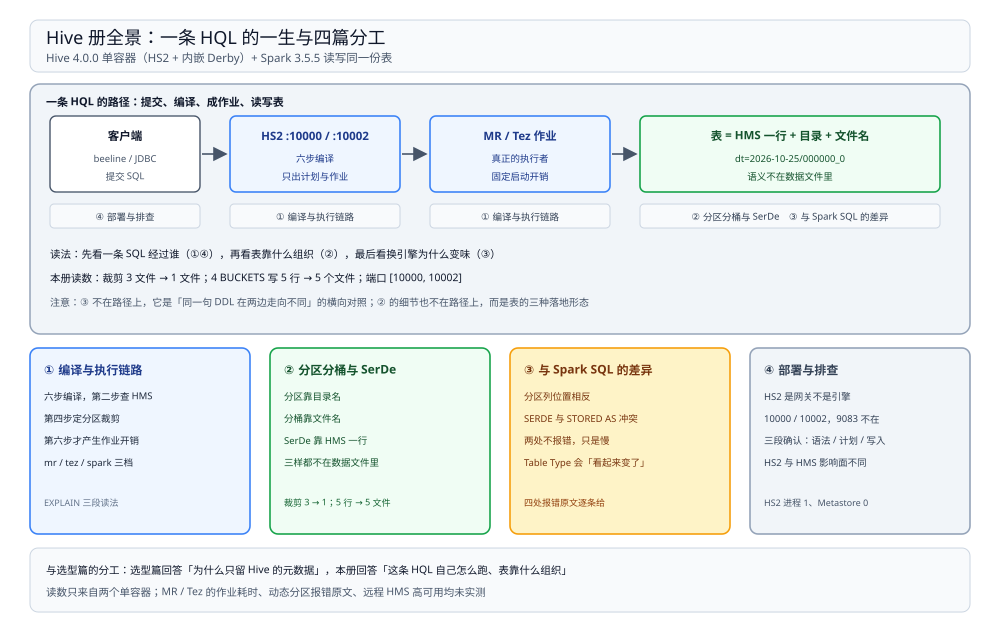

# Hive 目录导读

> 覆盖：**HQL 这一半**——一条 HQL 怎么被编成 MR / Tez 作业、表的三套「表外约定」（分区 / 分桶 / SerDe）怎么落地、与 Spark SQL 的四处不兼容、HS2 与 HMS 各占什么位置，以及出问题时按什么顺序查，共 **4 篇零件**。
>
> 不覆盖：HMS 存什么、三种部署形态、各引擎怎么连它，见 [HiveMetastore.md](../../Catalog/HiveMetastore.md)（同一个产品名的另一半）；四层分工与引擎层候选见 [大数据选型对比.md](../../大数据选型对比.md) 与 [计算引擎选型对比.md](../计算引擎选型对比.md)；分区从「目录」变成「元数据」的另一条路见 [Iceberg.md](../../表格式/Iceberg.md)；分层建模规范怎么落地见 [04 大数据平台册](../../../../04-架构与系统/系统设计/大数据平台/README.md)。
>
> 内容整理自个人学习笔记。本册读数全部来自 `dockerproxy.net/apache/hive:4.0.0`（HiveServer2 + 内嵌 Derby）与 `dockerproxy.net/apache/spark:3.5.5-scala2.12-java17-python3-ubuntu` 两个容器：Hive 侧负责建表、`EXPLAIN`、DDL 输出，Spark 侧负责读写同一份表并数文件。**未实测**：MR / Tez 作业的真实耗时、动态分区 `strict` 拒绝全动态写入的报错原文、远程 HMS 的高可用。

---

## 一、一句话定位：HQL 是 SQL-on-Hadoop 的第一代引擎

**本节要点**：HQL 的价值不在「现在还能跑」，而在**它是这套生态 SQL 语义的源头**——Spark 的 Hive 兼容层、Trino 的 Hive connector 都在翻译同一套语义。存量作业没迁完时它必须读懂；团队从零开始时它没有理由被选中。

| 维度 | HQL 引擎 | 现在通常用什么替代 |
| --- | --- | --- |
| 执行模型 | SQL → MR / Tez 作业 | Spark（批）、Trino（交互式查询） |
| 延迟量级 | 分钟级起步（作业启动开销） | Spark 秒级～分钟级，Trino 秒级 |
| 元数据 | 依赖 HMS | 同一个 HMS，或 Iceberg REST Catalog |
| 语法 | `PARTITIONED BY` 不含分区列、`ROW FORMAT SERDE`、`LATERAL VIEW` | Spark SQL 是另一个方言，见 [与SparkSQL的差异.md](与SparkSQL的差异.md) |

⭐ **判据**：**没有存量 HQL 作业，就别新写 HQL**。但必须能读懂它——你要迁的存量、要对照的 DDL、要解释的「为什么 Spark 建出来的表 Hive 读着不对」，都在这套语义里。

⚠️ 一个常见误判：把「装了 Hive 容器」当成「在用 HQL 引擎」。容器里的 HS2 起来、`CREATE TABLE` 能跑，不代表有人真在用它跑 MR 作业——很多环境只是拿它当 HMS 的载体。

## 二、四篇分工

**本节要点**：四篇按**一条 HQL 的一生**排开：先看它怎么被编成作业，再看表靠什么约定组织，再看两边方言的差异，最后看部署与排障。

图上半是一条 HQL 的路径：HS2 收 SQL、编译成作业、作业读写表；下半是四张卡片，标出每篇负责的那一段与本册的关键读数。

| 篇 | 回答什么 | 本册的关键读数 |
| --- | --- | --- |
| ① [编译与执行链路.md](编译与执行链路.md) | 六步编译各做什么、HMS 在第几步被读、分区裁剪为什么在编译期定、`EXPLAIN` 三段怎么读、`mr` / `tez` / `spark` 三档差别 | 六步；`EXPLAIN` 的 `Partition` 段 = 运行时目录数 |
| ② [分区分桶与SerDe.md](分区分桶与SerDe.md) | 三套表外约定各落在哪、分区双份记录、静态 / 动态分区、裁剪与分桶的实测与失效条件 | 裁剪 **3 文件 → 1 文件**；4 BUCKETS 写 5 行 → **5 个文件** |
| ③ [与SparkSQL的差异.md](与SparkSQL的差异.md) | 四处不兼容的报错原文、两处不报错的静默失效、`SHOW CREATE TABLE` 与 `DESCRIBE FORMATTED` 的判据 | `COLUMN_NOT_DEFINED_IN_TABLE`、`ROW FORMAT SERDE is incompatible` |
| ④ [部署与排查.md](部署与排查.md) | HS2 与 HMS 各占什么、端口与进程、beeline 连法、两方挂掉的影响面、三段确认与故障速查 | 端口 **`[10000, 10002]`**；HS2 进程 1、Metastore 进程 0 |

## 三、阅读路线

| 顺序 | 篇 | 视角 | 什么时候读 |
| --- | --- | --- | --- |
| ① | [编译与执行链路.md](编译与执行链路.md) | ⭐ **主线 / 原理** | 第一次读 Hive：一条 SQL 变成作业要过几段、慢在哪一段 |
| ② | [分区分桶与SerDe.md](分区分桶与SerDe.md) | 原理 / 表结构 | 要建分区表、怀疑裁剪没生效、或发现分桶不加速时 |
| ③ | [与SparkSQL的差异.md](与SparkSQL的差异.md) | 迁移 / 对照 | 要把 Hive DDL 搬去 Spark，或要解释两边读同一张表结果不同时 |
| ④ | [部署与排查.md](部署与排查.md) | 运维 / 排障 | 连不上、表读不到、作业跑不起来，需要按层定位时 |

### 依赖关系

| 本篇 | 建议先读 | 为什么 |
| --- | --- | --- |
| 分区分桶与SerDe.md | 编译与执行链路.md | 分区列表在第二步被读走、在第四步决定裁剪，不知道六步就看不出「谁决定要读几个目录」 |
| 与SparkSQL的差异.md | 分区分桶与SerDe.md | 四处不兼容里有三处直接作用在分区与 SerDe 上，不知道约定本身就看不懂差异 |
| 部署与排查.md | 编译与执行链路.md | 三段确认的第一段就是 `EXPLAIN`，不知道六步就分不清「语法错」和「裁剪没生效」 |

> ⭐ **两条线**：**原理线**（① → ② → ③）回答「HQL 怎么变成作业、表靠什么组织、换引擎为什么变味」；**问题线**回答「连不上 / 读不到 / 慢 / 结果不对怎么定位」——四类问题分别回 ④、④、②、③。

## 四、本轮实测坐标

| 项 | 值 |
| --- | --- |
| 镜像 / 版本 | `dockerproxy.net/apache/hive:4.0.0`；`dockerproxy.net/apache/spark:3.5.5-scala2.12-java17-python3-ubuntu` |
| 容器形态 | 两个容器各自独立起；Hive 侧 HS2 + 内嵌 Derby（Metastore 进程 0） |
| 端口 | HS2 `10000`（Thrift）、`10002`（Thrift over HTTP）；`9083` 不监听 |
| 运行时 | Java 17.0.14（Spark 容器）；Spark 内置 HMS 客户端 2.3.9（`builtin`） |
| 客户端 | 容器内 `beeline`；Spark 侧 `spark-sql` / PySpark |
| 观测手段 | `EXPLAIN`、`SHOW CREATE TABLE`、`DESCRIBE FORMATTED`、`inputFiles()`、`hdfs dfs -ls`、`/proc/net/tcp` |
| 数据规模 | 分区表 3 个分区、每分区 1 个文件；分桶表 4 BUCKETS、写入 5 行 |

## 五、六条最值得记住的读数

| 读数 | 值 | 出处 |
| --- | --- | --- |
| 裁剪在编译期就定了 | 3 个分区：无条件下 3 文件，带分区条件下 **1 文件** | [分区分桶与SerDe.md](分区分桶与SerDe.md) 第 4.1 节 |
| 分桶是写入端的约定 | 4 BUCKETS 的表，Spark 写 5 行产出 **5 个文件** | [分区分桶与SerDe.md](分区分桶与SerDe.md) 第 5.2 节 |
| 默认容器只有 HS2 | 监听 `[10000, 10002]`；HS2 进程 1、Metastore 进程 0 | [部署与排查.md](部署与排查.md) 第二节 |
| 四处不兼容里两处不报错 | 分区列变普通列、分桶不分桶——都只是慢 | [与SparkSQL的差异.md](与SparkSQL的差异.md) 第三节 |
| 计划能代替真跑 | `EXPLAIN` 的 `Partition` 段分区数 = 运行时真读的目录数 | [编译与执行链路.md](编译与执行链路.md) 第四节 |
| Hive 4 的表类型会「看起来变了」 | `Table Type` 显示 `EXTERNAL_TABLE` + `TRANSLATED_TO_EXTERNAL=TRUE`，是 Hive 自己的转换 | [与SparkSQL的差异.md](与SparkSQL的差异.md) 第 2.4 节 |

> ⚠️ **未实测项**：MR / Tez 执行引擎的真实作业耗时与容器池配置、`hive.exec.max.dynamic.partitions` 触顶时的表现、动态分区 `strict` 拒绝全动态写入的报错原文（只写判据）、自定义 SerDe 的读写、远程 HMS 的高可用与故障切换、HS2 多实例与 Kerberos 认证、`LATERAL VIEW` 与多插入语法的执行差异。原因统一是**本机只有单容器、没有 YARN / Tez 集群**，这些行为要么需要作业调度器，要么需要多服务协作。

## 六、本册的边界

| 本册收 | 不收（在哪） |
| --- | --- |
| HQL 自身的编译、表组织约定、方言差异与 HS2 / HMS 的分工 | **四层架构与引擎横向选型** → [大数据选型对比.md](../../大数据选型对比.md)、[计算引擎选型对比.md](../计算引擎选型对比.md) |
| 「改了 DDL / 执行引擎会发生什么」这类机制层面的因果 | **HMS 存什么、三种部署形态、客户端版本对齐** → [HiveMetastore.md](../../Catalog/HiveMetastore.md) |
| 分区、分桶、SerDe 三套约定的实测与失效条件 | **分区值写进 manifest、改分区策略不重写文件** → [Iceberg.md](../../表格式/Iceberg.md) |
| 与 Spark SQL 在表定义层的差异 | **Spark 侧的执行机制、shuffle、内存** → [Spark 册](../Spark/README.md) |
| HS2 端口、beeline、三段确认与故障速查 | **这套平台里 Hive 只作为存量、迁移路线怎么排** → [04 大数据平台册](../../../../04-架构与系统/系统设计/大数据平台/README.md) |

## 延伸追问

- **Hive 到底还算不算引擎？** → 它有三重身份：HMS 是 Catalog 层的落地件、HQL 是引擎、分层建模是方法论。今天只有 HMS 还在一线；HQL 通道留给存量与兼容，新作业应落在 Spark 或 Trino 上。
- **HQL 还值得学吗？** → 值得读、不值得写。独有语法只有 `LATERAL VIEW`、多插入与早期窗口函数写法；真正必须懂的是**分区与分桶这两套表外约定**——它们在 Spark 与 Trino 里同样生效。
- **为什么读数是用 Spark 读写 Hive 表得到的？** → 因为本机没有 YARN，起不了 MR 作业。但钳制结论的不是执行引擎，而是**元数据与文件**：读几个文件、写几个文件，由 HMS 与目录结构决定，换哪个引擎读都一样。
- **Hive 会消失吗？** → 要拆成两个问题：HQL 引擎这一半在生产上已退到存量；**HMS 那一半不会**——它是「表名 → 位置」的唯一权威，Spark / Flink / Trino 都依赖它。
- **为什么「表建成了」之后还要再验？** → 因为四处不兼容里有两处不报错（分区列变普通列、分桶不分桶）。它们的信号只有「慢」和「文件数不对」，见 [与SparkSQL的差异.md](与SparkSQL的差异.md) 第三节。
- **这套实测怎么复现？** → 起 `apache/hive:4.0.0` 与 `apache/spark:3.5.5` 两个容器，Hive 侧用 beeline 建表、跑 `EXPLAIN`；Spark 侧用 `inputFiles()` 数输入文件、用 `hdfs dfs -ls` 数输出文件。脚本在 `.workbuddy/tmp/bigdata-lab/`（不入库）。

## 关联

- **上游/总纲**：[计算引擎选型对比.md](../计算引擎选型对比.md) — 四款引擎的分水岭与 Hive 的定位
- **上游/总纲**：[大数据选型对比.md](../../大数据选型对比.md) — 四层分工、四根接口与目录结构
- **上游/总纲**：[04 大数据平台册](../../../../04-架构与系统/系统设计/大数据平台/README.md) — Hive 只作存量、迁移路线怎么排
- **对照/互补**：[HiveMetastore.md](../../Catalog/HiveMetastore.md) — 同一个产品名的另一半：元数据服务
- **对照/互补**：[Iceberg.md](../../表格式/Iceberg.md) — 分区从目录 + HMS 行变成 manifest 里的值
- **对照/互补**：[Spark 册](../Spark/README.md) — 同为引擎层，Spark 自带执行引擎
- **对照/互补**：[HDFS.md](../../文件系统/HDFS.md) — 分区目录与桶文件最终落在这上面
- **下游机制**：[分层建模与指标口径.md](../../../../04-架构与系统/系统设计/大数据平台/分层建模与指标口径.md) — ODS / DWD / DWS / ADS 在平台里的落地
