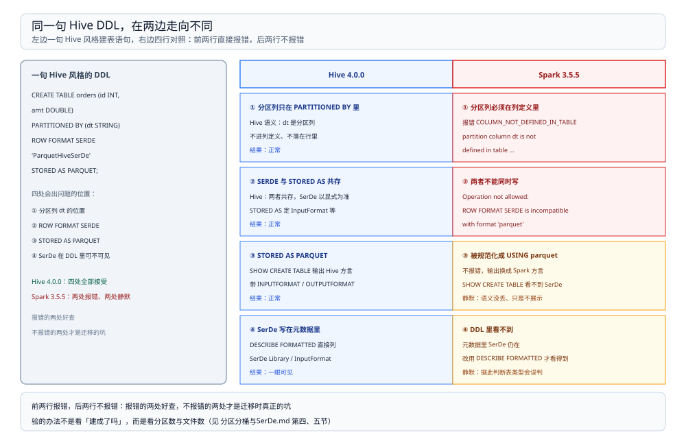

# 与 Spark SQL 的差异

> 覆盖：HQL 与 Spark SQL 在**表定义**上的四处不兼容（每处带实测报错原文）、两处「不报错只是失效」的静默差异、`SHOW CREATE TABLE` 与 `DESCRIBE FORMATTED` 的判据差异，以及把 Hive DDL 改写成 Spark DDL 的对照。
>
> 不覆盖：分区的语义与裁剪实测见 [分区分桶与SerDe.md](分区分桶与SerDe.md)；HQL 本身的编译链路见 [编译与执行链路.md](编译与执行链路.md)；Spark 侧的执行机制见 [Spark 册](../Spark/README.md)；两边共用的 HMS 见 [HiveMetastore.md](../../Catalog/HiveMetastore.md)。
>
> 内容整理自个人学习笔记。本篇四组 DDL 与报错原文均在 `dockerproxy.net/apache/hive:4.0.0` 与 `dockerproxy.net/apache/spark:3.5.5-scala2.12-java17-python3-ubuntu` 两个容器里真跑过，输出见第二节。**未实测**：Hive 4 的新语法（`CREATE TABLE ... AS` 的变体、`INSERT OVERWRITE` 的并发行为）、Spark 4 的差异、Tez 上的 DDL 行为。

---

## 一、一句话定位：Spark 只保留了 Hive DDL 的语法外壳

**本节要点**：Spark 号称兼容 Hive DDL，实际只到「语法能过」这一层——**语义由 Spark 3 的 DataSource 体系接管**。所以判断兼容性不能看「这句能不能执行」，要看「执行之后元数据里是什么、查询时裁不裁」。

| 维度 | 真 Hive 4.0.0 | Spark 3.5.5 |
| --- | --- | --- |
| 表定义的解释者 | Hive 自己的 DDL 语义 | DataSource 体系（格式 + 选项） |
| 分区列位置 | 只在 `PARTITIONED BY` 里 | 必须在列定义里 |
| SerDe | 显式类名，写在 HMS 里 | 由格式隐含，DDL 不展示 |
| 建表语句输出 | Hive 方言 | Spark 方言 |

⭐ 判据：**「建成了」只证明语法兼容，「语义对了」要另验**——验的办法是看分区数与文件数，见 [分区分桶与SerDe.md](分区分桶与SerDe.md) 第四、五节。



图的左边是一句 Hive 风格的建表语句，右边分成两条路：Hive 全部接受；Spark 有两处直接报错、一处规范化成自己的写法、一处只是不在 DDL 里展示。**报错的两处好查，不报错的两处才是迁移时真正的坑。**

---

## 二、四处不兼容

**本节要点**：四处各有明确的触发条件与可观测信号。前两处直接报错，后两处只是输出形态不同——它们共同的原因是 Spark 用 DataSource 体系接管了语义。

### 2.1 分区列：Hive 不写进列定义，Spark 必须写

```sql
-- Hive 语法：分区列不出现在列定义里
CREATE TABLE orders (id INT, amt DOUBLE)
PARTITIONED BY (dt STRING) STORED AS PARQUET;

-- Spark DataSource 语法：分区列必须出现在列定义里，且 USING 在 PARTITIONED BY 之前
CREATE TABLE orders (id INT, amt DOUBLE, dt STRING)
USING parquet PARTITIONED BY (dt);
```

把 Hive 的写法直接搬到 Spark 上，报错原文：

```text
[COLUMN_NOT_DEFINED_IN_TABLE] partition column `dt` is not defined in table
`spark_catalog`.`lab2`.`t_datasource`, defined table columns are: `id`, `amt`.
```

把 Spark 的写法搬到 Hive 上则是另一种结果：**`dt` 变成普通列，表建成功了，分区语义悄悄丢了**。这类错最难查，因为它不报错——后果与验证见 [分区分桶与SerDe.md](分区分桶与SerDe.md) 第 4.2 节。

### 2.2 `ROW FORMAT SERDE` 与 `STORED AS PARQUET` 不能同时写（Spark 侧）

在 Spark 3.5 里执行 Hive 的经典写法：

```sql
CREATE TABLE t (id INT) PARTITIONED BY (dt STRING)
ROW FORMAT SERDE 'org.apache.hadoop.hive.ql.io.parquet.serde.ParquetHiveSerDe'
STORED AS PARQUET;
```

报错原文：

```text
Operation not allowed: ROW FORMAT SERDE is incompatible with format 'parquet',
which also specifies a serde.
```

原因：`STORED AS PARQUET` 已经隐含了一个 SerDe，再显式写一个就冲突。**Spark 只保留了语法外壳，SerDe 由格式决定**——这条与 [分区分桶与SerDe.md](分区分桶与SerDe.md) 第 6.1 节是同一件事的两面。

### 2.3 `STORED AS PARQUET` 在 Spark 里被规范化成 `USING parquet`

同样一句 `STORED AS PARQUET`，两边 `SHOW CREATE TABLE` 的输出：

```text
-- 真 Hive 4.0.0
CREATE EXTERNAL TABLE `orders`(
  `id` int, `amt` double)
PARTITIONED BY (`dt` string)
ROW FORMAT SERDE
  'org.apache.hadoop.hive.ql.io.parquet.serde.ParquetHiveSerDe'
STORED AS INPUTFORMAT
  'org.apache.hadoop.hive.ql.io.parquet.MapredParquetInputFormat'
OUTPUTFORMAT
  'org.apache.hadoop.hive.ql.io.parquet.MapredParquetOutputFormat'
LOCATION 'file:/opt/hive/data/warehouse/lab.db/orders'
TBLPROPERTIES ('TRANSLATED_TO_EXTERNAL'='TRUE', ...)

-- Spark 3.5.5（同一句 DDL 建出来的表）
CREATE TABLE lab3.t_hive_style (
  id INT, amt DOUBLE, dt STRING)
USING parquet
PARTITIONED BY (dt)
```

⭐ **结论**：Spark 眼里没有「Hive SerDe 表」，只有「用 parquet 格式的 DataSource 表」。元数据里 SerDe 是有的（见 2.4），但 DDL 输出已经是 Spark 的方言。

### 2.4 SerDe 信息还在，只是不由 DDL 展示

有意思的是，`DESCRIBE FORMATTED` 里 SerDe 信息**两边都在**：

| 字段 | 真 Hive 4.0.0 | Spark 3.5.5 |
| --- | --- | --- |
| `Table Type` | `EXTERNAL_TABLE` | `MANAGED` |
| `SerDe Library` | `...parquet.serde.ParquetHiveSerDe` | 同左 |
| `InputFormat` | `...MapredParquetInputFormat` | 同左 |
| `OutputFormat` | `...MapredParquetOutputFormat` | 同左 |
| `Provider` | ❌ 没有这个字段 | `parquet` |

所以「SerDe 有没有丢」的正确查法是 `DESCRIBE FORMATTED`，不是 `SHOW CREATE TABLE`。⚠️ 用 `SHOW CREATE TABLE` 判断表类型，会得出「Spark 把 Hive 表变成了 DataSource 表」的错误结论——元数据其实没变。

⭐ 顺带一条：Hive 4.0 侧出现 `EXTERNAL_TABLE` 与 `TRANSLATED_TO_EXTERNAL` 不是 Spark 干的，是 Hive 4.0 自己的转换，见 [HiveMetastore.md](../../Catalog/HiveMetastore.md) 第七节。判断删表行为要看 `external.table.purge`，别看 `Table Type`。

---

## 三、两处不报错的静默失效

**本节要点**：四处不兼容里有两处**不报错**，它们的共同形态是：DDL 成功、查询能跑、结果对，只有性能或下游优化失效。

| 现象 | 起因 | 怎么发现 |
| --- | --- | --- |
| ⭐ 分区列变成普通列 | Spark 写法建表后，Hive 侧按 Hive 语法读 | `EXPLAIN` 的分区数 = 总数；谓词只当普通过滤 |
| ⭐ 分桶声明留着、数据没分 | Spark 写入端不读 `CLUSTERED BY` | 文件数与桶数不符（4 BUCKETS 写 5 行 → 5 个文件） |

⭐ 判据：**换引擎建表之后，除了看「建成了吗」，还要看「分区数对不对、文件数对不对」**。前一个问题有报错兜底，后两个没有。

---

## 四、改写对照：Hive DDL → Spark DDL

**本节要点**：迁移时真正要改的就四类地方，逐条对照即可；改完用第 2.4 节的查法确认元数据没被动过。

| Hive 写法 | Spark 写法 | 改的是什么 |
| --- | --- | --- |
| `CREATE TABLE t (id INT) PARTITIONED BY (dt STRING) STORED AS PARQUET` | `CREATE TABLE t (id INT, dt STRING) USING parquet PARTITIONED BY (dt)` | 分区列挪进列定义；`STORED AS` → `USING` |
| `ROW FORMAT SERDE '...'` + `STORED AS PARQUET` | 只留 `USING parquet` | 删掉显式 SerDe（会冲突） |
| `CLUSTERED BY (id) INTO 4 BUCKETS` | `CLUSTERED BY (id) INTO 4 BUCKETS`（保留声明）+ 写入端改用 `bucketBy` | 声明不动，**写入方式要改** |
| `CREATE EXTERNAL TABLE ... LOCATION '...'` | 同样保留 `EXTERNAL` + `LOCATION`，但格式改用 `USING` | 外部表语义两边一致，格式描述不同 |

⚠️ 第四行有个容易忽略的点：外部表的「删表不删数据」语义两边一致，但**判断依据不同**——Hive 4 还会写 `TRANSLATED_TO_EXTERNAL`，见 [HiveMetastore.md](../../Catalog/HiveMetastore.md) 第七节。

---

## 五、验证与排查

**本节要点**：四类信号对应四个命令，先看 DDL 过不过，再看元数据里是什么，最后看运行时行为。

| 症状 | 先查什么 |
| --- | --- |
| `partition column not defined in table` | 用了 Hive 语法建 Spark 表；分区列要写进列定义（2.1） |
| `ROW FORMAT SERDE is incompatible` | 同时写了 `STORED AS`，二选一（2.2） |
| `SHOW CREATE TABLE` 里看不到 SerDe | 正常，Spark 输出的是自己的方言；用 `DESCRIBE FORMATTED`（2.4） |
| 查询慢但不报错，`EXPLAIN` 里分区数等于总数 | ⭐ 分区列没被识别成分区（2.1 的第二段） |
| `CLUSTERED BY` 建表成功但查询没加速 | ⭐ Spark 写 Hive 分桶表不分桶（[分区分桶与SerDe.md](分区分桶与SerDe.md) 第 5.2 节） |

```bash
# 1. 建表后立刻确认元数据里的真实存储描述
beeline -e "DESCRIBE FORMATTED lab.db.orders;"

# 2. 确认分区认没认出来
beeline -e "EXPLAIN SELECT * FROM orders WHERE dt='2026-10-25';"

# 3. 确认写入端有没有按分桶落文件
hdfs dfs -ls /user/hive/warehouse/lab.db/bk/
```

---

## 六、校验口径

> ✅ 本篇的校验方式与范围（`apache/hive:4.0.0` + `apache/spark:3.5.5`，两个容器）：

- **真跑，容器内实测**：第 2.1 节 `COLUMN_NOT_DEFINED_IN_TABLE` 报错原文；第 2.2 节 `ROW FORMAT SERDE is incompatible` 报错原文；第 2.3 节两份 `SHOW CREATE TABLE` 输出；第 2.4 节两份 `DESCRIBE FORMATTED` 的五字段对照。
- **由实测推导，未单独跑**：第 2.1 节「Spark 写法搬到 Hive 上 `dt` 变普通列」的后果（分区失效读数见 [分区分桶与SerDe.md](分区分桶与SerDe.md) 第 4.1 节）；第三节的分桶静默失效（读数见同一篇第 5.2 节）。
- **未实测**：Hive 4 的新语法变体、`INSERT OVERWRITE` 的并发行为、Spark 4 的差异、Tez 上的 DDL 行为。
- **可复现性**：脚本在 `.workbuddy/tmp/bigdata-lab/`（不入库）。

| 依赖 | 实际版本 |
| --- | --- |
| Hive | `apache/hive:4.0.0`（HiveServer2 + 内嵌 Derby） |
| Spark | `apache/spark:3.5.5-scala2.12-java17-python3-ubuntu` |
| Java | 17.0.14（Spark 容器） |

---

## 延伸追问

- **为什么 Spark 不能直接吃 Hive 的 DDL？** → 因为 Spark 3 的表由 DataSource 体系解释：格式（`USING`）、选项、分区列都在同一套语法里描述。Hive 的 `STORED AS` 与 `ROW FORMAT SERDE` 是「存储描述」风格的语法，Spark 只保留了外壳，语义仍按自己的体系走。
- **两边建的表还互通吗？** → 互通，前提是元数据与文件格式一致。Spark 建的表进了同一个 HMS，Hive 侧照样能读——只是 Hive 侧的 `SHOW CREATE TABLE` 会按 Hive 风格重写，看着像另一张表。
- **迁移存量表要重写数据吗？** → 不用。四处不兼容都在 **DDL 层**，数据文件与 HMS 里的存储描述没变；需要改的是「以后用什么写法建表、用什么方式写入」。
- **怎么一次确认迁移没留下坑？** → 三个检查：`DESCRIBE FORMATTED` 看 SerDe 三件套在不在、`EXPLAIN` 看分区数、`hdfs dfs -ls` 看文件数对不对。三个都过，才算语义对齐。

## 关联

- **上游/总纲**：[README.md](README.md) — 本册五篇的分工、读序与实测坐标
- **上游/总纲**：[计算引擎选型对比.md](../计算引擎选型对比.md) — Hive 与 Spark 在引擎层的分工
- **对照/互补**：[分区分桶与SerDe.md](分区分桶与SerDe.md) — 分区、分桶、SerDe 三套约定本身
- **对照/互补**：[编译与执行链路.md](编译与执行链路.md) — `EXPLAIN` 的三段与分区数判据
- **运维/配置**：[部署与排查.md](部署与排查.md) — beeline 连法与全册故障速查
- **下游机制**：[HiveMetastore.md](../../Catalog/HiveMetastore.md) — 两边共用同一份元数据，差异只在外壳
- **对照/互补**：[Spark 册](../Spark/README.md) — Spark 侧的 DDL 与执行模型
