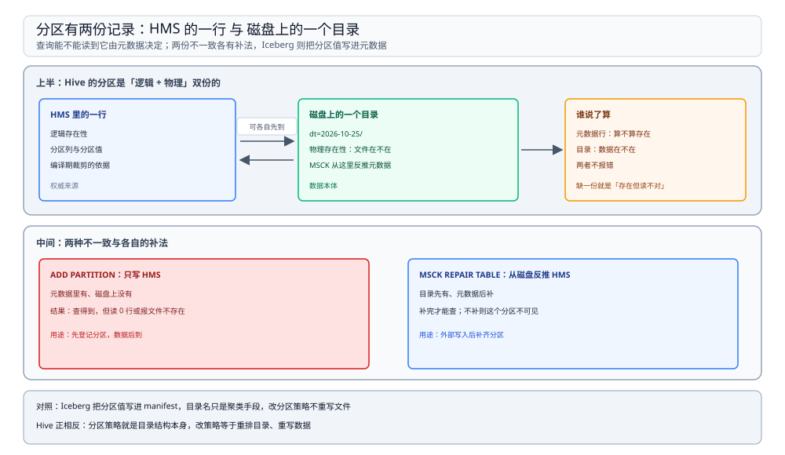
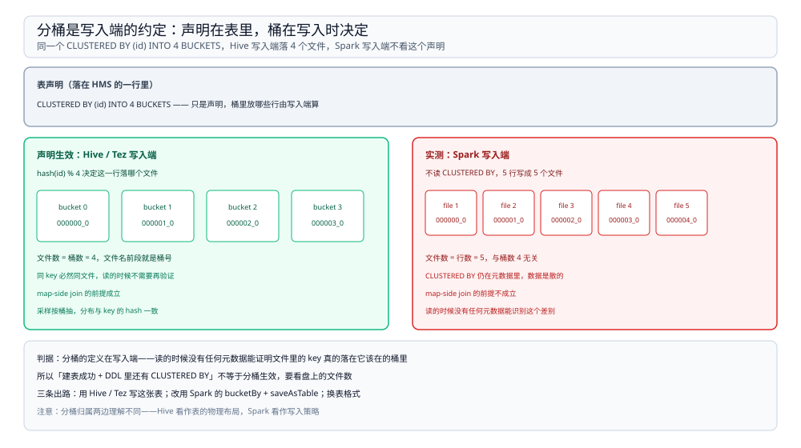

# 分区、分桶与 SerDe

> 覆盖：三套「表外约定」——分区靠目录名、分桶靠文件名、SerDe 靠 HMS 里的一行；分区的 DDL 与静态 / 动态写入、动态分区上限；分区裁剪的实测（3 个文件裁到 1 个）与失效形态；分桶的写入端约定与「Spark 写 Hive 分桶表不分桶」的实测（5 行写出 5 个文件）；SerDe 存在哪、怎么查。
>
> 不覆盖：HQL 怎么编译成作业、`EXPLAIN` 三段怎么读见 [编译与执行链路.md](编译与执行链路.md)；两边 DDL 的报错原文与改写对照见 [与SparkSQL的差异.md](与SparkSQL的差异.md)；分区在 HMS 里怎么存、三种部署形态见 [HiveMetastore.md](../../Catalog/HiveMetastore.md)；分区值写进 manifest 的另一条路见 [Iceberg.md](../../表格式/Iceberg.md)。
>
> 内容整理自个人学习笔记。本篇读数来自 `dockerproxy.net/apache/hive:4.0.0`（HiveServer2 + 内嵌 Derby）建表、`dockerproxy.net/apache/spark:3.5.5-scala2.12-java17-python3-ubuntu` 读写同一份元数据与文件，文件数与 DDL 输出见第三、四、五节。**未实测**：动态分区 `strict` 拒绝全动态写入的报错原文、`hive.exec.max.dynamic.partitions` 触顶时的真实表现、自定义 SerDe 类。

---

## 一、一句话定位：Hive 的表 = 一行元数据 + 目录结构 + 文件命名

**本节要点**：分区、分桶、SerDe 决定 HQL 的一切行为，而它们的共同点是——**都不写在数据文件里**。理解这一点，才能明白为什么换个引擎写同一张表，语义会悄悄丢。

| 概念 | 落地形态 | 它决定什么 | 换引擎时最容易丢的地方 |
| --- | --- | --- | --- |
| **分区**（Partition） | 目录（`dt=2026-10-25/`） | 裁剪——查询要读几个目录 | 分区列被当普通列 → 裁剪失效（第四节） |
| **分桶**（Bucket） | 文件（`000000_0`，桶号来自 `hash(key) % N`） | join 能不能做 map-side、采样是否均匀 | 写入端不分桶 → 表结构在、数据没分（第五节） |
| **SerDe** | HMS 里的一行（序列化类名） | 文件怎么被读成行 | DDL 里看不见 → 误以为丢了（第六节） |

⭐ **一句话记忆**：**Hive 的表 = HMS 里的一行 + 目录结构 + 文件命名约定**。三者任何一项对不上，表就「存在但读不对」。

⚠️ 这也是本册最容易被误读的地方：这三样都不是「值的集合」。分区值不在文件内容里，桶号不在行里，SerDe 不在 DDL 的显眼位置——**它们全是文件系统与元数据之间的约定**。

---

## 二、分区是「逻辑 + 物理」双份的

**本节要点**：一个分区有两份记录——HMS 里的一行（逻辑存在性）与磁盘上的一个目录（物理存在性）。两份可以不一致，而且**查询能不能读到它，由元数据决定**。



图上半是 Hive 的两份记录，中间是两种不一致的补法：`ADD PARTITION` 让逻辑先于物理存在，`MSCK REPAIR TABLE` 从目录反推元数据；下半是 Iceberg 的对照——分区值在 manifest 里，目录名只是聚类手段。

### 2.1 两份记录可以不一致

| 操作 | 改哪一份 | 结果 |
| --- | --- | --- |
| `ADD PARTITION` | 只写 HMS | 元数据里有、磁盘上没有：查得到但读 0 行（或报文件不存在） |
| `MSCK REPAIR TABLE` | 从磁盘反推 HMS | 目录先有、元数据后补：补完才可查 |

⭐ 判据：**分区的权威来源是元数据行，不是目录**。HMS 里没有这一行时，即使目录和文件都在，`WHERE dt='...'` 也不会把它算进来。细节（分区表怎么存、三种部署形态）见 [HiveMetastore.md](../../Catalog/HiveMetastore.md) 第 2.1 节。

### 2.2 与 Iceberg 正相反

Iceberg 把分区值写在 manifest 里，**目录名只是聚类手段，语义由元数据决定**。所以 Iceberg 能改分区策略而不重写历史文件，Hive 不能——Hive 的分区策略就是目录结构本身，改策略等于重排目录。

| 维度 | Hive | Iceberg |
| --- | --- | --- |
| 分区值的权威来源 | HMS 的一行 + 目录名 | manifest 里的分区值 |
| 改分区策略 | 重建目录、重写数据 | 换元数据，老文件不动 |
| 分区裁剪依据 | 编译期拿到的分区列表 | manifest 里的分区值与列级统计 |

---

## 三、分区的 DDL 与写入

**本节要点**：Hive 的分区 DDL 有一条与 Spark 相反的规则——**分区列不出现在列定义里**。这条规则是后面所有兼容问题的起点。

### 3.1 分区列不出现在列定义里

```sql
CREATE TABLE orders (id INT, amt DOUBLE)
PARTITIONED BY (dt STRING)
STORED AS PARQUET;
```

`dt` 只出现在 `PARTITIONED BY` 里，列定义中只有 `id` 与 `amt`。物理上它变成路径的一段：

```text
/opt/hive/data/warehouse/lab.db/orders/dt=2026-10-25/000000_0
```

⚠️ 与之相反，Spark 的 DataSource 写法要求分区列**必须**写进列定义，且 `USING` 在 `PARTITIONED BY` 之前。两种写法互换时的报错与静默失效，见 [与SparkSQL的差异.md](与SparkSQL的差异.md) 第二节。

### 3.2 静态与动态：差别是「分区值从哪来」

| 模式 | 写法 | 什么时候用 |
| --- | --- | --- |
| **静态分区** | `INSERT INTO orders PARTITION (dt='2026-10-25') SELECT ...` | 补数、单分区重灌 |
| **动态分区** | `INSERT INTO orders PARTITION (dt) SELECT ..., dt FROM src` | 常规批量入仓 |

静态分区的分区值是 DDL 里的常量，**写入路径在编译期就确定**；动态分区的分区值来自查询结果，写入作业要按结果值分流到不同目录——一个作业写出多个分区，这也是小文件与元数据膨胀的来源。

### 3.3 strict 与上限

动态分区默认是 `strict` 模式，要求**至少有一个静态分区列**。全动态写入（`PARTITION (dt)` 且 `dt` 完全来自查询结果）会被拒绝，报的是 Hive 的 `SemanticException`。

```properties
# 要放开全动态分区时（仅在能控制分区数时开）
hive.exec.dynamic.partition=true
hive.exec.dynamic.partition.mode=nonstrict
hive.exec.max.dynamic.partitions=10000
```

⚠️ 本轮**没跑出这条报错的原文**（容器里只做了建表与分区登记，没构造全动态写入）。错误码与文案随版本变化，认 `SemanticException` 与「dynamic partition」两个关键词，别照抄网上的 `Error 10096` 去匹配日志。

⚠️ `hive.exec.max.dynamic.partitions` 不设上限的后果不是报错，而是**把一个作业炸成几万个小文件**，元数据也跟着涨几万行。这是「分区表用起来便宜、用错了很贵」的典型。

---

## 四、分区裁剪

**本节要点**：分区裁剪是 Hive 唯一的「自动跳过数据」能力，也是唯一有实测的能力。它生效的条件全部在编译期判定，失效时**不报错**。

### 4.1 实测：3 个文件裁到 1 个

3 个分区、每分区 1 个文件，用 Spark 读同一份 Hive 表数输入文件：

```python
all_files = spark.sql("SELECT * FROM orders").inputFiles()
one_files = spark.sql("SELECT * FROM orders WHERE dt='2026-10-25'").inputFiles()
print(len(all_files), len(one_files))
```

```text
SELECT *                   -> 读 3 个文件
WHERE dt='2026-10-25'      -> 读 1 个文件
```

⭐ 读数只说明「裁剪生效」这一件事：条件命中一个分区，输入文件数从 3 降到 1。两个数一样时，说明分区列没被识别成分区。

### 4.2 三种失效形态

| 形态 | 证据 | 表现 |
| --- | --- | --- |
| 分区列被当普通列（Spark 写法漏写列定义） | ⭐ 本篇实测：两个数一样 | 不报错，扫全部 |
| 谓词被函数包裹（`substr(dt,1,7)=...`） | 文档口径，未实测 | 不报错，扫全部 |
| 分区列上做隐式类型转换 | 文档口径，未实测 | 不报错，扫全部 |

⭐ 三种的共同点：**编译期拿不到可求交的常量**，第四步只能放弃裁剪（裁判断点见 [编译与执行链路.md](编译与执行链路.md) 第 2.2 节）。

### 4.3 两条验证路径

| 路径 | 命令 | 证明什么 |
| --- | --- | --- |
| 看计划 | `EXPLAIN SELECT * FROM orders WHERE dt='...'` 的 `Partition` 段 | 编译期认不认这个分区 |
| 数文件 | `inputFiles()`（Spark 读）或 `hdfs dfs -ls` | 运行时真读了几个文件 |

⚠️ 两条路径测的不是同一件事：`EXPLAIN` 证明「计划要读几个」，`inputFiles()` 证明「真读了几个」。两者一致才说明裁剪端到端生效。

---

## 五、分桶：写入端的约定

**本节要点**：分桶的语义全在写入端。`CLUSTERED BY (id) INTO 4 BUCKETS` 只是声明，真正决定数据落哪个桶的是**写入作业有没有按这个规则算 hash**；读的时候没有任何元数据能证明文件里的 key 真的落在它该在的桶里。

### 5.1 分桶决定什么

| 能力 | 依赖什么 | 失效后 |
| --- | --- | --- |
| map-side join（同 key 同文件） | 两侧同桶数、同 hash 规则 | 退回 shuffle join，没有收益 |
| 采样（按桶抽） | 桶内分布与 key 的 hash 一致 | 样本有偏 |
| 文件布局可预期 | 写入端按 `hash(key) % N` 落文件 | 文件数与桶数无关 |

文件命名是 `000000_0` 这种形态：前段是桶号，后段是桶内序号。所以「文件数」本身就是判断分桶有没有生效的第一手证据。



图左边是「声明生效」时的形态：4 个桶、每桶一个文件；右边是实测形态：Spark 写 5 行产出 5 个文件，表结构里的 `CLUSTERED BY` 还在，但数据是散的。读的时候没有任何元数据能识别这个差别。

### 5.2 实测：Spark 写的时候会丢

```sql
CREATE TABLE bk (id INT, name STRING)
CLUSTERED BY (id) INTO 4 BUCKETS
STORED AS PARQUET;
```

建表成功，DDL 里也保留了分桶声明。用 Spark 写入 5 行之后：

```text
写入 5 行后文件数 = 5（真分桶应为 4 个 bucket 文件）
```

⭐ 结论：**Spark 只读 Hive 分桶表的声明，写入时不按桶落文件**。后果是分桶 join 的加速前提（同 key 落同一文件）不成立——表看着是分桶表，join 时没有 map-side 优化的收益。

### 5.3 三条出路

| 做法 | 代价 |
| --- | --- |
| 用 Hive / Tez 写这张表 | 写入链路被绑回老引擎 |
| 改用 Spark 自己的 `bucketBy` + `saveAsTable` | 只对 Spark 的 metastore 表有效，Hive 侧不一定认 |
| 不依赖分桶，改用表格式的隐藏分区 / 排序 | 换表格式，见 [Iceberg.md](../../表格式/Iceberg.md) |

⚠️ 这三条都不是「修好 Spark 的分桶写入」——分桶归属的理解两边不同：Hive 认为它是**表的物理布局**，Spark 认为它是**写入策略**（`bucketBy`）。

---

## 六、SerDe：HMS 里的一行

**本节要点**：SerDe 决定「文件怎么被读成行」，它存在 HMS 的一行里，不在 DDL 的显眼位置，也不在数据文件里。所以它最容易被误判成「丢了」。

### 6.1 `STORED AS` 隐含 SerDe

```sql
CREATE TABLE orders (id INT, amt DOUBLE)
PARTITIONED BY (dt STRING)
STORED AS PARQUET;
```

`STORED AS PARQUET` 同时定下 InputFormat、OutputFormat 与 SerDe 三样，HMS 里落成三行配置。**再显式写 `ROW FORMAT SERDE` 就冲突**——Spark 侧会直接报错，见 [与SparkSQL的差异.md](与SparkSQL的差异.md) 第 2.2 节。

### 6.2 查法：`DESCRIBE FORMATTED`，不是 `SHOW CREATE TABLE`

| 查什么 | 用哪个命令 | 为什么 |
| --- | --- | --- |
| SerDe / InputFormat / OutputFormat 有没有 | `DESCRIBE FORMATTED` | 直接读 HMS 的存储描述 |
| 引擎眼里的建表语句长什么样 | `SHOW CREATE TABLE` | 是方言输出，会按引擎重写 |

⚠️ 用 `SHOW CREATE TABLE` 判断「SerDe 丢了没有」，会得出错误结论——它在 Spark 侧输出的是自己的 DataSource 方言，元数据其实没变。两边的 `DESCRIBE FORMATTED` 对照见 [与SparkSQL的差异.md](与SparkSQL的差异.md) 第 2.4 节。

---

## 七、校验口径

> ✅ 本篇的校验方式与范围（`apache/hive:4.0.0` + `apache/spark:3.5.5`，两个容器）：

- **真跑，容器内实测**：第 3.1 节的建表与目录形态；第 4.1 节的裁剪文件数（3 → 1）；第 5.2 节的分桶文件数（5 行 → 5 文件）。
- **只写判据、未跑出原文**：第 3.3 节全动态分区被 `strict` 拒绝的报错原文、`hive.exec.max.dynamic.partitions` 触顶的真实表现。
- **文档口径、未实测**：第 4.2 节的后两种裁剪失效形态、自定义 SerDe 类的读写。
- **口径说明**：裁剪与分桶读数都是在 **Spark 里读 / 写 Hive 表**得到的（`inputFiles()`、文件计数），不是用 MR 作业跑出来的——结论对「读写同一份元数据与文件」成立，对「MR 作业的实际扫描量」是推论。
- **可复现性**：脚本在 `.workbuddy/tmp/bigdata-lab/`（不入库）；容器 `docker rm` 后环境不残留。

| 依赖 | 实际版本 |
| --- | --- |
| Hive | `apache/hive:4.0.0`（HiveServer2 + 内嵌 Derby） |
| Spark | `apache/spark:3.5.5-scala2.12-java17-python3-ubuntu` |
| Spark 内置 HMS 客户端 | 2.3.9（`builtin`） |

---

## 延伸追问

- **分区和分桶能互相替代吗？** → 不能。分区是「按列值切目录」，适合低基数、常做过滤条件的列；分桶是「按 hash 切文件」，适合高基数的主键与 join key。用分区列做 join 会炸出小文件，用分桶列做过滤不会裁剪。
- **为什么分区裁剪失效不报错？** → 因为裁剪是优化，不是语义。条件照样会执行（当成普通过滤），结果一定对，只是多读了数据。这类问题的唯一信号是「慢」和「输入文件数」。
- **`ADD PARTITION` 之后查不到数据，是丢了吗？** → 先看目录在不在。`ADD PARTITION` 只写了元数据那一行，物理目录如果不存在，查询会读到 0 行或报文件不存在；物理先有的情况用 `MSCK REPAIR TABLE` 反补。
- **为什么 Spark 写 Hive 分桶表不分桶？** → 分桶是写入端的约定，而 Spark 的 DataSource writer 不读 `CLUSTERED BY` 这个 Hive 专有属性。不是「不支持」，是**两个体系对分桶归属的理解不同**：Hive 当成表的物理布局，Spark 当成写入策略。
- **SerDe 能不能换？** → 能，但换完要保证文件真的按新 SerDe 的格式写；HMS 那一行只描述「怎么读」，不会改文件。本册没有自定义 SerDe 的实测。

## 关联

- **上游/总纲**：[README.md](README.md) — 本册五篇的分工、读序与实测坐标
- **上游/总纲**：[计算引擎选型对比.md](../计算引擎选型对比.md) — 四款引擎的分水岭与 Hive 的定位
- **对照/互补**：[与SparkSQL的差异.md](与SparkSQL的差异.md) — 同一条约定在 Spark 侧的写法与报错原文
- **对照/互补**：[编译与执行链路.md](编译与执行链路.md) — 分区列表在第二步被读走、在第四步决定裁剪
- **对照/互补**：[Iceberg.md](../../表格式/Iceberg.md) — 分区值写进 manifest，目录名只是聚类
- **下游机制**：[HiveMetastore.md](../../Catalog/HiveMetastore.md) — 分区行、SerDe 行存在哪，三种部署形态
- **对照/互补**：[HDFS.md](../../文件系统/HDFS.md) — 分区目录与桶文件最终落在这上面
