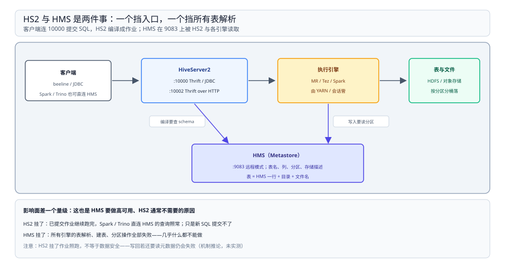
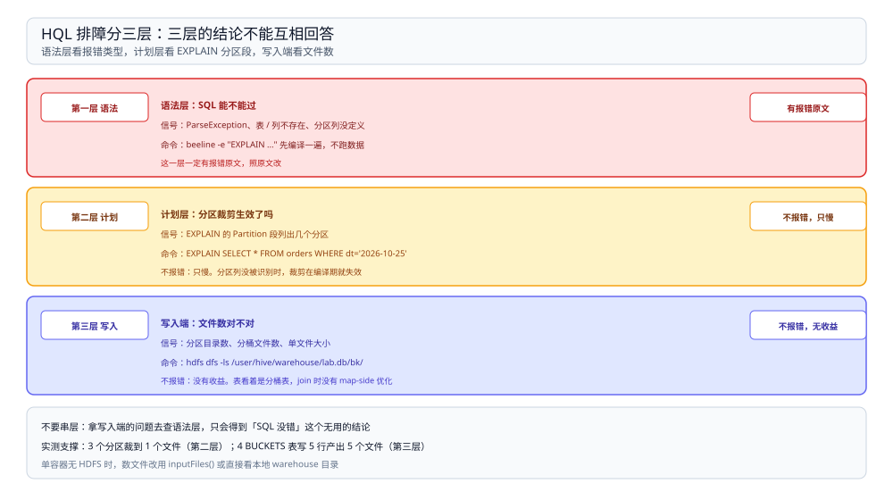

# 部署与排查

> 覆盖：HiveServer2 是什么、`10000` / `10002` 与 `9083` 各是谁、为什么单容器里看不到 `9083`、beeline 怎么连、执行引擎怎么切换、HS2 与 HMS 挂掉的影响面差在哪、以及 HQL 的三段确认法与故障速查。
>
> 不覆盖：HMS 的三种部署形态、客户端版本对齐见 [HiveMetastore.md](../../Catalog/HiveMetastore.md)；HQL 的六步编译与 `EXPLAIN` 读法见 [编译与执行链路.md](编译与执行链路.md)；分区与分桶的语义见 [分区分桶与SerDe.md](分区分桶与SerDe.md)；两边 DDL 的差异见 [与SparkSQL的差异.md](与SparkSQL的差异.md)。
>
> 内容整理自个人学习笔记。本篇端口与进程读数来自 `dockerproxy.net/apache/hive:4.0.0` 默认启动，命令输出见第二节。**未实测**：远程 HMS 的高可用与故障切换、HS2 的多实例与负载均衡、Kerberos 认证。

---

## 一、一句话定位：HS2 是 SQL 网关，不是引擎

**本节要点**：HiveServer2 提供一个 JDBC 端点，把 SQL 编译成作业交给执行引擎。它是「人连 Hive」的入口，不是「引擎本体」——所以它挂了作业照样跑，而元数据服务挂了所有引擎都停摆。

| 角色 | 端口 | 它是什么 | 挂了会怎样 |
| --- | --- | --- | --- |
| **HiveServer2** | `10000`（Thrift/JDBC）、`10002`（Thrift over HTTP） | SQL 网关：收 SQL、编译成作业、回结果 | 人连不上；已提交的作业不受影响 |
| **HMS**（Metastore） | `9083`（远程模式） | 表名、列、分区、存储描述的权威来源 | ⭐ 所有引擎都建不了表、读不了表 |
| **执行引擎** | 由 YARN / Tez 会话管 | 真正跑作业的一方 | 作业失败或排队 |

⭐ 判据：**排查前先分清「连不上」与「读不到」**。前者看 HS2，后者看 HMS——两者的处置动作完全不同。

---

## 二、实测：默认容器里只有 HS2

**本节要点**：`apache/hive:4.0.0` 默认启动的是 HS2 + 内嵌 Derby，只起一个进程、只监听两个端口。所以这个容器能建表能查询，但**没有任何服务在 9083 上**。

```text
容器内监听端口（/proc/net/tcp + tcp6）= [10000, 10002]
HiveServer2 进程数                     = 1
Metastore 进程数                       = 0
```

### 2.1 `10000` 与 `10002` 是同一个东西的两种传输

| 端口 | 协议 | 用途 |
| --- | --- | --- |
| `10000` | Thrift（二进制） | beeline / JDBC 默认连这个 |
| `10002` | Thrift over HTTP | 走 HTTP 代理或防火墙受限时用 |

⭐ 两个端口是同一个 HS2 进程的两种接入方式，不是两个服务。看到两个端口都在监听，不代表起了两份 HS2。

### 2.2 `9083` 为什么不存在

HMS 跑在内嵌 Derby 模式时由 HS2 进程内直接持有元数据，**不对外监听**。这时 `10000` 能用、`9083` 连不上，是正常形态，不是没起好。

要让多个引擎共享同一份元数据，必须换成远程 HMS——三种部署形态与各自端口见 [HiveMetastore.md](../../Catalog/HiveMetastore.md) 第四节。



图上把「谁能连、谁读元数据、谁跑作业」分开画：HS2 在左侧收 SQL，HMS 在下方被读取，执行引擎与存储在右侧。影响面的差别来自「谁依赖谁」——HS2 只挡入口，HMS 挡的是所有场景的表解析。

---

## 三、连接与执行引擎开关

**本节要点**：连与不连是两件事——beeline 能连说明 HS2 正常，但作业跑在哪由 `hive.execution.engine` 决定。

```bash
# JDBC 端点（默认 user= hive 的 anonymous 认证）
beeline -u "jdbc:hive2://hive:10000/default" -n hive

# 执行引擎：mr（默认）/ tez / spark
beeline -e "set hive.execution.engine=tez;"
```

| 目的 | 命令 | 读什么 |
| --- | --- | --- |
| 确认 HS2 活着 | `beeline -u "jdbc:hive2://<host>:10000/default" -n hive` | 连上即通 |
| 确认执行引擎 | `set hive.execution.engine;` | 当前会话取值 |
| 切执行引擎 | `set hive.execution.engine=tez;` | 只改当前会话，全局要写 `hive-site.xml` |

⚠️ `set` 只在当前会话生效。很多「为什么还是按 mr 跑」的问题，根因是只改了会话、没改配置——三档的代价与现状见 [编译与执行链路.md](编译与执行链路.md) 第三节。

---

## 四、HS2 与 HMS 的影响面完全不同

**本节要点**：两者挂掉的表象相似（都是「用不了」），但影响范围差一个量级。这也是为什么生产上 HMS 要做高可用、HS2 通常不需要。

| 谁挂了 | 还能做什么 | 不能做什么 |
| --- | --- | --- |
| HS2 | 已提交的作业继续跑完；Spark / Trino 直连 HMS 的查询照常 | 新 SQL 提交不了、建表改表提交不了 |
| HMS | 几乎什么都不能做 | 所有引擎的表解析、建表、分区操作全部失败 |

⚠️ 一个易错推断：HS2 挂了之后「作业继续跑」并不等于「数据安全」——作业跑完写回时如果还要读元数据（比如动态分区），仍会失败。本册没有这条的实测，属于机制推论。

---

## 五、三段确认：语法、计划、写入端

**本节要点**：HQL 的排查分三层——语法过不过、计划里裁不裁、写入端有没有按约定落。三层用三个不同的命令，不要用一层的结论去回答另一层的问题。



图从上到下三层，每层给一条命令和一个判据；右侧标出哪一层「报错」、哪一层「不报错只是慢」——分层的目的就是避免拿写入端的问题去查语法。

```bash
# 1. 语法与计划（不跑数据）
beeline -e "EXPLAIN SELECT * FROM orders WHERE dt='2026-10-25';"
#    看 Partition 段列出的分区数 = 运行时真读的目录数

# 2. 裁剪的实际效果（跑一次，数输入文件）
#    见 分区分桶与SerDe.md 第 4.1 节的 inputFiles() 对照

# 3. 分桶 / 分区文件的真实形态（绕过元数据，看盘）
hdfs dfs -ls /user/hive/warehouse/lab.db/bk/
#    真分桶：4 个文件；写出 5 个说明写入端没分桶
```

---

## 六、故障速查

**本节要点**：六类症状覆盖本册所有实测与判据，先按「报不报错」分流，再按层定位。

| 症状 | 先查什么 |
| --- | --- |
| `ParseException` | 语法层：SQL 写法、保留字（[编译与执行链路.md](编译与执行链路.md) 第五节） |
| 表 / 列不存在 | 语法层：当前库、HMS 连接、大小写 |
| `partition column not defined in table` | DDL 层：用了 Hive 语法建 Spark 表（[与SparkSQL的差异.md](与SparkSQL的差异.md) 第 2.1 节） |
| `ROW FORMAT SERDE is incompatible` | DDL 层：同时写了 `STORED AS`，二选一（同上第 2.2 节） |
| `Dynamic partition strict mode requires...` | 写入层：全动态分区没开 `nonstrict`，或没给静态分区列（[分区分桶与SerDe.md](分区分桶与SerDe.md) 第 3.3 节） |
| 查询慢但不报错，`EXPLAIN` 里分区数等于总数 | ⭐ 计划层：分区列没被识别成分区（同上第 4.2 节） |
| `CLUSTERED BY` 建表成功但查询没加速 | ⭐ 写入层：Spark 写 Hive 分桶表不分桶（同上第 5.2 节） |
| `SHOW CREATE TABLE` 里看不到 SerDe | 正常：Spark 输出自己的方言，用 `DESCRIBE FORMATTED`（[与SparkSQL的差异.md](与SparkSQL的差异.md) 第 2.4 节） |
| `Connection refused` 到 `9083` | 部署层：HMS 是内嵌模式或没起远程模式（[HiveMetastore.md](../../Catalog/HiveMetastore.md) 第四节） |

---

## 七、为什么「表建成了」不等于「语义对了」

**本节要点**：本册反复出现的四类问题里，**两类报错、两类静默**。报错的两类有明确的失败信号，静默的两类只有「慢」和「文件数不对」两个间接信号。

⭐ 判据：**换引擎建表之后，除了看「建成了吗」，还要看「分区数对不对、文件数对不对」**。前一个问题由引擎兜底，后两个只能自己验——验法就是第五节的三段确认。

---

## 八、校验口径

> ✅ 本篇的校验方式与范围（`apache/hive:4.0.0`，单容器）：

- **真跑，容器内实测**：第二节的端口列表（`[10000, 10002]`）、进程数（HS2 = 1、Metastore = 0）、`9083` 不监听；第三节 beeline 连接与 `set hive.execution.engine` 的读回。
- **机制推论、未实测**：第四节 HS2 / HMS 挂掉的影响面（没有做停服务实验）、第四节末「作业写回仍要读元数据」的例外。
- **未实测**：远程 HMS 的高可用与故障切换、HS2 多实例与负载均衡、Kerberos 认证。
- **口径说明**：本篇的命令都是容器内默认形态下的写法；换成远程 HMS 后 `9083` 的连通性检查会变成必查项。
- **可复现性**：脚本在 `.workbuddy/tmp/bigdata-lab/`（不入库）。

| 依赖 | 实际版本 |
| --- | --- |
| Hive | `apache/hive:4.0.0`（HiveServer2 + 内嵌 Derby） |
| 客户端 | 容器内 `beeline` |
| 元数据 | 内嵌 Derby（`9083` 不监听） |

---

## 延伸追问

- **HS2 和 HMS 能不能装在一台机器上？** → 能，但它们的端口、进程与故障影响面是两件事。单容器里 HS2 进程同时持有内嵌 Derby，看起来「只有 Hive 一个服务」，实际是把两个角色合到了一个进程——这也是为什么它不能给多个引擎共享元数据。
- **为什么 `9083` 连不上但 beeline 能用？** → 因为元数据由 HS2 进程内的 Derby 直接读，没有对外监听。要共享给 Spark / Trino，必须换成远程 HMS 并让 `metastore.uris` 指到 `9083`。
- **HS2 挂了，正在跑的作业会不会丢？** → 已经提交给执行引擎的作业不会因为 HS2 挂掉而中断；丢的是「提交新 SQL」和「拉取结果」这两个动作。带动态分区的作业在写回时仍可能需要元数据，属例外。
- **三段确认能不能只做一段？** → 不能。语法层过了不代表计划里裁了，计划里裁了不代表写入端按约定落了。三层是三个独立的失败面，读数也来自三个不同的命令。

## 关联

- **上游/总纲**：[README.md](README.md) — 本册五篇的分工、读序与实测坐标
- **上游/总纲**：[计算引擎选型对比.md](../计算引擎选型对比.md) — Hive 在四款引擎里的位置与「资源不够时的三种表现」
- **对照/互补**：[编译与执行链路.md](编译与执行链路.md) — 六步编译与 `EXPLAIN` 三段
- **对照/互补**：[分区分桶与SerDe.md](分区分桶与SerDe.md) — 分区裁剪与分桶的实测读数
- **对照/互补**：[与SparkSQL的差异.md](与SparkSQL的差异.md) — 报错原文与改写对照
- **下游机制**：[HiveMetastore.md](../../Catalog/HiveMetastore.md) — `9083` 背后那三种部署形态
- **运维/配置**：[HiveMetastore.md](../../Catalog/HiveMetastore.md) 第四节 — 换远程 HMS 后 HS2 侧要改的配置
