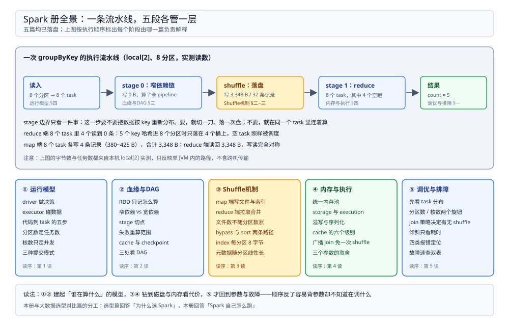

# Spark 目录导读

> 覆盖：Spark 自己怎么跑起来——driver 与 executor 的分工、一段代码怎么变成 task、血缘与 stage 切分、shuffle 在磁盘上留下什么、内存池与溢写、以及参数与故障的排查顺序，共 **5 篇零件**。
>
> 不覆盖：四层（文件系统 / 表格式 / Catalog / 引擎）的分层关系与同层多候选的选型见 [大数据选型对比.md](../../大数据选型对比.md)；15 分钟微批在这套架构里怎么切、`spark-submit` 的旋钮怎么配、补数怎么跑见 [04 的大数据平台册](../../../../04-架构与系统/系统设计/大数据平台/README.md)；Hive 侧 HQL 与 Spark SQL 的不兼容见 [与SparkSQL的差异.md](../Hive/与SparkSQL的差异.md)。
>
> 内容整理自个人学习笔记。本册读数全部来自本机 `apache/spark:3.5.5-scala2.12-java17-python3-ubuntu` 容器（`local[2]` / `local[4]`），由事件日志（`SparkListenerStageSubmitted` / `SparkListenerTaskEnd`）解析得到，各篇逐处标注了实测与文档口径。

---

## 一、一句话定位：省掉的不是磁盘，是「每个 stage 无条件落一遍 HDFS」

**本节要点**：把 Spark 和 MapReduce 放在一起，唯一需要记住的分水岭是**中间结果的传递方式**——MapReduce 每个 job 之间必须写 HDFS 再读回来，Spark 在同一 stage 内把算子串成管道直接传，跨 stage 才落本地磁盘。

| 维度 | MapReduce | Spark |
| --- | --- | --- |
| 中间结果 | 每个 job 结束写 HDFS | 算子间在流水线内传递；跨 stage 才落本地盘 |
| 执行单位 | 固定的 map / reduce 两段 | 任意 DAG，按 shuffle 边界切 stage |
| 迭代计算 | 每轮从头读 HDFS | 血缘复用，`cache` 可把中间结果留在内存 |
| 失败代价 | 整个 job 重跑 | 只重算丢了分区的那段血缘 |

> ⭐ 「Spark 全靠内存」是流传最广的一句错话。**shuffle 落盘、内存不足溢写落盘、checkpoint 落盘**——它省掉的是「每次跨阶段都去 HDFS 走一圈」，而不是磁盘本身。

## 二、五篇分工

**本节要点**：五篇按**一次作业的执行顺序**排开，每篇负责其中一个阶段；读的时候不需要跳着看，但排查问题时要按篇目名反查。

图上半是一条真实的执行流水线（`local[2]`、8 分区）：读入 → stage 0 的窄依赖链 → shuffle 落盘 → stage 1 的 reduce → 结果，每段下面标着由哪一篇负责解释；下半是五张卡片，列出每篇覆盖的机制与建议读序。

| 篇 | 回答什么 | 本册的关键读数 |
| --- | --- | --- |
| ① [运行模型.md](运行模型.md) | driver 与 executor 各做什么、一段代码怎么变成 task、分区数与核数分别决定什么、三种提交模式 | 8 task 在 2 核 5.54 s / 4 核 4.17 s；AQE 关 200 task、开实际 1 个 |
| ② [血缘与DAG.md](血缘与DAG.md) | RDD 只记「怎么算」、窄依赖与宽依赖、stage 在哪里切、失败要重算多少、cache 与 checkpoint 的差别 | 窄依赖链 1 stage / 8 task；`groupByKey(8)` 变成 8+8 个 task、4 个 reduce 空跑 |
| ③ [Shuffle机制.md](Shuffle机制.md) | 落盘到底是哪几个文件、index 与 checksum 的尺寸怎么算、reduce 端怎么拉、bypass 与 sort 两条写路径 | 4 个 map task → **12 个文件**；index `(R+1)×8`、checksum `R×8` |
| ④ [内存与执行.md](内存与执行.md) | 一个堆两个池怎么借、`cache` 的六个级别、溢写、序列化、广播变量为什么能免 shuffle | `groupByKey` 4.49 s vs `reduceByKey` 2.10 s；广播 join 4.03 s vs 排序合并 5.64 s |
| ⑤ [调优与排障.md](调优与排障.md) | 先看哪两个分布、三个旋钮（分区数 / 核数 / join 策略）各在什么时候有用、倾斜为什么可能被字节藏住、故障速查双表 | 400 个 reduce task 总 43.63 s；倾斜时 map 端耗时差 3.7 倍而字节只差 1.3 倍 |

## 三、阅读路线

| 顺序 | 篇 | 视角 | 什么时候读 |
| --- | --- | --- | --- |
| ① | [运行模型.md](运行模型.md) | ⭐ **主线 / 原理** | 第一次接触执行模型：谁做决策、谁碰数据，一段 `groupByKey` 怎么变成 task，分区数与核数差在哪 |
| ② | [血缘与DAG.md](血缘与DAG.md) | 原理 | 想弄清「为什么这里多了一次 shuffle」「任务失败为什么只重跑一段」时 |
| ③ | [Shuffle机制.md](Shuffle机制.md) | 原理 / 落盘 | 要算磁盘与元数据开销、或要解释「为什么文件数不随分区数增长」时 |
| ④ | [内存与执行.md](内存与执行.md) | 原理 / 内存 | 遇到缓存不生效、executor OOM、要不要改用广播时 |
| ⑤ | [调优与排障.md](调优与排障.md) | 落地 / 排障 | 线上作业慢或失败，需要一个按顺序走的判断表时 |

### 依赖关系

| 本篇 | 建议先读 | 为什么 |
| --- | --- | --- |
| 血缘与DAG.md | 运行模型.md | stage 是 driver 侧的切分结果，先知道谁在切 |
| Shuffle机制.md | 血缘与DAG.md | shuffle 就是宽依赖的落地动作，切点与文件是同一件事的两面 |
| 内存与执行.md | Shuffle机制.md | 写缓冲、溢写与读缓冲都挂在 shuffle 的两端 |
| 调优与排障.md | 前四篇 | 三个旋钮分别改的是 task 数、并发与 shuffle 次数，不认识这四篇就只能背参数 |

> ⭐ **两条线**：**原理线**（① → ② → ③ → ④）回答「它怎么跑、为什么这样设计」；**问题线**（⑤ 加前四篇的对应小节）回答「慢和失败怎么定位」。⑤ 放在最后不是因为它不重要，而是它的每个判断都要回指前四篇的机制。

## 四、本轮实测坐标

| 项 | 值 |
| --- | --- |
| 镜像 / 版本 | `dockerproxy.net/apache/spark:3.5.5-scala2.12-java17-python3-ubuntu`（经镜像站拉取，本地名带前缀） |
| 容器 | `spark-mech`，长驻 `tail -f /dev/null`，作业用 `docker exec … /opt/spark/bin/spark-submit` 提交 |
| 运行模式 | 只有 `local[2]` / `local[4]`，事件日志里 `Executor ID` 恒为 `driver` |
| 观测手段 | 事件日志解析 `SparkListenerStageSubmitted` / `SparkListenerTaskEnd`；shuffle 文件把 `spark.local.dir` 指到空目录后逐文件统计 |
| 数据规模 | 4 万 ~ 300 万行，单条 200~300 B 字符值；join 场景 100 万 × 1,000 行 |
| 宿主目录 | `D:\tmp\sparkmech` 挂到 `/w`，rig 脚本与事件日志都在这里 |

六条最值得记住的读数：

| 读数 | 值 | 出处 |
| --- | --- | --- |
| 8 个 task × 0.8 s：核数只改波数 | `local[2]` **5.54 s**（4 波）/ `local[4]` **4.17 s**（2 波） | [运行模型.md](运行模型.md) 第四节 |
| AQE 只改**实际** task 数 | 计划写 200，关 AQE 起 200 个 task；开 AQE 只起 **1 个** | [运行模型.md](运行模型.md) 第四节 |
| shuffle 文件数不随分区数涨 | 4 个 map task 恒为 **12 个文件**（data / index / checksum 各 4） | [Shuffle机制.md](Shuffle机制.md) 第二、三节 |
| 元数据按分区数线性长 | `.index` 从 **40 B**（4 分区）到 **136 B**（16 分区），即 `(R+1)×8` | [Shuffle机制.md](Shuffle机制.md) 第三节 |
| task 数量本身就是固定成本 | 400 个 reduce task 只写 147,888 B，却跑了 **43.63 s** | [Shuffle机制.md](Shuffle机制.md) 第六节 |
| 倾斜能被字节藏起来 | `reduceByKey` 的 reduce 读字节只差 1.3 倍，map 端耗时却差 **3.7 倍** | [调优与排障.md](调优与排障.md) 第五节 |

> ⚠️ **未实测项**：独立 executor 进程与多 executor 负载不均、`client` / `cluster` 提交模式、跨机 shuffle 拉取与 `fetchWaitTime`、YARN / K8s 的资源排队、spill 的真实触发（5 组配置下字节均为 0）、广播阈值误判导致的 OOM 报错原文。原因统一是**本机只有单 JVM 的 local 模式**，这些行为都发生在多进程 / 多机之间。

## 五、本册的边界

| 本册收 | 不收（在哪） |
| --- | --- |
| Spark 自身的执行机制：driver / executor、DAG、shuffle、内存、参数与排障 | **四层架构与引擎横向选型** → [大数据选型对比.md](../../大数据选型对比.md) |
| 「参数改了会发生什么」这类机制层面的因果 | **这套平台怎么拼、15 分钟微批怎么切、补数怎么跑** → [04 大数据平台册](../../../../04-架构与系统/系统设计/大数据平台/README.md) |
| 分区、分桶、`warehouse` 在 Spark 侧的配置项 | **HQL 与 Spark SQL 的四处不兼容与报错原文** → [与SparkSQL的差异.md](../Hive/与SparkSQL的差异.md) |
| shuffle 的本地文件布局与读取 | **分布式文件系统的块与副本模型** → [HDFS.md](../../文件系统/HDFS.md)、**表文件的组织** → [Iceberg.md](../../表格式/Iceberg.md) |
| 批处理引擎的执行模型 | **原生流式与水位线** → [Flink 册](../Flink/README.md)（机制归 Flink 册，链路归 [04 大数据平台册](../../../../04-架构与系统/系统设计/大数据平台/README.md)） |

## 延伸追问

- **只想弄清「作业为什么慢」，最短路径是什么？** → 直接读 [调优与排障.md](调优与排障.md) 第一、二节（先看 task 分布，再看是不是分区给多了），再按症状跳回对应篇。
- **为什么这五篇不合成一篇？** → 它们回答的是五个独立问题：谁在算、在哪切、落什么盘、占什么内存、怎么调。合成一篇后最容易出现的结果是「知道有一堆参数，但说不出哪个参数管哪一段」。
- **这套实测怎么复现？** → 起一个 `apache/spark:3.5.5` 容器常驻，把宿主目录挂到 `/w`，再用 `spark-submit --master local[4] /w/xxx.py` 提交；shuffle 文件要靠 `--conf spark.local.dir=/w/空目录` 单独收集，否则任务结束就被清掉。

## 关联

- **上游/总纲**：[大数据选型对比.md](../../大数据选型对比.md) — 四层分工、接口契约与引擎层候选
- **上游/总纲**：[04 大数据平台册](../../../../04-架构与系统/系统设计/大数据平台/README.md) — Spark 在这套平台里承担哪一段链路
- **对照/互补**：[Spark批处理与调度.md](../../../../04-架构与系统/系统设计/大数据平台/Spark批处理与调度.md) — 15 分钟微批的切分与调度策略
- **对照/互补**：[Hive 册](../Hive/README.md) — 同为引擎层，HQL 的执行路径与四处不兼容
- **下游机制**：[Iceberg.md](../../表格式/Iceberg.md) — Spark 写表时表格式那一侧的元数据
- **下游机制**：[HDFS.md](../../文件系统/HDFS.md) — shuffle 与 checkpoint 最终落到哪类存储
