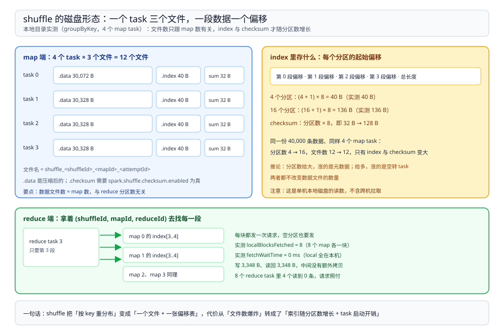

# Shuffle机制

> 覆盖：shuffle 在磁盘上留下的到底是什么文件、**一个 map task 写几个文件、index 与 checksum 的尺寸怎么算**、reduce task 怎么定位并拉取这些块、bypass 与 sort 两条写路径的差别，以及「文件数不随分区数增长」这件事的实测依据。
>
> 不覆盖：为什么在这里切 stage、切点之后怎么重算见 [血缘与DAG.md](血缘与DAG.md)；内存池、溢写与序列化见 [内存与执行.md](内存与执行.md)；分区数取值与倾斜处理见 [调优与排障.md](调优与排障.md)。
>
> 内容整理自个人学习笔记。本篇读数来自本机 `apache/spark:3.5.5-scala2.12-java17-python3-ubuntu` 容器，`local[4]`，把 `spark.local.dir` 指到一个空目录后在任务结束后逐文件统计；**只有单机本地磁盘，没有跨机拉取**，所以远程读取、shuffle service 与网络耗时未实测。

---

## 一、一句话定位：shuffle 是「按 key 重新分区」的落地动作

**本节要点**：宽依赖在逻辑上只说明「下游要按 key 重新分布」，shuffle 负责把它变成**一组可被精确定位的文件**——map 端写、reduce 端读，中间靠 index 索引。

| 角色 | 做什么 | 产物 |
| --- | --- | --- |
| map task | 把输出按目标分区号分桶，顺序写成一个数据文件，同时记录每个桶的偏移 | `<shuffleId>_<mapId>_0.data` + `.index` |
| reduce task | 按 `(shuffleId, mapId, reduceId)` 向所有 map 端要自己那一块 | 合并后的迭代器，交给下游算子 |
| BlockManager | 记录「哪个块在哪台机器」，供 reduce 端定位 | 块元数据（本地模式下全在本机） |

> ⭐ 记住这一条：**shuffle 的读写单位是「块」，不是「文件」**。一个 map task 只写一个数据文件，但里面被切成了 R 段（R = reduce 分区数）；reduce 端要的是文件里的第 r 段，靠 index 里的偏移找。这也解释了为什么文件数不随分区数增长。

## 二、map 端：一个 task 写三个文件

**本节要点**：每个 map task 产出 **data + index + checksum** 三件套，各自职责不同。实测 4 个 map task 共 12 个 shuffle 文件，一个不多。

在 `spark.local.dir` 指向的空目录里跑一次 `groupByKey(4)`（4 个 map task）：

| 文件 | 数量 | 单个大小 | 作用 |
| --- | --- | --- | --- |
| `shuffle_0_<mapId>_0.data` | 4 | 30,072 / 30,328 / 30,328 / 30,328 B | 压缩后的记录，按目标分区顺序拼接 |
| `shuffle_0_<mapId>_0.index` | 4 | 40 B | 每个分区的起始偏移，末尾留一个总长度 |
| `shuffle_0_<mapId>_0.checksum.ADLER32` | 4 | 32 B | 每个分区一个校验和，拉取时验完整性 |

三件事值得单独说：

1. **`.data` 是压缩的**。40,000 条 `(int, int)` 记录压缩后每个 task 只 ~30 KB，`spark.shuffle.compress` 默认为真。所以「shuffle 写了多少字节」这个指标看的是**压缩后**的大小，不能直接换算成内存占用。
2. **`.checksum` 是新版本才有的**。它跟 `.index` 一样按分区数增长，用来在拉取时发现损坏；`spark.shuffle.checksum.enabled` 默认为真，关掉它文件数会从 3×map 数降到 2×map 数。
3. **文件名里的三个数字**依次是 `shuffleId_mapId_attemptId`。多个 shuffle 叠在同一个目录里时，就靠第一个数区分。

## 三、index 与 checksum 的尺寸：按分区数线性长

**本节要点**：**data 文件数不变，但 index 与 checksum 的大小随 reduce 分区数线性增长**——这是 shuffle 的固定开销，跟数据量无关。

同一份 40,000 条数据、同样 4 个 map task，只把 reduce 分区数从 4 改成 16：

| 项 | 4 个分区 | 16 个分区 | 规律 |
| --- | --- | --- | --- |
| shuffle 文件数 | 12 | 12 | **不变**，恒为 map 数 × 3 |
| `.data` 单个 | 30,072~30,328 B | 30,992~31,248 B | 略增（每段多一条记录边界） |
| `.index` 单个 | **40 B** | **136 B** | 8 字节/分区 + 8 字节尾部 |
| `.checksum.ADLER32` 单个 | **32 B** | **128 B** | 8 字节/分区 |

两个式子可以直接验算：`(4+1)×8 = 40`、`(16+1)×8 = 136`；`4×8 = 32`、`16×8 = 128`。读数与式子完全对上。

图里上半部分是实测的目录结构：4 个 map task 各三个文件，data 大、index 与 checksum 小到可以直接背下尺寸；下半部分是 reduce 端拿着 `(shuffleId, mapId, reduceId)` 去每个 map 的 index 里查偏移，再读 data 的对应段。

⭐ 这条规律的实际含义：**分区数给得越大，map 端的元数据开销越大，而数据文件数不变**。200 个分区时每个 map task 的 index 约 `201×8 = 1,608 B`、checksum 约 `1,600 B`——单看不大，但 map task 数是几十万时（大表 + 小文件），这部分就会累积成可观的元数据量。⚠️ 后半句是按公式外推，**本篇未在大规模 map 数下实测**。

## 四、reduce 端：按三元组拉块，再合并

**本节要点**：reduce task 不读「文件」，而是读「文件里的第 r 段」。它要对**每个 map task 各发一次请求**，所以 reduce 端的拉取次数是 `map 数 × reduce 数` 量级。

实测 `groupByKey(8)` 的 reduce 侧读数：

| 读数 | 值 | 说明 |
| --- | --- | --- |
| 单个 reduce task 的 `localBlocksFetched` | 8 | 每个 map task 一块 |
| 有数据的 reduce task 数 | 4 / 8 | 另 4 个读到 0 条 |
| 有数据 task 的 `localBytesRead` | 1,022 / 776 / 774 / 776 B | 与 map 端写出的 3,348 B 相等 |
| `fetchWaitTime` | 0 ms | local 模式全在本机，没有等待 |

三点推论：

1. **空分区也要拉一遍**。4 个空 task 各自向 8 个 map task 各要一块，拿到 0 字节——请求开销照付。
2. **`fetchWaitTime` 只有在有远程拉取时才有意义**。local 模式恒为 0，所以本机测不出网络对 shuffle 的影响。
3. **合并发生在读侧**。同一个 key 的多个值来自不同 map task，reduce 端要把 8 段合成一条流，这一步是归并（sort）或哈希聚合（hash），取决于下游算子——`groupByKey` 用排序归并，`reduceByKey` 用哈希聚合。

## 五、两条写路径：bypass 与 sort

**本节要点**：map 端有两条差别很大的写路径，**选哪条由分区数和是否 map 端合并决定**，不写代码也不会报错，只体现在磁盘行为上。

| 路径 | 触发条件（官方口径） | 内存行为 | 文件行为 |
| --- | --- | --- | --- |
| **bypass merge sort** | reduce 分区数 ≤ `spark.shuffle.sort.bypassMergeThreshold`（默认 200）且不需要 map 端合并 | 每条记录直接写到目标分区的临时文件，**不在内存里排序** | 临时文件数 = map 数 × reduce 数，最后拼接成 1 个 data |
| **sort** | 分区数超过阈值，或需要 map 端合并 | 记录先进内存缓冲，排好序再落盘，**内存不够就溢写** | 仍只有 1 个 data，但写之前可能产生多次溢写文件 |

实测的一个反常现象：本篇 5 组配置下 `memoryBytesSpilled` **全部为 0**，包括把 `spark.shuffle.spill.numElementsForceSpillThreshold` 调到 1,000、把 `bypassMergeThreshold` 调到 0、把 reduce 分区数加到 400。这说明在 20 万~100 万条这个量级上，map 端根本没有在 JVM 内存里堆到需要溢写的水位——与「bypass 路径不缓冲」的行为一致，但**本篇没有直接读到 writer 的类名**，所以只能算间接印证，不作断言。

## 六、代价：文件数 × 分区数 × 数据量

**本节要点**：shuffle 的代价分三块，各自的主变量不同；把三个变量混在一起谈，就会得出「分区越多越慢」或「分区越多越快」两种相反的结论。

| 代价 | 主变量 | 实测锚点 |
| --- | --- | --- |
| 元数据（index + checksum） | **分区数 × map 数** | 4 分区 72 B/task → 16 分区 264 B/task |
| 落盘数据量 | **数据量**（压缩后） | 40,000 条 → 每个 task ~30 KB |
| 调度开销 | **task 数** | 400 个 reduce task：单 task 191~974 ms，总 43.63 s |

第三行最容易被低估：400 个 reduce task 那次作业，`groupByKey` 的 map 端只写了 147,888 B（压缩后），数据小到可以忽略，**43.63 秒几乎全是 400 个 task 的启动、序列化与结果回传**。这就是「分区数不是越多越好」最硬的证据。

## 七、校验口径

| 内容 | 状态 |
| --- | --- |
| 4 个 map task → 12 个 shuffle 文件（data + index + checksum 各 4） | ✅ 本机实测（`spark.local.dir=/w/shuf4` 后逐文件统计） |
| 4 分区：data 30,072~30,328 B、index 40 B、checksum 32 B | ✅ 本机实测 |
| 16 分区：文件数不变，index 136 B、checksum 128 B | ✅ 本机实测 |
| index = 8 B × 分区数 + 8 B；checksum = 8 B × 分区数 | ✅ 实测值反推，两组数据都对上 |
| 40,000 条记录压缩后每 task ~30 KB（`spark.shuffle.compress` 默认为真） | ✅ 本机实测；「压缩后」是观察到的文件大小 |
| reduce 端每 task `localBlocksFetched = 8`、`fetchWaitTime = 0` | ✅ 本机实测 |
| 400 个 reduce task 总计 43.63 s、单 task 191~974 ms | ✅ 本机实测 |
| `bypassMergeThreshold` 默认 200、两条写路径的触发条件 | ⚠️ 官方配置文档口径，**未读到 writer 类名** |
| 5 组配置下 `memoryBytesSpilled = 0` | ✅ 本机实测（**溢写未触发**，不代表机制不存在） |
| 跨机拉取、shuffle service、网络耗时 | ⚠️ **未实测**：local 模式全在本机磁盘 |
| 大规模 map 数下元数据累积量 | ⚠️ 按公式外推，**未实测** |

---

## 延伸追问

- **为什么一个 map task 只写一个 data 文件，而不是每个分区一个文件？** → 早期 hash shuffle 就是每分区一个文件（map 数 × reduce 数个小文件），分区一多就把磁盘 inode 打爆。现在改成「一个大文件 + 索引」，文件数只跟 map 数有关，分区数只影响索引大小。
- **index 里到底存的是偏移还是长度？** → 每项是「该分区数据的起始偏移」，末尾再补一个总长度，所以有 R+1 项。读的时候用第 r 项与第 r+1 项相减得到长度，这也是 `(R+1)×8` 的来源。
- **`.checksum` 文件能关吗，关了会怎样？** → 能，`spark.shuffle.checksum.enabled` 默认为真。关掉后少两个文件之一，但拉取时不再校验，损坏只能等到反序列化报错才暴露。
- **reduce 端拉取是并行还是串行？** → 并行，由 `spark.reducer.maxSizeInFlight`（默认 48 MB）限制同时在途的数据量，`spark.reducer.maxReqsInFlight` 限制并发请求数。本机 local 模式没有远程请求，这两个参数测不出效果。
- **为什么空分区还要发请求？** → reduce task 不知道自己是不是空的，只有把每个 map 的分块都问一遍才能确认。这是「分区数给大了」最直接的浪费：多出来的 task 全在空转。
- **shuffle 数据什么时候删？** → map 端的数据在 GC 时由 `ContextCleaner` 清理，条件是下游 stage 已完成且没有其他依赖；driver 侧保留元数据供重算。这也是 executor 一挂、下游就要重算的原因（见 [血缘与DAG.md](血缘与DAG.md) 第四节）。

---

## 关联

- [README.md](README.md) — 本册导读：五篇分工与读序
- [运行模型.md](运行模型.md) — **上游**：driver 与 executor 的分工、分区数与核数两个旋钮
- [血缘与DAG.md](血缘与DAG.md) — **上游**：shuffle 边界为什么就是 stage 边界
- [内存与执行.md](内存与执行.md) — **下游**：map 端缓冲、溢写的内存从哪来
- [调优与排障.md](调优与排障.md) — **下游**：分区数取值、倾斜与小文件问题
- [../../../../02-计算机基础/操作系统/零拷贝.md](../../../../02-计算机基础/操作系统/零拷贝.md) — **对照**：文件传输路径的通用机制，shuffle 的本地读取同样走页缓存
- [大数据选型对比.md](../../大数据选型对比.md) — **上游总纲**：计算引擎层的接口契约
