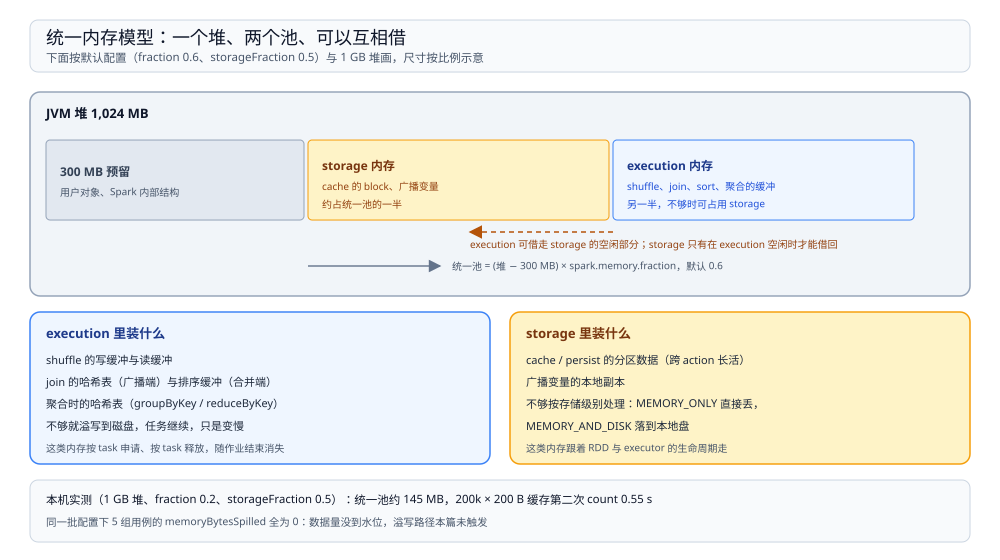

# 内存与执行

> 覆盖：**execution 与 storage 两个池怎么分同一个堆**、各自装什么、借还规则、`cache` 的存储级别怎么选、溢写这条唯一的降级路径、序列化在 PySpark 里多出来的那一跳，以及广播变量为什么能让 join 免掉一次 shuffle。
>
> 不覆盖：shuffle 文件的布局与读取见 [Shuffle机制.md](Shuffle机制.md)；stage 与血缘见 [血缘与DAG.md](血缘与DAG.md)；参数取值与 OOM 排查见 [调优与排障.md](调优与排障.md)。
>
> 内容整理自个人学习笔记。本篇读数来自本机 `apache/spark:3.5.5-scala2.12-java17-python3-ubuntu` 容器，`local[4]`，堆大小由 `--driver-memory` 指定并读 `Runtime.maxMemory()` 核对。⚠️ **溢写路径本篇未能触发**（5 组配置下字节数均为 0），这一节按官方文档陈述并明确标注。

---

## 一、一句话定位：内存不够不会立刻失败，会先降级

**本节要点**：Spark 的内存策略是**分级降级**而不是硬性拒绝——execution 不够就溢写到磁盘，storage 不够就按存储级别丢弃或落盘。真正会 OOM 的只有两种情况：单个对象大到放不进一个分区，或者 driver 端收集的结果超过堆。

| 情形 | 结果 | 观测点 |
| --- | --- | --- |
| execution 内存不够 | 溢写（spill）到本地磁盘，任务继续但变慢 | `memoryBytesSpilled` / `diskBytesSpilled` |
| storage 内存不够（`MEMORY_ONLY`） | 丢掉部分缓存分区，下次用到按血缘重算 | `StorageLevel` 与重算日志 |
| storage 内存不够（`MEMORY_AND_DISK`） | 溢到本地磁盘，慢但正确 | 存储页的 `diskSize` |
| 单分区数据超过堆 | `OutOfMemoryError`，task 失败 | executor 日志里的 OOM 栈 |
| `collect()` 回传数据超过 driver 堆 | driver OOM，整个 application 挂 | 日志里 driver 侧的 OOM |

⭐ 记住这条因果：**降级是「慢」，不是「错」**。看到溢写不用慌，看到 OOM 才需要改结构（分区数、是否 collect、是否广播）。

## 二、池子怎么分：一个堆、两个池

**本节要点**：堆先扣掉一个**固定预留**（默认 300 MB），剩下的按 `spark.memory.fraction`（默认 0.6）划成统一池，统一池再按 `spark.memory.storageFraction`（默认 0.5）分给 storage 与 execution。两个池**不是硬隔离**，能互相借。



图里的三段比例就是默认配置下的划分：预留段不参与调度，剩下两段各占统一池的一半。虚线箭头表示借用方向——**execution 优先**，它可以占用 storage 的空闲部分，且一旦占用，storage 必须等 execution 释放后才能要回来；反过来 storage 只能在 execution 空闲时借。

三个参数各自的含义与改动后果：

| 参数 | 默认 | 改大 | 改小 |
| --- | --- | --- | --- |
| `spark.memory.fraction` | 0.6 | 统一池更大，用户对象更容易 OOM | execution/storage 都变小，溢写与重算变多 |
| `spark.memory.storageFraction` | 0.5 | storage 起点更高，缓存更稳，execution 更容易溢写 | execution 起点更高，缓存更容易被挤掉 |
| `spark.memory.offHeap.size` | 0（关闭） | 堆外内存，减少 GC 压力 | 只有堆内池 |

实测的堆与配置：`Runtime.maxMemory()` 读到 `1,073,741,824`（1 GiB），`spark.memory.fraction` 被显式设为 `0.2`、`storageFraction` 保持 `0.5`。按公式算统一池约 `(1024 − 300) × 0.2 ≈ 145 MB`，其中起点各约 72 MB。⚠️ 这是**算术结果**，不是从内存池读出来的实时值。

## 三、execution 内存：四个消费者

**本节要点**：execution 内存只服务「当前正在跑的那批 task」，按 task 申请、随 task 结束释放。它被四类缓冲瓜分。

| 消费者 | 何时大量占用 | 超了会怎样 |
| --- | --- | --- |
| shuffle 写缓冲 | map 端把记录攒成批、排好序再落盘 | 溢写；文件数变多 |
| shuffle 读缓冲 | reduce 端边拉边合并 | 溢写；拉取变慢 |
| join 的哈希表 | 广播端把整张小表装进内存 | 构建失败，回退或 OOM |
| 排序/聚合缓冲 | `groupByKey`、全局排序 | 溢写 |

实测里能直接看到「哪类算子更吃内存」的一个对照：同样 100 万条数据、同样 4 个分区、同样 1 GB 堆，

| 算子 | 耗时 | shuffle 写出 | 原因 |
| --- | --- | --- | --- |
| `groupByKey(4)` | **4.49 s** | 14,272 B | 不做 map 端合并，值全部原样带到 reduce 端再聚 |
| `reduceByKey(4)` | **2.10 s** | 2,152 B | map 端先局部聚合，shuffle 数据量只有前者的约 1/6.6 |

两者最终结果都是 50 行，差别全在「有没有在 map 端就压掉重复值」。这也解释了为什么 `reduceByKey` 几乎总是比 `groupByKey` 好：**它把内存压力从 reduce 端挪到了 map 端，而 map 端是可以分片并行的**。

## 四、storage 内存与存储级别

**本节要点**：`cache()` 等价于 `persist(MEMORY_ONLY)`，它的语义是「**尽量**放进内存」——放不下就丢，不是报错。要「放不下就落盘」必须显式选 `MEMORY_AND_DISK`。

| 存储级别 | 内存 | 磁盘 | 序列化 | 适用 |
| --- | --- | --- | --- | --- |
| `MEMORY_ONLY`（`cache` 的默认） | ✅ | ❌ | 对象 | 中间结果小、重复读多 |
| `MEMORY_AND_DISK` | ✅ | ✅ | 对象 | 中间结果大，宁可慢也别重算 |
| `MEMORY_ONLY_SER` | ✅ | ❌ | 字节 | 省内存、多花 CPU |
| `MEMORY_AND_DISK_SER` | ✅ | ✅ | 字节 | 大中间结果 + 内存紧张 |
| `DISK_ONLY` | ❌ | ✅ | 字节 | 内存极度紧张，只求不重算 |
| `OFF_HEAP` | 堆外 | ❌ | 字节 | 需要显式开启堆外内存 |

实测的缓存收益：20 万条、每条 200 字符的 RDD 加 `cache()` 后，第一次 `count()` 的 task 耗时 833~1,170 ms，第二次 **0.55 s**（另一次运行 0.33 s）——省掉的是整条血缘的重算。⚠️ 这是**单次运行的量级对照**，没有做 3 轮取区间，不能当稳定基准。

⚠️ 一个要避开的坑：`SparkContext.getRDDStorageInfo()` 返回的 `memSize` 在 local 模式下**不随数据大小变化**——同一段代码把每条 200 字符换成 2,000 字符（10 倍），读到的是 `804,338 B` 与 `805,054 B`。所以不要拿它算内存占用，判断缓存是否生效要看第二次 action 的耗时与是否重算，不要看这个估算值。

## 五、溢写：唯一的降级路径

**本节要点**：溢写是 execution 内存不足时的**唯一**出路——把内存里的记录按分区排好序写到本地磁盘，后续读的时候多路归并。它保证正确性，代价是成倍的磁盘 I/O。

```text
内存缓冲写满 → 排序 → 落盘（一个临时文件）
            → 继续累积 → 再落盘
            → 结束时把所有临时文件 + 剩余内存一起归并
```

三个可观测的指标（都在 task 级累加器里）：

| 指标 | 含义 | 出现即为溢写 |
| --- | --- | --- |
| `memoryBytesSpilled` | 溢写到磁盘前在内存里占用的字节数 | > 0 |
| `diskBytesSpilled` | 实际写到磁盘的字节数 | > 0 |
| `shuffle.write.bytesWritten` | 最终 shuffle 数据文件的字节数 | 不含溢写临时文件 |

⚠️ **本篇未触发溢写**。实测用了 5 组配置：1 GB 堆 + `fraction 0.2` 下的 100 万条 `groupByKey`、把 `spark.shuffle.spill.numElementsForceSpillThreshold` 调到 1,000、再把 `bypassMergeThreshold` 调到 0、把 reduce 分区加到 400、以及对 300 万行做全局排序——`memoryBytesSpilled` 与 `diskBytesSpilled` **全部为 0**。原因是这个量级的数据在 map 端没有堆到溢写水位（也与 bypass 写路径不在内存里排序的行为一致）。真实触发需要更大的单分区数据或更小的堆，本机没有复现。

## 六、序列化：一进 shuffle 就变字节

**本节要点**：RDD 里的对象在 shuffle 与缓存（`_SER` 级别）时必须变成字节，这一步的编解码成本经常比计算本身还大。

| 场景 | 用什么序列化 | 代价 |
| --- | --- | --- |
| RDD API 默认 | Java 序列化 | 兼容性最好，体积与速度都一般 |
| 显式开 Kryo | `spark.serializer=...KryoSerializer` | 更小更快，但要求类可注册 |
| DataFrame / SQL | 不走对象序列化，走 `UnsafeRow` 二进制 | 省掉反序列化，这是 DataFrame 更快的主要原因 |
| PySpark RDD | Python 对象 → pickle → JVM 字节数组 | **每行数据都要跨进程转一次** |

PySpark 那一行是实际项目里最容易被忽略的成本：`rdd.map(pyfunc)` 的每一行都要在 Python worker 与 JVM 之间序列化一次，而 `df.select(...)` 这类纯 SQL 算子在 JVM 内跑完。⚠️ 本篇没有量化这两者的差距，只按执行位置陈述机制。

一个间接佐证来自调度开销：400 个 reduce task 那次作业，map 端 shuffle 只写了 147,888 B，但总耗时 **43.63 s**，单个 task 中位耗时约 450 ms。数据小到可以忽略，时间全花在 task 的启动、反序列化与结果回传上——**task 数量本身就是一份固定成本**。

## 七、广播变量：小表为什么能免掉一次 shuffle

**本节要点**：广播把一份只读数据发给每个 executor，join 时大表每个分区直接与本地这份数据连接，于是**大表侧不需要按 key 重分区**，也就没有 shuffle。

实测同一个 join（100 万行 × 1,000 行），只改 `spark.sql.autoBroadcastJoinThreshold`：

| 配置 | 物理计划 | 大表侧 Exchange | 耗时 |
| --- | --- | --- | --- |
| 默认（10 MB，小表 1,000 行远小于阈值） | `BroadcastHashJoin`，`BuildRight` | **没有**，只有小表侧的 `BroadcastExchange` | **4.03 s** |
| 阈值设为 -1（禁用广播） | `SortMergeJoin` | 有，`hashpartitioning(k, 8)` | **5.64 s** |

计划里 `BroadcastExchange` 只出现在小表那一侧，这就是「免掉一次 shuffle」的直观证据。分发方式按官方实现是 TorrentBroadcast：driver 先把数据切成块，executor 之间互相拉取，避免所有 executor 都去挤 driver。

代价也要说清：**广播变量常驻 storage 内存**。小表被广播十几次、每次几百 MB 时，会把 storage 池挤满，进而把缓存挤掉——这时候「省了一次 shuffle」换来的是「缓存天天重算」。

## 八、校验口径

| 内容 | 状态 |
| --- | --- |
| 堆 1 GiB（`Runtime.maxMemory()` 读到 1,073,741,824） | ✅ 本机实测 |
| `fraction 0.2` / `storageFraction 0.5` 生效 | ✅ 本机实测（`sc._conf.get` 回读） |
| 统一池约 145 MB、两池起点各约 72 MB | ✅ **本篇算术**（按 300 MB 预留与公式推算） |
| `groupByKey` 4.49 s / 写 14,272 B vs `reduceByKey` 2.10 s / 写 2,152 B | ✅ 本机实测（各跑一次） |
| 20 万条缓存后第二次 `count()` 0.55 s（另一次 0.33 s） | ✅ 本机实测；**未做 3 轮取区间** |
| `getRDDStorageInfo().memSize` 不随数据量变化（804,338 / 805,054 B） | ✅ 本机实测，结论是**该值不可用于估算内存** |
| 5 组配置下溢写字节均为 0 | ✅ 本机实测（**溢写未触发**） |
| 溢写的临时文件、归并过程、`memoryBytesSpilled` 的含义 | ⚠️ 官方文档口径，**未在本机复现** |
| 300 MB 预留、`fraction 0.6`、`storageFraction 0.5` 等默认值 | ⚠️ 官方配置文档口径 |
| Kryo / `UnsafeRow` / TorrentBroadcast 的实现方式 | ⚠️ 官方文档口径，**未做对照实测** |
| 广播 join 4.03 s vs 排序合并 5.64 s、计划差异 | ✅ 本机实测（同一份数据两次独立提交） |

---

## 延伸追问

- **为什么 300 MB 是固定预留，而不是按比例？** → Spark 自身对象、用户闭包与 GC 开销大致是个常数，按比例在堆很小时会扣到近乎为零，反而不安全。所以先扣固定值，再对剩余部分按比例分。
- **execution 能借 storage，那缓存会不会被挤掉、要不要重算？** → 会被挤掉（`MEMORY_ONLY` 直接丢弃），下次用到按血缘重算。要避免就用 `MEMORY_AND_DISK`，代价是磁盘 I/O。
- **`cache()` 和 `persist()` 有区别吗？** → `cache()` 就是 `persist(MEMORY_ONLY)` 的简写。只要不是纯内存就绝不会被挤掉，必须显式 `persist` 带磁盘的级别。
- **为什么 `groupByKey` 比 `reduceByKey` 慢这么多？** → 前者把同 key 的所有原始值都搬到 reduce 端再聚，shuffle 数据量与内存占用都按值的条数算；后者在 map 端先把同 key 的值压成一个，shuffle 只传部分结果。实测写出字节 14,272 对 2,152。
- **数据倾斜时调大内存有用吗？** → 只对溢写有效。倾斜是「一个 task 分到 90% 的数据」，加大内存能少溢写几次，但那个 task 依然最慢，瓶颈从磁盘换成 CPU 或单线程。真正的解法是把热点 key 拆开，见 [调优与排障.md](调优与排障.md)。
- **PySpark 的 UDF 为什么比 SQL 函数慢？** → SQL 函数在 JVM 里对 `UnsafeRow` 直接算，UDF 要把每行 pickle 成 Python 对象、算完再 pickle 回去。这也是「能用内置函数就别写 UDF」的量化依据，只是本篇没做基准测试。

---

## 关联

- [README.md](README.md) — 本册导读：五篇分工与读序
- [运行模型.md](运行模型.md) — **上游**：executor 的角色与 task 的并发上限
- [血缘与DAG.md](血缘与DAG.md) — **上游**：缓存一丢为什么要重算
- [Shuffle机制.md](Shuffle机制.md) — **上游**：shuffle 写缓冲的落地产物，本篇解释它从哪块内存来
- [调优与排障.md](调优与排障.md) — **下游**：溢写、OOM、倾斜的具体排查顺序
- [Spark批处理与调度.md](../../../../04-架构与系统/系统设计/大数据平台/Spark批处理与调度.md) — **项目落地**：真实链路里广播表与缓存策略的选择
- [大数据选型对比.md](../../大数据选型对比.md) — **上游总纲**：计算引擎层的资源模型
