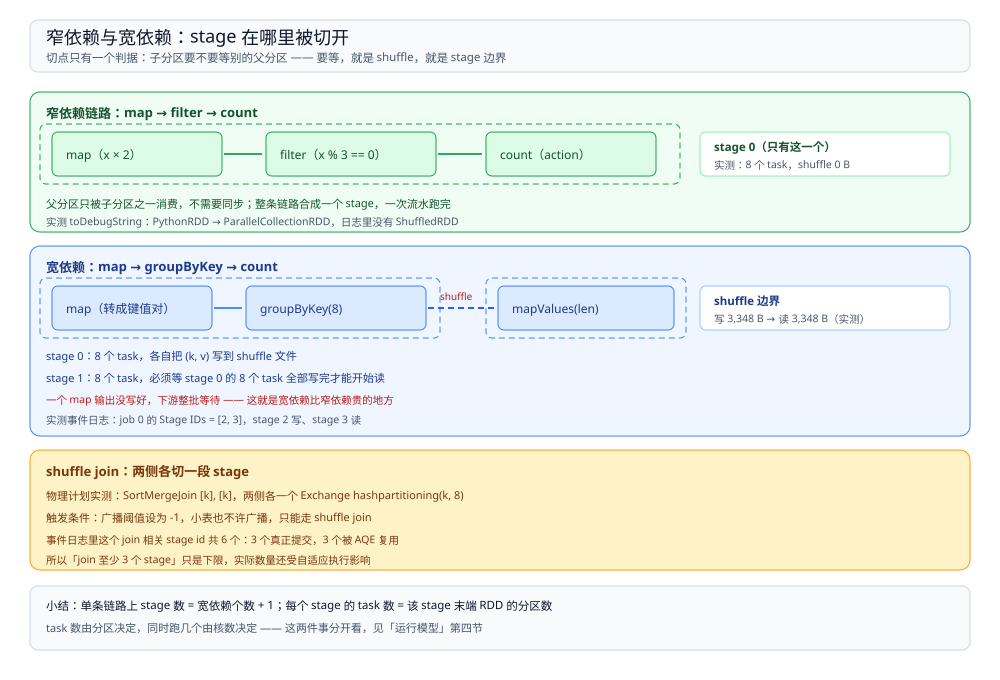

# 血缘与DAG

> 覆盖：RDD 记的到底是什么、**窄依赖与宽依赖的判据**、stage 为什么只在 shuffle 边界切开、task 失败与 executor 丢失后按血缘重算的范围、`cache` 与 `checkpoint` 在血缘上的差别，以及在三处日志里怎么看到这张图。
>
> 不覆盖：driver / executor 的分工与提交模式见 [运行模型.md](运行模型.md)；shuffle 文件怎么落地、为什么能省一次落盘见 [Shuffle机制.md](Shuffle机制.md)；内存不够时怎么溢写见 [内存与执行.md](内存与执行.md)。
>
> 内容整理自个人学习笔记。本篇读数来自本机 `apache/spark:3.5.5-scala2.12-java17-python3-ubuntu` 容器，`local[2]` 与 `local[4]` 各一轮，**通过事件日志的 stage / task 记录与 `toDebugString` / `explain()` 三类证据交叉核对**；真实集群上的 shuffle 传输与 stage 重试延迟未实测。

---

## 一、一句话定位：RDD 是「怎么算」的说明书，不是数据

**本节要点**：一个 RDD 不持有数据，它持有**五样东西**——分区列表、每个分区的计算函数、对父 RDD 的依赖、可选的分区器、可选的本地性偏好。所以对 RDD 唯一的「容错」手段就是：**照着说明书重算**。

| RDD 的属性 | 含义 | 决定什么 |
| --- | --- | --- |
| `partitions` | 这块数据被切成几份、边界在哪 | **task 数** |
| `compute(partition)` | 给定分区号，怎么算出这一份的数据 | task 里的实际逻辑 |
| `dependencies` | 父 RDD 是谁、怎么对应 | **stage 怎么切**、失败重算要回溯多远 |
| `partitioner` | 按什么规则分区（哈希 / 范围） | shuffle 后是否还需要再分区 |
| `preferredLocations` | 数据在哪台机器上 | 调度时的本地性等级 |

由此得到两条直接结论：

1. **不可变 + 惰性** → 每个 RDD 都能从源头重算，所以不需要副本、不需要 WAL，也没有「一致性协议」这一层。
2. **依赖的形状** → 决定能不能把多个算子拼进同一个 task 里连续跑，这就是 stage 的由来。

## 二、窄依赖与宽依赖：判据只有一个

**本节要点**：判据是「**父分区是否被多个子分区共享**」。一个父分区只喂一个子分区 → 窄依赖，可以流水线执行；一个父分区要被多个子分区各读一遍 → 宽依赖，必须先把上游全部写完。

| 维度 | 窄依赖 | 宽依赖 |
| --- | --- | --- |
| 典型算子 | `map`、`filter`、`flatMap`、`union`、`mapPartitions`、`coalesce`（不 shuffle 时） | `groupByKey`、`reduceByKey`、`join`（非广播）、`repartition`、`sortByKey`、`distinct` |
| 代码里的类型 | `OneToOneDependency`、`RangeDependency` | `ShuffleDependency` |
| 一个 task 能覆盖几段算子 | 整条链，可以 pipeline | 只有切点之后的那一段 |
| 失败重算范围 | 只重算丢失的那个分区 | 缺一份 map 输出，下游对应分区要重算 |
| 是否落盘 | 不落 | 落本地磁盘（map 端写 shuffle 文件） |
| 是否切 stage | 不切 | **切** |

算子的名字会骗人。`reduceByKey` 在 map 端会先做一次本地聚合（相当于 `mapSideCombine`），但**它仍然是宽依赖**——因为跨分区的同 key 必须汇到一处。判断标准永远是有没有发生「按 key 重新分区」，不是看名字里有没有 reduce。

## 三、stage 切点：每个 shuffle 边界切一刀

**本节要点**：一条线性链上，**stage 数 = 宽依赖个数 + 1**；每个 stage 的 task 数 = 该 stage 末端 RDD 的分区数。切在 shuffle 处不是因为实现方便，而是因为宽依赖的语义要求「上游全部产出就绪」才能开始下游。



图里三条链的读数就是本节的三组实测：纯窄依赖链 1 个 stage、8 个 task、0 B shuffle；`groupByKey` 变成 2 个 stage、8+8 个 task、3,348 B 写读对称；`join` 出现两个 `Exchange`，两侧各一个 map stage，最后合到一个 reduce stage。

### 3.1 纯窄依赖：一个 stage 跑到底

```python
sc.parallelize(range(1000), 8).map(lambda x: x * 2).filter(lambda x: x % 3 == 0).count()
```

实测：事件日志只收到 **1 次** `StageSubmitted`，`Number of Tasks = 8`，`Shuffle Write Metrics` 全为 0，结果 **334** 行。三个算子被压进同一个 task，数据不出 JVM、不落盘——这就是「pipeline」的实际含义。

### 3.2 `groupByKey`：切出第二个 stage

同一份数据加一步 `groupByKey(8)` 再 `count()`：

| stage | task 数 | 写 shuffle | 读 shuffle | 父 stage |
| --- | --- | --- | --- | --- |
| 2 | 8 | 3,348 B / 32 条 | 0 | 无 |
| 3 | 8 | 0 | 3,348 B / 32 条 | 2 |

写 3,348 B、读 3,348 B 完全对称，说明中间没有压缩也没有额外拷贝；32 条记录正好是 **8 个 map 任务各写出 4 条**（逐 task 核对：4 条 / 380、424、422、425、425、422、425、425 字节）。事件日志里这个 job 登记的 stage 列表是 `[2, 3]`，与「宽依赖个数 + 1」对得上。

⭐ reduce 端更值得看的一组数：**8 个 reduce task 里只有 4 个读到了数据**，各读 8 个 block（1,022 / 776 / 774 / 776 B），另外 4 个读到 0 条。原因是 5 个 key 按 `x % 10` 取值，哈希到 8 个分区后只落在 4 个桶里。**这 4 个空 task 照样被调度、照样跑完**——空分区不省任务，只省数据。这就是「分区数给多了」最直接的浪费形态。

### 3.3 `join`：两个 `Exchange`，三个 stage

`join` 在 `explain()` 里呈现为 `SortMergeJoin` 加两侧各一个 `Exchange hashpartitioning(k, 8)`——**两个 Exchange 就是两次 shuffle**，各自切出一个 map stage，再汇到一个 reduce stage。实测 stage 4 的 8 个 map task 各写 **125 条**记录（每条 374~375 B，合计 2,996 B / 1,000 条）；reduce 端一个 task 读 **16 个 block**（= 两个 map stage 各 8 个）、2,000 条记录、5,992 B，输出 1 条计数记录，join 本身产出 100,000 行。

⚠️ 这里有个容易读错的地方：**job 登记的 stage id 数量不一定等于事件日志里 `StageSubmitted` 的次数**。实测中部分 stage id 没有对应的提交记录，因为 AQE 在运行期改写了计划，把它们合并或复用掉了。看日志时若两者对不上，先确认 `spark.sql.adaptive.enabled` 是否为真，而不是怀疑日志丢了。

## 四、失败之后：沿血缘反向重算

**本节要点**：血缘的用途有两个——调度时切分、出错时回溯。回溯的**范围由依赖类型决定**，而且它不只在故障时发生：多个 action 重复触发同一段图，也会重算。

| 失败情形 | 重算范围 | 说明 |
| --- | --- | --- |
| 单个 task 抛异常 | 该 task 重试，最多 `spark.task.maxFailures`（默认 4）次 | 超过次数整个 job 失败 |
| executor 进程丢失 | 它上面**已完成的 map 输出一并失效**，下游对应分区重算 | 这就是宽依赖比窄依赖贵的地方 |
| driver 丢失 | 整个 application 结束 | local 模式没有恢复可能 |
| 缓存的分区丢失 | 该分区按血缘重算，不影响其他分区 | 缓存的 block 存在 executor 的 BlockManager 里 |

三种「留一手」的手段，差别全在血缘上：

| 手段 | 存在哪 | 血缘 | 丢了怎么办 | 适用 |
| --- | --- | --- | --- | --- |
| 不处理 | —— | 完整保留 | 从头重算 | 一次性作业 |
| `cache()` / `persist()` | executor 内存 / 磁盘 | **完整保留** | 按血缘重算该分区 | **同一份中间结果被多个 action 复用** |
| `checkpoint()` | 可靠存储（HDFS / S3） | **被截断**，不再回溯到源头 | 直接读文件 | 血缘太长、重算代价过高，或需要跨作业复用 |

`checkpoint` 会切断血缘这一点是它和 `cache` 最本质的区别：切断之后，即使上游全部丢失也不需要重算——代价是必须真的写一份到可靠存储，而且要额外触发一次计算。⚠️ 这条按官方 RDD Programming Guide 陈述，**本篇未实测 `checkpoint` 的血缘截断**（容器内没有可靠存储，只写到本地目录不具有代表性）。

### 4.1 重算不只发生在故障时

```python
acc = sc.accumulator(0)
rdd = sc.parallelize(range(100), 4).map(lambda x: (acc.add(1), x)[1])
rdd.count()   # 第一次 action
rdd.count()   # 第二次 action
print(acc.value)
```

实测读数：**200**。两次 `count()` 各触发一次完整计算，累加器被加了两次。同一段代码加一行 `.cache()` 后再跑两次，读数变成 **100**——第二次 action 直接读缓存，没有再算一遍。

这条读数的用途不是记「累加器会重复计数」，而是理解**血缘是一张可重复执行的图**：只要没有物化，每次 action 都从源头走一遍。副作用（累加器、写外部存储、调接口）放进 transformation 里都会因此重复执行。

## 五、在三处地方看见这张图

**本节要点**：同一个 DAG 有三个观察面，用途不同——`toDebugString` 看形状、`explain()` 看计划、事件日志看实际执行。

| 观察面 | 看什么 | 实测特征 |
| --- | --- | --- |
| `rdd.toDebugString()` | RDD 链条，**出现 `ShuffledRDD` 就说明有宽依赖** | 窄依赖链一路 `MapPartitionsRDD` 串下来；`groupByKey` 处换成 `ShuffledRDD` |
| `df.explain()` | 物理计划，**出现 `Exchange` 就是一次 shuffle** | `SortMergeJoin` 两侧各一个 `Exchange hashpartitioning(k, 8)` |
| 事件日志 | 实际提交了哪些 stage、各几个 task、读写多少字节 | `SparkListenerStageSubmitted` 的 `Stage ID` / `Number of Tasks` / `Parent IDs` |

⚠️ PySpark 的 `PipelinedRDD` 没有暴露 `.dependencies`，想直接看依赖类型得回到 Scala / Java 侧。用 `toDebugString` 的字符串形态代替是可以的，但它是**间接证据**：只能说明「这里有一个 shuffle 边界」，不能直接读出 `ShuffleDependency` 对象。本篇的读数就是这么来的，校验口径里已标注。

## 六、校验口径

| 内容 | 状态 |
| --- | --- |
| 纯窄依赖链 = 1 个 stage / 8 个 task / 0 B shuffle / 334 行 | ✅ 本机实测（`local[2]`，事件日志 + `toDebugString`） |
| `groupByKey(8)` = 2 个 stage、8+8 个 task、写读各 3,348 B、结果 5 行 | ✅ 本机实测 |
| 8 个 map task 各写 4 条 shuffle 记录（逐 task 380~425 B） | ✅ 本机实测（逐 task 的 `shuffle.write.recordsWritten`） |
| 8 个 reduce task 中 4 个读到 0 条、4 个各读 8 个 block | ✅ 本机实测（`shuffle.read.localBlocksFetched` / `recordsRead`） |
| `join` = `SortMergeJoin` + 两个 `Exchange hashpartitioning(k, 8)`，输出 100,000 行 | ✅ 本机实测（`explain()` + 事件日志） |
| join 的 map 端 8 task × 125 条 = 2,996 B；reduce 端读 16 个 block / 2,000 条 / 5,992 B | ✅ 本机实测 |
| 部分 stage id 没有 `StageSubmitted` 记录（AQE 合并/复用） | ✅ 本机实测观察，具体合并了哪一段**未展开验证** |
| 累加器无 `cache` 两次 action 读到 200、加 `cache` 后读到 100 | ✅ 本机实测 |
| 依赖类型 `OneToOneDependency` / `RangeDependency` / `ShuffleDependency` 与算子的对应 | ⚠️ 按官方 RDD Programming Guide 与源码命名陈述，**未在 Scala 侧打印依赖对象** |
| `spark.task.maxFailures` 默认 4、task 重试与 executor 丢失的重算范围 | ⚠️ 官方文档口径，**未构造故障** |
| `checkpoint` 截断血缘 | ⚠️ 官方文档口径，**未实测** |
| 真实集群上的 shuffle 跨机传输与 stage 重试代价 | ⚠️ **未实测**：本机只有 local 模式 |

---

## 延伸追问

- **为什么 `reduceByKey` 是宽依赖，`coalesce` 却不是？** → 判据是「父分区要不要被拆开分给多个子分区」。`reduceByKey` 必须按 key 重新分布，同 key 的数据可能从任意父分区来；`coalesce` 只是把多个分区并成一个，父分区整体归一个子分区，所以不 shuffle、不切 stage。
- **`repartition` 和 `coalesce` 差在哪？** → `repartition` 走一次完整 shuffle，分区数可增可减；`coalesce` 默认只能减、且尽量不 shuffle。要减分区优先 `coalesce`，要增分区只能 `repartition`。
- **为什么 broadcast join 不切 stage？** → 小表被广播到每个 executor，大表每个分区直接与小表本地连接，不存在「按 key 重分区」这一步，所以是窄依赖。这也解释了 `spark.sql.autoBroadcastJoinThreshold` 调大为什么能省掉一次 shuffle。
- **stage 数太多有什么坏处？** → 每个 stage 边界都是一次全量落盘 + 一轮调度等待，stage 越多、磁盘与延迟开销越大。链式 `join` 过多时，常见做法是拆成多个 job、中间结果落表。
- **`cache()` 之后血缘还在，为什么要用 `checkpoint`？** → `cache` 的 block 存在 executor 内存里，节点一丢就没了，血缘长的话重算代价极高。`checkpoint` 把结果写到可靠存储并**截断血缘**，代价是多一次写；两者常见组合是 `cache` 后 `checkpoint`，避免 checkpoint 自己触发的那次计算被重复执行。
- **为什么宽依赖的下游不能跟上游放进同一个 task？** → 下游一个分区要读上游**所有**分区的输出，而 task 只能看到本 executor 本地的数据。必须等所有 map task 写完、shuffle 服务能定位到文件之后，reduce task 才可能开始。

---

## 关联

- [README.md](README.md) — 本册导读：五篇分工与读序
- [运行模型.md](运行模型.md) — **上游**：driver 四个组件的分工与本篇提到的分区数、核数两个旋钮
- [Shuffle机制.md](Shuffle机制.md) — **下游**：宽依赖边界的物理形态——shuffle 文件怎么命名、怎么被下游读到
- [内存与执行.md](内存与执行.md) — **下游**：task 执行期的内存分配与溢写，`cache` 的 block 就存在那一层
- [调优与排障.md](调优与排障.md) — **下游**：stage 数与分区数的具体取值、数据倾斜怎么定位
- [../Hive/编译与执行链路.md](../Hive/编译与执行链路.md) — **对照**：Hive 把 HQL 编译成 MapReduce / Tez 作业，同样按 shuffle 边界切分，但切法由执行引擎决定
- [大数据选型对比.md](../../大数据选型对比.md) — **上游总纲**：计算引擎层在四层里的位置
- [Spark批处理与调度.md](../../../../04-架构与系统/系统设计/大数据平台/Spark批处理与调度.md) — **项目落地**：这条血缘链在真实链路里的触发方式与观测点
