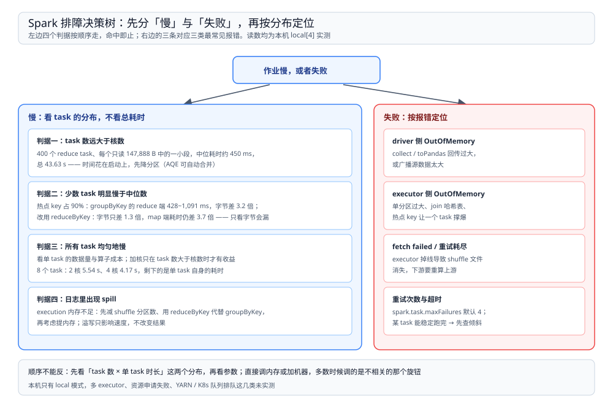

# 调优与排障

> 覆盖：Spark 作业「慢」与「失败」两类问题的定位顺序——先看 **task 数 × 单 task 时长**这两个分布，再动三个旋钮（分区数、核数、join 策略）；数据倾斜为什么有时在字节上暴露、有时只剩耗时，以及四类最常见报错各指向什么。
>
> 不覆盖：分区数与核数为什么决定任务数见 [运行模型.md](运行模型.md)；shuffle 文件与元数据开销见 [Shuffle机制.md](Shuffle机制.md)；内存池、溢写与 OOM 的分界见 [内存与执行.md](内存与执行.md)；失败重算的代价见 [血缘与DAG.md](血缘与DAG.md)。
>
> 内容整理自个人学习笔记。本篇读数来自本机 `apache/spark:3.5.5-scala2.12-java17-python3-ubuntu` 容器，`local[4]`（除注明外），事件日志由 `SparkListenerStageSubmitted` / `SparkListenerTaskEnd` 解析。⚠️ local 模式没有独立 executor、没有跨机拉取、也没有队列与资源申请，所以「多 executor 负载不均」「资源排队」「fetch failed 的真实网络原因」这三类未实测。

---

## 一、一句话定位：先看分布，再动旋钮

**本节要点**：总耗时几乎没有信息量，同一个 40 秒可能是「400 个小 task 排队」也可能是「4 个大 task 硬算」。**把每个 task 的耗时排成分布**（最小值、中位数、最大值），才能分出三类完全不同的慢。

图的读法是自上而下、命中即止：先问 task 数是否远大于核数，再看是不是少数 task 明显拖后腿，再看是否所有 task 均匀地慢，最后才看溢写。四个判据对应四种互斥的成因，**顺序不能反**——反过来先调内存，多数时候调的是不相干的那个旋钮。

| 症状 | 判据 | 该动的旋钮 | 动了也没用的 |
| --- | --- | --- | --- |
| task 数 ≫ 核数 | 400 个 task 跑 43.63 s，单 task 只读几百字节 | 降分区数、开 AQE 合并 | 加内存、加核（只是把排队变快一点） |
| 少数 task 明显慢 | 最大值是最小值的 2~4 倍 | 拆热点 key、广播小表 | 单纯提内存（那个 task 依然最慢） |
| 所有 task 均匀地慢 | 单 task 数据量本身就大 | 加核（仅当 task 数 > 核数） | 降分区（并行度更低，更慢） |
| 日志里有 spill | `memoryBytesSpilled` > 0 | 先降分区、换 `reduceByKey` | 一上来就加内存（最贵且常无效） |

## 二、旋钮一：分区数——唯一能凭空制造开销的参数

**本节要点**：分区数直接等于 task 数，而每个 task 都有一份与数据量无关的固定成本（启动、反序列化、结果回传）。**task 数远大于核数时，作业时间由 task 数决定，而不是由数据量决定**。

实测：一份小到可以忽略的数据，把 reduce 分区数设成 400，作业总耗时 **43.63 s**，map 端 shuffle 只写出 **147,888 B**（压缩后），单个 task 耗时 **191~974 ms**（中位约 450 ms）。用中位数粗算 `400 × 450 ms ÷ 4 核 ≈ 45 s`，与实测的 43.63 s 落在同一量级——这说明整段时间就是「这么多 task 的固定成本摊在 4 个核上」，跟数据快慢无关。

同一件事在 SQL 侧更常见：`groupBy` 之后的 shuffle 分区数默认 **200**，而数据可能只有几 KB。

| 状态 | shuffle 之后的 task 数 | 该段读 / 写 | 再下一步 |
| --- | --- | --- | --- |
| AQE 关 | **200**（stage 1） | 读 4,696 B，写 11,230 B | stage 2 一个 task 读回 11,230 B |
| AQE 开 | **1**（stage 2，计划仍是 200） | 读 4,696 B，写 59 B | 无，结果直接回传 |

⚠️ 注意第一行：200 个 task 分掉 4,696 B 的输入，平均每个 **23 B**。这些 task 的绝大部分时间不在算，而在「被创建出来」。

**结论要落到手段上**：不要全局把 `spark.sql.shuffle.partitions` 调成 1。分区数是按数据量定的，而调参时往往还不知道数据量；正确做法是留一个偏大的值、让 AQE 在运行期按目标大小合并（`spark.sql.adaptive.enabled` 默认已开启）。AQE 能合并的前提是**上游先写出来**，所以它是「按实际大小收口」，不是「提前猜对」。

## 三、旋钮二：核数——只在 task 数大于核数时有用

**本节要点**：核数决定的是**波数**（`ceil(task 数 / 核数)`），不是任务数。加核把 4 波压成 2 波，但单波的耗时一点不变；核数一旦达到 task 数，再加就是零收益。

实测同一段代码：8 个分区，每个元素故意睡 0.8 s。

| 配置 | task 数 | 并发 | 波数 | 实际耗时 |
| --- | --- | --- | --- | --- |
| `local[2]` | 8 | 2 | 4 | **5.54 s** |
| `local[4]` | 8 | 4 | 2 | **4.17 s** |

按「波数 × 0.8 s」算应该是 3.2 s 与 1.6 s，实测都高出约 1 s 以上：这部分是 JVM 预热、闭包序列化与结果回传的固定开销。**所以「加核后耗时减半」这件事永远不会精确成立**，只有「波数减半」成立。

⚠️ local 模式有一个耦合要避开：`local[n]` 里 `n` 同时是 `defaultParallelism`，所以改核数会**顺带改掉分区数**。实测 `local[2]` 下 `defaultParallelism = 2`、`local[4]` 下 `= 4`。集群模式下 executor 核数与初始分区数互不相干，不能把这里的结论直接搬过去。

判据总结：先说清是「task 太多」还是「task 太大」。task 太多 → 减 task；task 太大 → 加核只在你还有空闲核时有用，否则只能拆数据。

## 四、旋钮三：join 策略——决定这次 join 有没有 shuffle

**本节要点**：join 的两种物理实现在代价上差一个量级：**广播哈希 join 只重分布小表，排序合并 join 要重分布两侧**。这件事由优化器按小表大小自动选，而阈值是一个可以直接改的参数。

实测同一份数据（100 万行 × 1,000 行），只改 `spark.sql.autoBroadcastJoinThreshold`：

| 配置 | 物理计划 | 大表侧的 `Exchange` | 耗时 |
| --- | --- | --- | --- |
| 默认（10 MB） | `BroadcastHashJoin`，`BuildRight` | **没有**，只有小表侧的 `BroadcastExchange` | **4.03 s** |
| 设为 -1（禁用广播） | `SortMergeJoin` | 有，`hashpartitioning(k, 8)` | **5.64 s** |

判断是否真的广播了，只看一件事：`explain` 输出里**大表那一侧有没有 `Exchange`**。有 `Exchange` 就是 shuffle，就会切 stage，就会在失败时重算上游。计划里两侧都有 `Exchange hashpartitioning` + `Sort`，说明走的是排序合并。

代价那侧也要记住：广播要求小表**先全部收集到 driver**，再分发到每个 executor 并常驻 storage。所以广播成立的前提是小表真的小——阈值调大后优化器可能在统计信息失真时误判，结果就是 driver OOM 或 executor 的 storage 被挤满。⚠️ 本篇只验到 1,000 行的小表，广播失败的报错原文未实测。

## 五、倾斜：字节看得见，或者只剩耗时

**本节要点**：倾斜的经典定义是「某个 key 占了大部分数据，落进同一个 task」。但**它是否在 shuffle 字节上暴露，取决于 map 端有没有先做局部聚合**——做了，字节就均匀了，倾斜只剩下耗时。

实测：80 万行、50 个 key，其中一个 `hot` key 占 90%（720,000 条），4 个分区，同一个热点分别用 `reduceByKey` 与 `groupByKey` 跑。

| 观测点 | `reduceByKey`（map 端先聚合） | `groupByKey`（不聚合） |
| --- | --- | --- |
| map 端 task 耗时（min/中位/max） | 760 / 1,811 / **2,781** ms（**3.7 倍**） | 1,315 / 2,444 / **3,214** ms（2.4 倍） |
| shuffle 写出 | 27,608 B / 256 条部分结果 | 未单独记录 |
| reduce 端读字节 | 3,072 ~ **4,000** B（1.3 倍，**看不出倾斜**） | 3,576 / 4,160 / **11,336** B（**3.2 倍，一眼看出**） |
| reduce 端 task 耗时 | 293 ~ **533** ms（1.8 倍） | 428 / 643 / **1,091** ms（2.5 倍） |
| 作业总耗时 | **5.75 s** | **7.49 s** |

这张表要读出三件事：

1. **`groupByKey` 的倾斜在字节上可见**：热点分区读到 11,336 B，是冷分区的 3 倍多，减少任务时最先看到的就是这个。
2. **`reduceByKey` 的倾斜在字节上不可见**：4 个 reduce 分区只差 1.3 倍，看起来「很均匀」。但 map 端耗时差 3.7 倍——热点 key 在 map 端就已经在一个 task 上堆起来了。
3. **所以「shuffle 字节均匀」不能用来排除倾斜**。只按字节判断，`reduceByKey` 这个案例会被判成「没有倾斜」，而它比 `groupByKey` 那次的总耗时只少 1.7 秒却依然被热点拖住。

处理手段按代价从低到高：

| 手段 | 适用 | 代价 |
| --- | --- | --- |
| 两阶段聚合（热点 key 加随机前缀，再聚合一次） | 单 key 占比极高、可接受多一次 shuffle | 多一个 stage |
| 广播小表 | 一侧能完整装进内存 | 常驻 storage |
| AQE 的倾斜 join 拆分（`spark.sql.adaptive.skewJoin.enabled`） | 两侧都大、倾斜发生在 shuffle 后 | ⚠️ 本篇未实测该参数的实际拆分行为 |
| 加盐 / 拆分热点 key | 业务上能把大 key 拆开 | 改口径，需业务确认 |

⚠️ 本节的读数是单次运行、`local[4]`、80 万行构造数据，只能看趋势与倍数关系，不能当稳定基准。

## 六、故障速查

**本节要点**：报错信息本身通常不是根因，**往上找第一个 `Caused by`**，再按「发生在 driver 还是 executor」分两路。

| 报错 / 现象 | 先查什么 |
| --- | --- |
| `OutOfMemoryError: Java heap space`，栈在提交端 | driver 侧：`collect()` / `toPandas()` 回传过大，或广播源数据太大 → 改成 `write` 落盘 |
| `OutOfMemoryError`，栈在 executor | 单分区过大、join 的哈希表、或热点 key 让一个 task 撑爆 → 对比该 task 的 shuffle 读字节与中位数 |
| `FetchFailedException` | executor 掉线导致它的 shuffle 文件消失 → 下游重算上游 stage（见 [血缘与DAG.md](血缘与DAG.md) 第四节） |
| `Task ... failed 4 times` | `spark.task.maxFailures` 默认 4。**同一 task 稳定失败** = 数据或倾斜问题；**随机 task 失败** = 资源或网络 |
| `FileNotFoundException: ... shuffle_x_y_z.data` | 同 fetch failed：文件被 `ContextCleaner` 清掉或 executor 已退出 |
| `Job aborted due to stage failure` | 这是最外层包装，往下找第一个 `Caused by` 才是根因 |
| 任务卡在某个 stage 不动 | 该 stage 的 task 数 × 单 task 时长 ÷ 核数，先算一遍理论时长；对不上才怀疑资源排队 |

定位用的观测点，都可以从 Spark UI 或事件日志拿到：

| 排查项 | 做法 |
| --- | --- |
| task 耗时分布 | Spark UI 的 stage 页 Summary Metrics（min / median / max），或解析事件日志里的 `SparkListenerTaskEnd` |
| 物理计划 | `df.explain("formatted")`，看有没有 `Exchange` / `BroadcastExchange` |
| 实际分区数 | `df.rdd.getNumPartitions()` |
| shuffle 读写字节 | task 累加器 `shuffle.write.bytesWritten` / `shuffle.read.localBytesRead` |
| 是否真的缓存成功 | 第二次 action 的耗时；**不要看** `getRDDStorageInfo().memSize`（见 [内存与执行.md](内存与执行.md) 第四节） |

## 七、校验口径

| 内容 | 状态 |
| --- | --- |
| 400 个 reduce task、总 43.63 s、单 task 191~974 ms、map 写出 147,888 B | ✅ 本机实测（一次运行） |
| 「400 × 450 ms ÷ 4 核 ≈ 45 s」与实测同量级 | ✅ **本篇算术**（用中位数粗算，非精确值） |
| AQE 关：stage 1 = 200 task / 11,230 B；开：下游 1 task / 59 B | ✅ 本机实测（同一查询两次提交） |
| 8 task × 0.8 s：`local[2]` 5.54 s、`local[4]` 4.17 s | ✅ 本机实测（各跑一遍，**未做 3 轮取区间**） |
| `defaultParallelism` 在 `local[2]` / `local[4]` 下为 2 / 4 | ✅ 本机实测 |
| 广播 join 4.03 s vs 排序合并 5.64 s，及两侧 `Exchange` 的有无 | ✅ 本机实测（同一份数据两次独立提交） |
| `spark.sql.autoBroadcastJoinThreshold` 默认 10 MB | ⚠️ 官方配置文档口径 |
| 倾斜两组读数（800k 行 / 90% 热点 / 4 分区） | ✅ 本机实测，**单次运行**，只断言倍数趋势 |
| `reduceByKey` 的 shuffle 字节看不出倾斜、耗时看得出 | ✅ 本机实测（本篇最主要的结论） |
| `spark.sql.adaptive.skewJoin.enabled` 的实际拆分行为 | ⚠️ **未实测**，仅列入手册表 |
| 广播阈值调大后 driver / executor OOM 的报错原文 | ⚠️ **未实测**，本机只验了 1,000 行小表 |
| 多 executor 负载不均、YARN / K8s 队列排队、跨机 fetch failed | ⚠️ **未实测**：本机只有 local 模式 |

---

## 延伸追问

- **为什么不能直接把 `spark.sql.shuffle.partitions` 设成 1？** → 数据量大时一个 task 要吃全量数据，既没有并行也极易 OOM。AQE 的合并是运行期按分区实际大小合并，能在「数据小的时候只剩一个 task」和「数据大的时候保留并行」之间自适应，而静态参数只能二选一。
- **task 数是不是越少越好？** → 不是。要能填满核才能吃掉并行，经验上 task 数是核数的 2~3 倍时调度才顺；本篇只做了 8 task 对 2 核 / 4 核的对照，没做「核数与分区数」的二维扫描。
- **为什么加内存通常不是第一选择？** → 加内存只对溢写有效；对「task 太多」「倾斜」「单 task 数据量大」这三类都不解决，而内存是集群里最贵的资源。上内存之前先用第一节那张表确认自己是哪一类。
- **`reduceByKey` 的倾斜为什么字节看不出来？** → map 端先做了局部聚合，热点 key 在每个 map task 上只留一条部分结果，所以写出的字节按分区自然均匀；但每个 map task 处理热点 key 的那段时间仍然偏长，reduce 端也要把这几条合成一条。实测 map 端耗时差 3.7 倍、reduce 读字节只差 1.3 倍。
- **怎么区分「慢在调度」和「慢在计算」？** → 看单 task 的「处理数据量 / 耗时」之比。400 task 那次每个 task 只读几百字节却要约 450 ms，全是启动开销；单 task 处理几十 MB 且耗时随数据量线性增长，才是计算慢。这个比值不需要基准，只需要看量级。
- **广播 join 会不会反而更慢？** → 会。小表被广播后要常驻每个 executor 的 storage，缓存被挤掉就会频繁重算；表稍大时广播传输本身也要时间。阈值不是越大越好，判据是「小表是否真的能轻松装下」。

---

## 关联

- [README.md](README.md) — 本册导读：五篇分工与读序
- [运行模型.md](运行模型.md) — **上游**：分区数与核数这两个数分别从哪里来
- [血缘与DAG.md](血缘与DAG.md) — **上游**：失败之后要重算多少，代价按血缘算
- [Shuffle机制.md](Shuffle机制.md) — **上游**：400 个 task 的文件数与元数据开销从哪来
- [内存与执行.md](内存与执行.md) — **上游**：spill、OOM 与广播常驻内存的边界
- [Spark批处理与调度.md](../../../../04-架构与系统/系统设计/大数据平台/Spark批处理与调度.md) — **项目落地**：真实链路里分区数与 join 策略怎么定
- [大数据选型对比.md](../../大数据选型对比.md) — **上游总纲**：计算引擎层的定位与选型
