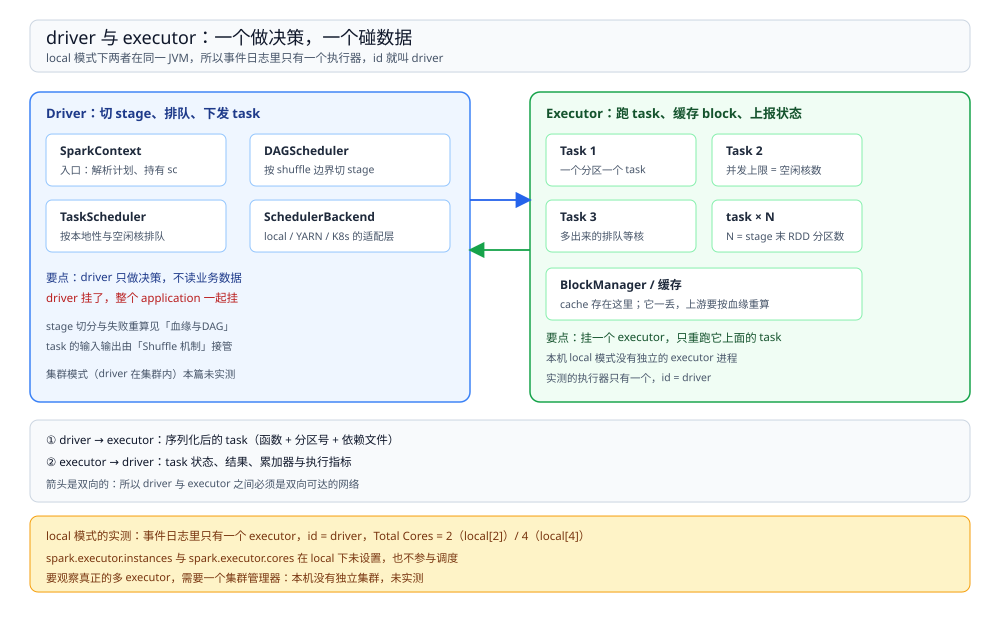
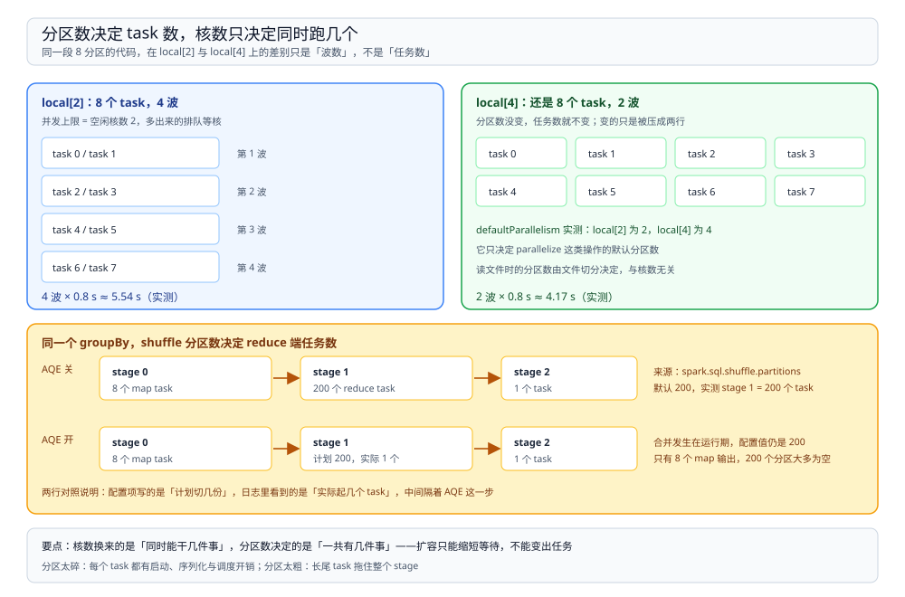

# 运行模型

> 覆盖：Spark 凭什么和 MapReduce 分开算、driver / executor / cluster manager 三个角色各管什么、一段代码从 RDD 或 SQL 到 task 的完整路径、**分区数与核数这两个数各自决定什么**、local / client / cluster 三种提交模式的差别。
>
> 不覆盖：stage 为什么在 shuffle 处切开、失败后怎么重算见 [血缘与DAG.md](血缘与DAG.md)；shuffle 的文件与读写路径见 [Shuffle机制.md](Shuffle机制.md)；内存分区、溢写与序列化见 [内存与执行.md](内存与执行.md)；参数怎么调、报错怎么查见 [调优与排障.md](调优与排障.md)。四层的分工见 [大数据选型对比.md](../../大数据选型对比.md)。
>
> 内容整理自个人学习笔记。本篇读数来自本机 `apache/spark:3.5.5-scala2.12-java17-python3-ubuntu` 容器，`spark-submit --master local[2]` / `local[4]` 各跑一轮，事件日志落盘后逐条统计，**没有真实集群**——所以多 executor、资源申请与调度延迟这几项本篇未实测。

---

## 一、一句话定位：Spark 是「先记图、再切任务」的引擎

**本节要点**：Spark 与 MapReduce 的分水岭不在「内存 vs 磁盘」，而在**一次提交能把整个 DAG 交给调度器**——MapReduce 每做一步就落一次 HDFS，Spark 把中间结果留在内存或本地磁盘，最后统一回收。

| 对照 | MapReduce | Spark |
| --- | --- | --- |
| 作业单位 | 一个 job = 一轮 map + 一轮 reduce | 一个 job = 一个 DAG，含多轮 shuffle |
| 中间结果 | 落 HDFS，下一步再读 | 留在内存 / 本地磁盘，shuffle 才落盘 |
| 编排方式 | 由客户端脚本串多个 job | 引擎内部按依赖切 stage |
| 迭代计算 | 每轮重读输入 | `cache` 后跨轮复用同一份分区数据 |
| 表达能力 | 只有 map / reduce 两个原语 | 任意算子组合，且 SQL、流、ML 共用一套执行栈 |

> ⭐ 最需要纠正的一个印象：**Spark 并不「不用磁盘」**。shuffle 数据、溢写、`checkpoint` 都要落盘，真正省掉的是「每一步的中间结果都写分布式文件系统再读回来」这一层。所以 Spark 快在**少一次落盘 + 少一次调度**，不是在内存里算得多神。

另一条边界：**Spark 没有自己的持久化格式**。数据在 HDFS / S3 / Iceberg / Hive 表里，Spark 只负责算完写回去。这也解释了它在本仓目录里的位置——属于「计算引擎」这一层，与 [Hive 册](../Hive/README.md) 同层，与表格式、文件系统不是同一件事（四层划分见 [大数据选型对比.md](../../大数据选型对比.md)）。

## 二、三个角色：driver 做决策，executor 碰数据

**本节要点**：整个运行时只有三类进程，职责切得很干净——**决策、执行、发容器**。判断一个故障该找谁，先看它属于哪一类。

| 角色 | 跑什么 | 持有 | 挂了会怎样 |
| --- | --- | --- | --- |
| **driver** | 用户 `main()`、`SparkContext`、DAGScheduler、TaskScheduler | 整个 DAG、stage 状态、task 状态、广播变量的源数据 | **整个 application 结束**，已完成的 stage 也要重来 |
| **executor** | task（一个分区一段计算）、BlockManager | 当前 task 的输入输出、`cache` 的 block、shuffle 输出文件 | 只重跑它上面**未完成**的 task；缓存的 block 丢失，下游按血缘重算 |
| **cluster manager** | 分配容器、拉起 executor 进程 | 资源账本 | local 模式没有这个角色 |



图中左右两栏就是判断故障归属的两条线：driver 侧挂了是 application 级故障，executor 侧挂了只是 task 级重试。local 模式下两者在同一 JVM，事件日志里只有一个执行器，`id` 就叫 `driver`。

实测印证这一点：`local[2]` 的事件日志里 `SparkListenerExecutorAdded` 只有一条，`Executor ID = driver`、`Total Cores = 2`；换 `local[4]` 后同一条记录变成 `Total Cores = 4`，**执行器数量没有变**。真正会出现多个 executor 的集群模式，本机没有集群管理器，未实测。

driver 端再往下分四块，各自的职责是固定的：

| 组件 | 管什么 | 出问题时的表现 |
| --- | --- | --- |
| `SparkContext` | 与集群的会话，持有配置与广播变量 | 一个 JVM 只能有一个活跃实例，第二个直接抛异常 |
| `DAGScheduler` | 把 RDD 依赖图切成 stage，按 stage 提交 task set | stage 数暴涨（多数是宽依赖太多）；报错里常出现 `Job aborted due to stage failure` |
| `TaskScheduler` | 把 task 排进队列，按本地性（`PROCESS_LOCAL` → `NODE_LOCAL` → `ANY`）与空闲核分配 | 长尾：大部分 task 秒完，最后几个卡在 `NODE_LOCAL` 等待 |
| `SchedulerBackend` | local / YARN / K8s / Standalone 的适配层 | 资源申请失败、executor 反复掉线 |

## 三、一段代码怎么变成 task

**本节要点**：不论写的是 RDD 还是 SQL，最终都收敛成同一条路径——**RDD 依赖图 → stage → task set → 单个分区上的 task**。差别只在于是谁生成的这张图。

### 3.1 两套 API，同一个出口

| 入口 | 谁负责优化 | 最终产物 |
| --- | --- | --- |
| `sc.parallelize(...).map(...).count()` | 没有优化器，写什么就是什么 | RDD DAG |
| `spark.sql("select ...").count()` | Catalyst 规则改写 + 物理计划选择 + 代码生成 | 先转成 RDD DAG，再切 stage |

SQL 那一侧多出来的四步是：

```text
SQL 文本
  → Unresolved Logical Plan     只解析语法，表和列都还没对上
  → Analyzed Logical Plan       查 catalog 补类型与表信息
  → Optimized Logical Plan      Catalyst 规则：谓词下推、列裁剪、常量折叠、join 重排
  → Physical Plan               选实现：BroadcastHashJoin 还是 SortMergeJoin
  → WholeStageCodegen           把相邻算子拼成一个 Java 方法，减少虚调用
  → RDD DAG                    从这里开始与 RDD API 合流
```

验证「物理计划确实选了排序合并」的办法是 `df.explain()`，实测输出里同时能看到 `SortMergeJoin` 和两侧各一个 `Exchange hashpartitioning(k, 8)`——`Exchange` 就是会引发 shuffle 的那一步，也是下一篇切 stage 的边界。

⚠️ 代码生成不是万能的：`spark.sql.codegen.hugeMethodLimit` 默认 65535 字节，超过这个大小的生成方法会退回解释执行。这是**官方参数文档的口径，本篇未构造出触发场景**。

### 3.2 五个步骤，逐层收紧

| 步骤 | 产出 | 数量由什么定 |
| --- | --- | --- |
| ① transformations 建图 | 一个惰性 RDD 依赖图，**什么都不算** | 算子个数 |
| ② action 触发 | 一个 job | 调用了几次 action |
| ③ DAGScheduler 切 stage | 若干 stage，按 shuffle 边界切 | 宽依赖个数 |
| ④ 每个 stage 生成 task set | N 个 task | **该 stage 末端 RDD 的分区数** |
| ⑤ TaskScheduler 分配到核 | 同时在跑的 task | **空闲核数**（与本地性约束） |

第 ① 步的「什么都不算」不是修辞。实测：在 `map` 里累加一个 `LongAccumulator`，连续跑两次 `count()`，读到的是 **200** 而不是 100——因为两次 action 各触发了一次完整计算，累加器也就加了两次；同一段代码加一行 `.cache()` 后读数变成 **100**。这就是惰性求值最容易被忽略的后果，展开见 [血缘与DAG.md](血缘与DAG.md) 第四节。

## 四、分区数决定任务数，核数决定并发

**本节要点**：这是 Spark 调优里最常被混淆的两个数。**分区数是在建图阶段定死的，核数只决定同一时刻能跑几个**——加核能缩短等待，但既不会变出任务，也不会改变任务大小。

实测用了同一段代码：8 个分区，每个元素故意睡 0.8 秒。

| 配置 | 分区数 | task 数 | 并发 | 实际耗时 |
| --- | --- | --- | --- | --- |
| `local[2]` | 8 | 8 | 2 | **5.54 s**（4 波 × 0.8 s） |
| `local[4]` | 8 | 8 | 4 | **4.17 s**（2 波 × 0.8 s） |



图上半部分是这两种核数下的「波」：任务数一栏始终是 8，变的只是被压成几行；下半部分是同一个 `groupBy` 在 AQE 开关两种状态下的 reduce 端任务数——配置写着 200，实际可能只起 1 个。

两个数的来源完全不同：

| 数字 | 来源 | 实测值 |
| --- | --- | --- |
| 初始分区数 | `local[n]` 下 `defaultParallelism = n`；读文件时由文件切分决定 | `local[2]` → 2，`local[4]` → 4 |
| shuffle 后的分区数 | `spark.sql.shuffle.partitions`，默认 **200** | 读到 200 |
| 实际 reduce task 数 | AQE 开启时按目标大小合并，**运行期**才定 | AQE 关 → 200 个；AQE 开 → 计划 200、实际 **1** 个 |

AQE 那一栏的两组读数是同一个查询、同一份数据，只改了 `spark.sql.adaptive.enabled`：

- **关**：stage 0 有 8 个 task，写出 4,696 B / 80 条记录；stage 1 起 **200 个 task**，读回 4,696 B、写 11,230 B；stage 2 一个 task 读 11,230 B。
- **开**：stage 1 仍是 8 个 task 写 4,696 B，但下游只起 **1 个 task** 读这 4,696 B，写出 59 B / 1 条。

200 个 task 里绝大多数只分到几十字节，全部开销都在「启动一个 task」上。这也说明一件事：**只改分区数不改数据量，是在拿调度开销换并行度**。

## 五、三种提交模式：driver 在哪

**本节要点**：模式之间的唯一实质差别是 **driver 跑在谁的机器上**，以及由此带来的网络与生命周期差异。

| 模式 | driver 位置 | 适用 | 代价 |
| --- | --- | --- | --- |
| `local[n]` | 提交进程内部，`n` 个线程 | 开发、单测、小数据验证 | 没有独立 executor，**测不出序列化、网络与多 executor 行为** |
| `client` | 提交机 | 交互式、笔记本上连远程集群 | 提交机必须与集群**全程可达**；提交机断网，作业跟着挂 |
| `cluster` | 集群内某个容器 | 生产批作业 | 日志要回捞；driver 的资源也要申请 |

实测用的都是 `local`，所以事件日志里 `Executor ID` 恒为 `driver`。这个限制要记住：**local 模式下的耗时不能当分布式基准**，它连网络序列化都没发生。

## 六、校验口径

| 内容 | 状态 |
| --- | --- |
| `defaultParallelism` 在 `local[2]` / `local[4]` 下等于 2 / 4 | ✅ 本机实测（打印 `sc.defaultParallelism`） |
| 8 分区 × 0.8 s 在 2 核 / 4 核下的耗时 5.54 s / 4.17 s | ✅ 本机实测（各跑一遍，未做 3 轮取区间） |
| 执行器只有 `driver` 一个，`Total Cores` 随 `local[n]` 变化 | ✅ 本机实测（解析 `SparkListenerExecutorAdded`） |
| 窄依赖链 1 个 stage 8 个 task、`groupByKey` 2 个 stage 8+8 个 task | ✅ 本机实测（解析 `SparkListenerStageSubmitted`） |
| `spark.sql.shuffle.partitions` 默认 200、AQE 关时起 200 个 task | ✅ 本机实测 |
| AQE 开启后 200 个计划分区合并成 1 个 task | ✅ 本机实测 |
| 累加器在无 `cache` 时两次 action 读到 200、加 `cache` 后读到 100 | ✅ 本机实测 |
| `explain()` 里出现 `SortMergeJoin` 与两个 `Exchange hashpartitioning(k, 8)` | ✅ 本机实测（`join(100000 行)` 用例） |
| `spark.sql.codegen.hugeMethodLimit` 默认 65535 与退回解释执行 | ⚠️ 官方参数文档口径，**未构造触发场景** |
| client / cluster 模式、多 executor、资源申请与调度延迟 | ⚠️ **未实测**：本机无 YARN / K8s 集群，只有 local 模式 |
| 三种提交模式的适用场景 | ⚠️ 按官方文档归纳，非实测 |

复现用的运行时与命令：

```text
镜像：dockerproxy.net/apache/spark:3.5.5-scala2.12-java17-python3-ubuntu
提交：spark-submit --master local[2]|local[4] /w/rig1.py
观测：spark.eventLog.enabled=true，spark.eventLog.dir=file:/w/evN
统计：按事件类型聚合 SparkListenerStageSubmitted / SparkListenerTaskEnd
```

---

## 延伸追问

- **为什么 task 数等于分区数，而不是等于数据量除以块大小？** → 分区是「逻辑上的一块数据」，一个 task 处理一个分区；块大小只在**读文件切分**那一步影响分区数，之后的 `map`/`filter` 会继承上游分区数。所以调并行度要么改读入切分，要么改 shuffle 分区数，要么重分区。
- **加了机器为什么没变快？** → 先看分区数。分区数是 1 时，无论多少核都只有一个 task，其余核全程空闲。其次是看有没有长尾：多数 task 秒完、少数卡住，加机器也救不了那一个。
- **driver 为什么要给比 executor 更大的内存？** → `collect()`、`broadcast` 的源数据、`toPandas()` 的结果都落在 driver。executor 侧 spill 只是变慢，driver 侧 OOM 是整个作业挂掉。
- **local 模式测出来的数字能直接用来做容量规划吗？** → 不能。local 只有单 JVM，省掉了 executor 间通信与网络序列化，shuffle 也只是本地读写；真实集群的同一作业通常更慢，且慢在 shuffle 的跨机传输上。
- **RDD 和 DataFrame 哪个快？** → 同一份物理执行时两者没有本质差异，差别在有没有优化器。写 RDD 等于绕过 Catalyst，谓词下推、列裁剪、join 重排都不会发生；能用 DataFrame 就别自己拼 RDD。
- **`SparkContext` 为什么一个 JVM 只能有一个？** → 它代表与集群的会话，持有调度器与广播变量的源数据，多个实例会争同一份资源配置。需要隔离就用 `SparkSession.newSession()` 共享 context，或直接起独立进程。

---

## 关联

- [README.md](README.md) — 本册导读：五篇分工与读序
- [血缘与DAG.md](血缘与DAG.md) — **下游**：本篇说「切成 stage」，那篇说「凭什么切、切错了怎么重算」
- [Shuffle机制.md](Shuffle机制.md) — **下游**：stage 边界的物理形态，shuffle 文件与读写路径
- [内存与执行.md](内存与执行.md) — **下游**：task 在 executor 内部的执行与内存分配
- [调优与排障.md](调优与排障.md) — **下游**：本篇提到的分区数、核数、AQE 三个旋钮的具体取值
- [../Hive/编译与执行链路.md](../Hive/编译与执行链路.md) — **对照**：同为 SQL 入口，Hive 把 HQL 翻译成作业交给别的引擎执行，Spark 自带执行引擎
- [大数据选型对比.md](../../大数据选型对比.md) — **上游总纲**：计算引擎层与文件系统、表格式、Catalog 的接口契约
- [Spark批处理与调度.md](../../../../04-架构与系统/系统设计/大数据平台/Spark批处理与调度.md) — **项目落地**：本篇的运行模型在那条链路里怎么被调度与观测
