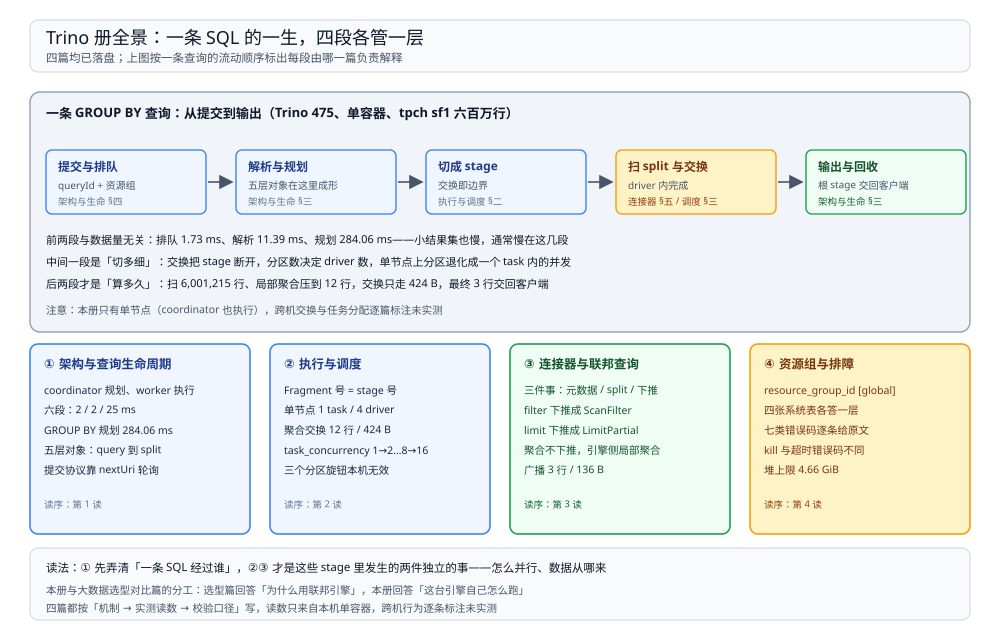

# Trino 目录导读

> 覆盖：Trino 自己怎么跑起来——一次查询从提交到输出要过哪几段、coordinator 与 worker 各占什么、plan 怎么变成 stage / task / driver、连接器为什么决定了「数据在哪」、联邦查询为什么能一条 SQL 跨两个数据源、以及慢了或失败了到底看哪张表，共 **4 篇零件**。
>
> 不覆盖：四层（文件系统 / 表格式 / Catalog / 引擎）的分层关系与同层多候选的选型见 [大数据选型对比.md](../../大数据选型对比.md)；这套平台里 Trino 摆在链路哪一段、资源组怎么按业务划分见 [04 的 OLAP 查询服务篇](../../../../04-架构与系统/系统设计/大数据平台/OLAP查询服务.md)。
>
> 内容整理自个人学习笔记。本册读数全部来自本机 `dockerproxy.net/trinodb/trino:475` 容器（**475**、Temurin **24** 运行时），单容器、`coordinator=true` 且 `node-scheduler.include-coordinator=true`，内置 `tpch` / `memory` / `jmx` / `system` / `tpcds` 五个 catalog；**没有任何外部数据源**，所以 Hive / Iceberg / MySQL 连接器的连接参数与鉴权逐处标注为未实测，机制部分以内置 `tpch` 与 `memory` 两个连接器实测。

---

## 一、一句话定位：它没有自己的存储

**本节要点**：Trino 与 Spark、ClickHouse 的分水岭不在快慢，而在**数据归谁**——Spark 把数据读进自己的 executor 内存里算，ClickHouse 自己存；Trino 只发号施令：向连接器要 split、在内存里做交换与聚合、算完就把数据扔掉。

| 维度 | Trino | Spark | ClickHouse |
| --- | --- | --- | --- |
| 数据在哪 | 连接器后面的外部系统 | 读进来放 executor | 自己存，本地盘 |
| 一次查询的生命周期 | 秒级到分钟级，现场读源 | 批作业，分钟到小时 | 毫秒到秒，命中本地索引 |
| 跨数据源 | ⭐ 一条 SQL 同时扫两个 catalog | 需要先落地一张表 | 需要外部表或导入 |
| 状态 / 中间结果 | 只在内存里，查询结束即丢 | shuffle 落盘 | 落盘 + 后台合并 |
| 失败重试 | 查询级重跑（本册未实测 FTE） | stage 级重算 | 靠副本与 part 重读 |

> ⭐ 「Trino 是个更快的 Hive」这句最容易误导人。它不是把 Hive 的存储换成更快的一层，而是**根本没有存储层**：所有性能问题最后都要回到「连接器给得出多少 split、这些 split 能不能并行读」。本册四篇都围绕这一句展开。

## 二、四篇分工

**本节要点**：四篇按**一条 SQL 的一生**排开：先看它怎么被接住（生命周期与角色），再看它怎么被切开（stage / task / driver），再看数据从哪来（连接器与联邦），最后看它跑歪了怎么查（资源与排障）。

图上半是一条真实查询的执行路径（单容器、5 个内置 catalog），每段下面标着由哪一篇负责解释；下半是四张卡片，列出每篇覆盖的机制与本册的关键读数。

| 篇 | 回答什么 | 本册的关键读数 |
| --- | --- | --- |
| ① [架构与查询生命周期.md](架构与查询生命周期.md) | coordinator 与 worker 怎么分工、单节点为什么 coordinator 也执行、一次查询的六段各花多少时间、HTTP 提交协议长什么样 | `count(*)` 排队 2 ms / 解析 2 ms / 规划 25 ms，扫 6,001,215 行；group-by 规划 **284.06 ms**、执行 4.16 s |
| ② [执行与调度.md](执行与调度.md) | plan 怎么变成 fragment / stage / task / driver / split、单节点为什么看不到「分区数 → task 数」、交换发生几次、join 的形状谁决定 | group-by 2 stage / 8 driver / 交换 **424 B**；`task_concurrency` 2/4/8 → driver 4/8/16 |
| ③ [连接器与联邦查询.md](连接器与联邦查询.md) | 连接器负责哪三件事、pushdown 到底推到了哪一层、跨 catalog 的 join 怎么摆、split 是谁切的 | filter → `ScanFilter`、limit → `LimitPartial`、聚合**不下推**；联邦 join 4 stage / 广播 **136 B** |
| ④ [资源组与排障.md](资源组与排障.md) | 资源组在单实例上落到哪个字段、四张观测表各答什么问题、七类错误码长什么样、怎么杀掉一条查询 | 资源组恒 `[global]`；`ADMINISTRATIVELY_KILLED`；`EXCEEDED_TIME_LIMIT` 原文 |

## 三、阅读路线

| 顺序 | 篇 | 视角 | 什么时候读 |
| --- | --- | --- | --- |
| ① | [架构与查询生命周期.md](架构与查询生命周期.md) | ⭐ **主线 / 原理** | 第一次接触 Trino：它到底是什么、一次查询经过谁、时间花在哪 |
| ② | [执行与调度.md](执行与调度.md) | 原理 / 并行度 | 想知道「为什么这个查询只用了 4 个核」「加机器会不会更快」时 |
| ③ | [连接器与联邦查询.md](连接器与联邦查询.md) | 原理 / 数据来源 | 要接一个新数据源、或发现过滤条件没生效（全表扫描）时 |
| ④ | [资源组与排障.md](资源组与排障.md) | 运维 / 排障 | 查询排队、跑超时、被取消，需要在系统表里定位时 |

### 依赖关系

| 本篇 | 建议先读 | 为什么 |
| --- | --- | --- |
| 执行与调度.md | 架构与查询生命周期.md | stage / task / driver 是「规划」的下游产物，不知道六段就分不清「规划慢」和「执行慢」 |
| 连接器与联邦查询.md | 执行与调度.md | 联邦查询的形状（广播还是重分区）由两侧行数决定，读不懂 stage 树就看不出它在搬什么 |
| 资源组与排障.md | 执行与调度.md | 四张观测表的字段与 stage / task / driver 一一对应，不知道层级就不知道该查哪张表 |

> ⭐ **两条线**：**原理线**（① → ② → ③）回答「它怎么把一条 SQL 变成并行执行」；**问题线**回答「慢、失败、取消怎么定位」——「排队久」回 ④，「只用了几个核」回 ②，「过滤没生效」回 ③，「规划比执行还慢」回 ①。

## 四、本轮实测坐标

| 项 | 值 |
| --- | --- |
| 镜像 / 版本 | `dockerproxy.net/trinodb/trino:475`（**475**） |
| 容器 | `trino-mech`，单容器；`config.properties` 里 `coordinator=true`、`node-scheduler.include-coordinator=true`、`http-server.http.port=8080` |
| 资源 | 1 个节点；JVM `max heap` **4,999,610,368 B**（约 4.66 GiB），实测运行 16 分钟后 `used` 1,385,368,120 B |
| catalog | `jmx` / `memory` / `system` / `tpcds` / `tpch`（全部内置，无外部依赖） |
| 客户端 | 容器内 `trino` CLI：`trino --file /w/x.sql --output-format TSV`，宿主目录 `D:\tmp\trinomech` 挂到 `/w` |
| 观测手段 | `system.runtime.queries` / `tasks` / `nodes` / `transactions`、`system.metadata.*`、`EXPLAIN` 与 `EXPLAIN ANALYZE`、REST `GET /v1/query/<id>`、`jmx.current."java.lang:type=memory"` |
| 数据规模 | `tpch.sf1`：`lineitem` 6,001,215 行、`orders` 1,500,000 行、`nation` 25 行、`region` 5 行；`memory.default` 自建 3 行小表 |

六条最值得记住的读数：

| 读数 | 值 | 出处 |
| --- | --- | --- |
| 规划可能比执行还慢 | group-by：解析 11.39 ms、**规划 284.06 ms**、执行 4.16 s | [架构与查询生命周期.md](架构与查询生命周期.md) 第三节 |
| 单节点上「分区」是 driver 不是 task | 最终聚合 **1 个 task / 4 个 driver**，只搬 12 行 **424 B** | [执行与调度.md](执行与调度.md) 第四节 |
| 分区数旋钮在本机不生效，`task_concurrency` 生效 | `min_hash_partition_count` 4/8/16/64 → driver 恒 4；`task_concurrency` 1/2/4/8 → **2/4/8/16** | [执行与调度.md](执行与调度.md) 第五节 |
| 三种 pushdown 只成两种 | filter → `ScanFilter`、limit → `LimitPartial`；聚合仍是引擎侧 `Aggregate[type = PARTIAL]` | [连接器与联邦查询.md](连接器与联邦查询.md) 第三节 |
| 联邦 join 靠广播小表 | nation × 3 行内存表：4 stage / 15 driver，广播只走 **136 B** | [连接器与联邦查询.md](连接器与联邦查询.md) 第四节 |
| 没有资源组配置就只有一个组 | 所有查询 `resource_group_id` 恒 `[global]`；kill 后 `ADMINISTRATIVELY_KILLED` | [资源组与排障.md](资源组与排障.md) 第二、五节 |

> ⚠️ **未实测项**：多节点集群（worker 注册、跨机交换、任务分配）、Hive / Iceberg / MySQL / Kafka 连接器的连接参数与鉴权、fault-tolerant execution 的重试、真实资源组配置（`resource-groups.properties`）、查询结果集的分页与 `nextUri` 长轮询完整时序、JDBC / Python 客户端的超时行为。原因统一是**本机只有一个 Trino 容器且没有外部数据源**；这些行为要么发生在多节点之间，要么需要额外系统配合。

## 五、本册的边界

| 本册收 | 不收（在哪） |
| --- | --- |
| Trino 自身的执行机制：生命周期、stage 切分、连接器接口、观测表 | **四层架构与引擎横向选型** → [大数据选型对比.md](../../大数据选型对比.md) |
| 「改了这个会话属性会发生什么」这类机制层面的因果 | **平台里 Trino 摆在哪、资源组按业务怎么划、慢查询治理** → [04 的 OLAP 查询服务篇](../../../../04-架构与系统/系统设计/大数据平台/OLAP查询服务.md) |
| 连接器作为接口：元数据、split、pushdown 三件事 | **表格式自己的元数据与快照** → [Iceberg.md](../../表格式/Iceberg.md) |
| 跨 engine 共用的表名解析（catalog 层） | **HMS 的部署形态与客户端版本对齐** → [HiveMetastore.md](../../Catalog/HiveMetastore.md) |
| Trino 的执行模型 | **批 / 流的执行模型对照** → [Spark 册](../Spark/README.md)、[Flink 册](../Flink/README.md) |

## 延伸追问

- **Trino 和 Presto 是什么关系？** → 同源分叉：PrestoSQL 改名 Trino，PrestoDB 留在原基金会。SQL 方言、连接器接口与 REST 协议高度相似，但版本号与部分行为已经分开演进；本册只覆盖 Trino 475 的实测行为。
- **它没有存储，为什么还要装一堆磁盘？** → 磁盘主要给日志、spooled 数据（开启 spooling 时）和 JVM 的本地页缓存；查询的中间结果默认只在内存里，所以**内存才是它的容量上限**，不是磁盘。
- **为什么说「加机器不一定更快」？** → 加机器只增加可并行的 task 数；如果瓶颈在单个大 split（连接器只给了一个 split）、在最终聚合的单个 driver，或者在数据源本身的读取速度，加节点没有意义。先看 [执行与调度.md](执行与调度.md) 第四节的 stage 树再决定。
- **一条 SQL 跨两个数据源，数据搬了多少？** → 只有 join 需要的那一侧会搬：小表走广播（本例 3 行、136 B），大表留在原地被扫。搬的是「行」，不是「表」——所以把大表放左边、小表放右边并不会改变广播方向，优化器按统计信息决定。
- **这套实测怎么复现？** → `docker run -d --name trino-mech -p 8080:8080 dockerproxy.net/trinodb/trino:475`，等 `/v1/info` 变成 `starting: false`，再用容器内 `trino` CLI 跑本册各节的 SQL；`EXPLAIN ANALYZE` 与 `system.runtime.*` 都不需要额外组件。
- **为什么读数都来自单容器？** → `docker network create` 在本机不可用，多节点集群起不来；单节点能覆盖生命周期、stage 切分、连接器接口与观测表，唯独覆盖不到跨机交换与任务分配，所以那些项一律标未实测。

## 关联

- **上游/总纲**：[大数据选型对比.md](../../大数据选型对比.md) — 四层分工、接口契约与引擎层候选
- **上游/总纲**：[04 大数据平台册](../../../../04-架构与系统/系统设计/大数据平台/README.md) — Trino 在这套平台里承担哪一段查询
- **对照/互补**：[Spark 册](../Spark/README.md) — 同为分布式执行，中间结果落盘与常驻内存的差异
- **对照/互补**：[Flink 册](../Flink/README.md) — 同为引擎层，流式语义与交互式查询的边界
- **下游机制**：[Iceberg.md](../../表格式/Iceberg.md) — 连接器读表时表格式那一侧的 split 与快照
- **下游机制**：[HiveMetastore.md](../../Catalog/HiveMetastore.md) — `hive` catalog 背后要连的元数据服务
