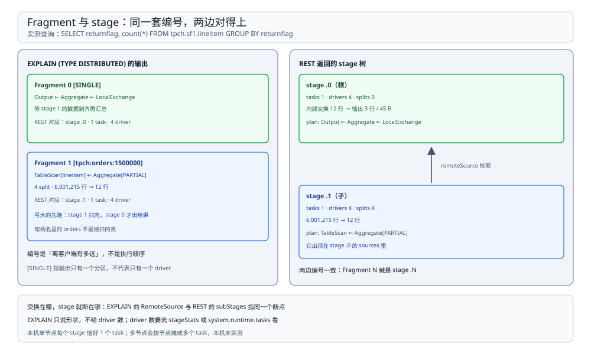
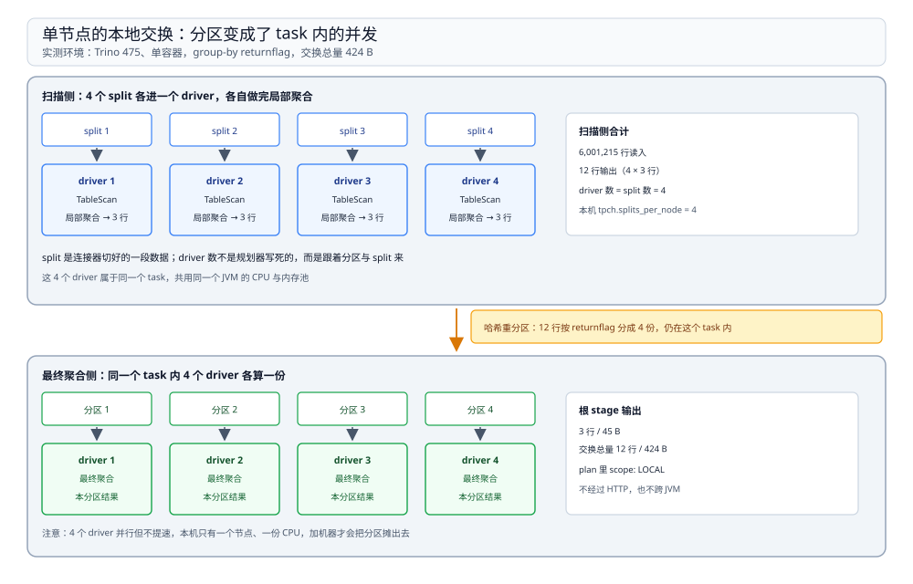

# 执行与调度

> 覆盖：EXPLAIN 的 fragment 与 REST 的 stage 树怎么对上、stage 内的 task / driver / split 各自由什么决定、**单节点上「分区」为什么表现成 driver 而不是 task**、三种典型查询的 stage 形状、四个分区相关会话属性的实测效果，以及 join 的广播与动态过滤是怎么落到计划里的。
>
> 不覆盖：排队、资源组、错误码见 [资源组与排障.md](资源组与排障.md)；split 由连接器怎么给出见 [连接器与联邦查询.md](连接器与联邦查询.md)；规划阶段的耗时构成见 [架构与查询生命周期.md](架构与查询生命周期.md)。
>
> 内容整理自个人学习笔记。本篇读数来自本机 `dockerproxy.net/trinodb/trino:475`（**475**）单容器、单节点，数据取自内置 `tpch.sf1`（`lineitem` 6,001,215 行、`region` 5 行）与 `memory.default` 的 3 行小表；stage 形状来自 `EXPLAIN` 与 REST `/v1/query/<id>` 的 `outputStage` 子树，逐处标注实测与推断。

---

## 一、一句话定位：规划只决定形状，driver 数才决定并行

**本节要点**：一条 SQL 被切成几个 stage、每个 stage 做什么，在规划期就定死了；**运行期能变的只有「每个 task 里同时开几个 driver」**。所以「这条查询只用了 4 个核」这类问题，答案不在优化器，而在 task 与 driver 的划分。

| 想知道 | 看哪 | 谁决定 |
| --- | --- | --- |
| 切成了几段 | `EXPLAIN` 的 Fragment 数 / REST 的 stage 数 | 规划器（中间有没有交换） |
| 每段做什么 | Fragment 里的算子 | 规划器 |
| 每段有几个 task | REST `stageStats.totalTasks` | 调度器（stage × 节点） |
| 每段有几个 driver | REST `stageStats.totalDrivers` | task 内的分区数 |
| 每个 driver 读多少 | `stageStats.totalSplits` / `system.runtime.tasks.splits` | 连接器给的 split |

⭐ 记住这条因果：**交换（exchange）是 stage 的边界，分区数是 driver 的上限，split 数是 driver 的输入量**。三者在单节点和多节点上的表现不同，这正是本篇最容易踩坑的地方。

## 二、EXPLAIN 的 fragment 与 REST 的 stage 是同一套编号

**本节要点**：两边都把**根 stage 编成 0**，子 stage 依次加一。所以 `EXPLAIN` 里 `Fragment 0 [SINGLE]` 就是 REST 里 stage `.0`，可以直接对照着看。



图中左边是 `EXPLAIN` 输出的 Fragment 列表，右边是 REST 的 stage 树；两边的编号一致，箭头标出 `RemoteSource` / `sourceFragmentIds` 指向的正是对方的 stage。

实测的 group-by 查询，两边对照：

| 编号 | `EXPLAIN` 里的样子 | REST 里的事实 |
| --- | --- | --- |
| Fragment 1 / stage 1 | `[tpch:orders:1500000]`，扫 `lineitem` 并做局部聚合 | 1 task、**4 driver**、4 split，6,001,215 行 → 12 行 |
| Fragment 0 / stage 0 | `[SINGLE]`，`Output ← Aggregate ← LocalExchange` | 1 task、**4 driver**，12 行 → 3 行 |

三点说明：

1. **`[SINGLE]` 表示这个 stage 只有一个分区**，它的输出要汇聚给客户端；`[tpch:orders:1500000]` 是连接器自己声明的分区句柄，跟「扫的是哪张表」无关——本例扫的是 `lineitem`，句柄名里却是 `orders`，因为 tpch 连接器用最大表的行数作为句柄标识。
2. **stage 号是「离客户端有多远」**，不是执行顺序。执行顺序反过来：**号大的先跑**（本例 stage 1 先扫，stage 0 等它）。
3. `EXPLAIN` 只说形状，**不告诉你几个 driver**。分区数、driver 数必须去 REST 或系统表看。

## 三、task 与 driver：单节点上「分区」变成了并发

**本节要点**：Trino 的 stage 按分区切成 task 派到各节点。**一台节点上同一 stage 只有一个 task**，分区多出来的部分在 task 内部变成多个 driver——所以单节点看不到「4 个分区 = 4 个 task」这种多节点现象。



图中上半是扫描侧：4 个 driver 各读一个 split，各自做局部聚合得到 3 行；下半是重分区侧：同一个 task 内按 `returnflag` 分成 4 份，4 个 driver 各自完成最终聚合的一份。整条交换只在 task 内走内存，实测总量 424 B。

| 现象 | 多节点（未实测） | 本机单节点（实测） |
| --- | --- | --- |
| 分区 → 对象 | 每个分区一个 task，落在不同节点 | 每个分区一个 driver，落在同一个 task |
| 交换走哪 | 经 HTTP 跨机传输 | task 内内存队列（plan 里 `scope: LOCAL`） |
| 加机器能提速吗 | 能，分区可以摊到更多节点 | 不能，只有一台 |

⚠️ 上面右列的「`scope: LOCAL`」来自 REST 返回的 plan JSON：根 stage 的算子是 `{"@type":"exchange","type":"REPARTITION","scope":"LOCAL"}`，`sources` 是一个 `remoteSource`。**多节点下同一段计划会不会变回跨节点分区交换，本机无法验证**，标为未实测。

## 四、三种查询的 stage 形状（实测）

**本节要点**：shape 由「要不要按 key 重分布」决定。**全局聚合要重分布，`count(*)` 不要，排序要**——三种形状对应三种 driver 数。

| 查询 | stage 数 | 每段 driver | 交换内容 | 总 CPU |
| --- | --- | --- | --- | --- |
| `count(*)` | 2 | 扫描 4 / 最终 3 | 4 行、**176 B**（`SINGLE`） | 4.11 s |
| `GROUP BY returnflag` | 2 | 扫描 4 / 最终 4 | 12 行、**424 B**（`FIXED` 哈希） | 7.34 s |
| `SELECT * FROM region ORDER BY regionkey` | 3 | 扫描 4 / 交换 3 / 输出 1 | 5 行，每段 542 B | 4 ms |

三条读法：

1. **`count(*)` 不需要哈希交换**。局部聚合把 6,001,215 行压成 4 行（每个 split 一行），最终聚合只把这 4 行加起来，所以交换是 `SINGLE`，只过 176 B。**这是 OLAP 里最便宜的一类查询**。
2. **`GROUP BY` 的哈希交换也只有 424 B**，因为局部聚合已经把 6,001,215 行压到 12 行（3 个分组 × 4 个 split）。**先把聚合推到扫描侧，是 Trino 省网络的主要手段**——真正跨机的从来不是原始数据，而是聚合后的中间结果。
3. **`ORDER BY` 多一个 stage**：排序需要「所有输入到齐后再合并」，所以扫描 → 重分布 → 归并输出是三段，即使只有 5 行也一样。

## 五、四个旋钮：哪个真的改了 driver 数

**本节要点**：分区相关的会话属性有四个，**本机只有 `task_concurrency` 改变了 driver 数**，另外三个（含两个名字里带 partition 的）一条也没改。这个结论只在单节点成立，原因见第三节。

| 会话属性 | 默认值 | 官方描述 | 本机实测（group-by，看 stage 0 的 driver） |
| --- | --- | --- | --- |
| `min_hash_partition_count` | 4 | 分布式 join / 聚合的最少分区数 | 8 / 16 / 64 → driver 恒 **4** |
| `max_hash_partition_count` | 100 | 最多分区数 | 未拿到有效读数（见下） |
| `min_input_rows_per_task` | 10,000,000 | 每个 task 的最少输入行数，帮优化器定分区数 | 100,000 / 200,000 / 50,000,000 → driver 恒 **4** |
| `task_concurrency` | 2 | 每个 task 内并发处理的 driver 数 | 1 / 2 / 4 / 8 → driver **2 / 4 / 8 / 16** |

```sql
-- 设置会话属性与查询写在同一个文件里，CLI 会顺序执行
SET SESSION task_concurrency = 4;
SELECT returnflag, count(*) FROM tpch.sf1.lineitem GROUP BY 1;
```

三点判断：

1. **driver 数 = 2 × `task_concurrency`**（1→2、2→4、4→8、8→16）。这个 2 倍关系是实测出来的，为什么是 2 倍本篇未读源码确认。
2. **`task_concurrency` 必须是 2 的幂**。设成 3 会直接拒绝：`task_concurrency must be a power of 2: 3`。
3. **两个 partition 属性在本机完全无效**，因为交换被规划成了 task 内的本地交换（`scope: LOCAL`），分区数退化成并发数；它们真正生效的场景是「多节点 + 分区数 > 节点数」。⚠️ `max_hash_partition_count` 一项本机**没有拿到有效读数**（探针匹配到了错误的查询记录），不引用其数值。

## 六、join 的形状：小表广播，大表留下

**本节要点**：join 是广播还是重分区，看**两侧行数**：小侧会被广播到每个 driver，大侧留在原地被扫。同时 join 的谓词会被压成**动态过滤**下推到扫大表的那一侧。

实测：`tpch.sf1.nation`（25 行）join `memory.default.region_note2`（3 行），结果 15 行。`EXPLAIN` 里两段关键原文：

```text
Fragment 2 [SOURCE]
    InnerJoin[criteria = (regionkey = regionkey_0), distribution = REPLICATED]
    │   dynamicFilterAssignments = {regionkey_0 -> #df_310}
    ├─ ScanFilter[table = tpch:sf1:nation, dynamicFilters = {regionkey = #df_310}]
    └─ LocalExchange[partitioning = SINGLE]
       └─ RemoteSource[sourceFragmentIds = [3]]

Fragment 3 [SOURCE]
    Output partitioning: BROADCAST []
    TableScan[table = memory:1]
```

四点读法：

1. **`distribution = REPLICATED` 就是广播**：3 行那一侧被复制到每个 driver；`Fragment 3` 的输出分区是 `BROADCAST`。
2. **`dynamicFilterAssignments` 是「边算边过滤」**：广播侧产出的 `regionkey` 值被收集成 `#df_310`，下推进 `nation` 的扫描。join 还没完成，扫描就已经只读需要的行了。
3. **`SINGLE` 本地交换出现在广播侧**：3 行要先聚成一份再广播，所以有一个 `LocalExchange[partitioning = SINGLE]`。
4. **广播的代价可以量化**：本次广播实测只走了 **136 B / 3 行**，整条查询 4 个 stage、15 个 driver、总 CPU 9 ms。

⭐ 排障含义：**看到 `distribution = PARTITIONED` 就要警惕两侧都不小**，那意味着两侧都要按 join key 重分布，网络代价是两边之和；看到 `REPLICATED` 说明优化器判断一侧足够小，此时「把小表挪到左边」没有意义——**判断依据是行数统计，不是 SQL 里的书写顺序**。

## 七、校验口径

| 内容 | 状态 |
| --- | --- |
| `EXPLAIN` 的 Fragment N 与 REST 的 stage `.N` 编号一致（根为 0） | ✅ 本机实测（同一条查询两边对照） |
| group-by：2 stage、扫描侧 4 driver、最终 4 driver、交换 424 B | ✅ 本机实测（REST `stageStats`） |
| `count(*)`：2 stage、交换 `SINGLE`、176 B / 4 行 | ✅ 本机实测 |
| `ORDER BY region`：3 stage、每段 542 B | ✅ 本机实测 |
| `task_concurrency` 1/2/4/8 → driver 2/4/8/16；设 3 报错原文 | ✅ 本机实测 |
| `min_hash_partition_count` 8/16/64、`min_input_rows_per_task` 三档 → driver 恒 4 | ✅ 本机实测（每个配置单独一次查询） |
| 广播 join：`distribution = REPLICATED`、动态过滤下推、广播 136 B | ✅ 本机实测（`EXPLAIN` 原文 + REST） |
| 交换为 `scope: LOCAL` | ✅ 本机实测（REST plan JSON）；**多节点下是否会变成跨节点交换未实测** |
| 多节点：分区 → task 的映射、跨机交换耗时、加节点后的提速幅度 | ⚠️ **未实测**：单容器 |
| `max_hash_partition_count` 的实际效果 | ⚠️ **无有效读数**（探针匹配错误），不引用 |
| 为什么 driver 数恰为 `task_concurrency` 的两倍 | ⚠️ **未读源码确认**，只报实测关系 |

---

## 延伸追问

- **`EXPLAIN` 为什么不显示分区数？** → 它展示的是 Fragment 级的计划，分区数在计划里只是一个 `FIXED HASH` 标记，具体数字在运行期由分区决策给出。想知道数字只能看 REST 的 `totalDrivers` 或系统表。
- **单节点上加 `task_concurrency` 会更快吗？** → 本机没观察到收益。三档的墙钟是 1 档 **1.72 s**、2 档 **1.74 s**、8 档 **2.64 s**，总 CPU 基本持平（5.00 / 4.79 / 5.03 s）。这组数字是**单次运行、按 1→2→8 顺序跑**，受 JIT 预热影响，只能说明「提高并发没有明显变快」，不能反过来断言「并发越高越慢」。
- **为什么 `count(*)` 的最终聚合只开了 3 个 driver？** → 最终聚合的输入只有 4 行（每个 split 一行），分区数不需要更多；这个数字由引擎按输入规模决定，不是配置项。
- **join 一侧很大一侧很小，怎样判断优化器选对了？** → 看 `EXPLAIN` 里的 `distribution`：`REPLICATED` 表示小表广播（正确），`PARTITIONED` 表示两侧都重分布（大表 join 大表）。若小表被判成 `PARTITIONED`，通常是**统计信息缺失**，需要让连接器提供行数或执行 `ANALYZE`。
- **`ORDER BY` 为什么一定要多一个 stage？** → 归并排序要求「所有输入都已就绪」，所以必须有一个只做归并的 stage 收齐上游数据；这也是大结果集 `ORDER BY` 慢的根本原因——它把并行度压回到 1。
- **stage 号大的一定先跑吗？** → 号大的是上游（离客户端远），调度上确实先起来；但并发起来之后两者同时在跑，只有「谁依赖谁」是确定的，不要用编号推断时序。

---

## 关联

- [README.md](README.md) — 本册导读：四篇分工与读序
- [架构与查询生命周期.md](架构与查询生命周期.md) — **上游**：stage 是规划期的产物，那一篇讲六段路径
- [连接器与联邦查询.md](连接器与联邦查询.md) — **下游**：split 与统计信息都来自连接器，决定 driver 能读多少
- [资源组与排障.md](资源组与排障.md) — **对照**：本篇看形状，那一篇看「谁在等、谁被杀」
- [Spark 册](../Spark/README.md) — **对照**：同为 stage / task 模型，Spark 的宽依赖必须落盘，Trino 的交换走内存
- [大数据选型对比.md](../../大数据选型对比.md) — **上游总纲**：交互式查询引擎与批处理引擎的分工
