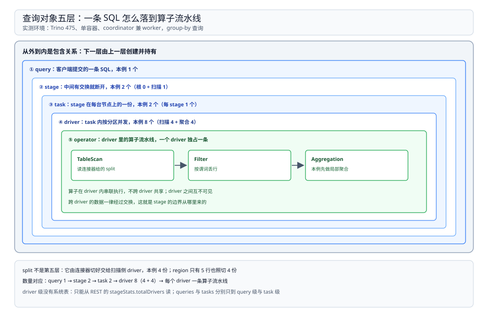
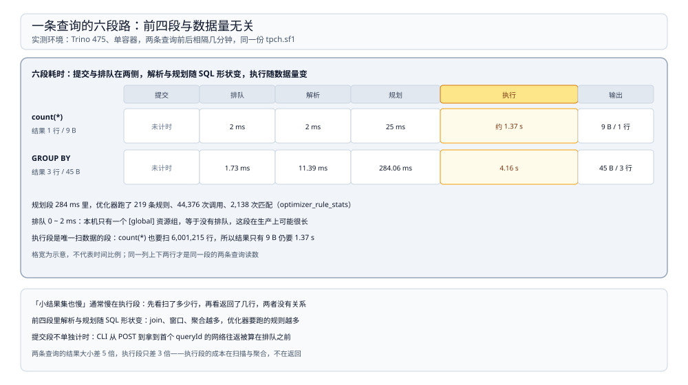

# 架构与查询生命周期

> 覆盖：Trino 里 coordinator 与 worker 的分工、单节点为什么 coordinator 也执行、query / stage / task / driver / split 五层对象、**一条 SQL 从提交到输出的六段路**（含每段的实测耗时）、HTTP 提交协议与身份头、以及执行期「谁先起来、谁在等谁」。
>
> 不覆盖：stage 怎么切、driver 数由什么决定见 [执行与调度.md](执行与调度.md)；连接器怎么给 split 见 [连接器与联邦查询.md](连接器与联邦查询.md)；资源组与错误码见 [资源组与排障.md](资源组与排障.md)。
>
> 内容整理自个人学习笔记。本篇读数来自本机 `dockerproxy.net/trinodb/trino:475`（**475**、Temurin 24）单容器：`coordinator=true` 且 `node-scheduler.include-coordinator=true`，仅 1 个节点，5 个内置 catalog；JVM `MaxRAMPercentage=80` → 最大堆 **4,999,610,368 B**。**没有 worker 节点，也没有外部数据源**，所以跨机调度与真实连接器鉴权未实测。

---

## 一、一句话定位：只有一个节点做设计，其余都照图施工

**本节要点**：Trino 的 coordinator 不参与「决定」以外的活——它解析 SQL、生成执行计划、把计划切成 stage 并派给 worker；worker 只拿到「扫这些 split、跑这些算子」的指令。**查询计划的形状只由 coordinator 决定一次**，worker 没有二次优化权。

| 角色 | 职责 | 本机实测 |
| --- | --- | --- |
| coordinator | 接 SQL、解析、规划、切片、调度、汇总输出、维护查询状态 | 唯一节点，`coordinator=true` |
| worker | 执行被分配的 task，读写连接器，交换数据 | **0 个**（单节点） |
| discovery | 节点注册与心跳的服务，通常与 coordinator 同进程 | `http://172.17.0.3:8080`，`system.runtime.nodes` 只有 1 行 |

本机的 `config.properties` 里有两条决定了「单节点也能干活」：

```properties
coordinator=true
node-scheduler.include-coordinator=true
```

第二条的意思是**允许把 task 也调度到 coordinator 自己身上**。生产上通常设成 `false`，让 coordinator 专心规划；本机设成 `true`，所以 `system.runtime.nodes` 里只有一行，且它既是 coordinator 又是唯一的执行节点。

⚠️ 由此带来一个观测偏差：本机所有 task 都跑在同一个 JVM 里，`totalBlockedTime` 里既有「等上游数据」也有「等 CPU 时间片」，两种等待分不开。多节点下的样子未实测。

## 二、五层对象：从一条 SQL 到一次算子调用

**本节要点**：Trino 的执行对象是**层层包含**的——一个 query 切若干 stage，一个 stage 在一台节点上是一个 task，一个 task 内按分区并发若干 driver，driver 里跑的是算子流水线；而 split 是驱动 driver 的数据片。



图中从外到内是包含关系，右侧标注了本例（group-by）的实际数量：2 个 stage、2 个 task、8 个 driver；`split` 不是嵌套层的子对象，而是驱动 driver 的输入单元，由连接器提供。

| 层 | 谁创建 | 回答什么 | 本例数量 |
| --- | --- | --- | --- |
| query | 客户端提交 | 这一条 SQL 的整体状态与统计 | 1 |
| stage | coordinator 的规划器 | 一段可以并行执行的子计划（中间有交换就断开） | 2 |
| task | 调度器按 stage × 节点分配 | 某个 stage 在某台节点上的那一份 | 2（每 stage 1 个） |
| driver | task 内按分区启动 | 一个分区上的一串算子 | 8（4 + 4） |
| split | 连接器 | 一段可独立读取的数据（文件块 / 分区 / 行区间） | 4（扫描侧） |

⭐ 记住这条对应关系：**`system.runtime.tasks` 是 task 级，`system.runtime.queries` 是 query 级，driver 级没有系统表，只能从 REST 的 `stageStats.totalDrivers` 看**。排障时先决定自己在问哪一层，再选表。

## 三、一条查询的六段路

**本节要点**：从客户端按下回车到结果回来，中间是六段而不是一段：提交 → 排队 → 解析 → 规划 → 执行 → 输出。**前四段的耗时与数据量无关，后两段才是**——所以「小结果集也慢」通常慢在前四段。



图中横轴是时间，前四段挤在左侧毫秒级区间，执行段横跨数秒；右侧标出 group-by 与 `count(*)` 两条查询在同一台机器上的实测值。

实测两台查询的六段读数（同一容器，前后相隔几分钟）：

| 段 | 做什么 | `count(*)` | `GROUP BY returnflag` |
| --- | --- | --- | --- |
| 提交 | 客户端 POST `/v1/statement`，拿到 queryId | — | — |
| 排队 | 等资源组放行 | **2 ms** | **1.73 ms** |
| 解析 | 语法树 + 语义分析（查表是否存在、列类型） | **2 ms** | **11.39 ms** |
| 规划 | 逻辑计划 → 优化 → 物理计划 → 切 stage | **25 ms** | **284.06 ms** |
| 执行 | stage 调度、扫数据、交换、聚合 | 约 **1.37 s** | **4.16 s** |
| 输出 | 根 stage 把结果交回客户端 | 9 B / 1 行 | 45 B / 3 行 |

三点读法：

1. **规划不是常数开销**。同一台机器上，`count(*)` 规划 25 ms，加一个 `GROUP BY` 就变成 284 ms——**11 倍**。规划期要做的事包括向连接器要表统计信息、决定交换的分区数、逐条跑优化器规则，算子越多、涉及的连接器越多越慢。
2. **解析慢通常意味着语义分析在查元数据**。`GROUP BY returnflag` 的解析 11.39 ms 而 `count(*)` 只有 2 ms，差别在要解析列引用并确认类型。
3. **执行时间与扫描行数强相关**。`count(*)` 扫 6,001,215 行用 1.37 s，group-by 同样扫 6,001,215 行却要 4.16 s——多出来的部分是分组与交换。

### 3.1 规划期到底在跑什么

`system.runtime.optimizer_rule_stats` 记录了每条优化器规则的调用次数与命中次数。本机（累计自 coordinator 启动，含全部探测查询）：

| 项 | 值 |
| --- | --- |
| 注册的规则数 | **219** |
| 累计调用 / 累计命中 | **44,376 / 2,138** |
| 调用次数最多 | `PushPredicateIntoTableScan`：499 次调用、46 次命中 |
| 单次平均最贵（前三条） | `ReorderJoins`、`DetermineJoinDistributionType`、`MergeProjectWithValues` |

⭐ 两条工程含义：**`PushPredicateIntoTableScan` 调用最频繁是因为它要为每个谓词问一次连接器「你能不能接」**——这正是连接器实现质量直接影响规划耗时的地方；**join 相关的三条规则单次最贵**，所以 join 越多、表越多的查询，规划越慢。

⚠️ 该表的「平均耗时」一栏随版本改过单位，本篇只用来比较相对大小，不换算成秒。

## 四、提交协议：HTTP + nextUri 轮询

**本节要点**：Trino 的客户端协议不是「一次请求拿完结果」，而是**提交后拿到一个 `nextUri`，反复拉取直到没有 nextUri**。所以客户端超时、中间网络断开、代理缓冲都会表现为「查询还在跑，但客户端先断了」。

| 步骤 | 请求 | 返回 |
| --- | --- | --- |
| 提交 | `POST /v1/statement`，body 是 SQL | `id`（queryId）、`nextUri`、`stats` |
| 取结果 | `GET <nextUri>` | 一批数据行 + 新的 `nextUri` |
| 结束 | `nextUri` 不再出现 | 最后一批数据与统计 |
| 取消 | `DELETE <nextUri>` | 查询进入 `FAILED` / `USER_CANCELED` |

本机实测的两个协议细节：

```bash
# 直接问 REST 要查询详情，必须带用户头
curl -s -H 'X-Trino-User: trino' http://127.0.0.1:8080/v1/query/<queryId>
```

不带这个头会拿到：`Basic authentication or X-Trino-Original-User or X-Trino-User must be sent`。**Trino 本身不做认证**，它只要求「用户是谁」这个字段非空，真正的认证交给前置的网关或 `etc/access-control.properties`。

另一个细节是 `nextUri` 指向的地址由 coordinator 生成，**如果客户端走代理访问，nextUri 里的主机名可能解析不到**——这是「能提交、拉不到结果」最常见的原因，排查时先看客户端拿到的 nextUri 主机是谁。

## 五、执行期：谁先起来，谁在等谁

**本节要点**：stage 之间是**自底向上**的依赖——源 stage 先跑起来产数据，下游 stage 的 driver 才能读到；下游 driver 在等上游时会记成 `blocked`。所以「任务都起来了但很慢」和「任务还没起来」是两种完全不同的状态。

实测的一条长查询（`lineitem × orders` 的交叉计数，跑了 21 秒后被手动杀掉）的 stage 树快照：

| stage | 做什么 | task / driver | CPU | 状态 |
| --- | --- | --- | --- | --- |
| 2（最底） | 扫 `orders` 1,500,000 行 | 1 / 4 | 1.88 s | 896 ms 就读完了 |
| 1（中间） | join + 聚合 | 1 / 7 | **39.35 s** | 累计 blocked **1.50 min** |
| 0（根） | 最终聚合 | 1 / 3 | 0.34 ms | 等上游 |

三点读法：

1. **最底层的 stage 早就跑完了，慢的是中间那段**。源 stage 896 ms 交完数据后就不再有活；中间 stage 的 CPU 时间 39.35 s 远超墙钟 21 秒，说明它同时在跑多个 driver。
2. **`blocked` 时间是按 driver 累加的**，不是墙钟。本作业墙钟约 21 s，`totalBlockedTime` 却是 1.50 min——三个 driver 各等了一会儿，加起来就超了。
3. **根 stage 的 CPU 小到可以忽略**（0.34 ms），但它的 elapsed 也是 21 秒——因为它在等上游。**看根 stage 的耗时判断不了任何事**。

## 六、校验口径

| 内容 | 状态 |
| --- | --- |
| 单节点、`coordinator=true`、`include-coordinator=true`，`system.runtime.nodes` 1 行 | ✅ 本机实测（`config.properties` + 系统表） |
| 六段耗时：`count(*)` 2 / 2 / 25 ms + 约 1.37 s；group-by 1.73 / 11.39 / 284.06 ms + 4.16 s | ✅ 本机实测（`system.runtime.queries` 与 `EXPLAIN ANALYZE`） |
| 五层对象数量：2 stage / 2 task / 8 driver（group-by） | ✅ 本机实测（REST `/v1/query/<id>`） |
| 优化器规则 219 条、累计调用 44,376 / 命中 2,138 | ✅ 本机实测（`system.runtime.optimizer_rule_stats`，累计自启动） |
| `X-Trino-User` 缺失时的报错原文 | ✅ 本机实测 |
| 长查询快照：源 stage 896 ms、中间 stage CPU 39.35 s / blocked 1.50 min | ✅ 本机实测（运行期 REST 快照） |
| `nextUri` 分页与 `DELETE` 取消的完整时序 | ⚠️ **未实测**：本机只用 CLI 与 REST 单次查询，未抓包 |
| 多节点注册、跨机任务分配、worker 故障转移 | ⚠️ **未实测**：单容器 |
| `hive` / `iceberg` / `mysql` 等外部连接器的元数据查询耗时 | ⚠️ **未实测**：无外部数据源 |
| 优化器规则「平均耗时」的单位换算 | ⚠️ **未确认**，本篇只比相对大小 |

---

## 延伸追问

- **coordinator 会不会成为瓶颈？** → 会，但瓶颈点不同：它承担全部解析与规划（CPU）、维护所有查询状态（堆内存）、汇总结果（网络）。所以生产上一般把 task 调度排除在 coordinator 之外，并把它与 worker 分开部署。
- **为什么 `count(*)` 的规划只有 25 ms，加个 `GROUP BY` 就 284 ms？** → 多出的部分主要在决定交换怎么切（分区数、分区键）与跑聚合相关规则；本篇只测到「差 11 倍」这个事实，具体哪条规则占大头需要开 trace 级别的优化器日志，未实测。
- **`system.runtime.queries` 里的 `analysis_time_ms` 和解析段是一回事吗？** → 是。`analysis` 包含语法树构造与语义分析，`planning` 从句法树到可执行计划，两段在系统表里分列，加起来才是「提交到开跑」的等待。
- **查询提交后客户端断开，查询会停吗？** → 不会立刻停。Trino 以 coordinator 侧的状态为准，客户端断开后查询继续跑，直到结果没人取、超时或被 kill；所以「点了取消」不等于「已经停了」，要到 `system.runtime.queries` 里确认状态。
- **单节点为什么还要写「架构」这一节？** → 因为对象层级与生命周期跟节点数无关：五层对象、六段路径、自底向上的调度顺序，在单节点和多节点上完全一样，只有「task 落在哪」这一层会变。把机制与部署形态分开看，才不会把单机现象当成规律。

---

## 关联

- [README.md](README.md) — 本册导读：四篇分工与读序
- [执行与调度.md](执行与调度.md) — **下游**：本篇的「规划」产出 stage，那一篇讲 stage 怎么变成 task 与 driver
- [连接器与联邦查询.md](连接器与联邦查询.md) — **下游**：规划期向连接器要统计信息，那一篇讲连接器接口
- [资源组与排障.md](资源组与排障.md) — **对照**：本篇讲「查了什么表」，那一篇讲「表中数字怎么用」
- [大数据选型对比.md](../../大数据选型对比.md) — **上游总纲**：为什么联邦查询要单独一类引擎
- [04 OLAP 查询服务](../../../../04-架构与系统/系统设计/大数据平台/OLAP查询服务.md) — **项目落地**：Trino 在这套平台里挡在哪一层
