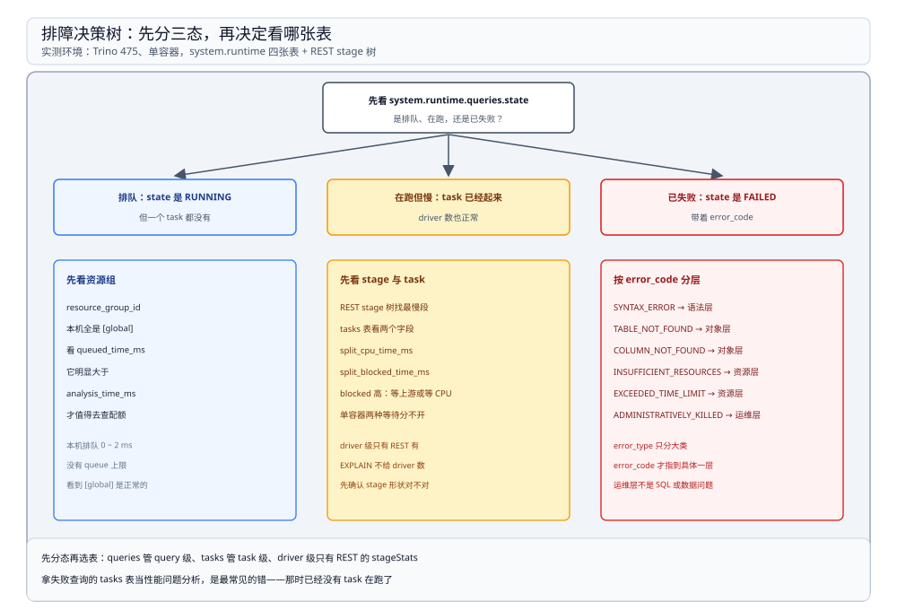

# 资源组与排障

> 覆盖：没有资源组配置时查询落在哪个组、四张观测表各答什么问题（含字段陷阱）、**七类错误码的原文与所属层级**、杀掉一条查询的完整时间线、以及「排队 / 慢 / 失败」三种现象各自该看哪里。
>
> 不覆盖：stage 与 driver 的划分见 [执行与调度.md](执行与调度.md)；查询生命周期的六段耗时见 [架构与查询生命周期.md](架构与查询生命周期.md)；平台级的多租户配额规划见 [04 的 OLAP 查询服务篇](../../../../04-架构与系统/系统设计/大数据平台/OLAP查询服务.md)。
>
> 内容整理自个人学习笔记。本篇读数来自本机 `dockerproxy.net/trinodb/trino:475`（**475**）单容器、单节点；`/etc/trino` 下**没有 `resource-groups.properties`**，所以资源组只能是默认的 `[global]`。所有错误码都由真实 SQL 触发后从 `system.runtime.queries` 与 CLI 输出两侧核对，未手工编造。

---

## 一、一句话定位：先分三态，再决定看哪张表

**本节要点**：一条查询出问题只有三种状态——**还在排队**、**在跑但慢**、**已经失败**。三态对应完全不同的观测点；不分态就查，最常犯的错是拿失败查询的 `tasks` 表当性能问题分析。

| 状态 | 判据 | 先看 |
| --- | --- | --- |
| 排队 | `state = 'RUNNING'` 但没有任何 task，`queued_time_ms` 在涨 | 资源组与配额 |
| 在跑但慢 | 有 task、`totalDrivers` 正常，但 `split_cpu_time_ms` 或 `split_blocked_time_ms` 高 | stage 树 + tasks 表 |
| 已失败 | `state = 'FAILED'`，有 `error_code` | `error_code` 原文 → 对应层 |



图中三个分支对应三种状态，最右侧列出每一种状态该读的字段；「运维层」指被显式取消或超时终止，不是数据或 SQL 的问题。

## 二、资源组：本机只有一个 `[global]`

**本节要点**：资源组不是 SQL 里的概念，而是 **`resource-groups.properties` + 一个 JSON 配置**定义的配额树。文件不存在时，所有查询落到默认组 `global`，没有任何限流。

| 项 | 本机实测 |
| --- | --- |
| `/etc/trino` 下的配置文件 | `config.properties`、`jvm.config`、`log.properties`、`node.properties`、`catalog/`——**没有** `resource-groups.properties` |
| `system.runtime.queries.resource_group_id` | 全部查询都是 **`[global]`** |
| 排队时间 | 2 ms、1 ms、0 ms（无排队） |

两个容易误读的点：

1. **`resource_group_id` 是数组**，不是字符串：它是「从根到叶的路径」，多层配置下会显示成 `[global, adhoc, team_a]`。本机只有一层，所以只看到一个元素。
2. **「没有配置」不等于「没有资源组」**：查询仍然归属 `global`，只是这个组没有并发上限、没有内存上限。所以「资源组为空」这种状态并不存在，看到 `[global]` 是正常的。

⭐ 排障含义：**只有当 `queued_time_ms` 明显大于 `analysis_time_ms` 时，才值得去查资源组**。本机这两者都是个位数毫秒，说明排队从来不是瓶颈。

## 三、四张观测表各答什么问题

**本节要点**：`system.runtime` 下只有四张表，各有明确分工。**混着查会得出错误结论**，因为它们的粒度差好几级。

| 表 | 粒度 | 回答什么 | 本机规模 |
| --- | --- | --- | --- |
| `queries` | 一条查询一行 | 谁提交的、排队 / 解析 / 规划各多久、成没成、错在哪 | 每条 SQL 一行 |
| `tasks` | 一个 task 一行 | 哪个 stage 慢、读了多少行、CPU 与 blocked 怎么分 | 一条查询 2~4 行 |
| `nodes` | 一个节点一行 | 有几台、谁是 coordinator、活没活着 | **1 行** |
| `optimizer_rule_stats` | 一条规则一行 | 哪条优化规则被调用了多少次、命中多少次 | 219 行 |
| `transactions` | 一个事务一行 | 有没有未提交的写入事务 | 写入后 1 行 |

本机 `nodes` 的唯一一行：

| 字段 | 值 |
| --- | --- |
| `node_id` | `e1ef06e5b49f`（容器 hostname） |
| `http_uri` | `http://172.17.0.3:8080` |
| `node_version` | `475` |
| `coordinator` | `true` |
| `state` | `active` |

### 3.1 两个「列不存在」的坑

查系统表最常见的时间浪费是**按印象写列名**。本机实测两例，报错原文都指向列名而不是权限：

```sql
-- 以为 queries 表有耗时字段
SELECT query_id, state, elapsed_time FROM system.runtime.queries;
-- → line 1:25: Column 'elapsed_time' cannot be resolved

-- 以为 nodes 表有存活标记
SELECT node_id, is_active FROM system.runtime.nodes;
-- → line 1:41: Column 'is_active' cannot be resolved
```

实际字段是：`queries` 里**只有分段时间**（`queued_time_ms` / `analysis_time_ms` / `planning_time_ms`）与时间戳（`created` / `started` / `end`），没有「总耗时」；`nodes` 里用 `state`（`active` / `inactive`）表示存活，没有 `is_active`。**先 `SHOW COLUMNS` 再写 SQL**，比猜快得多。

## 四、七类错误码：每一类落在不同层

**本节要点**：`error_type` 只有几个取值，但 `error_code` 更细，直接指出问题出在**语法层、对象层、执行层还是运维层**。排障时先读 `error_code`，再决定要不要看 SQL。

| 触发方式 | `error_type` | `error_code` | 原文 |
| --- | --- | --- | --- |
| `SELEC 1` | `USER_ERROR` | `SYNTAX_ERROR` | `line 1:1: mismatched input 'SELEC'. Expecting: 'ALTER', ...` |
| `SELECT * FROM tpch.sf1.nope` | `USER_ERROR` | `TABLE_NOT_FOUND` | `line 1:15: Table 'tpch.sf1.nope' does not exist` |
| `SELECT nope FROM tpch.sf1.orders` | `USER_ERROR` | `COLUMN_NOT_FOUND` | `line 1:8: Column 'nope' cannot be resolved` |
| `SELECT 1 / 0` | `USER_ERROR` | `DIVISION_BY_ZERO` | `Division by zero` |
| `SELECT 'a' + 1` | `USER_ERROR` | `TYPE_MISMATCH` | `line 1:12: Cannot apply operator: varchar(1) + integer` |
| 设 `query_max_run_time='2s'` 跑交叉 join | `INSUFFICIENT_RESOURCES` | `EXCEEDED_TIME_LIMIT` | `Query exceeded maximum time limit of 2.00s` |
| `CALL system.runtime.kill_query(...)` | `USER_ERROR` | `ADMINISTRATIVELY_KILLED` | CLI：`Query killed. No message provided.` |

三点判断：

1. **前五条都是 `USER_ERROR`**，但含义差很远：前三条是「写的名字不对」，后两条是「数据或类型不对」。**不要把 `USER_ERROR` 当成「SQL 写错了」的同义词**，`ADMINISTRATIVELY_KILLED` 也是它。
2. **只有超时是 `INSUFFICIENT_RESOURCES`**：它表示「资源够跑，但时间预算不够」，与内存不足、队列满不是一回事（那两项本机未触发）。
3. **`DIVISION_BY_ZERO` 的报错没有行列号**，因为它是运行期错误；其余五条都带 `line/column`，可以在 SQL 里直接定位。

## 五、处置动作：能停、能限时、能看谁在等

**本节要点**：Trino 提供的三个即时手段是**杀掉查询、给查询设时间上限、限制 task 内并发**；它们分别解决「跑飞了」「不该跑这么久」「核没用满」三类问题。

| 手段 | 怎么做 | 生效范围 |
| --- | --- | --- |
| 杀查询 | `CALL system.runtime.kill_query(query_id => '<id>')` | 单条查询，立即 |
| 时间上限 | `SET SESSION query_max_run_time = '2s'` | 当前会话的后续查询 |
| task 内并发 | `SET SESSION task_concurrency = 4`（必须是 2 的幂） | 后续查询的 driver 数 |
| 客户端取消 | 关掉 CLI / 断开连接 | **不会**立刻停，见下 |

⭐ **「点了取消」与「查询已停」是两件事**：客户端断开只是停止拉结果，coordinator 侧的查询会继续跑到「没人取结果」的判定为止。要确认真的停了，去 `system.runtime.queries` 看 `state` 是否变成 `FAILED` 或 `FINISHED`。

## 六、一次完整的处置：21 秒的长查询

**本节要点**：把上面几节串起来看一遍。这条查询没有错误、没有排队、没有 OOM，**唯一的问题是它本来就要算很久**，所以处置动作是「看懂它在哪慢，然后决定停不停」。

查询：`lineitem`（6,001,215 行）× `orders`（1,500,000 行）的交叉计数。跑了 21 秒后手动杀掉。

| 阶段 | 观测 | 值 |
| --- | --- | --- |
| 运行中 | `system.runtime.queries.state` | `RUNNING` |
| 运行中 | `totalDrivers` / `totalTasks` | 14 / 3 |
| 运行中 | 源 stage（扫 orders） | 1,500,000 行、**896 ms** 读完 |
| 运行中 | 中间 stage（join + 聚合） | CPU **39.35 s**、blocked **1.50 min**、7 个 driver |
| 运行中 | 根 stage | CPU 0.34 ms，elapsed 21 s（在等） |
| 处置 | `kill_query` 返回 | `CALL` |
| 之后 | `state` / `error_code` | `FAILED` / `ADMINISTRATIVELY_KILLED` |
| 之后 | CLI 输出 | `Query killed. No message provided.` |

三点读法：

1. **源 stage 是健康的**：896 ms 读完 150 万行，说明连接器给 split、读数据都没问题。慢的是中间那段 join。
2. **中间 stage 的 CPU 39.35 s 已经超过墙钟 21 s**，因为它 7 个 driver 并行跑；blocked 1.50 min 同样是 driver 累加值。**这两个数都不能当墙钟读**。
3. **杀掉之后错误码是 `ADMINISTRATIVELY_KILLED` 而不是「超时」**：这能区分「我主动停的」和「系统判定超时」——后者的码是 `EXCEEDED_TIME_LIMIT`，`error_type` 也变成 `INSUFFICIENT_RESOURCES`。

### 6.1 顺手能看的两项资源

| 项 | 读法 | 本机读数 |
| --- | --- | --- |
| JVM 堆 | `SELECT heapmemoryusage FROM jmx.current."java.lang:type=memory"` | used **1,385,368,120 B** / committed **1,677,721,600 B** / max **4,999,610,368 B** |
| JVM 运行时长 | `SELECT uptime FROM jmx.current."java.lang:type=runtime"` | **957,735 ms**（约 16 分钟） |
| 查询峰值用户内存 | REST `/v1/query/<id>` 的 `peakUserMemoryReservation` | group-by 10,312,839 B；联邦 join 131,584 B |

⚠️ 堆的 `used` 是「当下占用」，会随 GC 波动；判断「内存是否吃紧」要看**峰值用户内存是否接近堆上限**，而不是看某一时刻的 `used`。

## 七、校验口径

| 内容 | 状态 |
| --- | --- |
| 无 `resource-groups.properties`，所有查询 `resource_group_id = [global]` | ✅ 本机实测（`ls /etc/trino` + `system.runtime.queries`） |
| `queued_time_ms` 0~2 ms，从无排队 | ✅ 本机实测 |
| 四张 `system.runtime` 表 + `transactions` 的行数与字段 | ✅ 本机实测（`SHOW COLUMNS` / `SELECT`） |
| `elapsed_time` / `is_active` 两处「列不存在」的报错原文 | ✅ 本机实测 |
| 七类 `error_code` 与对应原文 | ✅ 本机实测（逐条触发后查 `system.runtime.queries`） |
| `kill_query` 的完整时间线（RUNNING → FAILED / `ADMINISTRATIVELY_KILLED`） | ✅ 本机实测（运行期 REST 快照 + kill + 复查） |
| JVM 堆三项读数与 uptime | ✅ 本机实测（`jmx.current`） |
| 资源组配额（并发上限、内存上限、子组）的真实行为 | ⚠️ **未实测**：本机没有资源组配置文件 |
| 内存不足（`EXCEEDED_LOCAL_MEMORY_LIMIT` / 队列满） | ⚠️ **未实测**：单节点、数据量小，未触发 |
| 多节点下 `nodes` 表的多行与摘除行为 | ⚠️ **未实测**：单容器 |
| 客户端断连后查询的实际清理时机 | ⚠️ **未实测**：未抓连接生命周期 |

---

## 延伸追问

- **`USER_ERROR` 一定是我的错吗？** → 不是。`ADMINISTRATIVELY_KILLED` 也归在 `USER_ERROR` 下，表示「被人为停掉」。判断责任要看具体 `error_code`，不要看 `error_type`。
- **查询被 kill 后资源立刻释放吗？** → 状态立刻变成 `FAILED`，但已分配的内存要等 driver 退出才回收；本机没有观测到长尾，规模小、无法说明生产上的释放延迟。
- **`query_max_run_time` 能设在全局吗？** → 这个属性是会话级的；要全局生效得走资源组或 `resource-groups.properties` 里的 `hardConcurrencyLimit` / `maxQueued` 等配置，本机未实测。
- **为什么 `tasks` 表里同一条查询有多行？** → 一个 task 一行。单节点上一个 stage 一个 task，所以 group-by 是 2 行、带排序的查询是 3 行；多节点时同一 stage 会有多行，可用来定位「哪个节点慢」。
- **`optimizer_rule_stats` 是累计值还是单查询值？** → 累计值，自 coordinator 启动起算，且没有按查询分组的维度。所以它只能回答「这台机器上哪条规则最常被调用」，不能回答「刚才那条慢查询卡在哪条规则」。
- **查询很慢但各表看起来都正常，从哪下手？** → 先看 `EXPLAIN` 的形状（有没有意外的笛卡尔积、广播变重分布），再看 `tasks` 里 `raw_input_rows` 与 `output_rows` 的比例（读了很多却几乎没输出，通常是过滤或 join 写错了）。这两步都在 SQL 侧，不需要改配置。

---

## 关联

- [README.md](README.md) — 本册导读：四篇分工与读序
- [执行与调度.md](执行与调度.md) — **上游**：本篇的 `tasks` 表字段与 stage / driver 一一对应
- [架构与查询生命周期.md](架构与查询生命周期.md) — **上游**：`queries` 表里的三段耗时就是那一篇的六段中的四段
- [连接器与联邦查询.md](连接器与联邦查询.md) — **对照**：读了多少行由连接器给多少 split 决定
- [04 OLAP 查询服务](../../../../04-架构与系统/系统设计/大数据平台/OLAP查询服务.md) — **项目落地**：平台级的多租户配额与慢查询治理
- [大数据选型对比.md](../../大数据选型对比.md) — **上游总纲**：为什么交互式查询引擎要单独一套资源管理
