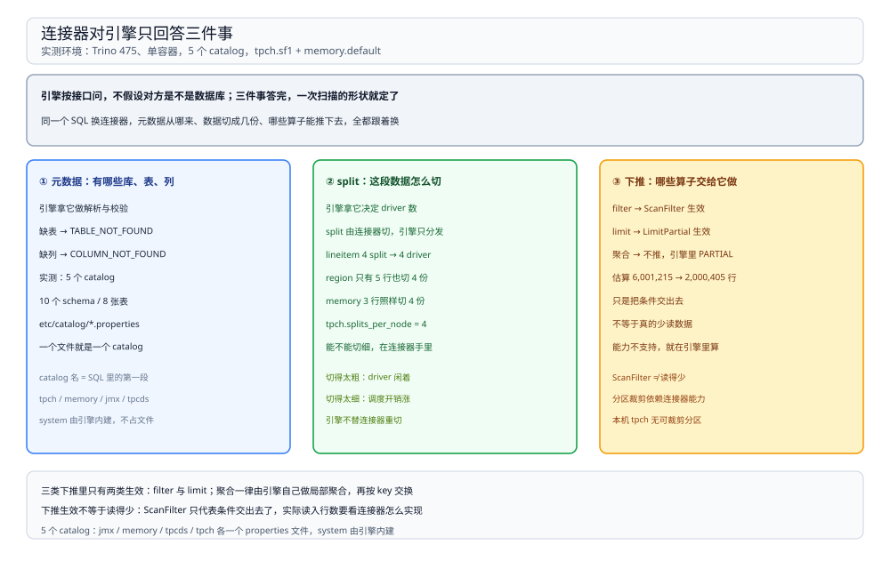
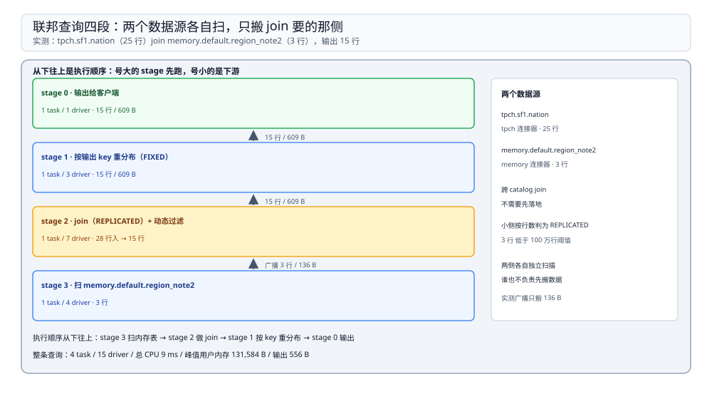

# 连接器与联邦查询

> 覆盖：连接器在 Trino 里到底负责哪三件事、`catalog.schema.table` 三段命名怎么落到 catalog 文件、**filter / limit / aggregation 三类下推各自推到了哪一层**（含 `EXPLAIN` 原文）、一条 SQL 跨两个 catalog 时数据搬了多少、split 是谁切的、以及写路径上「连接器不支持」会怎么报错。
>
> 不覆盖：stage 与 driver 的划分见 [执行与调度.md](执行与调度.md)；查询生命周期与 HTTP 协议见 [架构与查询生命周期.md](架构与查询生命周期.md)；HMS 这一侧的表名解析见 [HiveMetastore.md](../../Catalog/HiveMetastore.md)。
>
> 内容整理自个人学习笔记。本篇读数来自本机 `dockerproxy.net/trinodb/trino:475`（**475**）单容器，只用内置的 `tpch`（`sf1`）、`memory`、`jmx`、`system`、`tpcds` 五个 catalog——**没有任何外部数据源**，所以 Hive / Iceberg / MySQL 连接器的连接参数、鉴权与 split 形态未实测。

---

## 一、一句话定位：连接器决定「数据在哪、怎么切、能推给它什么」

**本节要点**：Trino 的引擎不认识任何存储格式。它只对着 `Connector` 接口问三件事：**这张表有什么列、给我一批可以独立读的 split、这个条件下你能不能少读一点**。三件事的答案质量，直接决定查询快慢。

| 连接器要回答 | 引擎用它做什么 | 本机证据 |
| --- | --- | --- |
| 有哪些 schema / table / column，统计信息是什么 | 语义分析、规划、join 侧选择 | `SHOW CATALOGS` / `information_schema.tables` / `EXPLAIN` 里的 `Estimates` |
| 这批 split 是什么（文件块 / 分区 / 行区间） | 决定 driver 数、并行读 | `region` 5 行也是 4 个 split；`lineitem` 6,001,215 行同样 4 个 |
| 谓词、limit、聚合能不能下推 | 减少读入与网络 | `ScanFilter` / `LimitPartial` / 聚合仍留在引擎侧 |



图中左侧是引擎侧的三类需求，中间是连接器接口，右侧是本机用内置 tpch / memory 连接器实测到的证据；蓝色路径是「问了就用」，橙色路径是「问了但没生效」。

⭐ 记住这条因果：**「查询慢」在 Trino 里第一嫌疑永远是「连接器给的 split 太少」或「谓词下推没生效」**，而不是引擎的算子慢。

## 二、三段命名与 catalog 文件

**本节要点**：`catalog.schema.table` 里的 `catalog` 直接对应 `etc/catalog/<name>.properties` 一个文件——**加一个数据源 = 加一个文件**，引擎不需要重启就能发现（本机未改动验证）。

| 层 | 本机实测 | 谁提供 |
| --- | --- | --- |
| catalog | `jmx` / `memory` / `system` / `tpcds` / `tpch` 共 **5** 个 | 4 个来自 `etc/catalog/*.properties`，`system` 由引擎内建 |
| schema | `tpch` 下 10 个：`information_schema`、`sf1`…`sf30000`、`tiny` | 连接器 |
| table | `tpch.sf1` 下 8 张：`customer` / `lineitem` / `nation` / `orders` / `part` / `partsupp` / `region` / `supplier` | 连接器 |

```bash
# 一个连接器一个 properties 文件；system catalog 没有文件，是引擎内建的
$ docker exec trino-mech ls /etc/trino/catalog
jmx.properties  memory.properties  tpcds.properties  tpch.properties
```

两个容易忽略的点：

1. **`system.metadata.catalogs` 里 `catalog_name` 与 `connector_name` 逐行相等**（本机 5 行全等）。一个连接器实例可以被命名成多个 catalog（比如两个 `hive` adapter 指向不同 Metastore），那时两者才会不同。
2. **`information_schema` 也是连接器提供的**，不是引擎内建表。所以不同连接器对 `information_schema.tables` 的支持程度不一样；本机 `tpch.information_schema.tables` 能正常返回 8 行 `BASE TABLE`。

## 三、三类下推：两类生效，一类没生效

**本节要点**：下推不是「生不生效」的二值判断，而是一个**分段**的判断——filter 下推成 `ScanFilter`、limit 下推成 `LimitPartial`、聚合**没有**下推到连接器，仍在引擎里做局部聚合。

实测查询与 `EXPLAIN` 原文：

```sql
EXPLAIN SELECT * FROM tpch.sf1.lineitem WHERE returnflag = 'R' LIMIT 3;
```

```text
Fragment 0 [SINGLE]
    Limit[count = 3]
    └─ LocalExchange[partitioning = SINGLE]
       └─ RemoteSource[sourceFragmentIds = [1]]

Fragment 1 [tpch:orders:1500000]
    LimitPartial[count = 3]
    └─ ScanFilter[table = tpch:sf1:lineitem, filterPredicate = (returnflag = varchar(1) 'R')]
           Estimates: {rows: 6001215 (747.67MB) ...}/{rows: 2000405 (249.22MB) ...}
```

| 下推类型 | 计划里的证据 | 结论 |
| --- | --- | --- |
| 过滤（filter） | `ScanFilter[filterPredicate = (returnflag = varchar(1) 'R')]` | ✅ 条件交给了连接器 |
| 限制（limit） | `LimitPartial[count = 3]` 出现在扫描侧，最终 `Limit[count = 3]` 在根 stage | ✅ 每个 split 只产 3 行就停 |
| 聚合（aggregation） | `Aggregate[type = PARTIAL]` 仍在引擎侧，`TableScan` 下没有聚合描述 | ❌ 没下推，聚合由引擎做 |

三点判断：

1. **`ScanFilter` 只代表「引擎把条件交出去了」**，不代表连接器真的少读了数据。tpch 连接器仍然生成整表的 split，只是把 `returnflag` 的取值当约束；估算从 6,001,215 行降到 2,000,405 行只是按「一个等值条件取 1/3」的经验值。
2. **`LimitPartial` 是「有上限的提前停止」**：每个 driver 读够 3 行就不再往下读，所以这个查询不会把 6,001,215 行全扫一遍。
3. **聚合不下推时，省网络靠的是「先局部聚合」**：`count(*)` 的计划里 `Aggregate[type = PARTIAL]` 紧贴 `TableScan`，把 6,001,215 行压成 4 行再往上送（实测交换 176 B）。

⚠️ 真正「跳过数据」的下推（分区裁剪、索引、文件级 min/max 过滤）依赖连接器自身能力，本机的 `tpch` / `memory` 都没有可裁剪的分区结构，**未实测**。

## 四、联邦查询：一条 SQL 两个数据源

**本节要点**：跨 catalog 的 join 不要求数据先落地。规划器把两侧各自切成 stage，**只把 join 需要的那一侧搬过去**——本例是小侧广播，实测只搬 136 B。

实测：`tpch.sf1.nation`（25 行）join `memory.default.region_note2`（3 行，自己 `INSERT` 进去的），输出 15 行。



图中从下往上是执行顺序：stage 3 扫内存表（3 行）、stage 2 做 join（广播侧 136 B）、stage 1 按 key 重分布（15 行、609 B）、stage 0 输出给客户端（15 行、609 B）。

| stage | 做什么 | task / driver | 数据量 |
| --- | --- | --- | --- |
| 3 | 扫 `memory.default.region_note2` | 1 / 4 | 3 行 → 3 行（广播） |
| 2 | join（`REPLICATED`）+ 动态过滤 | 1 / 7 | 28 行输入 → 15 行 |
| 1 | 按 key 重分布 | 1 / 3 | 15 行，**609 B** |
| 0 | 输出 | 1 / 1 | 15 行，**609 B** |

整条查询：4 task、15 driver、总 CPU **9 ms**、峰值用户内存 **131,584 B**、输出 556 B。

三点读法：

1. **两个数据源各自独立扫描**，谁也不负责「先把数据搬到一个地方」。`memory` 连接器给的 3 行按 4 个 split 分给 4 个 driver（行数比 split 还少，也照切）。
2. **广播的判定靠行数**：3 行被判为小侧，于是 `distribution = REPLICATED`，join 时每个 driver 手里都有一份。
3. **结果仍然要重分布**：join 完之后还要按输出顺序 merge（本例有 `ORDER BY`），所以多一个 `FIXED` 重分布 stage。

⚠️ 两侧都很大时优化器会选 `PARTITIONED`（两侧都按 key 重分布），此时网络代价是两边之和；本机没有能造出「两侧都大」的两个 catalog，**未实测**。

## 五、split 是连接器切的，不是引擎切的

**本节要点**：同一个连接器、不同表大小，split 数可以完全一样——因为 split 的策略写在连接器里（tpch 按节点切 4 片），跟行数无关。

| 表 | 行数 | 扫描侧 driver（= split 数） | 每 driver 读 |
| --- | --- | --- | --- |
| `tpch.sf1.region` | 5 | **4** | 1 ~ 2 行 |
| `tpch.sf1.lineitem` | 6,001,215 | **4** | 约 150 万行 |

这是 `tpch.splits_per_node = 4` 的直接结果：**tpch 连接器把每张表按节点切成 4 片**，与表里有多少行无关。所以「小表也开 4 个 driver」不是浪费，而是连接器没做按大小的自适应。

⭐ 工程含义：**要提速先问连接器能不能给更多 split**。真实的文件型连接器按文件块切（一个 Parquet 文件可以切成多个 split），分区型连接器按分区切；如果一张表只有一个不可切分的文件，引擎再多的节点也只能用一个 driver 读它——这也是「加机器不提速」最常见的原因。

⚠️ 文件级 split 的切分粒度、分区裁剪的实际效果都需要 Hive / Iceberg 连接器，本机**未实测**。

## 六、写路径：能力是分档的，不支持就直接报错

**本节要点**：连接器不仅要能读，还要声明「能不能写、能不能改、能不能删」。Trino **不会**在能力不足时静默降级——它直接拒绝并给出固定文案。

实测（`memory` 连接器）：

| 操作 | 结果 |
| --- | --- |
| `CREATE TABLE memory.default.region_note2 (regionkey bigint, note varchar)` | 成功 |
| `INSERT INTO ... VALUES (0,'AMERICA-NOTE'),(1,'ASIA-NOTE'),(4,'MIDEAST-NOTE')` | `INSERT: 3 rows` |
| `SHOW CREATE TABLE memory.default.region_note2` | `CREATE TABLE memory.default.region_note2 (regionkey bigint, note varchar)` |
| `DELETE FROM memory.default.region_note` | 失败：`This connector does not support modifying table rows` |

三点说明：

1. **`SHOW CREATE TABLE` 返回的是「规范化后的 DDL」**，不是原始建表语句：类型、大小写、列序都被整理过。用它对比两侧 DDL 差异时要注意这一点。
2. **`memory` 支持建表与插入，不支持删行**。所以同一条 `DELETE` 在 A 连接器能跑、在 B 连接器报错，是**能力声明**的差别，不是权限问题。
3. 写入后 `system.runtime.transactions` 里出现 **1 行**记录；连接器是否参与事务、事务边界在哪，取决于连接器实现（本机只有 memory 一条写入，未做事务对照）。

## 七、校验口径

| 内容 | 状态 |
| --- | --- |
| 5 个内置 catalog、`tpch` 下 10 个 schema / `sf1` 下 8 张表 | ✅ 本机实测（`SHOW CATALOGS` / `SHOW SCHEMAS` / `SHOW TABLES` / `information_schema`） |
| `catalog_name` 与 `connector_name` 逐行相等 | ✅ 本机实测（`system.metadata.catalogs` 5 行） |
| filter 下推成 `ScanFilter`、limit 下推成 `LimitPartial` | ✅ 本机实测（`EXPLAIN` 原文） |
| 聚合未下推，仍是引擎侧 `Aggregate[type = PARTIAL]` | ✅ 本机实测（`EXPLAIN` 原文） |
| 联邦 join：4 stage / 15 driver / 广播 136 B / 总 CPU 9 ms | ✅ 本机实测（REST `outputStage` 子树） |
| `region` 5 行与 `lineitem` 6,001,215 行同为 4 个扫描 driver | ✅ 本机实测 |
| `CREATE` / `INSERT` / `SHOW CREATE TABLE` 成功；`DELETE` 报错原文 | ✅ 本机实测（`memory` 连接器） |
| 分区裁剪、文件级 split、`PARTITIONED` 双侧重分布 | ⚠️ **未实测**：本机无带分区的连接器，也无第二个大数据源 |
| Hive / Iceberg / MySQL 连接器的 `*.properties` 与鉴权 | ⚠️ **未实测**：无外部数据源 |
| 新增 catalog 是否免重启生效 | ⚠️ **未验证** |

---

## 延伸追问

- **`ScanFilter` 出现了就代表更快的读吗？** → 不一定。`ScanFilter` 只说明条件被交给了连接器；能不能少读，取决于连接器有没有分区、索引或统计信息可用。tpch 连接器拿到条件后仍然扫整表，只是把返回的行过滤掉。
- **为什么聚合不下推？** → 下推聚合需要连接器实现 `applyAggregation`，且只对「能按分区增量计算」的聚合有意义（count / sum / min / max）。本机的 tpch / memory 都没实现，所以引擎侧先做 `PARTIAL` 聚合来压小数据量——**这已经是「不下推」情况下的最优解**。
- **联邦查询会不会把整张表拉到 Trino 里？** → 不会。搬的是 join 需要的那一侧（本例 3 行广播），大表留在源侧被扫。真正会拉全表的是「两侧都大且没有可用谓词」的 join，那属于 SQL 写法或统计信息问题。
- **一张表只有一个 split 会怎样？** → 这个 stage 只有一个 driver，多节点也帮不上忙；吞吐上限就是那一份数据的读取速度。遇到这种表要先看它能不能被切分（文件块、分区键），而不是加节点。
- **`catalog` 名字可以随便起吗？** → 起名只影响 `etc/catalog/<name>.properties` 与 SQL 里的三段式；同一个连接器可以起多个 catalog 名指向不同 Metastore。改名的代价是所有 SQL 与视图里的前缀都要跟着改。
- **`SHOW CREATE TABLE` 能用来做迁移吗？** → 可以看结构，但它是规范化 DDL，可能丢掉原表的属性（注释、分区子句、连接器私有属性）；跨连接器迁移仍要按目标连接器的 DDL 语法重写。

---

## 关联

- [README.md](README.md) — 本册导读：四篇分工与读序
- [执行与调度.md](执行与调度.md) — **上游**：split 与分区数决定 driver 数，那一篇讲 stage 形状
- [架构与查询生命周期.md](架构与查询生命周期.md) — **上游**：规划期向连接器要统计信息，那一篇讲六段路径
- [资源组与排障.md](资源组与排障.md) — **对照**：下推没生效时，排障从哪张表看出「读了多少行」
- [Iceberg.md](../../表格式/Iceberg.md) — **下游**：文件型连接器的 split 来自表格式的元数据
- [HiveMetastore.md](../../Catalog/HiveMetastore.md) — **下游**：`hive` catalog 背后要连的元数据服务
- [大数据选型对比.md](../../大数据选型对比.md) — **上游总纲**：联邦查询引擎在四层里的位置
