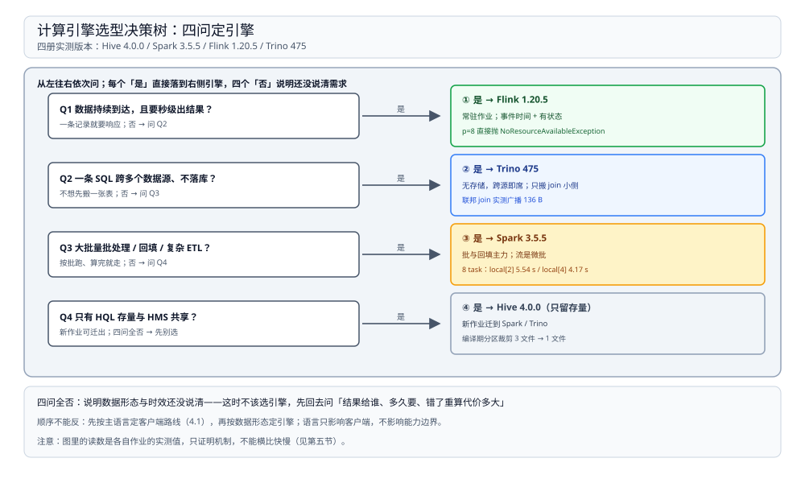
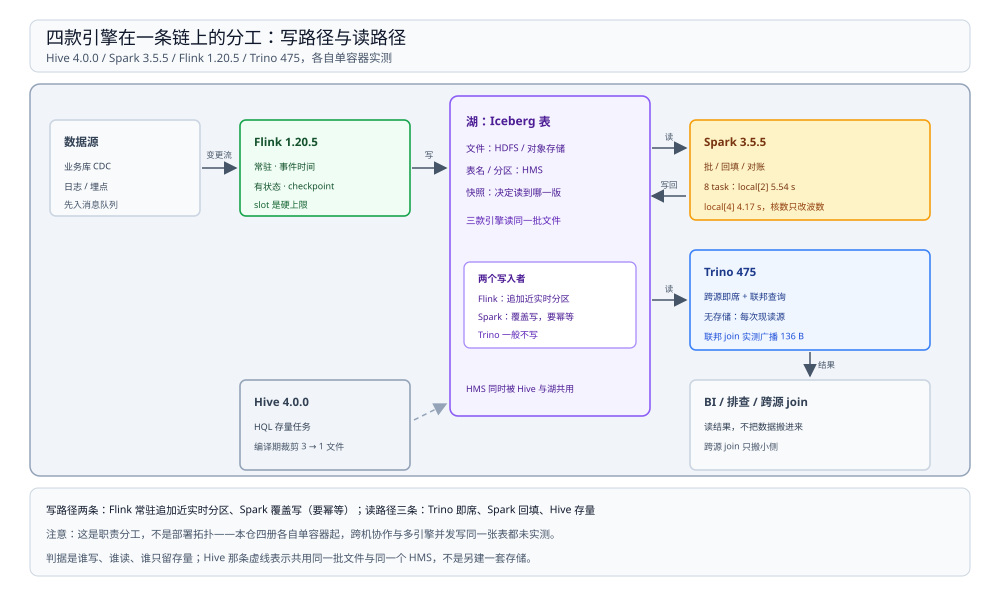

# 计算引擎选型对比

> 覆盖：引擎层的四个候选——Hive、Spark、Flink、Trino——按**数据在哪、时间从哪来、状态存在哪、失败怎么恢复**四条分水岭怎么分；四款各自的定位与代价、同一批湖表上怎么组合、以及「一个问题该问哪个引擎」的决策路径与语言前提。
>
> 不覆盖：四层（文件系统 / 表格式 / Catalog / 引擎）之间靠哪四根接口连接、跨层怎么选，见 [大数据选型对比.md](../大数据选型对比.md)；每款的机制细节、参数与报错原文见 [Hive 册](Hive/README.md)、[Spark 册](Spark/README.md)、[Flink 册](Flink/README.md)、[Trino 册](Trino/README.md)；OLAP 数据库（ClickHouse / Doris / StarRocks）的选型在存储侧，见 [列式数据库选型对比.md](../../数据存储/列式数据库/列式数据库选型对比.md)。
>
> 内容整理自个人学习笔记。⭐ 本篇是判据与对照，**不新增实测**；引用的读数全部来自四册的实测坐标并注明出处。四册的作业、数据规模与运行模式各不相同，**不能横向比快慢**——第五节专门说这件事。

---

## 一、引擎层的分水岭在哪？

**本节要点**：引擎层的选择不看「谁更快」，看**四件事归谁管**——数据在哪、时间从哪来、状态存在哪、失败后从哪恢复。四个答案组合起来，一个引擎的适用边界基本就定了。

| 分水岭 | Hive | Spark | Flink | Trino |
| --- | --- | --- | --- | --- |
| 数据在哪 | 外部存储；自己只留 HMS 元数据 | 外部存储，读进 executor | 外部存储，读进算子 | 外部存储，经连接器现读 |
| 时间从哪来 | 提交时刻；无事件时间 | 微批边界；流式靠批内 watermark | ⭐ 数据自带时间戳 + 水位线 | 查询时刻；无窗口 |
| 状态存在哪 | 无；中间结果落 HDFS | 血缘 + shuffle 落盘；流式另有 state store | ⭐ 引擎内 keyed / operator state，随 checkpoint 快照 | 无；中间结果只在内存 |
| 失败恢复单位 | 整条 HQL 重跑 | 丢了的那段血缘重算 | 从最近一次 checkpoint 回滚 | 查询级重跑 |
| 典型触发 | 调度系统按点触发 | 提交作业 / 微批间隔 | 常驻，记录级 | 人按需提交 |

⭐ **一句话记忆**：**Hive 只剩元数据与存量 SQL，Spark 管批与回填，Flink 管常驻与时间语义，Trino 管跨源即席。**

⚠️ 一句纠偏：这四个不是「同一件事的四种实现」。Trino 根本不存数据，写能力取决于连接器；Flink 不擅长回填历史；Spark 的流是微批；Hive 的 HQL 执行通道今天基本只剩兼容价值。按「哪个更流行」选，四款里总有三款会被用错地方。

---

## 二、四个候选各自回答什么问题？

**本节要点**：四款各有一句「它唯一不可替代的地方」和一条「它最容易被误用的地方」。先记住这两句，再看参数。

### 2.1 Hive：还在一线的是元数据与存量 SQL，不是执行

HQL 走**六步编译**（解析 → 语义分析查 HMS → 逻辑计划 → 优化 → 物理计划 → 执行），其中**分区裁剪发生在优化阶段，编译期就能判定**——实测 3 个分区文件裁到 1 个，不需要真跑作业。

它今天的位置是两样东西：

1. **HMS**：作为 Catalog 层被所有引擎共用（细化见 [HiveMetastore.md](../Catalog/HiveMetastore.md)）；
2. **HQL 存量与分层建模规范**：ODS / DWD / DWS / ADS 这套语言仍然是数仓的通用口语。

**代价**：编译链路后面挂的是 MR / Tez 作业，重且慢；没有事件时间、没有状态；与 Spark SQL 有四处不兼容（分区列位置相反、`ROW FORMAT SERDE` 与 `STORED AS` 冲突、`STORED AS` 被规范化成 `USING parquet`、SerDe 只在 `DESCRIBE FORMATTED` 里可见），其中两处**不报错、只是慢或优化失效**。另外实测到一处陷阱：**Spark 写 Hive 分桶表不分桶**——`4 BUCKETS` 写 5 行产出 5 个文件。

⚠️ 本册对 Hive 的实测**只到编译计划**，MR / Tez 作业的真实耗时未测。所以「Hive 慢」在本仓是文档口径，不是读数。

### 2.2 Spark：批处理与回填的主力，流的边界是微批

Spark 与 MapReduce 的分水岭不是「用不用磁盘」，而是**中间结果怎么传**：stage 内算子串成管道直接传，跨 stage 才落本地盘。所以它的强项是**一次提交、算完就走的批作业**——历史回填、对账、复杂 ETL、训练前的特征加工。

三个实测读数说明它的成本结构：

| 读数 | 值 | 说明 |
| --- | --- | --- |
| 核数只改波数 | 8 个 task × 0.8 s：`local[2]` **5.54 s** / `local[4]` **4.17 s** | 时间由「task 数 ÷ 并行槽」决定，不是核越多越快 |
| AQE 改的是实际 task 数 | 计划写 200，关 AQE 起 200 个 task；开 AQE 只起 **1 个** | 计划里的分区数是上限，不是实际并发 |
| task 数量本身是固定成本 | 400 个 reduce task 只写 147,888 B，却跑了 **43.63 s** | 分区给多了，调度开销会盖过数据量 |

**代价**：微批的延迟下限就在那里，单条记录要秒级响应不要用它；shuffle 落盘与 task 固定成本都在；本册只有 `local[n]`，多 executor 的负载不均、跨机拉取、YARN / K8s 排队均未实测。

### 2.3 Flink：时间与状态归引擎，代价是常驻资源

Flink 唯一不可替代的是**「事件时间 + 有状态」同时成立**：水位线是「不会再有更早数据」的承诺，窗口按它触发（`[0,10)` 在 +1,923 ms 才出结果）；状态是一等公民，barrier 流过所有算子时被拍成快照。

两个读数说明它的运行方式：

- **slot 是硬上限，不是排队**：p=1 / 2 / 4 → 12,310 / 6,318 / 3,430 ms；p=8 直接抛 `NoResourceAvailableException`，作业根本起不来；
- **反压就是缓冲池被写满**：`outPoolUsage` **1.0**，`numBytesOut` 均值 2,621,440 B = 80 × 32 KB；
- 检查点 28 次完成 / 0 失败，`state_size` 恒 202,722 B（全量重写）。

**代价**：作业常驻，资源不按「跑完就还」算；状态规模直接压在堆与磁盘上；本册单容器、4 slot，多 TM、跨机传输、RocksDB 与 savepoint 改并行度都未实测。

### 2.4 Trino：没有存储的查询层

Trino 对引擎只要求连接器回答三件事：**元数据、split、下推**。它自己没有存储、没有长活状态，一条查询结束，中间结果就没了——所以它的强项是**跨源即席查询**：一条 SQL 同时扫两个 catalog，只把 join 需要的那小侧搬过来。

实测支撑：

| 事实 | 读数 |
| --- | --- |
| 规划可能比执行还显眼 | group-by：解析 11.39 ms、规划 **284.06 ms**、执行 4.16 s |
| 下推只成两类 | filter → `ScanFilter`、limit → `LimitPartial`；聚合仍是引擎侧 `PARTIAL` |
| 联邦只搬小侧 | nation 25 行 × memory 3 行：4 stage / 15 driver，广播 **136 B** |
| 单节点的并行是 driver | 最终聚合 1 个 task、4 个 driver，交换 12 行 / **424 B** |

**代价**：每次查询都现读源，源慢它就慢；写能力分档（`memory` 连接器直接拒绝 `DELETE`：`This connector does not support modifying table rows`）；没有 `resource-groups.properties` 时只有一个 `[global]`，没有任何配额；多节点、Hive / Iceberg 连接器、FTE 重试均未实测。

---

## 三、横向对比：哪些维度必须并排看？

**本节要点**：并排看的是**机制**，不是性能。三张表分别回答：它擅长什么、时间与状态怎么处理、资源不够时表现成什么样。

### 3.1 定位速览

| 维度 | Hive | Spark | Flink | Trino |
| --- | --- | --- | --- | --- |
| 时效 | 批 | 批 + 微批 | ⭐ 原生流 + 批 | 交互式查询 |
| 延迟下限 | 分钟级（文档口径） | 一个微批间隔 | ⭐ 一条记录 | 秒级 |
| 官方 API | Java（HiveServer2 + JDBC） | Java / Scala / Python | Java / Scala / Python | Java + 任意 SQL 客户端 |
| 状态 | 无 | 血缘；流式有 state store | ⭐ 一等公民 | 无 |
| 资源单位 | YARN 容器（未实测） | executor 的核与内存 | ⭐ slot | worker + 资源组 |
| 写表能力 | 可写 Hive 表 | 可写多种格式 | 由 sink 决定 | 由连接器决定（分档） |
| SQL 覆盖面 | HQL | Spark SQL | Flink SQL | Trino SQL（跨源） |
| 单机可跑 | HS2 单容器 | `local[n]` | 单容器 JM+TM 同进程 | 单容器 coordinator 兼 worker |
| 运维成本 | 低（但生态在退） | 中 | 中高（常驻 + 状态） | 低（不存数据） |
| 最适合的第一件事 | 维护存量 | 回填与对账 | 秒级流水线 | 跨源排查与报表 |

⚠️ 表里「延迟下限」「写表能力」「YARN 容器」是文档口径与机制推论，本仓四册没有对应实测；带 ⭐ 的三格有读数支撑（见第二节）。

### 3.2 时间与状态：四种处理方式

| 问题 | Hive | Spark | Flink | Trino |
| --- | --- | --- | --- | --- |
| 事件时间 | 不支持 | 微批内 watermark（文档口径） | ⭐ 一等公民，驱动窗口触发 | 不支持 |
| 窗口怎么关 | 无窗口 | 按微批 / watermark | ⭐ 水位线 ≥ 右边界 − 1 ms | 无窗口 |
| 状态放哪 | 无 | executor 内存 + state store | ⭐ 托管状态，随 checkpoint 快照 | 无 |
| 迟到数据 | — | 丢弃或按 watermark 处理 | 旁路输出；`allowedLateness` 未实测 | — |

⭐ **判据**：只要「结果对不对取决于数据自带的时间」，就只能是 Flink；按处理时刻算账（每天跑一次、每 15 分钟一批）用 Spark 或调度批次更简单，硬上 Flink 只会多一套常驻资源和状态运维。

### 3.3 资源与失败恢复：三种「不够」长得不一样

| 维度 | Hive | Spark | Flink | Trino |
| --- | --- | --- | --- | --- |
| 资源单位 | YARN 容器 | executor 核与内存 | slot（并行度上限） | worker + 资源组配额 |
| 资源不够时 | 排队 | 排队等 executor | ⭐ 提交即失败 | 排队或按配额拒绝 |
| 恢复粒度 | 整条 HQL | 丢失分区的那段血缘 | 最近一次 checkpoint | 整条查询 |
| 观测点 | HS2 日志（未实测） | 事件日志的 stage / task | REST + metrics | `system.runtime.*` + REST |

⭐ 看到「作业起不来」先分清是哪一种：**Flink 是硬失败**（slot 不够直接抛 `NoResourceAvailableException`），**Spark 是排队**（executor 迟迟不分配），**Trino 是卡在资源组**（`state=RUNNING` 但没有 task、`queued_time_ms` 在涨）。三者的处置动作完全不同。

---

## 四、怎么选？

**本节要点**：先按**团队主语言**定「作业代码放哪、谁来提交」，再按**数据形态**定引擎——顺序不能反，因为语言只影响客户端路线，不影响引擎的能力边界。



图从左到右是四个问题，每个「是」直接落到右侧对应的引擎；四问全「否」说明还没说清数据形态与时效，这时不该选引擎。图里每个引擎卡片下都标了本仓的实测版本与一条关键读数。

### 4.1 先按主语言定客户端路线

| 主语言 | 作业代码写在哪 | 怎么提交 | 查询怎么接 | 注意 |
| --- | --- | --- | --- | --- |
| Java | Java / Scala，打 jar 或 JVM 客户端 | `spark-submit` / `flink run` / JDBC | JDBC | 四个引擎都原生，选型只看数据形态 |
| Go | ⭐ 不在 Go 里写作业，交给 Java / Python 侧 | Spark 走 Livy REST、Flink 走 REST / CLI | Trino 有 trinodb 仓库的 Go client（本册未实测） | 多一层提交服务，日志与重试要自己接 |
| PHP / 多语言 | 同上 | 交给调度系统，不直接暴露提交面 | Trino 走 HTTP / JDBC 网关 | 只做 SQL 客户端，不要把 UDF 写在 PHP |

> ⭐ **先说清**：主语言决定的是「作业代码放哪、谁来提交」，**不决定选哪个引擎**。引擎由数据形态与时效决定，见 4.2 之后的判据。

### 4.2 契合语言与团队栈怎么选 ⭐

同一份机制清单落到不同语言上，**客户端与提交面的成熟度**差别很大，而它往往是隐性成本最高的一项——引擎本身是 JVM 的，这一点换不掉。

| 产品 | 服务端 | 最契合语言 | Java 侧实际体验 | Go 侧实际体验 | PHP / 其他 |
| --- | --- | --- | --- | --- | --- |
| Hive | JVM（HiveServer2 + HMS） | Java | JDBC / Thrift 原生，UDF 用 Java 写 | 无官方驱动，只能第三方 Thrift 或经网关转 JDBC | 同 Go，且 Thrift 库多年未更新（未实测） |
| Spark | JVM | Java / Scala，其次 Python | 官方 API，作业打 jar 提交 | 无官方 API，靠 Livy REST 提交，作业本身仍要 Java / Python 写 | PySpark 官方；PHP 只能走查询网关 |
| Flink | JVM | Java / Scala，其次 Python | DataStream / Table API 原生，UDF 一等公民 | 无官方 API，提交走 REST / CLI，作业本身仍要 Java / Python 写 | PyFlink 官方；PHP 无 |
| Trino | JVM | Java（JDBC），其余靠 SQL | JDBC 官方，客户端极薄 | trinodb 仓库有 Go client（本册未实测） | 无官方客户端；HTTP 协议最简单，可自己封 |

> ⭐ **三条结论**：
> ① **Go 团队**：不要试图用 Go 写作业——四个引擎的作业 API 都不是 Go。Go 只承担「提交 + 查询」：Spark 走 Livy、Flink 走 REST、Trino 用官方 Go client；UDF 也放在 Java / Python 侧。
> ② **Java 团队**：四个都能用 Java 接，选型只看数据形态与时效；只有「已有 HQL 存量或必须共享 HMS」时才保留 Hive。
> ③ **PHP / 多语言混合团队**：只做 SQL 客户端；Trino 的 HTTP 协议最适合「只查询」的接入，Spark / Flink 的提交面不要暴露给 PHP，交给调度系统。

> ⚠️ **反面教训**：客户端缺失不是「少几个 API」，而是**提交与排障能力缺失**——Go 侧提交 Spark 只能靠 Livy，作业日志、参数覆盖、重试都要多接一层；一旦失败，先要排除的是提交层，而不是作业本身。

### 4.3 组合用法：一套湖上三个引擎

四款不是互斥选项。同一条链路的常见摆法是：**Flink 写近实时、Spark 回填与对账、Trino 即席与联邦、Hive 只留存量与 HMS 共享**。



图中箭头是数据方向：源到 Flink 到湖是写路径，湖到 Trino / Spark 是读路径；Hive 那一条用虚线，表示它与湖共用同一批文件与同一个 HMS，而不是另建一套存储。各卡片下标注的是本仓实测版本与该册的一条关键读数。

| 角色 | 什么时候跑 | 读什么 | 写什么 | 失败怎么办 |
| --- | --- | --- | --- | --- |
| Flink | 常驻 | 消息队列 / CDC 流 | 湖表的近实时分区 | 从 checkpoint 回滚 |
| Spark | 每 15 分钟 / 日批 / 手工回填 | 湖表 + 源库快照 | 湖表，覆盖写要幂等 | 重跑该批次 |
| Trino | 即席 | 湖表 + 外部数据源 | 一般不写 | 重跑查询 |
| Hive | 存量任务 | Hive 表 | Hive 表 | 重跑 HQL |

⚠️ 这张图是**职责分工**，不是部署拓扑：本仓四册都在单容器里各自独立起，跨机协作、多引擎并发写同一张表、HMS 的并发提交都未实测。

### 4.4 什么时候不该用

| 引擎 | 不该用来做 | 为什么（带读数） |
| --- | --- | --- |
| Hive | 新作业的起点 | 编译链路后面是 MR / Tez；与 Spark SQL 四处不兼容，且两处不报错 |
| Spark | 单记录秒级响应 | 微批延迟下限；本册最小的调度单位就是一批 task |
| Flink | 回填历史与大批量重算 | 常驻资源按 slot 计（p=8 直接失败）；回填是 Spark 的活 |
| Trino | 大批量 ETL 落地 | 无存储、写能力分档（`memory` 拒绝 `DELETE`）、每次现读源 |

### 4.5 选型评估清单

| 评估项 | 要问的问题 |
| --- | --- |
| 时效 | 数据到达后多久必须出结果？一条记录还是按批？ |
| 数据形态 | 源在几个系统？要不要跨源 join？能不能先落一张表？ |
| 状态规模 | 要记住多少 key、多大状态？丢了能不能重算？ |
| 失败代价 | 重跑整条链路的代价是多少？能不能只重算一段？ |
| 资源形态 | 能常驻吃 slot，还是只能按批申请 executor？ |
| 客户端与提交 | 谁来提交作业？失败时看哪一层日志？ |
| **契合语言 / 客户端质量** ⭐ | 团队主语言有没有官方 API？没有的话提交层是谁？ |
| 观测与排障 | 有没有 `system.runtime` / REST / 事件日志这类可查的运行时事实？ |

---

## 五、这些读数能横向比快慢吗？

**本节要点**：不能。四册的作业不同、数据规模不同、运行模式也不同，读数只证明「机制确实如此」，不证明「谁更快」。

| 册 | 关键读数 | 那是什么作业 | 什么环境 |
| --- | --- | --- | --- |
| [Hive 册](Hive/README.md) | 分区裁剪 3 文件 → 1 文件 | 一张分区表的编译计划 | Hive 4.0.0，只到编译，未提交 MR 作业 |
| [Spark 册](Spark/README.md) | 8 task × 0.8 s → 5.54 s / 4.17 s | 8 个固定耗时的 task | `local[2]` / `local[4]`，单 JVM |
| [Flink 册](Flink/README.md) | p=1/2/4 → 12,310 / 6,318 / 3,430 ms | 一个 `keyBy` + 窗口聚合作业 | 单容器、JM 与 TM 同进程、4 slot |
| [Trino 册](Trino/README.md) | 规划 284.06 ms、执行 4.16 s | `lineitem` 6,001,215 行的 group-by | 单容器、coordinator 兼 worker |

三条理由：

1. **作业不同**：Spark 那组是 8 个等长 task 的调度实验，Flink 那组是窗口聚合，Trino 那组是六百万行扫描——连「工作量」都不是一回事；
2. **数据规模不同**：Spark 4 万 ~ 300 万行、Flink 300 ~ 300,000 条、Trino 600 万行；
3. **运行模式不同**：三者都是单容器 / 单 JVM，没有跨机传输，也没有真实资源竞争。

⭐ 读数的正确用法是**证明机制**：slot 是硬上限（p=8 失败）、规划可以占掉可观时间（284 ms）、task 数本身是成本（400 task 43.63 s）、缓冲区满就是反压（`outPoolUsage` 1.0）。

⚠️ **反面教训**：把「Flink 3,430 ms」和「Spark 4.17 s」并排说「Flink 快 1.2 倍」，是拿两个不同作业的两个不同指标在比——这类结论一进评审就会被推翻，正确说法是「两者的延迟下限分别是一条记录和一个微批」。

---

## 使用：本目录怎么读

**本节要点**：按你手上的问题选入口，不按目录顺序读。

| 你在问什么 | 看哪里 |
| --- | --- |
| 四个引擎到底怎么分、该选哪个 | ⭐ **本篇第一、四节** |
| 四层（文件系统 / 表格式 / Catalog / 引擎）怎么叠、接口在哪 | [大数据选型对比.md](../大数据选型对比.md) |
| HQL 的编译链路、分区与分桶、与 Spark SQL 的差异 | [Hive 册](Hive/README.md) |
| HMS 怎么部署、怎么被多引擎共用 | [HiveMetastore.md](../Catalog/HiveMetastore.md) |
| Spark 作业为什么慢、stage 怎么切、shuffle 落了什么 | [Spark 册](Spark/README.md) |
| Flink 的窗口为什么不触发、slot 为什么是硬上限、反压看哪 | [Flink 册](Flink/README.md) |
| Trino 怎么跨源、下推推到了哪、慢查询按什么顺序查 | [Trino 册](Trino/README.md) |
| 这套平台里三个引擎怎么排班、15 分钟微批怎么切 | [04 大数据平台册](../../../04-架构与系统/系统设计/大数据平台/README.md) |

**读序**（前一篇的概念是后一篇的前提）：

```text
本篇（谁适合什么）──> Hive（老链路怎么编译）──> Spark（批怎么切 stage）──> Flink（时间与状态怎么管）──> Trino（没有存储怎么查）
```

---

## 延伸追问

- **Hive 到底还算不算引擎？** → 它有三重身份：HMS 是 Catalog 层的落地件、HQL 是引擎、分层建模是方法论。今天只有 HMS 还在一线；HQL 通道在存量与兼容场景保留，新作业应落在 Spark 或 Trino 上。
- **Spark Structured Streaming 能不能替代 Flink？** → 能覆盖「微批就够」的场景，替代不了「一条记录 + 事件时间 + 大状态」。判据是延迟下限与状态规模：接受一个微批的延迟且状态不大，Spark 一套栈更省；要秒级且状态要一致快照，就是 Flink。
- **Trino 能不能当 ETL 引擎？** → 不适合。它无存储、写能力由连接器分档，`memory` 连接器实测直接拒绝 `DELETE`；它的价值是「不落库就能查」，落地与重写交给 Spark / Flink。
- **只允许选一个，选哪个？** → 看第一需求：要把历史算对 → Spark；要持续出结果 → Flink；要跨源即席查 → Trino。三者的机制互不覆盖，硬选一个必然要放弃另外两类场景。
- **这些单机读数有什么用？** → 它们证明机制边界（slot 是硬上限、规划会占时间、task 数是成本、缓冲池满即反压），这些结论换机器仍然成立；具体秒数不能外推。
- **为什么没有 ClickHouse / Doris / StarRocks？** → 它们自己存数据，属于「列式数据库」这一层，归 [列式数据库选型对比.md](../../数据存储/列式数据库/列式数据库选型对比.md)；本篇只覆盖「读别人的数据来算」的引擎。

---

## 关联

- **上游/总纲**：[大数据选型对比.md](../大数据选型对比.md) — 四层分工、四根接口与本目录的目录结构
- **上游/总纲**：[04 大数据平台册](../../../04-架构与系统/系统设计/大数据平台/README.md) — 三个引擎在一套 15 分钟时效平台里怎么排班
- **下游机制**：[Hive 册](Hive/README.md) — HQL 的六步编译、分区与分桶、与 Spark SQL 的不兼容
- **下游机制**：[Spark 册](Spark/README.md) — DAG 切分、shuffle、内存与调优
- **下游机制**：[Flink 册](Flink/README.md) — 水位线、检查点、网络栈与反压
- **下游机制**：[Trino 册](Trino/README.md) — 五层对象、连接器接口、资源组与错误码
- **对照/互补**：[HiveMetastore.md](../Catalog/HiveMetastore.md) — 四款共用的表名解析那一层
- **对照/互补**：[列式数据库选型对比.md](../../数据存储/列式数据库/列式数据库选型对比.md) — 自己存数据的 OLAP 引擎，与本篇的边界
- **对照/互补**：[Iceberg.md](../表格式/Iceberg.md) — 三个引擎读写的同一份表格式
