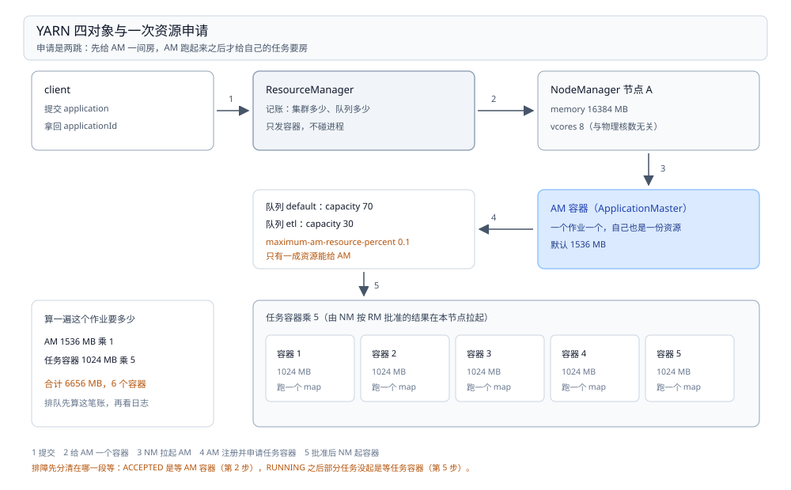

# YARN

> 覆盖：YARN 在资源调度这一层里的真实身份——它是**集群资源的柜台**，不执行任何计算；RM / NM / AM / Container 四个对象各管一段、一次作业为什么要申请两次容器、队列的 `capacity` 与 `maximum-capacity` 到底是什么关系、容器被杀有哪三种死法、`vcore` 与物理核数为什么对不上，以及出问题时按什么顺序查。
>
> 不覆盖：YARN 与 Kubernetes / Mesos 怎么选、三套系统里同一件事各叫什么，见 [资源调度选型对比.md](资源调度选型对比.md)；七层职责怎么分见 [大数据选型对比.md](../大数据选型对比.md)；**平台整体怎么摆、容量怎么估**见 [K8s部署与运维.md](../../../04-架构与系统/系统设计/大数据平台/K8s部署与运维.md) 与 [容量规划与成本.md](../../../04-架构与系统/系统设计/大数据平台/容量规划与成本.md)。
>
> 内容整理自个人学习笔记，并参考 Hadoop 官方文档。⚠️ **本篇没有任何本机读数**——本机没有可观测的 YARN 集群，而队列分摊、容器被杀、`ACCEPTED` 卡住这三类现象**只有多节点并发才出现**，单机 minicluster 跑出来的数字不具参考价值，按纪律不写。文中参数默认值按 Hadoop 3.x 陈述，**未在本机核对**，以 `yarn-site.xml` 与 `yarn-default.xml` 为准。

---

## 一、一句话定位：集群资源的柜台

**本节要点**：YARN 的分水岭不是「能不能跑作业」，而是**它自己不跑**——它把节点上的 CPU 与内存切成一间间房（Container），按队列租出去，谁租到谁在里面跑自己的东西。

| 谁 | 干什么 | 类比 |
| --- | --- | --- |
| ResourceManager（RM） | 记账：全集群有多少资源、每个队列分到多少、谁在排队 | 柜台 |
| NodeManager（NM） | 出租：在本节点上按 RM 给的规格拉起容器、盯着它用多少 | 房东 |
| ApplicationMaster（AM） | 谈判：代表一个作业向 RM 要容器、安排任务、汇报进度 | 包工头 |
| Container | 租约：一份内存 + 若干 vcore 的占用凭证 | 一间房 |

⭐ 三条推论直接成立：

1. **计算不归 YARN 管**——MapReduce、Spark、Flink 各自跑在自己的容器里，YARN 只负责「给你一间房、时间到了看你还活着」；
2. **规格不可变**——容器申请下来就不能改内存，想要更大只能申请新的。所以所有引擎的参数调优（executor 内存、map 内存）最终都落成一次容器申请；
3. **作业的失败重试由 AM 决定**，不是 RM。RM 只关心「容器还活着吗」；「任务失败了要不要重试」是 AM 与引擎的事。

⚠️ 常见误判：把 YARN 当成「Hadoop 的调度器」。Hadoop 只是它的第一个住户。**今天跑在 YARN 上的主力是 Spark、Hive 与存量 Sqoop**，MapReduce 本身已经是少数。

## 二、核心概念：四个对象与三个参数族

**本节要点**：YARN 的对象只有四个，但参数分三族且互相卡死——**资源规模族**决定「一间房多大」、**队列族**决定「这层楼归谁」、**调度器族**决定「按什么规则发钥匙」。三族配不匹配的典型表现是「作业一直 ACCEPTED」。

| 对象 | 由谁创建 | 一句话 |
| --- | --- | --- |
| ResourceManager | 集群启动 | 全局唯一，管所有队列与节点 |
| NodeManager | 每台从节点一个 | 上报本节点资源，按 RM 指令起容器 |
| ApplicationMaster | 每个作业一个（跑在容器里） | 向 RM 要资源、向 NM 下命令、向 RM 报进度 |
| Container | AM 申请、RM 批准、NM 拉起 | 一份内存 + 若干 vcore 的租约 |

| 参数族 | 关键项 | 默认值（3.x） | 它卡住什么 |
| --- | --- | --- | --- |
| 资源规模 | `yarn.nodemanager.resource.memory-mb` | 8192 | ⭐ 本节点**最多借出**多少内存 |
| 资源规模 | `yarn.nodemanager.resource.cpu-vcores` | 8 | ⭐ 本节点最多借出几个核（与物理核数**无关**） |
| 资源规模 | `yarn.scheduler.minimum-allocation-mb` | 1024 | 一个容器最少要多少（不足按此向上取整） |
| 资源规模 | `yarn.scheduler.maximum-allocation-mb` | 8192 | 一个容器最多能给多少 |
| 资源规模 | `yarn.scheduler.maximum-allocation-vcores` | 4 | 一个容器最多几个 vcore |
| 资源规模 | `yarn.nodemanager.vmem-pmem-ratio` | 2.1 | 虚拟内存不得超过物理内存的几倍 |
| 队列 | `yarn.scheduler.capacity.root.queues` | `default` | 队列树的分支 |
| 队列 | `...root.<q>.capacity` | 100 | ⭐ 该队列的**保底**百分比 |
| 队列 | `...root.<q>.maximum-capacity` | 100 | ⭐ 该队列的**上限**百分比（空闲时可借到） |
| 队列 | `...root.<q>.user-limit-factor` | 1 | 单用户最多用本队列的几倍 |
| 队列 | `yarn.scheduler.capacity.maximum-am-resource-percent` | 0.1 | ⭐ 队列里最多用 10% 跑 AM |
| 调度器 | `yarn.resourcemanager.scheduler.class` | Capacity Scheduler | FIFO / Capacity / Fair 三选一 |
| 调度器 | `yarn.resourcemanager.scheduler.monitor.enable` | false | 抢占总开关，⚠️ 默认关 |

⭐ **三族里最容易被忽略的是 `maximum-am-resource-percent`**：默认只有 10% 的队列资源能给 AM。队列里全是「每作业一个 AM」的小作业时，**内存明明空着，新作业却一直 ACCEPTED**——因为 AM 的份额用完了。这是 YARN 里最反直觉的一处。

## 三、整体架构：一次作业为什么要申请两次容器

**本节要点**：YARN 的申请是**两跳**——先给 AM 一间房，AM 跑起来之后再给自己的任务要房。中间隔着一个「作业已提交、但一个任务都还没起」的状态，这也是大多数「提交了没反应」的现场。



图要读出的是**「AM 自己也是一份资源」**：一个 5 个 map 的作业，实际要 1 个 AM 容器加 5 个任务容器，共 6 份。所以「作业数 × AM 开销」在大量小作业的场景下会先撞上 `maximum-am-resource-percent`，而不是撞上总内存。

| 步骤 | 谁 → 谁 | 发生了什么 | 卡住时的表现 |
| --- | --- | --- | --- |
| 1 | client → RM | 提交 application，请求第一个容器跑 AM | 报错退出（队列不存在、权限不够） |
| 2 | RM → client | 给一个 AM 容器（或先排队） | ⭐ 一直 `ACCEPTED` |
| 3 | NM → 新容器 | 按规格拉起 AM | `FAILED`（镜像 / 环境 / 内存不够） |
| 4 | AM → RM | 注册，申请 N 个任务容器 | AM 日志里反复 `Waiting for containers` |
| 5 | RM → AM | 逐个分配（可能分批） | 部分任务起、部分等 |
| 6 | AM → NM | 用分配到的容器启动任务 | 容器 `RUNNING` 后立刻退出 |
| 7 | AM → RM | 全部完成，注销 | 作业成功但 AM 日志有异常 |

⚠️ 第 2 步和第 5 步是**两个独立的等待点**，排障时必须先分清在哪一段等：`ACCEPTED` 是等 AM 容器，`RUNNING` 之后的「部分任务没起」是等任务容器。两者的原因与对策完全不同。

## 四、部署：最小可运行配置与启动检查

**本节要点**：YARN 的部署只有一件事——**让 RM 认为集群有资源、让 NM 认为本节点该借多少**。这两件事都由配置决定，配错的表现是「集群起来了，但资源显示为 0」。

最小配置（`etc/hadoop/yarn-site.xml`）：

```xml
<configuration>
  <!-- 本节点愿意借出多少：这两个值决定「集群总容量」，不是物理规格 -->
  <property>
    <name>yarn.nodemanager.resource.memory-mb</name>
    <value>16384</value>
  </property>
  <property>
    <name>yarn.nodemanager.resource.cpu-vcores</name>
    <value>8</value>
  </property>

  <!-- 单容器的上下限：调度器按这个范围把申请值向上取整 -->
  <property>
    <name>yarn.scheduler.minimum-allocation-mb</name>
    <value>1024</value>
  </property>
  <property>
    <name>yarn.scheduler.maximum-allocation-mb</name>
    <value>16384</value>
  </property>

  <!-- 集群拓扑：单节点也要写，否则 RM 认为没有可用节点 -->
  <property>
    <name>yarn.resourcemanager.hostname</name>
    <value>rm.example.com</value>
  </property>
  <property>
    <name>yarn.nodemanager.aux-services</name>
    <value>mapreduce_shuffle</value>
  </property>
</configuration>
```

队列配置（`etc/hadoop/capacity-scheduler.xml`），两层队列，`etl` 保底 30%、最多可借到 80%：

```xml
<configuration>
  <property>
    <name>yarn.scheduler.capacity.root.queues</name>
    <value>default,etl</value>
  </property>
  <property>
    <name>yarn.scheduler.capacity.root.default.capacity</name>
    <value>70</value>
  </property>
  <property>
    <name>yarn.scheduler.capacity.root.etl.capacity</name>
    <value>30</value>
  </property>
  <property>
    <name>yarn.scheduler.capacity.root.etl.maximum-capacity</name>
    <value>80</value>
  </property>
</configuration>
```

⭐ 注意 `capacity` 之和必须等于 100：`70 + 30`。写成 `70 + 40` 时 RM 会拒绝启动或按比例归一化，**不同版本行为不同**，所以务必让它自己对上。

启动检查按四层往下查，任一层不过就不用往下走：

| 层 | 命令 | 通过的标准 |
| --- | --- | --- |
| HDFS | `hdfs dfs -ls /` | 能列目录（YARN 的日志聚合依赖它） |
| NM 是否被 RM 看见 | `yarn node -list` | 至少一个 `RUNNING` 节点，且**内存不为 0** |
| 队列是否建起来 | `yarn queue -status root.etl` | 能看到 `Capacity` 与 `Maximum Capacity`（⚠️ 3.x 提供；2.x 只能看 RM 页面或 REST） |
| 能不能跑一个作业 | `yarn jar $HADOOP_HOME/share/hadoop/mapreduce/hadoop-mapreduce-examples-*.jar pi 1 100` | 作业 `SUCCEEDED` |

⚠️ 最常见的部署坑不是 YARN 本身，而是**`yarn.nodemanager.resource.memory-mb` 用了默认值 8192**：机器 64 GB，YARN 却只认为自己有 8 GB，于是「内存明明够，作业一直在排队」。第二条检查必须看内存数字，不能只看节点数为 1。

## 五、使用一：提交一个作业并算清它要了多少

**本节要点**：看懂 YARN 的第一步不是学会提交，是**学会算「这个作业要几份资源」**——因为排队与失败的原因，多半就在这个算术里。

```bash
# 提交（以 MR 自带示例为例，任何引擎同构）
yarn jar hadoop-mapreduce-examples.jar pi 5 100

# 看作业状态（含队列、进度、已用资源）
yarn application -list -appStates ALL
yarn application -status application_1698000000000_0001

# 看容器级别的明细
yarn container -list <ApplicationAttemptId>
```

一个 5 个 map 的作业要多少，按默认值算一遍：

| 组成 | 规格 | 数量 | 小计 |
| --- | --- | --- | --- |
| AM | `yarn.app.mapreduce.am.resource.mb` = 1536 | 1 | 1536 MB |
| map 容器 | `mapreduce.map.memory.mb` = 1024 | 5 | 5120 MB |
| **合计** | | 6 个容器 | **6656 MB** |

⭐ 所以 `pi 5 100` 在只有 8 GB 的节点上**刚好能跑**，`pi 20 100` 就必然排队——不是因为「YARN 慢」，是因为 20 个 map 要 20 份 1024 MB。**任何「作业跑不动」的问题，先算这笔账再看日志。**

## 六、使用二：队列与资源规格怎么配

**本节要点**：`capacity` 是保底、`maximum-capacity` 是上限，两者之间的差额是**借来的**——空闲时才借得到，别人要用就得还。把这两者当「硬切」是这一层最常见的误解。

| 概念 | 含义 | 配小了会怎样 | 配大了会怎样 |
| --- | --- | --- | --- |
| `capacity` | 队列的**保底**份额 | 队列经常拿不到资源 | 别的队列保底被挤 |
| `maximum-capacity` | 队列能膨胀到的**上限** | 峰值时资源闲置也没人能用 | 一个队列能吃掉整个集群 |
| `user-limit-factor` | 单用户可占本队列的倍数 | 一个人把队列占满 | 多用户互相看不见上限 |
| `maximum-am-resource-percent` | 队列中跑 AM 的资源占比 | ⭐ 空队列也提交不上作业 | 小作业挤掉大作业的任务容器 |

三个数必须满足的大小关系（违反其中任一，容器永远起不来）：

```text
minimum-allocation-mb  ≤  单容器申请值  ≤  maximum-allocation-mb
       1024                   1024~8192              8192
```

⚠️ 两个必踩的坑：

- **引擎要的比 `maximum-allocation-mb` 大**：Spark 的 `spark.executor.memory` 设了 12 GB，而 `maximum-allocation-mb` 是 8192 → 请求永远得不到满足，作业卡在 `Waiting for containers`，日志里没有明显的「要太多」提示；
- **`vcore` 请求超过 `maximum-allocation-vcores`**：默认 4，把 `spark.executor.cores` 设成 8 也是同样的沉默失败。

## 七、使用三：看一个容器为什么被杀

**本节要点**：容器「没了」有三种死法，现象相似但日志位置与对策完全不同——**先分辨是哪一种，再谈优化**。

| 死法 | 触发者 | 日志特征 | 对策 |
| --- | --- | --- | --- |
| 超内存被 NM 杀 | `pmem-check` / `vmem-check` | `Container killed on request. Exit code is 137` + `exceeding memory limits` | 调 `mapreduce.map.memory.mb` 或 JVM 的 `-Xmx`；检查 `vmem-pmem-ratio` |
| 被抢占 | Capacity Scheduler preemption | RM 日志里有 `preempt` 记录，容器被杀但**没有**超内存字样 | 提队列 `capacity`，或把作业放进独立队列 |
| 节点失联 | NM 心跳超时 | `Container released on a *lost* node` | 查节点存活与网络，不是调参 |

⭐ 退出码 **137 = 128 + 9**，即被 `SIGKILL`——这是「不是你的程序自己退出的」最硬的证据。看到 137 先查内存，不要先怀疑代码。

日志在哪，取决于有没有开聚合：

```bash
# 开了日志聚合（yarn.log-aggregation-enable=true）
yarn logs -applicationId application_1698000000000_0001

# 没开：去容器所在节点的 yarn.nodemanager.log-dirs 下按 application 目录找
```

⚠️ 日志聚合默认是**关闭**的。没开时 `yarn logs` 会报找不到，容器日志只留在那台节点上——节点一换就没了。生产上第一件该改的配置就是它。

## 八、验证与排查：三张表

**本节要点**：YARN 的排查必须分「提交层」与「容器层」——`ACCEPTED`、`RUNNING`、容器被杀，三个现场对应三段完全不同的链路。

### 8.1 先确认配置生效

| 要确认的事 | 命令 / 位置 | 正常形态 |
| --- | --- | --- |
| 节点被 RM 看见 | `yarn node -list` | 节点数对，**内存不为 0** |
| 集群总容量对不对 | RM Web UI 的 Cluster Metrics | 总内存 ≈ 各节点 `resource.memory-mb` 之和 |
| 队列建起来了 | `yarn queue -status root.etl` | 打印 Capacity / Maximum Capacity |
| 调度器是哪个 | `yarn.scheduler.capacity.*` 是否被读到 | 日志里出现 `CapacityScheduler` 初始化 |
| 日志聚合开了没 | `yarn.log-aggregation-enable` | `true` 才能用 `yarn logs` |

### 8.2 故障速查：提交层

| 症状 | 先查什么 |
| --- | --- |
| 提交就报 `Queue ... does not exist` | `root.queues` 里有没有这个队列名（**要用 `root.` 前缀的相对名**） |
| 一直 `ACCEPTED`，队列看起来空着 | ⭐ `maximum-am-resource-percent`（默认 0.1）——AM 份额用完了 |
| 一直 `ACCEPTED`，集群确实没资源 | 算一遍作业要几份（第五节），再看队列 `capacity` |
| `FAILED`，日志里没有任务记录 | AM 容器都没起来：查 NM 日志与节点内存 |

### 8.3 故障速查：容器层

| 症状 | 先查什么 |
| --- | --- |
| 容器 `Exit code is 137` | 超内存被杀，调容器内存或 `-Xmx`（第七节） |
| 容器起不来，报 `InvalidResourceRequest` | 申请值超出 `maximum-allocation-mb` / `vcores` |
| 只有部分任务在跑，其余一直等 | 队列总容量不够，或 `vcore` 用尽而内存还够（⭐ 最常见的「假空闲」） |
| 作业成功但结果不全 | AM 的重试策略掩盖了任务失败，看 AM 日志里的 `Task attempt` |
| 容器莫名消失，日志说 `lost node` | 节点失联，查 NM 心跳与网络 |

### 8.4 排查顺序

1. `yarn node -list` —— 资源报上来了吗（内存不为 0）；
2. `yarn queue -status` —— 队列在吗、配额多少；
3. 算一遍作业要几份 —— 需求与供给对得上吗；
4. 看 `ACCEPTED` 还是 `RUNNING` —— 卡在 AM 还是卡在任务容器；
5. 看容器退出码 —— 137 查内存、`lost node` 查节点；
6. 最后才看引擎参数 —— 它是第 3 步的输入，不是第 1 步。

⭐ 这个顺序的价值在于**每步只引入一个变量**。先调 Spark 的 executor 内存再看 YARN，等于把「资源不够」和「参数超限」两类问题混在一起查。

## 九、校验口径

> ✅ **本篇没有任何本机读数**（本机无 YARN 集群）：

- **未实测，原因**：本篇要回答的三件事——队列之间怎么分资源、`ACCEPTED` 为什么会卡、容器被谁杀——**都需要多节点并发才有观测意义**。单机伪分布式跑出来的数字只反映一台机器的行为，按纪律不写。
- **参数默认值**：按 Hadoop 3.x 的 `yarn-default.xml` / `capacity-scheduler.xml` 陈述，**未在本机 `grep` 核对**；不同发行版（CDH / HDP / 云厂商）常改默认值，**以现场 `*-site.xml` 为准**。
- **命令**：第四、五、六、七节的命令**未执行**。其中 `yarn queue -status` 在 2.x 上可能不存在，需改用 RM Web UI 或 REST。
- **三类「容器被杀」的日志原文**：`Container killed on request. Exit code is 137`、`exceeding memory limits`、`released on a *lost* node` 按官方与社区一致的说法陈述，**未在本机触发**。
- **`maximum-am-resource-percent` 默认 0.1**：按官方文档陈述，**未实测「空队列提交不上」这个现象**。这条是本篇最需要现场复核的一条。
- **`capacity` 之和不为 100 时的行为**：⚠️ **未验证**，不同版本处理方式不同（拒绝启动 / 归一化），本篇写作时按「必须等于 100」处理。
- **`yarn.nodemanager.resource.cpu-vcores` 与物理核数的关系**：按「逻辑配额、与物理核数无关」陈述，**未实测超卖后的表现**。

| 依赖 | 状态 |
| --- | --- |
| Hadoop / HDFS | 本机无，未实测 |
| YARN（RM + NM） | 本机无，未实测 |
| 多节点环境 | 无，队列分摊类现象无法观测 |
| 日志聚合 | 未开启，未实测 |

## 延伸追问

- **YARN 到底调度了什么？** → 只调度「容器」，不调度「任务」。任务怎么切、起几个、失败要不要重试，全在 AM 里（MapReduce 的 AM 是 `MRAppMaster`，Spark 的是 `YarnClusterScheduler` 那一层）。所以「YARN 调优」实际调的是**容器规格与队列**，「作业调优」调的是**任务数与内存**，两件事别混。
- **为什么容器规格不能改？** → 因为容器是**租约**，资源在分配那一刻就从队列里扣掉了。要更大就申请新的、放掉旧的——这也是 Spark 动态分配（dynamic allocation）在 YARN 上要「申请 / 释放 executor」而不是「改 executor 内存」的原因。
- **`capacity` 与 `maximum-capacity` 到底怎么算？** → `capacity` 是**保底**，任何时刻（只要队列有需求）都该拿到这么多；`maximum-capacity` 是**上限**，其余队列空闲时可以膨胀到这里。两者之间那段是「借来的」，别人一要就得还——所以它不是硬切，是「有保底的弹性」。
- **`vcore` 超卖到什么程度是安全的？** → 没有通用答案，但有一个判据：**看作业是 CPU 密集还是 IO 密集**。CPU 密集的作业超卖只会让所有人一起变慢；IO 密集的作业超卖常常是赚的。默认 8 vcore 在一台 32 核机器上等于「保守到浪费」，这是最该改的第一个数。
- **YARN 还需要学吗？** → 需要，但要学的只有四个对象与两个数字（`capacity` / `maximum-capacity`）。这套「申请—授予 + 百分比队列」的模型今天仍被 YuniKorn 搬到 K8s 上，理解它就理解了那一类调度器。

## 关联

- **上游/总纲**：[资源调度选型对比.md](资源调度选型对比.md) — 本层三个候选的分水岭与判据表
- **上游/总纲**：[大数据选型对比.md](../大数据选型对比.md) — 七层职责与本目录在其中的位置
- **对照/互补**：[K8s部署与运维.md](../../../04-架构与系统/系统设计/大数据平台/K8s部署与运维.md) — 换了资源层之后，组件与资源分区怎么摆
- **对照/互补**：[作业编排选型对比.md](../作业编排/作业编排选型对比.md) — YARN 决定「跑在谁的资源上」，「什么时候跑」归编排器
- **下游机制**：[计算引擎选型对比.md](../计算引擎/计算引擎选型对比.md) — 引擎怎么把这些容器用成 executor 与 slot
- **上游/依赖**：[Sqoop.md](../数据集成与采集/Sqoop.md) — 没有 YARN 就跑不起来的典型工具
