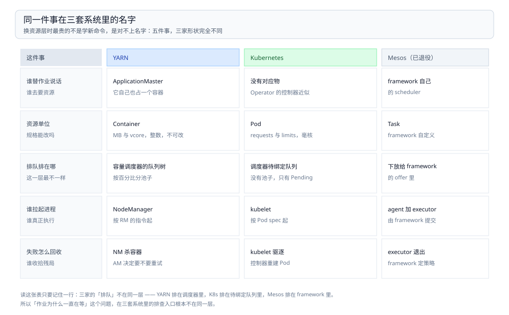

# 资源调度选型对比

> 覆盖：本目录的**总纲兼导读**。CPU 与内存「分给谁」这一层里，三个候选——YARN、Kubernetes、Mesos——按**资源是「申请—授予」还是「声明—绑定」**这条分水岭怎么分；四对象在三套系统里各叫什么、资源不够时三种反应、`vcore` 与 `milliCPU` 为什么对不上、什么情况下根本不该引入这一层。本篇同时承担本目录的入口：**本目录不设目录级 `README.md`**。
>
> 不覆盖：七层职责（文件系统 / 表格式 / Catalog / 计算引擎 / 数据集成与采集 / 资源调度 / 作业编排）怎么分、跨层怎么选，见 [大数据选型对比.md](../大数据选型对比.md)；YARN 的配置项、队列参数与报错原文见 [YARN.md](YARN.md)；**这条链路在自建 K8s 上怎么摆、Operator 怎么排、资源分区怎么切**，见 [K8s部署与运维.md](../../../04-架构与系统/系统设计/大数据平台/K8s部署与运维.md)（那是应用层，本篇是机制层）。**任务按时间与依赖怎么触发**不在这里，见 [作业编排选型对比.md](../作业编排/作业编排选型对比.md)。
>
> 内容整理自个人学习笔记，并参考 Hadoop 与 Kubernetes 官方文档。⚠️ **本篇没有任何本机读数**——本机没有可观测的 YARN 集群，单节点 Docker 也测不出「队列之间怎么分资源」这类只有多节点并发才会出现的现象。文中参数默认值按 Hadoop 3.x / Kubernetes 1.2x 陈述，**未在本机核对**，以各发行版的 `*-site.xml` 与官方文档为准。

---

## 一、这一层的分水岭在哪？

**本节要点**：不看「谁更先进」，看**资源是谁算出来的**——是调度器按池子算给你（申请—授予），还是你写进 spec、调度器只负责找个位置放下（声明—绑定）。

| 分水岭 | YARN | Kubernetes | Mesos |
| --- | --- | --- | --- |
| 资源怎么到手 | 应用**先要**，RM 按队列配额算，给了才有 Container | Pod 的 `requests` 写进 spec，调度器只做「找节点 + bind」 | master 把资源**端上来**（offer），framework 挑要不要 |
| 分配依据 | ⭐ **百分比池子**（队列 capacity / maximum-capacity） | ⚠️ **没有池子**，只有 namespace 的绝对值上限（ResourceQuota） | 两级：master 给 offer，framework 自己算 |
| 它知不知道「作业」 | ⭐ **知道**——Application + AM + 一组 Container 是一个整体 | ⚠️ **不知道**——只认 Pod / Job；「一组要一起起」得靠上层 | 知道「framework」，但作业模型交给 framework 自己 |
| 谁真正拉起进程 | NodeManager | kubelet | agent + executor |
| 失败回收 | NM 杀容器、RM 让 AM 重试 | kubelet 按 QoS 驱逐 / cgroup OOM kill，控制器重建 | executor 退出，framework 决定 |

⭐ **一句话记忆**：**YARN 按池子算给你、K8s 按声明找给你、Mesos 先端上来让你挑。**

⚠️ 一句纠偏：这三家不是「同一件事的三代产品」。K8s 的调度器比 YARN 的简单得多（它只做 bind，不做配额分摊），它把「配额」这件事交给了 namespace 的硬上限；YARN 反过来，配额是核心，调度器本身不碰进程。所以「K8s 会取代 YARN」这句话只在「新链路都上 K8s」这个意义上成立，**不等于 K8s 的调度能力覆盖了 YARN 的队列语义**——那部分到今天仍然要靠 ResourceQuota 加批调度器拼出来。

## 二、三个候选各自回答什么问题？

**本节要点**：每个候选只解决一类问题，判据是「把它换掉，这段话还成立吗」——成立的部分才是它的灵魂。

### 2.1 YARN：把集群切成可申请的容器，并且懂「作业」

它是 Hadoop 2 拆出来的那一半：**MapReduce 只留计算，资源管理独立成 YARN**。所以它的设计目标从头就是「一群互不相识的作业，按队列分一个固定集群」。

| 擅长 | 不擅长 |
| --- | --- |
| 多租户队列：按百分比切池子、按用户限流、队列间借还 | 只能跑 JVM 系的「申请—授予」模型，容器规格申请后不可变 |
| 懂作业生命周期：一个 Application 有一组 Container、有 AM 替它说话 | 长生命周期服务（常驻 Web、数据库）不是它的场景 |
| 与 HDFS 同机部署，数据本地性（`Data locality`）由 RM 直接算 | 镜像与依赖管理约等于没有，节点环境靠人肉对齐 |
| 存量生态：Hive on MR / Spark on YARN / Sqoop 全都默认它 | 跨集群、跨云的弹性伸缩很笨重 |

⭐ 判断 YARN 还有没有用的**唯一实测型问题**：集群里还有没有跑在 YARN 上的作业。有，它就是现成的地基；没有，它就是一台需要人维护的空转组件。这条判据与 [Sqoop 的退役判据](../数据集成与采集/数据集成与采集选型对比.md) 是同一个：**没有 YARN 就跑不起来的工具，寿命跟着 YARN 走。**

### 2.2 Kubernetes：把集群变成声明式对象，不懂「作业」

它的强项不是「调度得更聪明」，而是**把「我要什么」和「怎么做到」分开**：你写 spec，控制器不停把现实拉回 spec。这套模型对无状态服务近乎完美，对「一批要一起起来的任务」则要额外补。

| 擅长 | 不擅长 |
| --- | --- |
| 资源声明的单位是字节与毫核，比 `vcore` 的整数粒度细 | ⚠️ **没有队列语义**：`ResourceQuota` 是硬上限，不会按比例分摊、不会借还 |
| 一个 spec 管住镜像、依赖、健康检查、滚动升级 | ⚠️ **没有「一组」概念**：原生调度器不管 gang scheduling |
| 弹性与故障自愈是内建的（控制器循环） | 数据本地性弱：不知道数据在哪个节点，只知道节点有没有空 |
| 生态统一：Spark / Flink / Trino / Kafka 都有 Operator | 大数据的「作业」概念要由 Operator 补，补出来的语义各家不一样 |

⭐ 三个补丁值得记住名字：**Volcano**（批调度，gang scheduling + 队列）、**YuniKorn**（把 YARN 那套队列语义搬到 K8s）、**Kueue**（把「排队」做成 K8s 原生 API）。它们存在本身就说明一件事：**原生 K8s 缺的不是调度能力，是「队列」与「一组一起起」这两个语义。**

### 2.3 Mesos：两级调度，已退役

它的思路最优雅也最不实用：**master 只负责把空闲资源端给 framework（offer），要不要、要多少由 framework 自己算**。好处是 framework 可以有自己的调度策略（Marathon 管长服务、Spark 管批作业）；坏处是每个 framework 都要重新实现一遍「资源够不够、要不要等」。

⚠️ 它已停止活跃开发并进入 Apache Attic（退役），**具体年份本篇未核实**。写在这里不是让你选它，而是因为**它是理解「单层调度与两级调度」差别的最短路径**——YARN 与 K8s 都是单层（一个调度器说了算），Mesos 是两级。今天再看这套思路，它的「offer」其实被 K8s 的 `Pending` + 控制器循环换了个形式实现了。

## 三、横向对比：哪些维度必须并排看？

### 3.1 定位速览

| 维度 | YARN | Kubernetes | Mesos |
| --- | --- | --- | --- |
| 出现时间 | Hadoop 2 起（MapReduce 拆分） | 容器编排事实标准 | 已退役 |
| 调度单位 | Container（内存 MB + vcore 整数） | Pod（bytes + milliCPU） | Task（framework 自定义） |
| 配额语义 | ⭐ 队列百分比，可借还 | namespace 绝对上限 | role 权重（DRF） |
| 抢占 | Capacity Scheduler 支持，默认不开 | `PriorityClass` + 抢占，默认开 | 由 framework 自己实现 |
| 典型使用者 | Hive / Spark / Sqoop / MapReduce | 一切容器化负载 | 已无新用户 |

### 3.2 同一件事在三套系统里的名字

**本节要点**：换系统时最贵的不是学新命令，是**对不上名字**——「谁替作业说话」「资源单位是什么」「排队排在哪」这三个问题，三家的答案形状完全不同。



图要读出的是**「排队的层不一样」**：YARN 的排队发生在 RM 的调度器里（按队列），K8s 的排队发生在调度器的待绑定队列里（没有队列语义，只有优先级），Mesos 的排队被下放给了 framework。所以「我们的作业为什么一直在等」这个问题，在三套系统里的排查入口根本不在同一层。

| 这件事 | YARN | Kubernetes |
| --- | --- | --- |
| 谁替作业说话 | ApplicationMaster（一个容器，自己也要资源） | 没有对应物；Operator 的控制器近似 |
| 资源单位 | Container：memory MB + vcore | Pod：`requests` / `limits` |
| 排队排在哪 | Capacity Scheduler 的队列树 | 调度器的待绑定队列 + Pending 状态 |
| 谁拉起进程 | NodeManager | kubelet |
| 规格能改吗 | ⚠️ 不能，改了要重新申请 | ⚠️ 不能，改了要重建 Pod |
| 一组要一起起 | AM 逐个申请，申请不到就等 | 原生不管，要 Volcano / Kueue |

⚠️ 最容易被忽略的一行是**「谁替作业说话」**：YARN 里 AM 本身占一个 Container（默认 1536 MB），所以「一个 10 个 map 的作业」实际要 11 份资源。K8s 上没有这一层开销，但 Spark Operator 的 driver 也是要资源的 Pod——**换个名字，同一笔账还在**。

### 3.3 资源不够时三种反应

**本节要点**：等、抢、赶——三种策略决定了「作业排队一小时」和「作业被莫名其妙杀掉」是不是同一件事。

| 反应 | YARN | Kubernetes |
| --- | --- | --- |
| 等（排队） | 队列满就 PENDING，直到有容器腾出来 | Pod Pending，调度器每轮重试 |
| 抢（抢占） | Capacity Scheduler 的 preemption，⚠️ 默认关闭 | `PriorityClass` 抢占，默认开启 |
| 赶（驱逐） | NM 发现容器超内存 → 直接 kill | kubelet 按 QoS 驱逐；超 `limits` 由 cgroup OOM kill |

⭐ 这三行的实际价值：**「作业被杀」先分辨是哪一种**。超内存被杀看容器日志里的退出码（137 = 128 + 9，SIGKILL）；被抢占会在 RM / 调度器日志里留下 preempt 记录；两者现象一样（容器没了），原因与对策完全不同。

### 3.4 单位对不上：`vcore` 与 `milliCPU`

**本节要点**：YARN 说「我要 2 个 vcore」，K8s 说「我要 500m」。看起来只是换算，实际是**两种不同的假设**。

| | YARN `vcore` | K8s `cpu` |
| --- | --- | --- |
| 粒度 | 整数，最小 1 | 小数，`500m` = 0.5 核 |
| 它代表什么 | 一个**逻辑配额单位**，与物理核数无关 | 一个**时间份额**（`requests` 决定权重，`limits` 决定上限） |
| 超卖 | 默认允许（`vcore` 不等于核数） | `requests` 决定调度，`limits` 可超卖 |
| 常见坑 | ⚠️ 节点 32 核，但 `yarn.nodemanager.resource.cpu-vcores` 默认 8 → 只借出 8 个 | ⚠️ 只写 `limits` 不写 `requests`，调度按 `limits` 算，节点被塞满 |

⭐ 这张表的结论：**YARN 的 `vcore` 是保守的整数配额，K8s 的 `cpu` 是可压缩的时间份额。** 同一台 32 核机器，YARN 默认只认为自己有 8 个核可借；K8s 会认为自己有 32000m。所以「迁到 K8s 后资源利用率上去了」往往不是调度变聪明了，是**默认假设变激进了**——这一条在容量规划里必须显式对齐，否则会从「排队」变成「互相拖慢」。

## 四、怎么选？

**本节要点**：这一层几乎没有「选型」，只有**「集群里已经有什么」**。资源调度是装在地基上的东西，换它的代价等于换地基。

### 4.1 先问集群里已经有谁

| 现状 | 结论 |
| --- | --- |
| 已有 HDFS + YARN 的存量集群，跑着 Hive / Sqoop / Spark | ⭐ **别动**。新链路（Flink、容器化服务）另起 K8s，两套并存 |
| 全新起一套，没有任何 Hadoop 遗产 | ⭐ **K8s**。所有引擎都有 Operator，不用为了「大数据」单独养一套 YARN |
| 已经在 K8s 上跑着几十个微服务 | ⭐ **K8s**，再补一个批调度器（Volcano / Kueue），别引第二套资源层 |
| 只有一个引擎、独占整台机器 | 这一层不需要。直接跑进程或单机容器 |

### 4.2 判据表 ⭐

| 你在问什么 | 判据 | 落到 |
| --- | --- | --- |
| 要不要按**比例**给部门分资源 | 需要「A 部门保底 40%、空闲时可用到 70%」→ 只有 YARN 原生支持 | YARN |
| 要不要**一组容器一起起** | 要（典型：Spark driver + N executor 不能半启动）→ K8s 要装批调度器 | YARN 原生 / K8s 装 Volcano |
| 资源要**弹性到云上** | 要按量扩缩 → K8s 的节点池与 HPA 成熟得多 | K8s |
| 团队**只写 SQL / 只交作业** | 不想碰 K8s 的 YAML 与 Operator → YARN 的 `spark-submit --master yarn` 更短 | YARN |
| 要跑**长服务**（Trino 集群、Kafka、Web） | YARN 不适合长服务 → K8s | K8s |
| 要**多租户隔离到网络 / 存储** | namespace + NetworkPolicy + PVC 是现成的 | K8s |

⚠️ 反面教训：**把「我们已经上 K8s 了」当成「YARN 没用了」**。存量 Hive / Sqoop 作业不会因为你上了 K8s 就变快，它们仍然要 YARN；两条资源层并存是常态，验收标准是「有没有人还在为旧的排队」。真要把它们迁走，工作量在「重打镜像 + 重配依赖 + 重调资源规格」，不在资源层本身。

### 4.3 混部的两种做法

| 做法 | 怎么摆 | 代价 |
| --- | --- | --- |
| **两套并存 + 物理隔离** | YARN 独占一批节点，K8s 独占另一批 | 最省心；两批节点不能互相借，峰值时总有一边闲 |
| **K8s 统一承载（YARN 也跑在容器里）** | YARN 的 RM / NM 跑成 Pod | 省节点；⚠️ YARN 看不到宿主真实资源，配额要按 Pod 的 `limits` 反推 |

第二种在法律上可行、在运维上很痛：YARN 的 `yarn.nodemanager.resource.memory-mb` 必须小于 Pod 的 `limits`，否则 NM 会以为自己有更多内存，超卖后被 cgroup OOM kill——**两层调度器的账对不上**，这是混部最常见的事故来源。

### 4.4 什么时候不该引入这一层

- **一个进程能吃满整机**：`local[*]` 跑 Spark、单机 Trino，加资源层只是多一层浪费；
- **只有定时 SQL**：交给云数仓或单机调度就够，资源层是为「多人抢机器」存在的；
- **托管服务已经替你管了**：EMR / Databricks / 云托管的 Flink，资源层在厂商那边，你只需要会写「要几个 CU」。

⭐ 判据：**这一层解决的是「多人抢机器」，不是「作业跑得快」。** 一个人、一台机器、一批作业，装它就是给自己加运维。

### 4.5 选型评估清单

1. 集群里现在有几套资源层？谁在维护？（答不上来就先盘点，别急着选）
2. 有没有「按部门保底 + 空闲借用」的需求？（有 → YARN 或 YuniKorn）
3. 有没有 gang scheduling 需求？（有 → YARN 原生，或 K8s + Volcano）
4. 要不要跑长服务？（要 → K8s）
5. 谁写 YAML？（团队里只有 SQL 工程师 → YARN 的门槛更低）
6. 迁移成本谁来付？重打镜像、重配依赖的工作量算过没有？

## 五、这一层与 04 平台册的分工

**本节要点**：判据还是那句话——**把产品名删掉，这段话还成立吗**。成立的是链路设计（04），不成立的是机制（这里）。

| 问题 | 归哪 | 例子 |
| --- | --- | --- |
| 队列怎么配、`vcore` 怎么算、容器超内存怎么查 | ⭐ **本篇 / [YARN.md](YARN.md)** | `yarn.scheduler.maximum-allocation-mb` 是多少、`Container killed` 后面那行看什么 |
| 自建 K8s 上八个大数据组件怎么摆、Operator 怎么排 | [K8s部署与运维.md](../../../04-架构与系统/系统设计/大数据平台/K8s部署与运维.md) | 哪些组件自己管、CPU 内存怎么分才不互相挤 |
| 这套平台的量级怎么估、扩容单价多少 | [容量规划与成本.md](../../../04-架构与系统/系统设计/大数据平台/容量规划与成本.md) | 30 slot / 120 GB 这类规划数字 |
| 三个引擎各自怎么用资源、参数怎么调 | [计算引擎选型对比.md](../计算引擎/计算引擎选型对比.md) 与各册 | Spark 的 executor 内存模型、Flink 的 slot |

⚠️ 一句话：**04 讲「我的平台长什么样」，这里讲「CPU 与内存凭什么分给这个作业」。**

## 使用：本目录怎么读

**本节要点**：按你手上的问题选入口，不按目录树顺序读。

| 你在问什么 | 看哪里 |
| --- | --- |
| YARN 到底有几个角色、一次作业怎么申请到容器 | ⭐ [YARN.md](YARN.md) 第二、三节 |
| 队列怎么配、`capacity` 与 `maximum-capacity` 差在哪 | ⭐ [YARN.md](YARN.md) 第六节 |
| 作业一直 ACCEPTED / 容器被杀 / `vcore` 不够 | [YARN.md](YARN.md) 第七、八节 |
| YARN 与 K8s 到底该选哪个 | ⭐ **本篇第 4.2 节的判据表** |
| 三套系统里「资源」「排队」「作业」各叫什么 | ⭐ **本篇第 3.2 节**（含对照图） |
| 自建 K8s 上组件怎么摆、资源分区怎么切 | [K8s部署与运维.md](../../../04-架构与系统/系统设计/大数据平台/K8s部署与运维.md) |
| 任务按时间与依赖怎么触发 | [作业编排选型对比.md](../作业编排/作业编排选型对比.md) |
| 七个职责层怎么分、跨层怎么选 | [大数据选型对比.md](../大数据选型对比.md) |

**读序**（前一篇的概念是后一篇的前提）：

```text
本篇（分水岭与判据）──> YARN.md（一个具体实现怎么跑）
                     └─> 04 K8s部署与运维.md（换了资源层之后平台怎么摆）
```

**目录怎么分**：本层只有 1 个落地的产品篇（YARN），与 `文件系统/` 只落 HDFS、`表格式/` 只落 Iceberg 一样——**层内候选的对照写在总纲，不每个候选都开一篇**。三个候选里 Mesos 已退役，Kubernetes 的调度机制在 04 的册里按「怎么用」讲，这里只做机制对照。

## 延伸追问

- **YARN 会被 K8s 取代吗？** → 在「新链路」上基本会，在「存量 Hadoop」上不会。判据不是趋势，是「还有多少作业跑在 YARN 上」——只要 Hive MR 与 Sqoop 还在跑，YARN 就得有人维护。真正的迁移障碍是镜像与依赖，不是调度能力。
- **为什么 K8s 原生不做队列？** → 它的设计目标是「声明式收敛」而不是「配额分摊」。配额这件事在 K8s 里被拆成两半：`ResourceQuota` 管上限，`PriorityClass` 管先后；「保底 40%、空闲可借到 70%」这种**比例语义**没有对应物，只能靠 YuniKorn 这类调度器补。
- **gang scheduling 为什么在大数据里是硬需求？** → 因为 Spark / Flink 的作业是「driver + N 个 executor 一起才算跑起来」。如果 executor 只起来 3 个中的 2 个，作业不是「慢」，是**占着 2 份资源什么也不干**。这正是 YARN 的 AM 模型天然解决的问题，也是 K8s 上要装 Volcano 的原因。
- **`vcore` 能不能超卖？** → 能，而且默认就在超卖——`yarn.nodemanager.resource.cpu-vcores` 与物理核数无关，它只是一个「我打算借出几个核」的声明。超卖的好处是利用率，坏处是所有容器一起抢 CPU，谁都跑不快。这与 K8s 里 `requests` 总和超过节点容量是同一类问题。
- **Mesos 的两级调度到底好在哪？** → 好在 framework 可以有完全不同的调度策略，而不用改 master。代价是每个 framework 都要重写一遍「资源够不够、要不要等」。今天 K8s 用控制器循环实现了类似效果，只是「offer」变成了「Reconcile」。

## 关联

- **上游/总纲**：[大数据选型对比.md](../大数据选型对比.md) — 七层职责与本目录在其中的位置
- **下游机制**：[YARN.md](YARN.md) — 本层唯一落地的产品：四对象、队列参数、容器被杀怎么查
- **对照/互补**：[K8s部署与运维.md](../../../04-架构与系统/系统设计/大数据平台/K8s部署与运维.md) — 换了资源层之后，平台上的组件怎么摆
- **对照/互补**：[作业编排选型对比.md](../作业编排/作业编排选型对比.md) — 同一个集群上，**「什么时候跑」与「跑在谁的资源上」是两件事**
- **下游机制**：[计算引擎选型对比.md](../计算引擎/计算引擎选型对比.md) — 引擎怎么用这些资源（executor 数、slot 数）
- **上游/依赖**：[Sqoop.md](../数据集成与采集/Sqoop.md) — 「没有 YARN 就跑不起来」的典型工具，也是 YARN 退役判据的另一面
