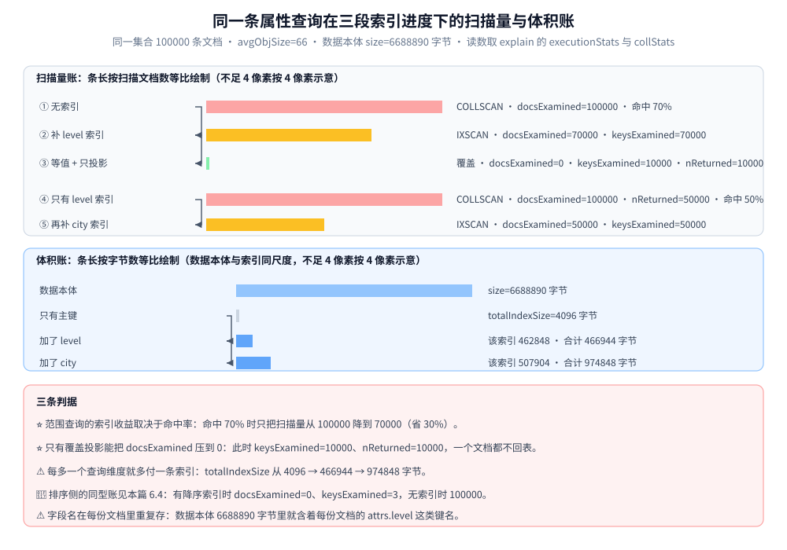
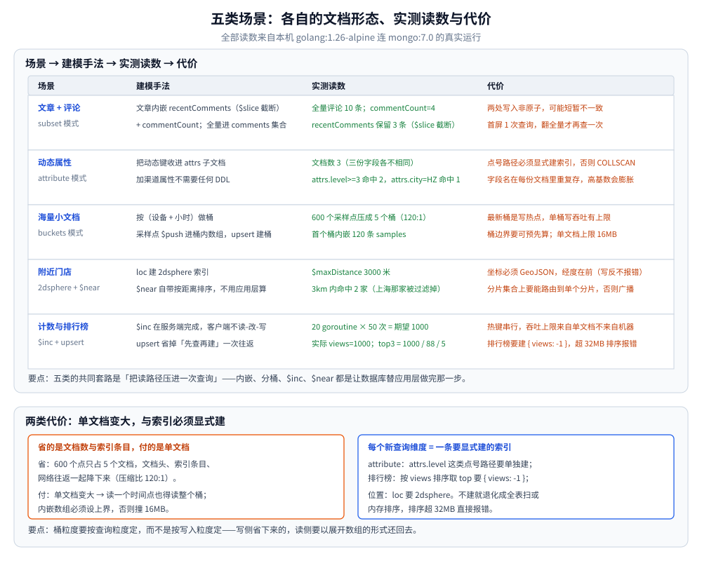

# MongoDB 应用与场景

> 五类典型业务在 MongoDB 里怎么落地：内容管理、动态属性、时序分桶、位置服务、计数与排行榜。
> 每个场景给出 Go 实现与真实运行读数。
>
> 素材来源：《MongoDB 进阶与实战：微服务整合、性能优化、架构管理》（唐卓章）「应用与场景」相关章节的读后整理，
> **按主题归纳而非逐字摘录**；全部 Go 代码在本机 Docker 容器内真实运行（`golang:1.26-alpine` 连 `mongo:7.0`，7.0.40），
> 驱动为官方 `go.mongodb.org/mongo-driver`。

---

## 一、什么业务适合 MongoDB？

**本节要点**：判据是「数据形状是否随业务变」和「一次查询要不要跨多张表」。

| 适合 | 为什么 |
| --- | --- |
| **文档边界清晰的聚合根**（订单、文章、商品、用户） | 一次查询拿到完整对象，不用 JOIN |
| **字段不固定 / 演进快** | 加字段不用 DDL，老文档照样读 |
| **读写比高、按主键或少量索引查询** | 单文档读写是它的强项 |
| **需要水平扩展写入** | 原生分片，片键定了就能扩 |
| **半结构化 / 嵌套数据**（配置、表单、IoT 采样） | 文档模型天然表达层级 |

| 不适合 | 该用什么 |
| --- | --- |
| 强事务、多表 JOIN、复杂报表 | 关系型（见 [数据库选型对比.md](../../数据库选型对比.md)） |
| 全文检索 + 复杂聚合 | Elasticsearch |
| 超高频计数、榜位实时变化 | Redis（见 [数据类型.md](../Redis/数据类型.md)） |
| 单表十几亿行的强一致账务 | 关系型 + 分库分表 |

⚠️ 一条常被忽略的判据：**MongoDB 也支持多文档事务，但「能开事务」不等于「可以照搬关系模型」**
（见 [事务与一致性.md](事务与一致性.md)）。用文档模型装关系模型，会同时丢掉两者的好处。

---

## 二、文章和评论怎么建模？

**本节要点**：内嵌**最近 N 条**保证首屏一次读完，全量放独立集合——这就是 subset 模式。

### 2.1 建模

- 文章文档内嵌 `recentComments`（**截断到固定条数**）与 `commentCount`；
- 完整评论写在 `comments` 集合，字段带 `postId`；
- 写一条评论 = 插全量 + `$push` 进内嵌数组并 `$slice` 截断 + `$inc` 计数。

```go
// 每条评论：全量入 comments，同时把最近 3 条留在文章里
_, err = comments.InsertOne(ctx, bson.M{"postId": postID, "seq": i, "text": text})
_, err = posts.UpdateOne(ctx, bson.M{"_id": postID}, bson.M{
    "$push": bson.M{"recentComments": bson.M{
        "$each":  bson.A{text},
        "$slice": -3, // 只保留最后 3 条，数组不会无限增长
    }},
    "$inc": bson.M{"commentCount": 1},
})
```

### 2.2 实测结果

```text
全量评论 10 条；文章 1 的 commentCount=4，内嵌 recentComments 保留 3 条（$slice 截断）
首屏只需 1 次查询读文章（含最近 3 条评论），翻全量再查 comments 集合
```

⭐ **收益**：文章详情页从「读文章 + 读评论表」两次查询压成一次，且内嵌数组有上界、不会把单文档撑爆。

### 2.3 代价

⚠️ **两处要同步，而且不是原子的**：写全量成功、`$push` 失败（或反过来）就会短暂不一致。
要么容忍（下次刷新自愈），要么包进事务——但事务是单文档原子性失效后的兜底，别当默认方案。

---

## 三、字段总在变的用户属性怎么存？

**本节要点**：把动态键收进一个子文档（**attribute 模式**），顶层字段数就不会失控。

### 3.1 建模

用户画像的字段因渠道而异（`level` / `vip` / `city` / `tags` / `source` …），
若每个属性都当顶层字段，字段数会无限增长、索引也建不完。做法是把它们收进 `attrs` 子文档：

```go
docs := []interface{}{
    bson.M{"_id": 1, "name": "alice", "attrs": bson.M{"level": 3, "vip": true}},
    bson.M{"_id": 2, "name": "bob", "attrs": bson.M{"level": 7, "city": "HZ",
        "tags": bson.A{"go", "db"}}},
    bson.M{"_id": 3, "name": "carol", "attrs": bson.M{"level": 1, "source": "wechat"}},
}
_, err = users.InsertMany(ctx, docs)

// attribute 模式必须给**会被查询的属性**单独建索引，否则每个查询都是 COLLSCAN
_, err = users.Indexes().CreateOne(ctx, mongo.IndexModel{
    Keys: bson.D{{Key: "attrs.level", Value: 1}}})
```

### 3.2 实测结果

```text
文档数 3（三份文档字段各不相同，无需 DDL）；attrs.level>=3 命中 2，attrs.city=HZ 命中 1
```

⭐ **收益**：字段完全自由，加一个渠道属性不需要任何 DDL，老文档缺失该字段也不影响读。

### 3.3 代价

⚠️ 两条硬代价，写进设计文档再动手：

1. **必须显式建索引**：`attrs.level` 这种点号路径的查询要走索引，就得单独 `createIndex({ "attrs.level": 1 })`；
   没有对应索引时查询会退化成全表扫。
2. **字段名在每份文档里重复存**：`attrs.level` 这串名字在每个用户的文档里都要存一遍，
   高基数属性（比如上千个指标名）会让存储与索引一起膨胀。

### 3.4 索引进度的三段实测账

上一节的「必须显式建索引」是可以按字节算的。本机实测：同一集合灌 100000 条文档
（`avgObjSize=66`、数据本体 `size=6688890` 字节），三个查询形态各跑 `explain("executionStats")`，
读数取 `totalDocsExamined` / `totalKeysExamined` / `nReturned`，索引体积取 `collStats.indexSizes`。
区间口径：无索引 → `COLLSCAN` 的结论在两次独立运行里复现（`docsExamined=100000` 各一次）。

| 查询 | 索引状态 | 计划 | `nReturned` | `docsExamined` | `keysExamined` | 索引体积（字节） |
| --- | --- | --- | --- | --- | --- | --- |
| `attrs.level >= 3`（命中 70%） | 只有 `_id` | `COLLSCAN` | 70000 | 100000 | 0 | `totalIndexSize` 4096 |
| `attrs.level >= 3` | 补 `attrs.level` 索引 | `FETCH > IXSCAN` | 70000 | 70000 | 70000 | 该索引 462848，合计 466944 |
| `attrs.level == 3` 且只投影 `attrs.level` | 同上 | `PROJECTION_DEFAULT > IXSCAN`（覆盖） | 10000 | 0 | 10000 | 复用同一条 466944 |
| `attrs.city = "HZ"`（命中 50%） | 只有 `level` 索引 | `COLLSCAN` | 50000 | 100000 | 0 | 4096 + 462848 |
| `attrs.city = "HZ"` | 再补 `city` 索引 | `FETCH > IXSCAN` | 50000 | 50000 | 50000 | 该索引 507904，合计 974848 |

⭐ 三条实测结论：
1. **范围查询的索引收益取决于命中率**：`>= 3` 命中 70%，索引只把扫描量从 100000 降到 70000（省 30%），
   却要用 462848 字节换——命中率越高，索引越接近「只省了回表前的定位成本」。
2. **只有覆盖投影能把 `docsExamined` 压到 0**：等值 + 只取索引内字段时 `docsExamined=0`、`keysExamined=10000`、
   `nReturned=10000`，一个文档都不回表。
3. **每多一个查询维度就多付一条索引**：`city` 那条单独就 507904 字节，`totalIndexSize` 从 4096 → 466944 → 974848，
   已经是数据本体 6688890 字节的量级可比项——这正是 3.3 第 2 条「膨胀」的具体数字。



**图怎么读**：上栏把 3.4 表格里的 `docsExamined` 画成等比条（条长按扫描文档数等比绘制），
左组是 `attrs.level >= 3`（100000 → 70000 → 覆盖查询归 0），右组是 `attrs.city = "HZ"`（100000 → 50000），
组内第二条起都标注了当时的索引状态；中栏是同一批数据的索引体积账（4096 → 466944 → 974848 字节，
与数据本体 6688890 字节同尺度并排）；下栏是三行判据。图上所有读数都来自 3.4 的表格，命中率 70% 与 50%
是按 `nReturned` / 文档总数（70000 / 50000 对 100000）算出来的。

---

## 四、海量小文档怎么压缩？

**本节要点**：按时间窗把高频小文档攒成「一个桶文档 + 内嵌数组」（**buckets 模式**）。

### 4.1 建模

IoT / 监控场景每秒都在写采样点，直接一条一个文档会有几亿个文档、索引元数据本身就是负担。
做法是**按（设备 + 小时）做桶**，采样点进桶内数组：

```go
ts := start.Add(time.Duration(i) * 30 * time.Second) // 每 30 秒一个采样点
hourID := ts.Format("2006-01-02-15")                 // 桶键：设备 + 小时

_, err = buckets.UpdateOne(ctx,
    bson.M{"_id": "dev42-" + hourID},
    bson.M{
        "$push":        bson.M{"samples": bson.M{"t": ts, "v": v}},
        "$inc":         bson.M{"count": 1},
        "$setOnInsert": bson.M{"device": "dev42", "hour": hourID},
    },
    options.Update().SetUpsert(true)) // 桶不存在就自动建
```

### 4.2 实测结果

```text
600 个采样点压成 5 个桶文档（压缩比 120:1），首个桶内嵌 120 条 samples
```

⭐ **收益**：600 个点只占 5 个文档，**压缩比 120:1**。索引条目、文档头开销、网络往返一起降下来。
查询一段时间的曲线时，只需读少数几个桶、在应用层展开数组。

### 4.3 代价

⚠️ 三条，都必须先想清楚：

1. **最新桶是写热点**：所有写入都撞同一个 `_id`，单桶写吞吐有上限（这也是本项目 [秒杀系统](../../../../04-架构与系统/系统设计/秒杀系统/README.md)
   里「热点写」的同类问题）。
2. **桶边界要预先可算**：按小时分桶可以，按「每 N 条」分桶就得先知道 `count`——那等于每写一次都要读一次桶。
3. **单文档上限 16MB**：桶内数组必须设上界（或按时间窗收口），否则迟早撑爆。

---

## 五、附近的门店怎么查？

**本节要点**：`2dsphere` 索引 + `$near`，距离过滤与排序都由数据库完成。

### 5.1 建模与查询

```go
_, err = shops.Indexes().CreateOne(ctx, mongo.IndexModel{
    Keys: bson.D{{Key: "loc", Value: "2dsphere"}}}) // 球面坐标，GeoJSON 格式

cur, err := shops.Find(ctx, bson.M{"loc": bson.M{"$near": bson.M{
    "$geometry":    bson.M{"type": "Point", "coordinates": bson.A{120.150, 30.280}},
    "$maxDistance": 3000, // 米
}}})
```

### 5.2 实测结果

```text
原点 3km 内命中 2 家：[A B]（上海那家被距离过滤掉）
```

⭐ **收益**：`$near` **自带按距离排序**且走索引，应用层不用捞全量再算距离、再排序。

### 5.3 代价与注意

- ⚠️ `$near` **不能与分片键冲突**：分片集合上带 `$near` 的查询要能路由到单个分片，否则要广播。
- ⚠️ 坐标系必须传 GeoJSON（`{ type: "Point", coordinates: [lon, lat] }`）——**经度在前**，
  写反了不会报错，只会静默查错区域。
- 平面坐标的 legacy `2d` 只在极小范围可用，新项目一律用 `2dsphere`。
- 其他操作符：`$geoWithin`（范围内）、`$geoIntersects`（相交）、`$geoNear`（聚合阶段，附带距离字段）。

---

## 六、计数和排行榜怎么做？

**本节要点**：`$inc` 是服务端原子操作，`upsert` 省掉「先查再建」——两者配合就是计数器。

### 6.1 并发自增

```go
// 20 个 goroutine 各做 50 次自增
_, err := stats.UpdateOne(ctx,
    bson.M{"_id": "page:home"},
    bson.M{"$inc": bson.M{"views": 1}},
    options.Update().SetUpsert(true)) // 文档不存在则自动创建
```

### 6.2 实测结果

```text
20 个 goroutine × 50 次 $inc = 期望 1000，实际 views=1000
排行榜 top3：page:home=1000  page:list=88  page:about=5
```

⭐ **收益**：`$inc` 在服务端完成，客户端不需要「读-改-写」，因此**不会有丢失更新**——
20 个 goroutine 并发 1000 次，一次不差。`upsert` 则让「第一次访问就要建计数文档」这件事变成一次往返。

排行榜就是同集合内按计数字段排序取 top：

```go
cur, err := stats.Find(ctx, bson.M{}, options.Find().
    SetSort(bson.D{{Key: "views", Value: -1}}).
    SetLimit(3).
    SetProjection(bson.M{"views": 1}))
```

### 6.3 代价

⚠️ **热键仍是热键**：单文档的写入在 MongoDB 内部是串行的，`_id: "page:home"` 被全站打时，
它就是单点。这与 Redis 的 `INCR` 是同一个约束（见 [数据类型.md](../Redis/数据类型.md)）；
真正需要每秒百万次计数时应该先累加到 Redis / 本地，再周期性回写。

⚠️ **排行榜要建索引**：按 `views` 排序取 top 必须有 `{ views: -1 }` 索引，
否则就是全集合扫描 + 内存排序（排序超 32MB 直接报错），判据见 [索引原理.md](索引原理.md)。



**图怎么读**：每一行是一个场景，横着读过去就是「建模手法 → 实测读数 → 代价」，读数都是本机容器里的真实运行结果；下栏把五类的代价归纳成两条——单文档变大，以及每个新的查询维度都要显式建一条索引。

### 6.4 排序护栏的实测原文

上面「排行榜要建索引」这条代价，实测里能同时看到**收益**和**撞墙**两种形状（同一实例、两次独立运行复现同一条报错）。

```javascript
// ① 有 { views: -1 } 降序索引时，取 top3 的 explain 形态：不回表、只走 3 个键
db.stats.find({}).sort({ views: -1 }).limit(3).explain("executionStats")
//   stages: LIMIT > PROJECTION_COVERED > IXSCAN   nReturned=3  docsExamined=0  keysExamined=3

// ② 无索引时同一句话：全集合扫描 + 内存排序，仍然只返回 3 条
db.stats.find({}).sort({ views: -1 }).limit(3).explain("executionStats")
//   stages: PROJECTION_SIMPLE > SORT > COLLSCAN   docsExamined=100000（100000 条文档的集合）

// ③ 聚合里对 200000 条文档做全量 $sort：不开外排直接撞上限
db.stats.aggregate([{ $sort: { views: -1 } }, { $count: "n" }])
//   Sort exceeded memory limit of 104857600 bytes, but did not opt in to external sorting.
db.stats.aggregate([{ $sort: { views: -1 } }, { $count: "n" }], { allowDiskUse: true })
//   { n: 200000 }
```

| 做法 | 数据量 | 实测结果 |
| --- | --- | --- |
| `find().sort().limit(3)` **有**降序索引 | 100000 条 | `docsExamined=0`、`keysExamined=3`、`nReturned=3`，计划 `LIMIT > PROJECTION_COVERED > IXSCAN` |
| `find().sort().limit(3)` **无**索引 | 100000 条 | `docsExamined=100000`，计划 `PROJECTION_SIMPLE > SORT > COLLSCAN`；返回仍是 3 条，但每个文档都被排过一次 |
| `find().sort().limit(3)` 大文档集合 | 200000 条（`avgObjSize=294`、`size=58888890`） | 成功返回 3 条——带 `limit` 的排序走有界排序器，不会因为文档多而撑爆 |
| 聚合 `$sort` 全量（不开外排） | 100000 条 | 成功 |
| 聚合 `$sort` 全量（不开外排） | 200000 条 | 报 `Sort exceeded memory limit of 104857600 bytes, but did not opt in to external sorting.`（两次运行原文一致） |
| 同上 + `allowDiskUse: true` | 200000 条 | 成功，`{ n: 200000 }` |

⭐ 三条判据：① 排行榜这类「排序 + 取前 N」必须建降序索引，收益是把 `docsExamined` 从 100000 直接压到 0（不是「快一点」，是**根本不回表**）；
② `find` 侧带 `limit` 的排序有界、聚合 `$sort` 侧的上限实测是 104857600 字节，**同一个文档量级（100000 条）能过、翻倍（200000 条）就撞墙**；
③ 撞墙后的出路是 `allowDiskUse` 外排或补索引，而不是加大内存——外排要落临时文件，排行榜这种高频接口不该长期靠它。
⚠️ 与 3.4 同一套账：这条 `{ views: -1 }` 索引同样是「每多一个排序维度就多一条索引」。

---

## 使用：跑通一个最小闭环

```bash
# ① 起一个隔离实例（端口自选，避免与既有实例冲突）
docker run -d --name mongo-app-lab -p 27018:27017 mongo:7.0

# ② 语言运行时也用容器（见 AGENTS.md 实测口径），连宿主机映射端口
docker run --rm -v "$PWD":/w -w /w \
  -e GOPROXY=https://goproxy.cn,direct -e GOSUMDB=off \
  golang:1.26-alpine sh -c "go mod init applab && go mod tidy && go run ."
```

```go
// main.go —— 五个场景的公共开头
cli, err := mongo.Connect(ctx,
    options.Client().ApplyURI("mongodb://host.docker.internal:27018"))
defer func() { _ = cli.Disconnect(ctx) }()
db := cli.Database("applab")
```

⚠️ 容器里的 Go 连宿主机的映射端口用 `host.docker.internal`；若两个容器在同一自定义网络里，
可直接用容器名当主机名。

---

## 延伸追问

- **什么情况下应该把内嵌改成引用？**
  → 判据是「子数据会不会无限增长」和「会不会被独立查询」。评论可能涨到几十万条（必须独立集合），
  而订单里的收货地址就那几行（内嵌更好）。基数关系可以双向建模，见 [数据建模.md](数据建模.md)。
- **attribute 模式与直接把属性当顶层字段，本质区别是什么？**
  → 顶层字段受 `index.mapping` 式的字段数限制（这里对应「索引数量 + 文档结构」的膨胀），
  attribute 模式把「字段名」变成「数据」，代价是查询必须写完整路径且每个要查的属性都得单独建索引。
- **分桶模式与「一个文档一条采样」相比，读放大了什么？**
  → 写侧省了（120:1），读侧要展开数组：查一个时间点也得读整个桶再在应用层挑。
  所以桶粒度要按**查询粒度**定，而不是按写入粒度。
- **`$inc` 原子是不是意味着计数器一定准？**
  → 单文档内一定准（实测 1000 次不差）。但跨文档、跨分片没有全局原子性；
  而且**热键会串行化**，吞吐上限来自单文档，不来自机器。
- **这些场景哪些不该用 MongoDB？**
  → 需要跨多个聚合根的一致性（账务）、需要多表 JOIN 的报表、需要复杂全文相关性排序的检索——
  分别回关系型、ClickHouse / ES。

## 关联

- [README.md](README.md) — 本目录导读：MongoDB 是什么、与 MySQL 怎么选、版本速查与阅读顺序
- [索引原理.md](索引原理.md) — 这些场景能跑多快取决于索引：ESR 顺序、覆盖索引、多键索引、planner 选索引
- [数据库选型对比.md](../../数据库选型对比.md) — 七类存储的定位矩阵，本篇第一节的判据在其中
- [数据类型.md](../Redis/数据类型.md) — 计数与热键的另一种解：Redis 侧的自增与排行榜
- [README.md](../../../../04-架构与系统/系统设计/秒杀系统/README.md) — 热点写与削峰的完整场景题
- [朋友圈设计.md](../../../../04-架构与系统/系统设计/社交互动系统/朋友圈设计.md) — 读扩散 / 写扩散的建模对照
- [海量数据存储设计.md](../../../../04-架构与系统/系统设计/海量数据存储设计.md) — 分桶与冷热分层在更大尺度上的同类思路
> 反向引用（本篇被下列文档引到）：[数据建模.md](数据建模.md)、[时间序列集合.md](时间序列集合.md)、[聚合管道.md](聚合管道.md)
